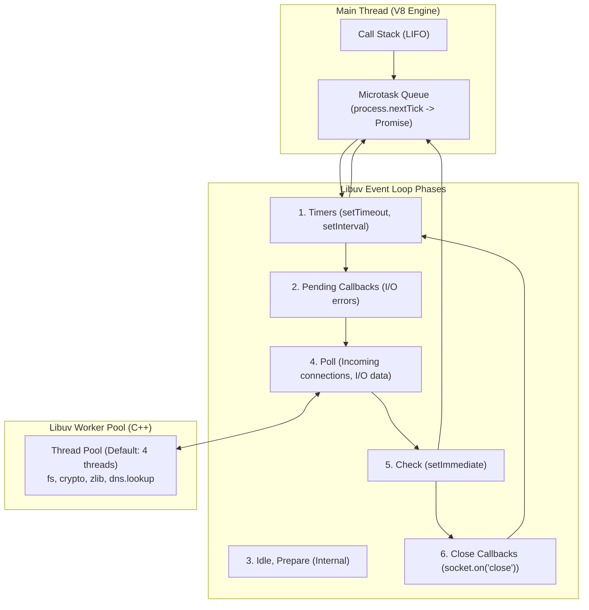

# 📗 CHUYÊN ĐỀ 01: NODE.JS ARCHITECTURE & PRODUCTION GUIDE

---

## 1. Bản chất cốt lõi & Cơ chế hoạt động (Core Internals)

### 1.1. Event Loop & Libuv Architecture
Node.js sử dụng kiến trúc **Single-Threaded Event Loop** được điều khiển bởi thư viện C/C++ **Libuv**. Mặc dù JavaScript code chạy trên một thread duy nhất (Main Thread), các tác vụ I/O nặng (File system, DNS lookup, Crypto, Zlib) được Libuv ủy quyền cho **Thread Pool** ngầm (mặc định 4 threads, tinh chỉnh qua `UV_THREADPOOL_SIZE`).



### 1.2. Độ ưu tiên thực thi (Execution Priority)
1. **Call Stack**: Code đồng bộ (Synchronous) thực thi đến khi rỗng.
2. **Microtasks Queue** (Được kiểm tra ngay sau mỗi tick hoặc khi call stack rỗng):
   * `process.nextTick()`: Độ ưu tiên cao nhất, chạy trước tất cả các microtask khác.
   * `Promise.then()` / `catch()` / `finally()` & `queueMicrotask()`.
3. **Macrotasks (Phases của Event Loop)**:
   * `Timers` $\rightarrow$ `Pending Callbacks` $\rightarrow$ `Poll` $\rightarrow$ `Check (setImmediate)` $\rightarrow$ `Close Callbacks`.

> ⚠️ **Quy tắc vàng**: `process.nextTick` chạy đệ quy không kiểm soát sẽ gây **Starvation** (chết đói I/O), chặn hoàn toàn Event Loop tiến vào phase tiếp theo.

---

## 2. Kiến trúc chuẩn cho Enterprise Backend (Production Architecture)

### 2.1. Layered / Hexagonal Architecture (Clean Architecture)
```
src/
├── domain/                  # Lõi nghiệp vụ (Thuần TS, không phụ thuộc framework)
│   ├── entities/            # User, Order
│   └── exceptions/          # DomainException
├── application/             # Use cases điều phối luồng
│   ├── use-cases/           # CreateOrderUseCase
│   └── ports/               # IOrderRepository, INotificationService
├── infrastructure/          # Chi tiết kỹ thuật (Framework, DB, MQ)
│   ├── database/            # TypeORM / Prisma / Drizzle
│   ├── adapters/            # RabbitMQPublisher, BullMQWorker
│   └── http/                # NestJS Controllers, Express Routers
└── main.ts                  # Entry point, bootstrap, lifecycle hooks
```

### 2.2. Xử lý Multi-Core & Clustering
Vì Node.js là single-threaded, trên server vật lý hoặc VM đa nhân (ví dụ: 16 vCPU), bạn phải scale theo 2 cách:
1. **Containerized (Kubernetes)** *(Khuyến nghị)*: Mỗi container chạy 1 tiến trình Node.js với `resources.limits.cpu = 1` hoặc `2`. Scale ngang bằng K8s HPA (Horizontal Pod Autoscaler).
2. **Cluster Module / PM2** (Nếu chạy trên EC2/VM đơn lẻ):
   ```bash
   pm2 start dist/main.js -i max --name "enterprise-api"
   ```

---

## 3. Best Practices & Code Triển Khai Chuẩn

### 3.1. Tránh chặn Event Loop với Worker Threads
Khi cần xử lý tác vụ CPU-heavy (ví dụ: giải mã file Excel 50MB, băm mã hóa lượng lớn):

```typescript
// worker-pool.ts
import { Worker } from 'worker_threads';
import path from 'path';

export function runCpuIntensiveTask(data: unknown): Promise<unknown> {
  return new Promise((resolve, reject) => {
    const worker = new Worker(path.resolve(__dirname, 'task.worker.js'), {
      workerData: data,
    });
    worker.on('message', resolve);
    worker.on('error', reject);
    worker.on('exit', (code) => {
      if (code !== 0) reject(new Error(`Worker stopped with exit code ${code}`));
    });
  });
}
```

### 3.2. Quản lý Context xuyên suốt với `AsyncLocalStorage`
Truyền `traceId` và `tenantId` xuyên qua các tầng service/repository mà không cần truyền qua từng parameter:

```typescript
// context.storage.ts
import { AsyncLocalStorage } from 'async_hooks';

export interface RequestContext {
  traceId: string;
  tenantId: string;
  userId?: string;
}

export const contextStorage = new AsyncLocalStorage<RequestContext>();

// middleware.ts
export function contextMiddleware(req: any, res: any, next: any) {
  const store: RequestContext = {
    traceId: req.headers['x-trace-id'] || crypto.randomUUID(),
    tenantId: req.headers['x-tenant-id'] || 'default',
  };
  contextStorage.run(store, () => next());
}

// logger.service.ts
export class LoggerService {
  log(message: string) {
    const store = contextStorage.getStore();
    console.log(`[${store?.traceId || 'N/A'}] [Tenant: ${store?.tenantId || 'N/A'}] - ${message}`);
  }
}
```

---

## 4. Các bẫy kỹ thuật & Lưu ý sống còn (Production Caveats)

| STT | Vấn đề / Bẫy kỹ thuật | Hậu quả | Giải pháp xử lý |
| :--- | :--- | :--- | :--- |
| **1** | **Chặn Event Loop bởi Sync API** | `fs.readFileSync`, `crypto.pbkdf2Sync`, `JSON.parse` chuỗi 100MB khiến server không thể nhận bất kỳ HTTP request nào khác. | Luôn dùng API bất đồng bộ (`fs.promises`). Dùng stream cho dữ liệu lớn (`JSONStream`). |
| **2** | **Memory Leak từ Closure & EventListener** | Quên `emitter.off()` hoặc đẩy dữ liệu vào mảng/Map toàn cục không giới hạn dung lượng $\rightarrow$ OOM Crash (Exit code 137). | Dùng WeakMap/WeakSet cho cache tạm thời. Đặt cảnh báo Heap Memory qua Prometheus/Grafana. |
| **3** | **Unhandled Promise Rejection** | Từ Node.js 15+, Unhandled Promise Rejection sẽ mặc định **làm sập toàn bộ tiến trình** (Process Exit). | Luôn bắt lỗi ở tầng ngoài cùng, đăng ký `process.on('unhandledRejection')` và ghi log có cấu trúc. |
| **4** | **DNS Resolution Bottleneck** | Mặc định `dns.lookup` dùng Libuv threadpool (chỉ có 4 threads). Khi gọi hàng nghìn API bên ngoài, 4 threads này bị nghẽn làm chậm cả các lệnh I/O file. | Tăng `UV_THREADPOOL_SIZE=64` hoặc dùng `dns.resolve` (dùng c-ares không chặn threadpool). |
| **5** | **Zombie / Orphan Process khi Graceful Shutdown** | Khi redeploy (SIGTERM), app ngắt kết nối ngay làm mất dữ liệu đang ghi dở hoặc treo connection DB. | Đăng ký hook bắt `SIGTERM` và `SIGINT`: Dừng nhận request mới, đợi in-flight requests hoàn tất (30s timeout), đóng DB pool rồi mới exit. |

### 4.1. Mẫu Graceful Shutdown chuẩn
```typescript
async function bootstrap() {
  const app = await NestFactory.create(AppModule);
  const server = app.getHttpServer();

  app.enableShutdownHooks();

  const shutdown = async (signal: string) => {
    console.log(`Received ${signal}. Starting graceful shutdown...`);
    server.close(async () => {
      console.log('HTTP server closed.');
      await app.close(); // Đóng DB pool, Redis connections, Queue consumers
      console.log('All connections closed cleanly.');
      process.exit(0);
    });

    // Force exit nếu sau 30 giây không tắt xong
    setTimeout(() => {
      console.error('Could not close connections in time, forcefully shutting down');
      process.exit(1);
    }, 30000);
  };

  process.on('SIGTERM', () => shutdown('SIGTERM'));
  process.on('SIGINT', () => shutdown('SIGINT'));
}
```

---

## 5. Tối ưu hóa hiệu năng & Giám sát (Performance & Profiling)

* **Thiết lập Flag V8 khi khởi chạy**:
  ```bash
  node --max-old-space-size=4096 --inspect=0.0.0.0:9229 dist/main.js
  ```
  *(Chỉ định giới hạn RAM 4GB và mở cổng debug profiling)*.
* **Theo dõi Event Loop Lag**:
  * Sử dụng thư viện `event-loop-lag` hoặc `@promster/metrics`.
  * Nếu Event Loop Lag > 50ms liên tục $\rightarrow$ Cảnh báo đỏ hệ thống đang bị quá tải CPU-bound.
* **Chụp Heap Snapshot**: Sử dụng Chrome DevTools hoặc `v8.writeHeapSnapshot()` khi RAM vượt ngưỡng 80% để phân tích rò rỉ bộ nhớ.

---

## 6. Bộ câu hỏi phỏng vấn chuyên sâu (Senior / Staff Level)

1. **Hỏi**: *“Khi nào bạn chọn `setImmediate()` thay vì `process.nextTick()`? Điều gì xảy ra nếu gọi đệ quy `process.nextTick()`?”*
   * **Đáp chuẩn**: `process.nextTick()` chạy ở Microtask phase (ngay sau khi stack hiện tại rỗng, trước khi Event Loop bước vào phase tiếp theo). Nếu đệ quy, nó sẽ làm nghẽn Event Loop (Starvation), ngăn chặn I/O và Timers. `setImmediate()` được xếp vào phase `Check` của Event Loop, cho phép I/O ở phase khác tiếp tục chạy.
2. **Hỏi**: *“Làm sao để trace một memory leak trong ứng dụng Node.js đang chạy trên Kubernetes mà không làm ảnh hưởng traffic người dùng?”*
   * **Đáp chuẩn**: Tách 1 Pod bị nghi ngờ rò rỉ ra khỏi Service endpoints (remove traffic), kết nối `kubectl port-forward` cổng 9229 hoặc trigger endpoint nội bộ tạo 2 bản Heap Snapshot cách nhau 5 phút, tải về so sánh (Comparison View) trên Chrome DevTools để tìm các object không được giải phóng.
3. **Hỏi**: *“Tại sao `UV_THREADPOOL_SIZE` mặc định là 4? Trường hợp nào trong ứng dụng enterprise bạn bắt buộc phải nâng con số này lên?”*
   * **Đáp chuẩn**: Libuv đặt mặc định 4 threads để tối ưu tài nguyên CPU trên máy ít nhân. Cần nâng lên (ví dụ 32 hoặc 64) khi ứng dụng thực hiện nhiều tác vụ File System đồng thời, mã hóa crypto dày đặc (`bcrypt`), hoặc gọi external services nhiều dẫn đến `dns.lookup` nghẽn hàng đợi.
