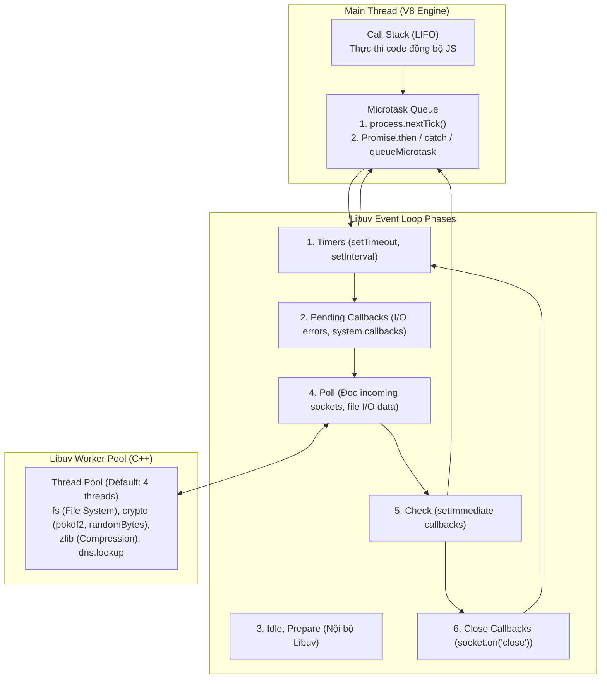

# 📗 CHUYÊN ĐỀ 01.1: NODE.JS ARCHITECTURE – LÝ THUYẾT & KIẾN TRÚC LÕI

> **Mục tiêu**: Nắm vững bản chất nội tại của Node.js runtime, V8 Engine, Libuv, cơ chế điều phối Event Loop, mô hình bộ nhớ và các mẫu kiến trúc chuẩn cho hệ thống Backend Enterprise chịu tải cao.

---

## 1. Bản chất cốt lõi & Cơ chế hoạt động (Core Internals)

### 1.1. Kiến trúc Libuv & Multi-Threading ngầm
Node.js sử dụng mô hình **Single-Threaded Event Loop** để thực thi mã nguồn JavaScript. Tuy nhiên, ở tầng C/C++, thư viện **Libuv** cung cấp một **Thread Pool** ngầm (mặc định 4 threads, tinh chỉnh qua biến môi trường `UV_THREADPOOL_SIZE` lên tới tối đa 1024).



### 1.2. Phân loại tác vụ Blocking vs Non-Blocking I/O
* **Non-Blocking I/O (Async I/O trên Kernel)**:
  * Network I/O (TCP/UDP sockets, HTTP requests, incoming connections).
  * Được Libuv ủy quyền trực tiếp cho cơ chế multiplexing bất đồng bộ của Kernel hệ điều hành: **epoll** (Linux), **kqueue** (macOS), hoặc **IOCP** (Windows). **Không hề tiêu tốn Worker Thread trong Thread Pool!**
* **Blocking I/O (Chuyển sang Worker Pool)**:
  * File System operations (`fs.readFile`, `fs.writeFile`). Do các hệ điều hành lớn chưa hỗ trợ Async File I/O hoàn hảo và đồng nhất.
  * DNS Resolution (`dns.lookup` - vì gọi hàm `getaddrinfo` chặn của glibc).
  * Crypto hashing CPU nặng (`crypto.pbkdf2`, `bcrypt`).
  * Nén/giải nén (`zlib`).

### 1.3. Thứ tự ưu tiên điều phối thực thi (Execution Priority)
1. **Call Stack**: Code đồng bộ chạy cho tới khi stack rỗng.
2. **Microtasks Queue** (Được kiểm tra và vét cạn ngay sau mỗi tác vụ hoặc giữa các phase của Event Loop):
   * `process.nextTick()`: Ưu tiên số 1 tuyệt đối, chạy trước tất cả Promise.
   * `Promise.then()` / `catch()` / `finally()` & `queueMicrotask()`.
3. **Macrotasks (Các Phase của Event Loop)**:
   * `Timers` $\rightarrow$ `Pending Callbacks` $\rightarrow$ `Poll` $\rightarrow$ `Check (setImmediate)` $\rightarrow$ `Close Callbacks`.

> ⚠️ **Quy tắc Starvation**: Nếu bạn đệ quy `process.nextTick()`, microtask queue sẽ không bao giờ rỗng, làm Event Loop **chết đói (Starvation)**, hoàn toàn không thể chuyển sang phase I/O hay xử lý request mới!

---

## 2. Kiến trúc chuẩn cho Enterprise Backend (Production Architecture)

### 2.1. Hexagonal / Clean Architecture trong Node.js (NestJS)
```
src/
├── domain/                  # Lõi nghiệp vụ (Thuần TypeScript, zero dependency bên ngoài)
│   ├── entities/            # User, Order, Product
│   └── value-objects/       # Money, Email, Address
├── application/             # Use cases điều phối luồng
│   ├── use-cases/           # CreateOrderUseCase, CancelOrderUseCase
│   └── ports/               # IOrderRepository, INotificationService, IPaymentGateway
├── infrastructure/          # Chi tiết kỹ thuật (Framework, DB, MQ)
│   ├── persistence/         # PrismaOrderRepository, TypeOrmOrderRepository
│   ├── messaging/           # BullMQProducer, RabbitMQConsumer
│   └── http/                # NestJS Fastify Controllers, DTOs, Guards
└── main.ts                  # Bootstrap, lifecycle hooks, graceful shutdown
```

### 2.2. Scale Multi-Core & Tiến trình (Clustering vs Containerization)
Vì một tiến trình Node.js chỉ chạy trên 1 core CPU duy nhất:
1. **Containerized (Kubernetes / Docker) - Khuyến nghị Enterprise**:
   * Mỗi container chạy **đúng 1 process Node.js**.
   * Đặt CPU limit: `cpu: 1` hoặc `2`.
   * Scale ngang (Horizontal Scaling) tự động qua K8s Horizontal Pod Autoscaler (HPA) dựa trên CPU/Memory hoặc Custom Metrics (Event Loop Lag).
2. **Cluster Module / PM2 (Trên máy chủ vật lý hoặc VM đơn lẻ)**:
   ```bash
   pm2 start dist/main.js -i max --name "enterprise-api"
   ```
   *(Master process sẽ spawn ra $N$ worker processes bằng số core CPU và dùng thuật toán Round-Robin phân phối kết nối TCP).*

---

## 3. Best Practices & Code Triển Khai Chuẩn Production

### 3.1. Tránh chặn Event Loop với Worker Threads
Với các tác vụ tính toán CPU-bound nặng (băm mã hóa, tính toán ma trận, xử lý file Excel 50MB):
```typescript
// worker-pool.service.ts
import { Worker } from 'worker_threads';
import path from 'path';

export function runCpuHeavyTask(payload: unknown): Promise<unknown> {
  return new Promise((resolve, reject) => {
    const worker = new Worker(path.resolve(__dirname, 'task.worker.js'), {
      workerData: payload,
    });
    worker.on('message', resolve);
    worker.on('error', reject);
    worker.on('exit', (code) => {
      if (code !== 0) reject(new Error(`Worker stopped with exit code ${code}`));
    });
  });
}
```

### 3.2. Quản lý Context xuyên suốt với `AsyncLocalStorage`
Truyền `traceId`, `tenantId`, `userId` xuyên qua tất cả các tầng Controller $\rightarrow$ Service $\rightarrow$ Repository mà không cần truyền tham số thủ công:

```typescript
// request-context.storage.ts
import { AsyncLocalStorage } from 'async_hooks';

export interface RequestContext {
  traceId: string;
  tenantId: string;
  userId?: string;
}

export const requestContextStorage = new AsyncLocalStorage<RequestContext>();

// context.middleware.ts
export function contextMiddleware(req: any, res: any, next: () => void) {
  const store: RequestContext = {
    traceId: (req.headers['x-trace-id'] as string) || crypto.randomUUID(),
    tenantId: (req.headers['x-tenant-id'] as string) || 'default_tenant',
    userId: req.user?.id,
  };
  requestContextStorage.run(store, () => next());
}
```

### 3.3. Xử lý Stream & Backpressure khi truyền tải file lớn
Không bao giờ đọc toàn bộ file vào buffer RAM (`fs.readFile`), luôn dùng Stream kết hợp `pipeline` để kiểm soát hiện tượng nghẽn dòng (Backpressure):

```typescript
import { pipeline } from 'stream/promises';
import fs from 'fs';
import zlib from 'zlib';

export async function compressLargeFile(source: string, destination: string): Promise<void> {
  await pipeline(
    fs.createReadStream(source),
    zlib.createGzip(),
    fs.createWriteStream(destination)
  );
}
```

### 3.4. Pattern Graceful Shutdown chuẩn Production
```typescript
async function bootstrap() {
  const app = await NestFactory.create(AppModule);
  const server = app.getHttpServer();

  app.enableShutdownHooks();

  const handleShutdown = async (signal: string) => {
    console.log(`Received ${signal}. Shutting down gracefully...`);
    // 1. Dừng nhận request HTTP mới
    server.close(async () => {
      console.log('HTTP server closed.');
      // 2. Chờ in-flight requests và đóng kết nối DB, Redis, BullMQ
      await app.close();
      console.log('All resources cleanly closed.');
      process.exit(0);
    });

    // 3. Chốt chặn ép tắt sau 30 giây nếu bị kẹt
    setTimeout(() => {
      console.error('Graceful shutdown timeout exceeded, forcefully exiting!');
      process.exit(1);
    }, 30000);
  };

  process.on('SIGTERM', () => handleShutdown('SIGTERM'));
  process.on('SIGINT', () => handleShutdown('SIGINT'));
}
```

---

## 4. Các bẫy kỹ thuật & Lưu ý sống còn (Production Caveats)

| STT | Bẫy kỹ thuật | Hậu quả thực tế | Giải pháp chuẩn Production |
| :--- | :--- | :--- | :--- |
| **1** | **Chặn Event Loop bởi Sync API** | `fs.readFileSync`, `crypto.pbkdf2Sync`, parse JSON chuỗi 100MB làm server tê liệt hoàn toàn mọi HTTP request khác. | Tuyệt đối dùng Async API (`fs.promises`). Dùng stream cho JSON lớn (`JSONStream`). |
| **2** | **Memory Leak từ Closure & EventListener** | Quên gọi `emitter.off()` hoặc nhét object vào mảng toàn cục không dọn $\rightarrow$ OOM Crash (Exit Code 137). | Dùng `WeakMap`/`WeakSet` cho cache tạm thời. Đặt cảnh báo Heap Memory qua Prometheus/Grafana. |
| **3** | **Unhandled Promise Rejection** | Từ Node.js 15+, Unhandled Promise Rejection sẽ mặc định **làm sập toàn bộ tiến trình** (Process Exit). | Luôn bắt lỗi ở tầng ngoài cùng, đăng ký `process.on('unhandledRejection')` và log cấu trúc. |
| **4** | **DNS Resolution Bottleneck** | Mặc định `dns.lookup` dùng 4 threads của Libuv thread pool. Khi gọi hàng nghìn API bên ngoài, 4 threads này nghẽn làm chậm cả I/O file. | Nâng `UV_THREADPOOL_SIZE=64` hoặc dùng `dns.resolve` (dùng c-ares không chặn threadpool). |
| **5** | **Zombie Process khi redeploy K8s** | Pod nhận `SIGTERM` tắt ngay làm mất dữ liệu đang ghi dở hoặc treo connection pool của DB. | Triển khai Graceful Shutdown hook (chờ 30s timeout), cấu hình `terminationGracePeriodSeconds: 45` trên K8s. |
| **6** | **Giới hạn RAM mặc định của V8** | Trên máy chủ 64-bit, V8 mặc định chỉ cấp ~1.4GB RAM cho Heap. Ứng dụng vượt quá sẽ bị văng lỗi `FATAL ERROR: Ineffective mark-compacts near heap limit Allocation failed - JavaScript heap out of memory`. | Thiết lập cờ khi start: `node --max-old-space-size=4096 dist/main.js` để nâng giới hạn lên 4GB. |
