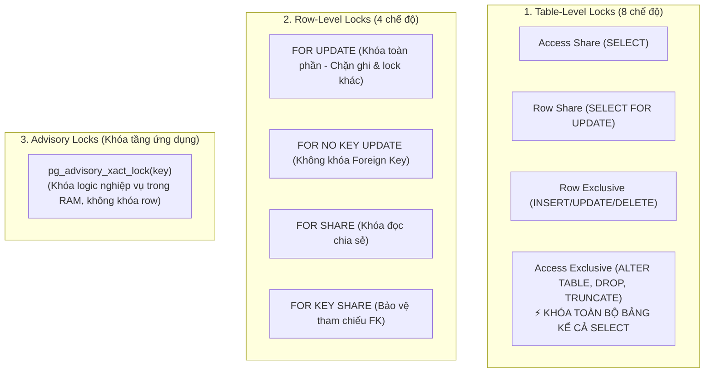
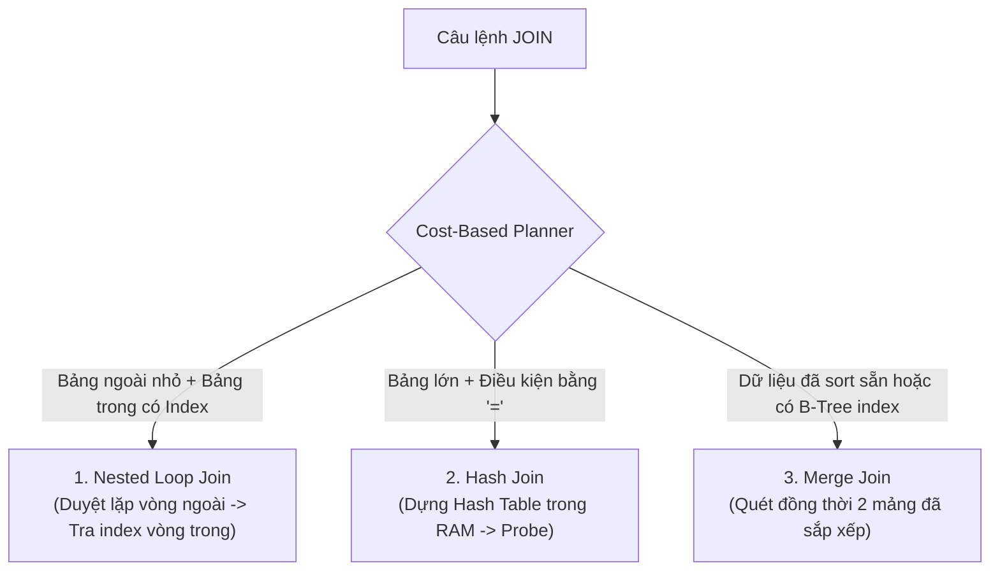

# 🗄️ CHUYÊN ĐỀ 02: DATABASE (POSTGRESQL / RDBMS) DEEP-DIVE & PRODUCTION GUIDE

---

## 1. Bản chất cốt lõi & Cơ chế hoạt động (PostgreSQL Internals)

### 1.1. MVCC (Multi-Version Concurrency Control)
PostgreSQL sử dụng **MVCC** để đảm bảo *"Readers never block Writers, and Writers never block Readers"*.
* Khi thực hiện `UPDATE`, PostgreSQL **không ghi đè** lên bản ghi cũ. Nó đánh dấu bản ghi cũ là đã xóa (`xmax` được gán transaction ID hiện tại) và chèn một bản ghi mới (`xmin` là transaction ID mới).
* Khi thực hiện `DELETE`, nó chỉ đánh dấu `xmax` mà không thu hồi dung lượng đĩa ngay lập tức.
* Các bản ghi cũ không còn transaction nào nhìn thấy được gọi là **Dead Tuples**.

### 1.2. WAL (Write-Ahead Logging) & Checkpoints
* Mọi thao tác ghi dữ liệu (INSERT/UPDATE/DELETE) **bắt buộc phải được ghi tuần tự vào WAL file trên đĩa trước** khi trang dữ liệu thực tế trong RAM (Shared Buffers) được sửa đổi.
* Điều này đảm bảo tính bền vững (**Durability** trong ACID): nếu server mất điện đột ngột, khi khởi động lại PostgreSQL sẽ replay WAL để khôi phục dữ liệu nguyên vẹn.
* **Checkpoint**: Quá trình flush toàn bộ các trang dữ liệu "bẩn" (Dirty Pages) từ RAM xuống file dữ liệu chính trên đĩa.

```mermaid
flowchart LR
    Client["Client App"] -->|1. SQL Write| Buffer["Shared Buffers (RAM)"]
    Client -->|2. Append Log| WAL["WAL File (Disk - Sequential I/O)"]
    Buffer -.->|3. Checkpoint (Flush Dirty Pages)| DataFile[("Data Files (Disk - Random I/O)")]
```

---

## 2. Các mức độ cô lập giao dịch (Transaction Isolation Levels)

| Mức cô lập | Dirty Read (Đọc rác) | Non-Repeatable Read (Đọc không lặp lại) | Phantom Read (Bản ghi ma) | Serialization Anomaly (Dị thường chuỗi) |
| :--- | :---: | :---: | :---: | :---: |
| **Read Committed** *(Mặc định của PG)* | ❌ Không bị | ⚠️ **Có thể bị** | ⚠️ **Có thể bị** | ⚠️ **Có thể bị** |
| **Repeatable Read** | ❌ Không bị | ❌ Không bị | ❌ Không bị *(Trong PG)* | ⚠️ **Có thể bị (Write Skew)** |
| **Serializable** | ❌ Không bị | ❌ Không bị | ❌ Không bị | ❌ Không bị |

> 📌 **Lưu ý thực tế**: Trong PostgreSQL, mức `Repeatable Read` sử dụng Snapshot Isolation nên giải quyết được cả Phantom Read. Tuy nhiên, nó vẫn có thể gặp lỗi **Write Skew** (hai transaction đọc cùng điều kiện và cập nhật hai dòng dữ liệu độc lập làm vi phạm toàn vẹn nghiệp vụ). Khi đó, mức `Serializable` sử dụng SSI (Serializable Snapshot Isolation) để rollback transaction vi phạm.

---

## 3. Quản lý Concurrency, Khóa (Locking) & Tránh Deadlock

### 3.1. Phân tầng các loại Khóa (Lock Hierarchy)
PostgreSQL phân chia khóa thành 3 cấp độ chính: **Table-level Locks**, **Row-level Locks**, và **Advisory Locks**.



#### Ma trận xung đột Table Locks phổ biến:
* Khi bạn chạy `ALTER TABLE ... ADD COLUMN`, PG sử dụng **AccessExclusiveLock** $\rightarrow$ Khóa chặn tất cả các câu lệnh `SELECT`, `INSERT`, `UPDATE` cho đến khi hoàn tất.
* Khi chạy `CREATE INDEX CONCURRENTLY`, PG dùng **ShareUpdateExclusiveLock** $\rightarrow$ Cho phép người dùng đọc và ghi (`SELECT`, `INSERT`, `UPDATE`, `DELETE`) bình thường trong suốt quá trình đánh index.

### 3.2. Chi tiết các chế độ Khóa dòng (Row-Level Locks)
```sql
-- 1. FOR UPDATE: Khóa độc quyền dòng (Chặn UPDATE, DELETE và mọi FOR ... khác)
SELECT * FROM inventory WHERE product_id = 100 FOR UPDATE;

-- 2. FOR NO KEY UPDATE: Khóa nhẹ hơn, chỉ chặn UPDATE/DELETE nhưng CHO PHÉP người khác FOR KEY SHARE
-- Rất hữu ích khi chỉ update các trường thông tin thường (status, note) mà không đụng tới Primary Key/Unique Key
SELECT * FROM orders WHERE id = 'ord_1' FOR NO KEY UPDATE;

-- 3. FOR UPDATE NOWAIT: Báo lỗi ngay lập tức nếu dòng đang bị transaction khác lock (Tránh nghẽn thread pool)
SELECT * FROM inventory WHERE product_id = 100 FOR UPDATE NOWAIT;

-- 4. FOR UPDATE SKIP LOCKED: Bỏ qua dòng bị lock, gắp ngay dòng tiếp theo (Mô hình Job Queue)
SELECT * FROM jobs WHERE status = 'PENDING' ORDER BY priority DESC LIMIT 1 FOR UPDATE SKIP LOCKED;
```

### 3.3. Advisory Locks (Khóa ứng dụng không cần bảng DB)
Khóa logic dựa trên số nguyên 64-bit do lập trình viên định nghĩa, tự động giải phóng khi transaction kết thúc (`xact`):
```sql
-- Dùng chạy Cron / Scheduled Job trên nhiều Pod Node.js mà không cần Redis:
SELECT pg_try_advisory_xact_lock(123456); 
-- Trả về true: Lấy lock thành công -> chạy job.
-- Trả về false: Đã có Pod khác đang chạy -> bỏ qua.
```

### 3.4. Chiến lược chống Deadlock (Deadlock Prevention)
1. **Khóa theo thứ tự xác định (Consistent Order Locking)**:
   * Nếu giao dịch A cần cập nhật bản ghi 10 và 20, giao dịch B cũng phải cập nhật theo thứ tự **10 rồi đến 20** (Sắp xếp ID tăng dần trước khi `SELECT FOR UPDATE`). Tuyệt đối không để B cập nhật ngược (20 $\rightarrow$ 10).
2. **Cấu hình Timeout an toàn**:
   ```sql
   SET deadlock_timeout = '1s';   -- Sau 1s nếu bị block, PG sẽ quét chu trình đồ thị (Wait-for Graph) để báo lỗi Deadlock
   SET lock_timeout = '3s';       -- Tránh đợi khóa quá 3 giây
   SET statement_timeout = '10s';  -- Tránh query chạy ngầm quá 10 giây
   ```

---

## 4. Tối ưu hóa Index (Indexing Masterclass)

### 4.1. Phân loại Index & Cấu trúc nội tại
* **B-Tree (Balanced Tree)** *(Mặc định)*: 
  * Cấu trúc cây cân bằng $O(\log N)$ gồm Root $\rightarrow$ Branch $\rightarrow$ Leaf. Mỗi Leaf Node chứa Key và con trỏ **TID (Tuple ID: Page Number + Offset)** trỏ xuống bảng dữ liệu.
  * Hỗ trợ tốt nhất: `=`, `<`, `>`, `<=`, `>=`, `BETWEEN`, `IN`, `ORDER BY`.
* **GIN (Generalized Inverted Index)**: 
  * Chỉ mục đảo ngược tương tự Elasticsearch. Một dòng dữ liệu có thể chứa nhiều giá trị (Mảng `ARRAY`, `JSONB` với toán tử `@>`, hoặc `tsvector` trong Full-text Search).
* **BRIN (Block Range Index)**: 
  * Không lưu từng dòng mà chỉ lưu giá trị **Min/Max** cho mỗi cụm 128 trang đĩa (Page Range).
  * *Ưu điểm*: Kích thước chỉ vài chục KB (nhỏ hơn B-Tree hàng nghìn lần). Cực kỳ thích hợp cho bảng dữ liệu khổng lồ (hàng trăm triệu dòng) được ghi tuần tự theo thời gian (Log, Time-series metrics).
* **GiST / SP-GiST**: Tối ưu cho dữ liệu không gian 2D/3D (PostGIS) hoặc kiểu dữ liệu khoảng (`numrange`, `daterange`).

### 4.2. Các kiểu quét Index trong Query Planner (Scan Types)
Khi chạy `EXPLAIN (ANALYZE, BUFFERS)`:
1. **Sequential Scan (Seq Scan)**: Quét toàn bộ bảng từ đầu đến cuối. Tối ưu khi bảng nhỏ hoặc khi query cần lấy > 15-20% tổng số dòng của bảng.
2. **Index Scan**: Quét B-Tree để tìm TID $\rightarrow$ Nhảy xuống Heap Table đọc dòng dữ liệu (Random I/O). Tốt khi lấy số lượng ít dòng.
3. **Index Only Scan**: Toàn bộ cột cần lấy đều nằm sẵn trong Index (Covering Index) VÀ trang dữ liệu được đánh dấu sạch trong **Visibility Map** $\rightarrow$ **Không cần chạm xuống Heap Table**, tốc độ tối đa!
4. **Bitmap Index Scan + Bitmap Heap Scan**: Khi có nhiều điều kiện (`WHERE status = 'PAID' AND city = 'HN'`), PG quét 2 index độc lập tạo ra 2 Bitmap trên RAM, thực hiện phép `AND` các bit, sau đó mới quét tuần tự xuống Heap Table $\rightarrow$ Hạn chế tối đa Random I/O.

### 4.3. Các kỹ thuật Index nâng cao trong Thực tế
```sql
-- 1. Composite Index & Leftmost Prefix Rule
-- Tối ưu cho: WHERE user_id = 1 AND status = 'COMPLETED' ORDER BY created_at
CREATE INDEX idx_orders_user_status_created ON orders (user_id, status, created_at);

-- 2. Covering Index (Sử dụng INCLUDE)
-- Đưa cột cần SELECT vào leaf node của index mà không đưa vào cây tìm kiếm B-Tree:
CREATE INDEX idx_users_email_covering ON users (email) INCLUDE (first_name, last_name);
SELECT first_name, last_name FROM users WHERE email = 'test@example.com'; -- -> Index Only Scan!

-- 3. Partial Index (Chỉ mục có điều kiện - Tiết kiệm 80-95% dung lượng RAM)
-- Chỉ đánh index cho các đơn chưa xử lý (thường chiếm 1% bảng):
CREATE INDEX idx_orders_unprocessed ON orders (created_at) WHERE status = 'PENDING';

-- 4. Expression Index (Đánh index theo hàm / biểu thức)
CREATE INDEX idx_users_lower_email ON users (lower(email));
SELECT * FROM users WHERE lower(email) = 'user@example.com'; -- Sử dụng được Index!
```

---

## 5. Thuật toán JOIN trong PostgreSQL (Join Deep-Dive)

PostgreSQL Query Planner lựa chọn giữa **3 thuật toán JOIN cốt lõi** dựa trên chi phí ước tính (Cost-based Optimizer):



### 5.1. So sánh chi tiết 3 thuật toán JOIN

| Tiêu chí | Nested Loop Join | Hash Join | Merge Join |
| :--- | :--- | :--- | :--- |
| **Cơ chế hoạt động** | Duyệt từng dòng của Outer Table, với mỗi dòng nhảy sang Inner Table tìm kiếm. | Nạp bảng nhỏ hơn vào RAM dựng **Hash Table** theo Join Key. Sau đó quét tuần tự bảng lớn (Probe) để đối soát. | Cả 2 bảng được sắp xếp theo Join Key trước. Sau đó dùng 2 con trỏ quét song song từ đầu đến cuối một lượt. |
| **Độ phức tạp** | $O(M \times \log N)$ (nếu có index)<br/>$O(M \times N)$ (nếu không có index) | $O(M + N)$ | $O(M \log M + N \log N)$ (chưa sort)<br/>$O(M + N)$ (đã sort sẵn) |
| **Điều kiện hỗ trợ** | Mọi điều kiện so sánh (`=, <, >, <=, >=, !=`). | **Chỉ hỗ trợ so sánh bằng (`=`)**. Không hỗ trợ so sánh khoảng. | Hỗ trợ so sánh bằng (`=`) và so sánh khoảng. |
| **Điểm phụ thuộc cốt lõi** | Phụ thuộc vào **Index trên bảng trong**. | Phụ thuộc vào **`work_mem`**. Nếu Hash Table > `work_mem`, phải ghi tràn xuống đĩa (Spill to Disk) gây sụt giảm tốc độ nghiêm trọng. | Tối ưu khi Join Key trùng với **B-Tree Index** hoặc câu lệnh có sẵn `ORDER BY` theo Join Key. |

### 5.2. Tối ưu hóa JOIN trên Production
1. **Tinh chỉnh `work_mem`**:
   * Mặc định PostgreSQL chỉ cấp `work_mem = 4MB`. Với các câu lệnh Hash Join hoặc Sort trên dữ liệu lớn, Postgres sẽ chuyển sang **2-Pass Hash Join (ghi batch xuống đĩa)**.
   * *Giải pháp*: Tăng `work_mem` lên 32MB–128MB cho phiên làm việc cần tính toán nặng:
     ```sql
     SET work_mem = '64MB';
     SELECT * FROM large_orders o JOIN large_customers c ON o.customer_id = c.id;
     ```
2. **Luôn đánh Index cho Foreign Key**:
   * PostgreSQL **không tự động tạo index** cho các cột Foreign Key. Nếu không đánh index, các thao tác `JOIN` và thao tác xóa dữ liệu bảng cha (`CASCADE DELETE`) sẽ buộc phải quét toàn bộ bảng con (Seq Scan).
3. **Đọc `EXPLAIN (ANALYZE, BUFFERS)` để phát hiện nghẽn JOIN**:
   * Nếu thấy: `Hash (Batches: 4  Memory Usage: 32768kB)` $\rightarrow$ Hash Table bị chia làm 4 batch và phải tràn xuống đĩa $\rightarrow$ Cần tăng `work_mem`.
   * Nếu thấy: `Nested Loop` với `actual rows` chênh lệch hàng nghìn lần so với `rows (estimated)` $\rightarrow$ Thống kê bảng bị cũ, cần chạy `ANALYZE table_name;` để Query Planner tính toán lại.

---

## 5. Connection Pooling với PgBouncer

### 5.1. Vì sao Node.js bắt buộc phải có PgBouncer?
Mỗi kết nối trực tiếp vào PostgreSQL tiêu tốn một tiến trình hệ điều hành (Process) riêng, chiếm khoảng **5–10MB RAM** và gây áp lực lớn lên CPU khi context switching.
* Khi ứng dụng Node.js scale ra 20 pods $\times$ 25 connection pool = 500 connections $\rightarrow$ PostgreSQL sẽ bị quá tải ngay lập tức.
* **PgBouncer** đóng vai trò Proxy trung gian, duy trì hàng nghìn kết nối nhẹ từ Node.js nhưng chỉ mở một số lượng kết nối thực cố định (ví dụ: 30–50 connections) xuống PostgreSQL.

### 5.2. Các chế độ của PgBouncer
1. **Session Pooling**: Connection được cấp cho client từ lúc kết nối đến lúc disconnect. (Ít tối ưu).
2. **Transaction Pooling** *(Khuyến nghị cho Web API)*: Connection chỉ được cấp cho client trong thời gian diễn ra 1 Transaction SQL. Xong transaction thì trả lại pool cho request khác.
   > ⚠️ **Cảnh báo sống còn với Transaction Pooling**: Không hỗ trợ `PREPARE` statement cấp phiên (Prepared Statements), biến phiên (`SET timezone = ...`), hoặc Temporary Tables nếu không cấu hình tương thích.
3. **Statement Pooling**: Giải phóng connection sau từng câu lệnh SQL đơn lẻ (Không hỗ trợ Multi-statement Transaction).

---

## 6. Autovacuum Tuning & Ngăn chặn Bloat

### 6.1. Nguyên nhân gây Index & Table Bloat
Khi có nhiều `UPDATE`/`DELETE`, các dead tuples tích tụ chiếm dụng dung lượng đĩa và làm chậm quá trình quét index. Nếu Autovacuum chạy quá chậm, dung lượng bảng phình to gấp 3–5 lần dung lượng thực.

### 6.2. Cấu hình Autovacuum hung hăng cho bảng chịu tải cao
```sql
ALTER TABLE orders SET (
  autovacuum_vacuum_scale_factor = 0.05, -- Kích hoạt khi có 5% số dòng bị dead (thay vì 20% mặc định)
  autovacuum_vacuum_threshold = 1000,    -- Số dòng tối thiểu
  autovacuum_vacuum_cost_limit = 2000    -- Cho phép autovacuum dùng nhiều I/O hơn để dọn dẹp nhanh
);
```

### 6.3. Dọn dẹp Bloat online mà không khóa bảng
```sql
-- Dọn dẹp index mà không chặn các câu lệnh INSERT/UPDATE khác:
REINDEX TABLE CONCURRENTLY orders;
```

---

## 7. Kiến trúc Multi-Tenancy (Đa người thuê)

| Mô hình | Ưu điểm | Nhược điểm | Trường hợp sử dụng |
| :--- | :--- | :--- | :--- |
| **Database-per-Tenant** | Cách ly dữ liệu 100%, dễ backup/restore từng tenant. | Chi phí hạ tầng cao, khó quản lý migration cho hàng nghìn DB. | Khách hàng Enterprise lớn, yêu cầu bảo mật tài chính khắt khe. |
| **Schema-per-Tenant** | Cách ly logic tốt, chung 1 Database instance. | Khó scale khi vượt quá hàng nghìn schemas (vượt giới hạn catalog cache của PG). | Phân khúc B2B vừa và nhỏ (< 500 khách hàng). |
| **Row-Level-Security (RLS) / Tenant-ID Column** | Rẻ nhất, dễ scale, chung 1 schema và bảng dữ liệu. | Rủi ro rò rỉ dữ liệu nếu developer quên WHERE hoặc miss policy. | Ứng dụng B2B/B2C SaaS quy mô lớn, hàng chục nghìn tenants. |

### Thiết lập RLS (Row-Level Security) an toàn trong PostgreSQL
```sql
ALTER TABLE documents ENABLE ROW LEVEL SECURITY;

CREATE POLICY tenant_isolation_policy ON documents
  USING (tenant_id = current_setting('app.current_tenant_id')::UUID);

-- Trong code Node.js trước khi truy vấn:
SET LOCAL app.current_tenant_id = 'c4b8e219-5d29-...';
SELECT * FROM documents; -- Tự động chỉ trả về dữ liệu của tenant hiện tại
```

---

## 8. Bộ câu hỏi phỏng vấn chuyên sâu (Senior / Staff Level)

1. **Hỏi**: *“Làm thế nào để implement một hệ thống Message Queue / Job processing hiệu quả trực tiếp trên PostgreSQL mà không bị race condition và không làm nghẽn các worker?”*
   * **Đáp chuẩn**: Sử dụng bảng `jobs` kết hợp câu lệnh `SELECT ... FOR UPDATE SKIP LOCKED`. Câu lệnh này khóa các dòng được chọn và cho phép các worker khác lập tức bỏ qua những dòng đó để lấy các dòng tiếp theo mà không phải chờ đợi lock release, loại bỏ hoàn toàn hiện tượng worker contention.
2. **Hỏi**: *“Nếu hệ thống của bạn dùng PgBouncer ở chế độ Transaction Pooling, Prisma hoặc TypeORM gặp lỗi gì và cách khắc phục ra sao?”*
   * **Đáp chuẩn**: Mặc định Prisma/TypeORM sử dụng Server-side Prepared Statements. Trong Transaction Pooling mode, kết nối vật lý bị tráo đổi giữa các transaction, dẫn đến lỗi `prepared statement "s1" already exists` hoặc `does not exist`. Khắc phục bằng cách thêm flag `?pgbouncer=true` vào connection string (với Prisma) để tắt prepared statement hoặc cấu hình PgBouncer hỗ trợ protocol-level named prepared statements.
3. **Hỏi**: *“Hiện tượng Transaction ID Wraparound trong PostgreSQL là gì và điều gì xảy ra nếu không được xử lý?”*
   * **Đáp chuẩn**: PostgreSQL dùng số nguyên 32-bit cho Transaction ID (tối đa ~4 tỷ giao dịch). Nếu số ID vượt quá 2 tỷ mà không được dọn dẹp và freeze (gắn cờ frozen), các giao dịch cũ trong quá khứ sẽ bị coi là nằm ở tương lai $\rightarrow$ Dữ liệu bị biến mất đối với các query mới. Để ngăn ngừa thảm họa này, PostgreSQL có tiến trình `autovacuum freeze` tự động; nếu chạm ngưỡng nguy hiểm, DB sẽ tự động chuyển sang chế độ Read-Only để ép dọn dẹp.
