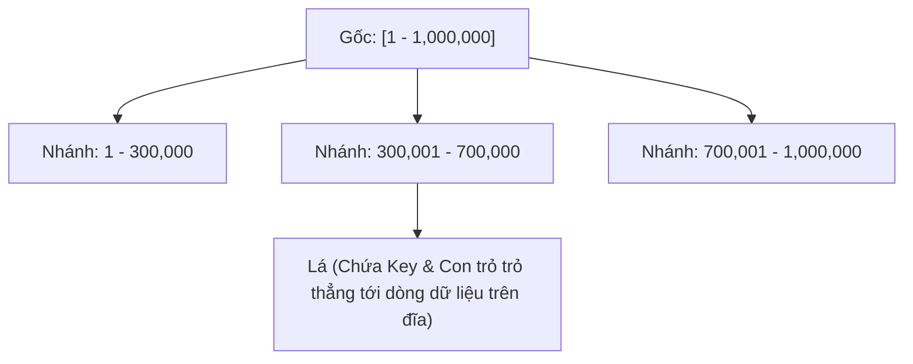
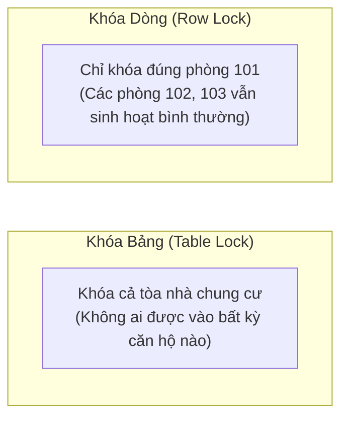
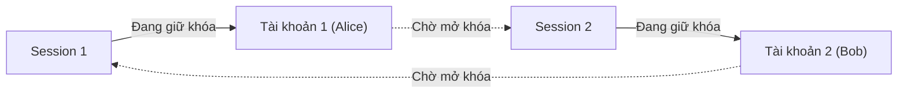
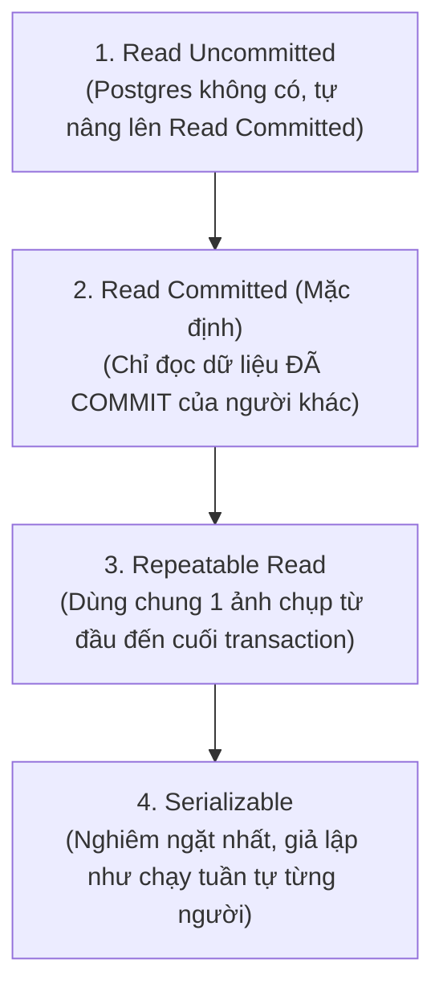

# 📗 CHUYÊN ĐỀ 02.1: DATABASE (POSTGRESQL) – BẢN CHẤT DỄ HIỂU TỪ GỐC RỄ: INDEX, LOCK & TRANSACTION

> **Mục tiêu**: Giúp lập trình viên từ Junior đến Senior hiểu **bản chất thực sự** của PostgreSQL mà không bị ngợp bởi các thuật ngữ hàn lâm khó hiểu. Đi thẳng từ **ví dụ đời sống thực tế $\rightarrow$ cơ chế chạy ngầm $\rightarrow$ câu lệnh SQL thực chiến $\rightarrow$ các cạm bẫy hay gặp khi đi làm**.

---

## PHẦN 1: INDEX (CHỈ MỤC) – TẠI SAO QUERY NHANH VÀ KHI NÀO BỊ NGHẼN?

### 1. Index thực chất là gì? (Ví dụ đời sống)
Hãy tưởng tượng bạn đang cầm trên tay một cuốn từ điển dày 2,000 trang:
* **Nếu KHÔNG CÓ mục lục**: Muốn tìm từ *"PostgreSQL"*, bạn buộc phải lật giở từng trang một từ trang 1 đến trang 2,000 để tìm kiếm. Trong cơ sở dữ liệu, hành động quét từ đầu đến cuối này gọi là **Sequential Scan (Seq Scan)**. Bảng có 10 triệu dòng thì nó đọc đủ 10 triệu dòng $\rightarrow$ Cực kỳ chậm, ngốn đĩa và CPU.
* **Nếu CÓ mục lục (Index)**: Bạn lật ngay ra trang mục lục ở cuối sách, tra chữ cái "P", mục lục chỉ ngay: *"Từ này ở trang 850"*. Bạn lật thẳng đến trang 850. Trong database, hành động này gọi là **Index Scan**.

> ⚠️ **Cái giá phải trả của Index (Không có bữa trưa nào miễn phí)**:
> 1. **Tốn dung lượng đĩa và RAM**: Cuốn sách có thêm 100 trang mục lục thì sách sẽ dày hơn và nặng hơn.
> 2. **Ghi chậm đi (Write Overhead)**: Mỗi lần bạn bổ sung thêm 1 từ mới vào sách (`INSERT`) hoặc sửa nghĩa của từ (`UPDATE`), bạn vừa phải viết từ đó vào sách, vừa phải cặm cụi sửa lại trang mục lục. Đánh quá nhiều Index sẽ làm các lệnh `INSERT/UPDATE/DELETE` bị chậm rõ rệt!

---

### 2. B-Tree Index hoạt động như thế nào? (Cực kỳ trực quan)
B-Tree (Balanced Tree) là loại index mặc định trong hầu hết các hệ quản trị CSDL quan hệ.

**Cách nó hoạt động giống trò chơi "Đoán số từ 1 đến 100"**:
* Bạn nghĩ ra số **68**.
* Người chơi hỏi: *"Số đó lớn hơn hay nhỏ hơn 50?"* $\rightarrow$ Bạn bảo: *"Lớn hơn"*. (Loại ngay 50 số từ 1 đến 50).
* Người chơi hỏi tiếp: *"Lớn hơn hay nhỏ hơn 75?"* $\rightarrow$ Bạn bảo: *"Nhỏ hơn"*. (Thu hẹp vùng còn 51 đến 75).
* Người chơi hỏi tiếp: *"Lớn hơn hay nhỏ hơn 65?"* $\rightarrow$ Bạn bảo: *"Lớn hơn"*. (Thu hẹp còn 66 đến 75).
* Chỉ sau 4-5 câu hỏi, người chơi đã tìm trúng số 68!



* Cây B-Tree trong database được sắp xếp sẵn theo thứ tự tăng dần. Một cây B-Tree cho bảng 10 triệu dòng thường chỉ cao **3 đến 4 tầng**.
* Để tìm 1 người trong 10 triệu người, database **chỉ mất đúng 3 đến 4 bước nhảy**, thay vì phải duyệt 10 triệu lần!
* **B-Tree hỗ trợ cực tốt cho các toán tử**: So sánh bằng (`=`), tìm trong khoảng (`<, >, BETWEEN`), tìm trong danh sách (`IN`), và sắp xếp (`ORDER BY`).

---

### 3. Khi nào dùng B-Tree, GIN, BRIN? (Bản chất dễ nhớ)

| Loại Index | Giải thích đời thường | Khi nào nên dùng? | Ví dụ thực tế |
| :--- | :--- | :--- | :--- |
| **B-Tree** *(Mặc định)* | Mục lục từ điển sắp xếp từ A đến Z. | Dùng cho **90% nhu cầu thông thường**: Tìm ID, mã đơn hàng, ngày tạo, khoảng giá, sắp xếp tăng/giảm. | `WHERE user_id = 10`<br/>`WHERE created_at >= '2026-01-01'` |
| **GIN** *(Inverted Index)* | Mục lục chuyên mục báo chí: Từ khóa này xuất hiện ở những bài báo nào. | Dùng khi một ô dữ liệu chứa **nhiều giá trị bên trong**: Cột Mảng (`ARRAY`), Cột `JSONB`, hoặc Tìm kiếm văn bản (Full-text search). | `WHERE tags @> ARRAY['nodejs']`<br/>`WHERE details @> '{"color": "red"}'` |
| **BRIN** *(Block Range)* | Chỉ ghi chú vắn tắt: "Tủ hồ sơ số 1 chứa hồ sơ từ ngày 1/1 đến 5/1". | Dùng cho bảng **khổng lồ hàng chục triệu dòng** ghi liên tục theo thời gian (Log hệ thống, IoT, Lịch sử chuyển tiền). Cực kỳ nhẹ RAM. | Bảng `audit_logs` có 100 triệu dòng đánh BRIN trên cột `created_at`. |

---

### 4. Composite Index (Index nhiều cột) & Quy tắc "Danh bạ điện thoại"
Giả sử bạn tạo index trên 2 cột: `CREATE INDEX idx_users ON users (ho, ten);`

**Quy tắc Danh bạ điện thoại (Leftmost Prefix Rule)**:
Cuốn danh bạ điện thoại luôn được in theo thứ tự: **HỌ $\rightarrow$ TÊN**.
1. **Tìm người họ "Nguyễn", tên "An"**: Lật danh bạ đến vần "Nguyễn", sau đó tìm tên "An" $\rightarrow$ **Tìm siêu nhanh (Dùng được Index)**.
2. **Tìm tất cả người họ "Nguyễn"**: Lật danh bạ đến vần "Nguyễn" lấy toàn bộ ra $\rightarrow$ **Vẫn tìm siêu nhanh (Dùng được Index)**.
3. **Tìm tất cả người tên "An" (nhưng không biết họ gì)**: Lúc này cuốn danh bạ hoàn toàn vô dụng! Bạn buộc phải lật từng trang từ đầu đến cuối sách để xem ai tên "An" $\rightarrow$ **Mất sạch tác dụng của Index (Bị Seq Scan)**!

> 💡 **Quy tắc vàng khi xếp thứ tự cột trong Composite Index**:
> Cột nào hay lọc bằng dấu bằng (`=`) và có khả năng loại bỏ nhiều bản ghi nhất thì **đặt lên ĐẦU TIÊN**. Cột lọc theo khoảng (`<, >`) hoặc sắp xếp (`ORDER BY`) thì **đặt ở PHÍA SAU**.

---

### 5. Tại sao bảng đã đánh Index mà câu query vẫn chạy chậm rì?
Đây là câu hỏi kinh điển đi phỏng vấn hay bị hỏi và đi làm hay gặp nhất:

* **Bẫy 1: Ép kiểu ngầm định (Implicit Type Casting)**
  * Cột số điện thoại lưu dạng chữ: `phone VARCHAR(20)`.
  * Trong code backend truyền số nguyên: `SELECT * FROM users WHERE phone = 0987654321;`
  * Database ngầm hiểu là bạn muốn so sánh số, nó sẽ tự bọc: `WHERE CAST(phone AS bigint) = 0987654321`. Việc biến đổi dữ liệu cột làm **vô hiệu hóa hoàn toàn cây B-Tree** $\rightarrow$ Bị Sequential Scan!
  * *Cách sửa*: Luôn truyền đúng kiểu chuỗi: `WHERE phone = '0987654321'`.
* **Bẫy 2: Bọc hàm quanh cột được đánh index**
  * `WHERE LOWER(email) = 'abc@gmail.com'` hoặc `WHERE DATE(created_at) = '2026-10-08'`.
  * Index chỉ lưu giá trị nguyên bản của `email`, nó không biết kết quả của hàm `LOWER()` là gì.
  * *Cách sửa*: Tạo **Functional Index**: `CREATE INDEX idx_lower_email ON users (LOWER(email));`.
* **Bẫy 3: Tìm kiếm `LIKE '%abc'` có dấu `%` ở đầu**
  * B-Tree chỉ biết tìm kiếm khi biết ký tự đầu tiên (tương tự lật từ điển tìm từ bắt đầu bằng chữ "A"). Nếu tìm từ có đuôi là "abc", B-Tree chịu thua, phải quét toàn bộ bảng.
* **Bẫy 4: Query lấy ra quá nhiều dữ liệu (> 20% số dòng của bảng)**
  * Nếu bảng có 10,000 dòng mà query lấy ra tới 4,000 dòng, Database tính toán rằng: Đi tra index rồi nhảy lung tung khắp ổ đĩa để bốc 4,000 dòng còn tốn thời gian hơn việc đọc tuần tự một mạch từ đầu đến cuối bảng $\rightarrow$ Database chủ động chọn Sequential Scan. Đây là hành vi thông minh của DB, không phải lỗi!

---

## PHẦN 2: LOCK (CƠ CHẾ KHÓA) – BẢO VỆ DỮ LIỆU KHÔNG BỊ TRANH CHẤP

### 1. Lock là gì và tại sao phải khóa? (Ví dụ đời sống)
Hãy tưởng tượng hệ thống bán vé xem phim: Ghế **A1** là chiếc ghế VIP duy nhất còn trống.
* Đúng 12:00:00, Khách A bấm *"Thanh toán ghế A1"*.
* Đúng 12:00:00, Khách B cũng bấm *"Thanh toán ghế A1"*.
* **Nếu KHÔNG CÓ LOCK**: Cả 2 cùng đọc thấy ghế A1 còn trống $\rightarrow$ Cả 2 cùng chuyển tiền thành công $\rightarrow$ Hai người đến rạp tranh nhau 1 cái ghế $\rightarrow$ **Lỗi nghiêm trọng (Race Condition)!**
* **Khi CÓ LOCK**: Giống như cái chốt cửa phòng vệ sinh. Khách A chạm vào ghế A1 trước $\rightarrow$ Khách A "gài chốt cửa lại". Khách B đến sau thấy cửa đang khóa thì buộc phải đứng ngoài đợi. Khi Khách A thanh toán xong hoặc hủy thì Khách B mới được xử lý tiếp.

---

### 2. Khóa bảng (Table Lock) vs Khóa dòng (Row Lock)



* **Khóa dòng (Row-Level Lock)**: Mức khóa lý tưởng nhất khi code backend. Bạn sửa đơn hàng số 10 thì chỉ khóa đúng dòng số 10. Hàng nghìn người khác sửa đơn hàng số 11, 12, 13 vẫn diễn ra đồng thời mượt mà.
* **Khóa bảng (Table-Level Lock)**: Nguy hiểm! Khi bạn chạy lệnh thay đổi cấu trúc bảng như `ALTER TABLE users ADD COLUMN age INT;`, database sẽ xin khóa độc quyền toàn bộ bảng. Nếu có câu lệnh nào đang chạy dở, toàn bộ các request `SELECT`, `INSERT`, `UPDATE` của người dùng đến sau đều bị chặn đứng ngoài cửa $\rightarrow$ Hệ thống API bị treo cứng!
  * *Kinh nghiệm thực tế*: Luôn đặt `SET lock_timeout = '2s';` trước khi chạy migration để nếu không xin được lock thì tự động nhả ra, không làm treo server.

---

### 3. Ba câu lệnh khóa dòng bắt buộc phải biết khi đi làm

#### 1. `SELECT ... FOR UPDATE` (Khóa độc quyền)
Dùng khi bạn muốn đọc dữ liệu lên để chuẩn bị sửa hoặc trừ tiền:
```sql
BEGIN;
SELECT balance FROM wallets WHERE user_id = 100 FOR UPDATE;
-- Lúc này không ai khác có thể sửa hoặc trừ tiền ví của user 100 được nữa
UPDATE wallets SET balance = balance - 50 WHERE user_id = 100;
COMMIT; -- Mở khóa cho người khác
```

#### 2. `SELECT ... FOR NO KEY UPDATE` (Khóa thông minh)
* Nếu bạn dùng `FOR UPDATE`, nó sẽ khóa rất chặt và chặn luôn cả các lệnh tạo đơn hàng ở bảng con có Foreign Key trỏ vào user đó.
* Nếu bạn chỉ sửa số dư tiền hoặc đổi trạng thái (những cột không phải Khóa chính/Unique), hãy dùng **`FOR NO KEY UPDATE`**. Nó bảo vệ dòng không bị sửa đè, nhưng vẫn cho phép các bảng con tạo liên kết bình thường $\rightarrow$ Tránh nghẽn hệ thống.

#### 3. `SELECT ... FOR UPDATE SKIP LOCKED` (Tuyệt chiêu làm Hàng Đợi - Job Queue)
Tưởng tượng quầy lấy vé: Có 10 công việc đang chờ xử lý (`status = 'PENDING'`). Có 3 nhân viên (Worker 1, 2, 3) cùng đến bốc việc:
```sql
SELECT id FROM jobs WHERE status = 'PENDING' LIMIT 1 FOR UPDATE SKIP LOCKED;
```
* Worker 1 bốc Job 1 và khóa lại.
* Worker 2 chạy câu lệnh, thấy Job 1 đang bị khóa $\rightarrow$ **Tự động bỏ qua Job 1 và bốc ngay Job 2** mà không cần đứng đợi Worker 1!
* Worker 3 thấy Job 1, 2 bị khóa $\rightarrow$ **Bốc luôn Job 3**.
* Cả 3 workers cùng xử lý 3 công việc song song mà không bao giờ bị nghẽn nhau 1 giây nào!

---

### 4. Deadlock (Khóa chết) là gì và làm sao để phòng tránh?

#### 4.1. Ví dụ đời sống
* Ông Nam đang cầm xe máy của bạn và đòi: *"Đưa điện thoại đây thì tao mới trả xe máy!"*
* Bạn đang cầm điện thoại của ông Nam và bảo: *"Trả xe máy đây thì tao mới đưa điện thoại!"*
* Cả hai ông cùng giữ chặt món đồ của mình và đòi đồ của người kia $\rightarrow$ **Cả 2 đứng nhìn nhau vĩnh viễn không ai chịu nhả ra (Deadlock)!**



---

#### 4.2. Kịch bản thực tế Deadlock xảy ra trong SQL (Từng giây)

Giả sử ta có bảng tài khoản ngân hàng đơn giản:
```sql
CREATE TABLE accounts (
    id INT PRIMARY KEY,
    name VARCHAR(50),
    balance INT
);

INSERT INTO accounts (id, name, balance) VALUES 
(1, 'Alice', 1000),
(2, 'Bob', 1000);
```

Mở 2 cửa sổ Terminal (hoặc 2 tab kết nối DB) chạy song song cùng lúc:

| Thời điểm | Session 1 (Alice chuyển 200k cho Bob) | Session 2 (Bob chuyển 100k cho Alice) | Giải thích cơ chế ngầm |
| :--- | :--- | :--- | :--- |
| **Giây 01** | `BEGIN;` | | Cả 2 cùng mở transaction. |
| **Giây 02** | `UPDATE accounts SET balance = balance - 200 WHERE id = 1;`<br/>*(Thành công!)* | `BEGIN;` | **Session 1** khóa dòng `id = 1` (Alice). |
| **Giây 03** | | `UPDATE accounts SET balance = balance - 100 WHERE id = 2;`<br/>*(Thành công!)* | **Session 2** khóa dòng `id = 2` (Bob). |
| **Giây 04** | `UPDATE accounts SET balance = balance + 200 WHERE id = 2;`<br/>*(⏳ **BỊ TREO / WAITING...**)* | | Session 1 muốn cộng tiền cho Bob (`id = 2`), nhưng dòng 2 đang bị Session 2 khóa $\rightarrow$ **Session 1 phải đứng chờ**. |
| **Giây 05** | | `UPDATE accounts SET balance = balance + 100 WHERE id = 1;`<br/>*(⏳ **BỊ TREO / WAITING...**)* | Session 2 muốn cộng tiền cho Alice (`id = 1`), nhưng dòng 1 lại đang bị Session 1 giữ $\rightarrow$ **Session 2 cũng đứng chờ**! |
| **Giây 06** | | 💥 **POSTGRESQL BẮN LỖI:**<br/>`ERROR: deadlock detected`<br/>`DETAIL: Process 12345 waits for ShareLock...`<br/>`SQLSTATE: 40P01` | Hai bên chờ chéo nhau. Sau 1 giây (`deadlock_timeout`), Postgres phát hiện vòng lặp khóa và **ép hủy (Abort) Session 2** để giải cứu Session 1! |

*Thông báo lỗi thực tế của PostgreSQL khi đụng Deadlock:*
```text
ERROR: deadlock detected
DETAIL: Process 12345 waits for ExclusiveLock on tuple (0,2) of relation "accounts"; blocked by process 12346.
Process 12346 waits for ExclusiveLock on tuple (0,1) of relation "accounts"; blocked by process 12345.
HINT: See server log for query details.
CONTEXT: while updating tuple (0,1) in relation "accounts"
SQLSTATE: 40P01
```

---

#### 4.3. Cách chữa trị Deadlock triệt để: Khóa theo thứ tự ID tăng dần (Deterministic Ordering)

> 💡 **Quy tắc vàng**: Dù A chuyển cho B hay B chuyển cho A, **luôn luôn bắt buộc phải khóa tài khoản có ID nhỏ hơn trước (`min(id)`), rồi mới khóa tài khoản có ID lớn hơn sau (`max(id)`)**.

Hãy xem điều kỳ diệu xảy ra khi cả 2 Session cùng tuân thủ quy tắc này:

| Thời điểm | Session 1 (Alice id=1 chuyển cho Bob id=2) | Session 2 (Bob id=2 chuyển cho Alice id=1) | Kết quả thực tế |
| :--- | :--- | :--- | :--- |
| **Quy tắc** | *ID nhỏ là 1, ID lớn là 2 $\rightarrow$ Khóa 1 trước, khóa 2 sau.* | *ID nhỏ là 1, ID lớn là 2 $\rightarrow$ Khóa 1 trước, khóa 2 sau.* | Cả 2 cùng tuân theo một thứ tự duy nhất. |
| **Giây 01** | `BEGIN;` | `BEGIN;` | Mở transaction. |
| **Giây 02** | `SELECT balance FROM accounts WHERE id = 1 FOR UPDATE;`<br/>*(✅ Khóa thành công ID 1!)* | | Session 1 nhanh tay khóa được `id = 1`. |
| **Giây 03** | | `SELECT balance FROM accounts WHERE id = 1 FOR UPDATE;`<br/>*(⏳ **BỊ CHẶN ĐỨNG NGAY TỪ ĐẦU!**)* | Session 2 cũng cố khóa `id = 1` nhưng bị kẹt lại đứng chờ. **Session 2 CHƯA HỀ khóa dòng `id = 2`!** |
| **Giây 04** | `SELECT balance FROM accounts WHERE id = 2 FOR UPDATE;`<br/>*(✅ Khóa tiếp thành công ID 2!)* | *(Vẫn đang đứng chờ dòng 1...)* | Session 1 thảnh thơi khóa tiếp `id = 2` vì dòng 2 đang hoàn toàn tự do! |
| **Giây 05** | `UPDATE accounts SET balance = balance - 200 WHERE id = 1;`<br/>`UPDATE accounts SET balance = balance + 200 WHERE id = 2;`<br/>`COMMIT;` *(🎉 Thành công, nhả cả khóa 1 và 2)* | *(Nhận được khóa ID 1, bắt đầu chạy!)* | Session 1 hoàn tất giao dịch và nhả khóa. |
| **Giây 06** | | `SELECT balance FROM accounts WHERE id = 2 FOR UPDATE;`<br/>`UPDATE accounts SET balance = balance - 100 WHERE id = 2;`<br/>`UPDATE accounts SET balance = balance + 100 WHERE id = 1;`<br/>`COMMIT;` *(🎉 Thành công!)* | Session 2 tiếp tục khóa dòng 2 và hoàn tất giao dịch mượt mà! |

👉 **KẾT QUẢ**: Không còn bất kỳ ai chờ chéo nhau. Một người vào trước làm xong thì người kia vào sau, **triệt tiêu 100% khả năng xảy ra Deadlock!**

---

#### 4.4. Code TypeScript / SQL mẫu trong thực tế

```typescript
import { PoolClient } from 'pg';

export async function transferMoneySafe(
  client: PoolClient,
  fromAccountId: number,
  toAccountId: number,
  amount: number
): Promise<void> {
  await client.query('BEGIN');
  try {
    // BƯỚC 1: Luôn sắp xếp ID tăng dần để quyết định thứ tự khóa
    const firstId = Math.min(fromAccountId, toAccountId);
    const secondId = Math.max(fromAccountId, toAccountId);

    // BƯỚC 2: Khóa lần lượt theo thứ tự xác định (FOR NO KEY UPDATE)
    // Cách 1: Khóa từng dòng theo thứ tự
    await client.query('SELECT id FROM accounts WHERE id = $1 FOR NO KEY UPDATE', [firstId]);
    await client.query('SELECT id FROM accounts WHERE id = $2 FOR NO KEY UPDATE', [secondId]);

    // Hoặc Cách 2 ngắn hơn: Dùng IN kết hợp ORDER BY id
    // await client.query('SELECT id FROM accounts WHERE id IN ($1, $2) ORDER BY id FOR NO KEY UPDATE', [firstId, secondId]);

    // BƯỚC 3: Kiểm tra số dư tài khoản gửi
    const senderRes = await client.query('SELECT balance FROM accounts WHERE id = $1', [fromAccountId]);
    if (senderRes.rows[0].balance < amount) {
      throw new Error('Số dư không đủ để thực hiện giao dịch');
    }

    // BƯỚC 4: Thực hiện chuyển tiền
    await client.query('UPDATE accounts SET balance = balance - $1 WHERE id = $2', [amount, fromAccountId]);
    await client.query('UPDATE accounts SET balance = balance + $1 WHERE id = $2', [amount, toAccountId]);

    await client.query('COMMIT');
    console.log('Chuyển tiền thành công, an toàn tuyệt đối!');
  } catch (error) {
    await client.query('ROLLBACK');
    throw error;
  }
}
```

---

### 5. Pessimistic Lock (Bi quan) vs Optimistic Lock (Lạc quan)

* **Khóa bi quan (Pessimistic)**:
  * *Tâm lý*: "Tính tôi hay lo, tôi nghĩ chắc chắn sẽ có người tranh giành dữ liệu này với tôi $\rightarrow$ Cứ vào đọc là tôi khóa cứng lại ngay (`FOR UPDATE`)!".
  * *Ưu điểm*: An toàn tuyệt đối, không sợ bị ghi đè dữ liệu.
  * *Nhược điểm*: Giữ kết nối DB lâu, người khác phải đứng chờ, giảm tốc độ hệ thống.
  * *Dùng khi nào*: Chuyển tiền ngân hàng, trừ tồn kho hàng hiệu flash sale chỉ có 1-2 món.
* **Khóa lạc quan (Optimistic)**:
  * *Tâm lý*: "Tôi sống tích cực, tôi nghĩ ít ai tranh giành với tôi lắm $\rightarrow$ Cứ đọc bình thường không thèm khóa ai cả!".
  * *Cách làm*: Thêm một cột `version INT` vào bảng.
    1. Đọc dữ liệu: Thấy số dư là 100, `version = 1`.
    2. Khi lưu lại: `UPDATE accounts SET balance = 50, version = 2 WHERE id = 10 AND version = 1;`
    3. Nếu câu lệnh báo cập nhật thành công 1 dòng $\rightarrow$ Xong!
    4. Nếu câu lệnh báo cập nhật 0 dòng (nghĩa là đã có người khác nhanh tay sửa trước làm version nhảy lên 2 rồi) $\rightarrow$ Báo lỗi hoặc tải lại dữ liệu làm lại từ đầu.
  * *Dùng khi nào*: Bài toán đọc nhiều - sửa ít (Sửa bài viết blog, cập nhật thông tin cá nhân).

---

## PHẦN 3: TRANSACTION & MVCC – "TẤT CẢ HOẶC KHÔNG GÌ CẢ" & TẠI SAO ĐỌC KHÔNG CHẶN GHI?

### 1. Transaction (Giao dịch) là gì?
Transaction là tập hợp nhiều thao tác cơ sở dữ liệu được gộp lại thành một khối duy nhất tuân theo nguyên tắc: **"Tất cả cùng thành công, hoặc tất cả cùng thất bại (All or Nothing)"**.

**Ví dụ chuyển 500k từ bạn sang người yêu**:
* Bước 1: Trừ 500k trong tài khoản của bạn.
* Bước 2: Cộng 500k vào tài khoản người yêu.
* Nếu vừa xong Bước 1 mà server bị sét đánh mất điện: Toàn bộ quá trình phải được hủy bỏ (**Rollback**), tài khoản của bạn phải được hoàn lại 500k như chưa hề có chuyện gì xảy ra. Tuyệt đối không thể có chuyện bạn mất tiền mà người yêu chưa nhận được!

#### 4 chữ vàng ACID giải thích bằng "tiếng người":
* **A (Atomicity - Tính nguyên tử)**: "Được ăn cả, ngã về không". Không có trạng thái dở dang một nửa.
* **C (Consistency - Tính nhất quán)**: Dữ liệu luôn đúng luật. Ví dụ: Tổng số tiền trước và sau khi chuyển không được tự nhiên sinh ra hay biến mất; số dư không được âm nếu có ràng buộc `balance >= 0`.
* **I (Isolation - Tính cô lập)**: Bạn đang chuyển tiền dở thì người khác vào xem không được nhìn thấy số tiền đang bay lơ lửng giữa chừng.
* **D (Durability - Tính bền vững)**: Khi hệ thống đã báo *"Giao dịch thành công"*, dù ngay 1 mili-giây sau bạn rút phích cắm máy chủ, khi bật máy tính lên số tiền đó vẫn được ghi nhận an toàn (nhờ database đã ghi vào sổ nhật ký đĩa cứng gọi là WAL trước).

---

### 2. Bản chất của MVCC: Tại sao "Người đọc không chặn người ghi"?
Trong các cơ sở dữ liệu đời cũ, khi ai đó đang cập nhật dữ liệu (`UPDATE`), toàn bộ người khác muốn đọc (`SELECT`) đều bị chặn lại đứng chờ.

**PostgreSQL giải quyết điều này bằng MVCC (Multi-Version Concurrency Control)**:
* **Ví dụ đời sống**: Bạn đang ngồi quán cà phê đọc **tờ báo in lúc 8h sáng**. Phóng viên tòa soạn đang ngồi viết một bài báo mới lúc **8h15**.
  * Phóng viên cứ thoải mái viết bài mới của họ.
  * Bạn cứ thoải mái đọc tờ báo in lúc 8h sáng của bạn.
  * Phóng viên **không cần chạy đến giật tờ báo trên tay bạn**, và bạn đọc báo cũng **không hề làm cản trở ngòi bút của phóng viên**!
* **Bản chất trong Postgres**:
  * Khi bạn chạy lệnh `UPDATE`, Postgres **không hề xóa đè lên chữ cũ**.
  * Nó đánh dấu bản ghi cũ là "sắp hết hạn" và **tạo ra một bản sao mới toanh** với dữ liệu mới.
  * Ai đang đọc ở giao dịch trước đó vẫn nhìn thấy bản ghi cũ (Snapshot cũ).
  * Ai bắt đầu giao dịch sau sẽ nhìn thấy bản sao mới.
  * $\rightarrow$ **Readers never block Writers, and Writers never block Readers!**

---

### 3. Bốn cấp độ cô lập (Transaction Isolation Levels) & Các lỗi dị thường
Khi nhiều người cùng thao tác đồng thời, các giao dịch có thể nhìn thấy dữ liệu của nhau ở các mức độ khác nhau:



#### Các lỗi dị thường giải thích bằng thực tế:
1. **Dirty Read (Đọc dữ liệu rác)**:
   * Bạn vào xem tài khoản thấy số dư là 10 triệu. Nhưng số 10 triệu này do ai đó đang gõ dở và **chưa ấn nút xác nhận (Chưa Commit)**. Sau đó họ ấn Hủy. Bạn đã đọc phải một dữ liệu không hề tồn tại!
   * *Trong PostgreSQL*: **Không bao giờ bị lỗi này**, kể cả ở mức thấp nhất.
2. **Non-Repeatable Read (Đọc không lặp lại được)**:
   * Lúc 9h00 bạn mở giao dịch ra đọc thấy số dư ví là **1 triệu**.
   * Lúc 9h01 người yêu bạn rút 500k và đã ấn Commit.
   * Lúc 9h02 bạn vẫn ở trong giao dịch đó và đọc lại $\rightarrow$ Thấy số dư nhảy xuống còn **500k**! Trong cùng 1 transaction mà đọc 2 lần ra 2 kết quả khác nhau.
3. **Phantom Read (Bản ghi ma)**:
   * Bạn đếm số học sinh giỏi trong lớp: `SELECT count(*) WHERE diem >= 8` $\rightarrow$ Ra kết quả **10 em**.
   * Giáo viên khác vừa nhập thêm 1 học sinh giỏi mới và Commit.
   * Bạn đếm lại lần nữa $\rightarrow$ Tự nhiên thấy nhảy lên **11 em** (xuất hiện thêm 1 dòng "ma").
4. **Write Skew (Ghi lệch - Bài toán Bác sĩ trực ca)**:
   * Bệnh viện quy định: *Luôn phải có ít nhất 1 bác sĩ trực ca đêm*.
   * Hiện tại có 2 bác sĩ A và B đang trực. Cả hai cùng cảm thấy mệt và cùng muốn xin nghỉ trực:
     * Bác sĩ A kiểm tra hệ thống: Thấy có 2 người trực $\rightarrow$ Nghĩ bụng *"Mình nghỉ thì vẫn còn B trực"* $\rightarrow$ Bác sĩ A gửi đơn xin nghỉ.
     * Cùng lúc đó, Bác sĩ B kiểm tra hệ thống: Vẫn thấy có 2 người trực $\rightarrow$ Nghĩ bụng *"Mình nghỉ thì vẫn còn A trực"* $\rightarrow$ Bác sĩ B gửi đơn xin nghỉ.
     * Cả 2 đơn cùng được chấp thuận và Commit thành công!
     * **Hậu quả**: Cả 2 bác sĩ cùng nghỉ, đêm đó bệnh viện không còn ai trực!
   * Cấp độ `Repeatable Read` đầu hàng trước lỗi này vì 2 người sửa 2 dòng khác nhau. Để chữa dứt điểm, bạn phải dùng cấp độ **`SERIALIZABLE`** hoặc dùng lệnh khóa chủ động `SELECT ... FOR UPDATE`.

---

### 4. VACUUM là gì và tại sao Database bị "Phình to" (Table Bloat)?
* Như chúng ta đã biết ở phần MVCC: Khi bạn chạy `UPDATE` hoặc `DELETE`, Postgres **không hề xóa dữ liệu cũ trên đĩa ngay lập tức**. Nó chỉ đánh dấu dòng đó là "đã chết" (Dead Tuple).
* **Hậu quả**: Nếu bạn có bảng 1 triệu dòng mà ngày nào cũng UPDATE liên tục, số lượng dòng chết tích tụ sẽ lên tới hàng chục triệu dòng. Bảng phình to từ 100MB lên 5GB, ổ đĩa bị lấp đầy bởi rác và query trở nên cực kỳ chậm chạp. Hiện tượng này gọi là **Table Bloat**.
* **VACUUM chính là "Cô lao công dọn rác"**:
  * Tiến trình `autovacuum` sẽ tự động chạy ngầm, quét qua các trang đĩa để dọn dẹp các dòng chết và đánh dấu các khoảng trống đó để lần sau có dữ liệu mới thì ghi đè vào.
  * `VACUUM` thường không trả lại dung lượng đĩa cho Windows/Linux (file trên đĩa không nhỏ đi), nó chỉ dọn rác bên trong để tái sử dụng.
  * Nếu bảng bị phình to quá mức, người ta dùng `REINDEX TABLE CONCURRENTLY` hoặc các công cụ như `pg_repack` để dọn dẹp mà không làm gián đoạn hệ thống.

---

## 📌 TỔNG KẾT BỎ TÚI CHO DEVELOPER

1. **Về Index**:
   * Index giống như mục lục sách: Giúp tìm nhanh nhưng ghi chậm đi và tốn dung lượng.
   * Composite Index tuân theo quy tắc danh bạ: Lọc cột nào trước thì phải xếp cột đó lên đầu.
   * Không bọc hàm hoặc ép kiểu ngầm định quanh cột đánh index.
2. **Về Lock**:
   * Khóa càng nhỏ càng tốt: Ưu tiên khóa dòng (`Row Lock`), hạn chế tối đa khóa bảng (`Table Lock`).
   * Làm Job Queue thì dùng ngay `FOR UPDATE SKIP LOCKED`.
   * Chống Deadlock bằng cách: Luôn khóa các tài nguyên theo thứ tự ID tăng dần.
3. **Về Transaction**:
   * Tuân thủ ACID: Hoặc thành công trọn vẹn, hoặc hoàn tác như ban đầu.
   * MVCC giúp việc Đọc không bao giờ làm nghẽn việc Ghi.
   * Cẩn thận với bẫy Write Skew khi kiểm tra điều kiện tổng thể rồi sửa các dòng rời rạc.
