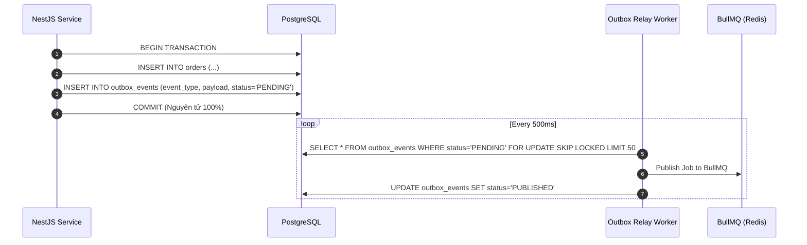

# 🎯 CHUYÊN ĐỀ 02.2: POSTGRESQL – BỘ CÂU HỎI PHỎNG VẤN SENIOR & ÁP DỤNG DỰ ÁN THỰC CHIẾN TRONG CV

> **Ứng viên**: Nguyễn Đức Quỳnh – Backend / Fullstack Engineer  
> **Mục tiêu**: Bộ câu hỏi phỏng vấn chuyên sâu kết hợp trực tiếp với các dự án trong CV: **ViShop (WMS/OMS/ERP)**, **Multimodal Document Ingestion & RAG (pgvector)**, **CRMAgent (Dynamic Schema/JSONB)**, và **MIAPET (Booking & VNPay Payment)**. Giúp ứng viên tự tin trả lời lưu loát, làm chủ kiến trúc và phản biện sắc bén trước các câu hỏi vặn của Tech Lead / Staff Engineer.

---

## PHẦN 1: DỰ ÁN VISHOP – E-COMMERCE ERP & WMS/OMS PLATFORM

### Case 1: Xử lý Race Condition & Giữ tính toàn vẹn kho hàng (WMS Inventory Ledger)
> **Trích dẫn CV**: *"Engineered a high-integrity WMS inventory ledger with PostgreSQL triggers and command handlers to maintain inventory consistency and prevent race conditions during warehouse transfers and concurrent updates."*

#### Q1: Tại sao em lại thiết kế kiến trúc Inventory Ledger (Sổ cái kho) thay vì chỉ lưu một cột `quantity` trong bảng `inventory`? Cơ chế chống Race Condition ở đây là gì?
* 💡 **Câu trả lời ăn điểm**:
  * **Hạn chế của mô hình Snapshot đơn thuần**: Nếu chỉ lưu `current_stock INT` trong bảng `products`, khi xảy ra sai lệch số lượng do lỗi phần mềm, race condition hoặc mất kết nối mạng, ta **hoàn toàn mất dấu vết kiểm toán (Audit Trail)**, không thể biết số lượng bị hao hụt ở transaction nào, đơn hàng nào.
  * **Kiến trúc Double-Entry Inventory Ledger (Sổ cái ghi kép)**:
    * Bảng `inventory_balances`: Lưu snapshot số lượng hiện tại theo `(warehouse_id, sku_id)` để phục vụ các câu query đọc nhanh từ storefront.
    * Bảng `inventory_ledger`: Lưu lịch sử biến động (Append-Only) với các trường `(id, warehouse_id, sku_id, change_qty, balance_after, reference_type, reference_id, created_at)`.
  * **Cơ chế chống Race Condition khi bán hàng / xuất kho đồng thời**:
    * Khi có 5 webhook bán hàng từ TikTok Shop/Shopee đồng thời kéo hàng từ cùng một SKU tại kho Hà Nội:
    * Áp dụng **Pessimistic Row-Level Lock**: Dùng `SELECT balance FROM inventory_balances WHERE warehouse_id = $1 AND sku_id = $2 FOR NO KEY UPDATE`.
    * Khóa này đảm bảo chỉ 1 transaction được đọc số dư và kiểm tra điều kiện `balance >= change_qty`, 4 transaction còn lại phải xếp hàng chờ một cách tuần tự.
    * Dùng `FOR NO KEY UPDATE` thay vì `FOR UPDATE` để cho phép các câu lệnh kiểm tra Foreign Key (`FOR KEY SHARE`) của các bảng khác không bị block.

```sql
-- Kịch bản trừ kho an toàn tuyệt đối
BEGIN;
-- 1. Khóa dòng số dư cần trừ
SELECT available_quantity 
FROM inventory_balances 
WHERE warehouse_id = 10 AND sku_id = 'SKU_IPHONE_16'
FOR NO KEY UPDATE;

-- 2. Kiểm tra nếu available_quantity < order_qty -> Rollback & Báo hết hàng
-- 3. Cập nhật số dư snapshot
UPDATE inventory_balances 
SET available_quantity = available_quantity - 2, 
    updated_at = NOW()
WHERE warehouse_id = 10 AND sku_id = 'SKU_IPHONE_16';

-- 4. Ghi nối đuôi vào sổ cái Ledger
INSERT INTO inventory_ledger (warehouse_id, sku_id, change_qty, reference_type, reference_id, created_at)
VALUES (10, 'SKU_IPHONE_16', -2, 'ORDER_FULFILLMENT', 'ORD_TIKTOK_9981', NOW());

COMMIT;
```

---

#### Q2: Trong thao tác Luân chuyển kho (Warehouse Transfer), làm thế nào để em ngăn chặn triệt để nguy cơ Deadlock khi hai kho chuyển hàng qua lại cho nhau?
* 💡 **Câu trả lời ăn điểm**:
  * **Nguyên nhân Deadlock**:
    * Luồng 1 (Chuyển hàng Kho A sang Kho B): Khóa kho A $\rightarrow$ Chờ khóa kho B.
    * Luồng 2 (Chuyển hàng Kho B sang Kho A): Khóa kho B $\rightarrow$ Chờ khóa kho A.
    * Hai transaction chờ chéo nhau $\rightarrow$ Deadlock (`ERROR: 40P01`).
  * **Giải pháp: Deterministic Locking Order (Sắp xếp khóa xác định)**:
    * Luôn sắp xếp danh sách tài nguyên cần khóa theo một trật tự cố định (ví dụ: `warehouse_id` tăng dần) trước khi thực hiện câu lệnh `SELECT ... FOR NO KEY UPDATE`.
    * Dù chuyển từ A sang B hay từ B sang A, hệ thống đều khóa kho có `id` nhỏ hơn trước, sau đó mới khóa kho có `id` lớn hơn. Việc này loại bỏ 100% khả năng hình thành chu trình phụ thuộc chờ đợi (Wait-For Graph cycle).

---

### Case 2: Transactional Outbox Pattern kết hợp BullMQ & PostgreSQL
> **Trích dẫn CV**: *"Implemented the Transactional Outbox Pattern with BullMQ and Redis for reliable domain event processing, along with distributed leader election to prevent duplicate scheduled jobs across multiple pods."*

#### Q3: Tại sao lại cần Transactional Outbox Pattern mà không bắn thẳng Event vào BullMQ/Redis ngay trong NestJS Service sau khi commit DB?
* 💡 **Câu trả lời ăn điểm**:
  * **Bản chất vấn đề Dual-Write**: Không thể có một Distributed Transaction hoàn hảo giữa PostgreSQL và Redis mà không dùng 2PC (Two-Phase Commit - cực kỳ chậm và phức tạp).
    * *Kịch bản 1*: Lưu DB thành công $\rightarrow$ Gặp sự cố mạng hoặc Redis crash khi bắn job $\rightarrow$ Mất Event, hệ thống phân tán bị lệch dữ liệu.
    * *Kịch bản 2*: Bắn job vào Redis trước $\rightarrow$ DB commit gặp lỗi rollback $\rightarrow$ Worker đã xử lý job dựa trên dữ liệu không hề tồn tại trong DB (Ghost Event).
  * **Giải pháp Transactional Outbox**:
    * Trong cùng một PostgreSQL Transaction: Ghi dữ liệu nghiệp vụ (ví dụ: `orders`) VÀ chèn một dòng vào bảng `outbox_events`.
    * Vì nằm trong cùng một ACID transaction của Postgres, cả hai cùng thành công hoặc cùng rollback $\rightarrow$ Tính toàn vẹn 100%.



#### Q4: Khi ứng dụng ViShop scale ra 10 Pods, làm sao để các Outbox Worker không quét trùng lặp các event và không khóa nhau?
* 💡 **Câu trả lời ăn điểm**:
  * Sử dụng kết hợp **`SELECT ... FOR UPDATE SKIP LOCKED`**:
    ```sql
    WITH ready_events AS (
        SELECT id 
        FROM outbox_events 
        WHERE status = 'PENDING'
        ORDER BY created_at ASC
        LIMIT 50
        FOR UPDATE SKIP LOCKED      -- Không bị block, pod khác sẽ tự nhảy qua các event này
    )
    UPDATE outbox_events
    SET status = 'PROCESSING', locked_by = $1, updated_at = NOW()
    WHERE id IN (SELECT id FROM ready_events)
    RETURNING id, event_type, payload;
    ```
  * *Ưu điểm*: Mỗi Pod gắp một batch 50 events hoàn toàn độc lập, không cần phân chia shard phức tạp, không bao giờ bị nghẽn lock giữa 10 pods.

---

### Case 3: Chống trùng đơn hàng TikTok Shop Webhook (Idempotency)
> **Trích dẫn CV**: *"Developed bi-directional TikTok Shop Open API integrations handling OAuth2 token lifecycles, webhook event ingestion, rate limiting, and Redis-based idempotency to prevent duplicate order processing."*

#### Q5: Nếu Redis bị restart hoặc cache eviction làm mất Idempotency key, tầng PostgreSQL của em phòng thủ như thế nào để không tạo 2 đơn hàng trùng lặp?
* 💡 **Câu trả lời ăn điểm**:
  * **Tầng phòng thủ cuối cùng (Defense-in-depth) ở Database**:
    * Tạo một **Unique Partial Index** trên bảng `orders`:
      ```sql
      CREATE UNIQUE INDEX uq_orders_channel_external_id 
      ON orders (channel, external_order_id) 
      WHERE external_order_id IS NOT NULL;
      ```
    * Khi hai webhook TikTok Shop cùng bắn một `order_id` vào đồng thời do mạng chập chờn:
    * Dùng cú pháp `INSERT ... ON CONFLICT (channel, external_order_id) DO NOTHING` hoặc bắt lỗi Unique Constraint Violation (`23505`).
    * Nếu bắt được lỗi `23505`, NestJS service sẽ âm thầm trả về mã HTTP `200 OK` cho TikTok Shop để xác nhận đã nhận webhook, ngăn TikTok Shop tiếp tục retry.

---

## PHẦN 2: DỰ ÁN MULTIMODAL RAG PLATFORM (POSTGRESQL + PGVECTOR)

### Case 4: Dense Vector Retrieval & Indexing với pgvector
> **Trích dẫn CV**: *"Integrated the core RAG retrieval & generation engine leveraging dense vector embeddings and PostgreSQL vector storage, orchestrating cosine distance similarity search, multi-tenant metadata filtering..."*

#### Q6: Trong dự án RAG của em, em lựa chọn loại Index nào cho pgvector: IVFFlat hay HNSW? So sánh ưu nhược điểm và cơ chế hoạt động của chúng?
* 💡 **Câu trả lời ăn điểm**:
  * **IVFFlat (Inverted File Flat)**:
    * *Cơ chế*: Dùng thuật toán K-Means chia không gian vector thành $K$ cụm (clusters/lists). Khi query, nó chỉ tìm trong các cụm gần nhất (`probes`).
    * *Ưu điểm*: Tốn rất ít RAM, tốc độ build index nhanh.
    * *Nhược điểm*: **Chất lượng tìm kiếm (Recall) thấp** nếu dữ liệu phân bố không đều. Bắt buộc phải có sẵn dữ liệu trước khi build index (nếu build trên bảng rỗng, K-Means sẽ vô dụng).
  * **HNSW (Hierarchical Navigable Small World - Khuyến nghị từ pgvector 0.5+)**:
    * *Cơ chế*: Dựng đồ thị đa tầng nhiều lớp (tương tự Skip List phiên bản đồ thị). Tầng trên cùng có ít node để nhảy bước dài; tầng dưới cùng chứa đầy đủ các vector để tìm kiếm cục bộ chính xác.
    * *Ưu điểm*: **Recall cực kỳ cao (> 95–99%)**, tốc độ query tìm kiếm nhanh hơn IVFFlat từ 5–10 lần, có thể build ngay cả khi bảng đang rỗng và chèn dữ liệu dần.
    * *Trade-off*: Tốn RAM hơn IVFFlat khoảng 3–5 lần, thời gian build index lâu hơn.
* 💻 **Cú pháp HNSW Cosine Distance trong dự án**:
  ```sql
  -- m = 16 (số kết nối tối đa mỗi node), ef_construction = 64 (kích thước danh sách ứng viên khi build)
  CREATE INDEX idx_document_chunks_embedding_hnsw 
  ON document_chunks 
  USING hnsw (embedding vector_cosine_ops)
  WITH (m = 16, ef_construction = 64);
  ```

---

#### Q7: Khi câu query RAG vừa cần tìm Cosine Distance (`<->`), vừa cần lọc Metadata đa người thuê (`WHERE tenant_id = '...' AND doc_type = 'SOP'`), pgvector gặp vấn đề gì và giải quyết ra sao?
* 💡 **Câu trả lời ăn điểm**:
  * **Vấn đề "Curse of Filtering" (Lọc trước vs Lọc sau)**:
    * *Post-filtering (Lọc sau)*: Index HNSW duyệt ra Top 100 vector gần nhất. Sau đó áp dụng điều kiện `WHERE tenant_id = 'tenant_A'`. Nếu tenant_A chỉ chiếm 1% dữ liệu của toàn bảng, sau khi lọc có thể **trả về 0 kết quả** mặc dù trong DB có tài liệu phù hợp!
    * *Pre-filtering (Lọc trước)*: Dùng B-Tree lọc ra các dòng của `tenant_A`, nhưng sau đó không dùng được index HNSW nữa mà phải quét vector brute-force (Seq Scan)!
  * **Giải pháp trong pgvector 0.5+ (Iterative Index Scan)**:
    * pgvector hỗ trợ quét đồ thị HNSW lặp lại (Iterative scanning): Nó tiếp tục mở rộng duyệt qua các node trên đồ thị HNSW cho đến khi gom đủ số lượng vector thỏa mãn điều kiện `WHERE` metadata.
  * **Chiến lược tối ưu thiết kế Database**:
    * **Phân vùng bảng (Table Partitioning)** theo `tenant_id` hoặc `workspace_id`.
    * Mỗi partition sẽ sở hữu một cây HNSW riêng biệt. Khi query, Postgres thực hiện **Partition Pruning** chỉ quét trúng partition của tenant đó $\rightarrow$ Vừa bảo mật dữ liệu, vừa tối đa tốc độ truy vấn vector.

---

## PHẦN 3: DỰ ÁN CRMAGENT – OMNICHANNEL ENTERPRISE CRM

### Case 5: Dynamic Schema với JSONB & GIN Indexing
> **Trích dẫn CV**: *"Developed a dynamic schema and metadata engine supporting custom objects and fields without database schema changes... optimized PostgreSQL queries for high-volume CRM and messaging workloads."*

#### Q8: Khi thiết kế Custom Fields động cho hàng nghìn doanh nghiệp B2B, tại sao em chọn JSONB thay vì mô hình EAV (Entity-Attribute-Value)? Đánh index gì để tìm kiếm các trường này siêu tốc?
* 💡 **Câu trả lời ăn điểm**:
  * **Hạn chế của mô hình EAV**:
    * Bảng gồm `(entity_id, attribute_key, value_string, value_int, ...)`.
    * Mỗi lần muốn hiển thị một trang danh bạ khách hàng gồm 10 custom fields, câu query phải thực hiện **10 phép JOIN** vào chính bảng EAV $\rightarrow$ Làm tê liệt CPU và RAM của database khi dữ liệu lớn.
  * **Sức mạnh của `JSONB` trong PostgreSQL**:
    * Lưu trữ dưới dạng nhị phân đã phân tích cú pháp (parsed binary format), cho phép truy cập trực tiếp vào các key mà không cần parse lại string.
  * **Chiến lược Indexing với GIN**:
    * `jsonb_ops` *(Mặc định)*: Đánh index cho mọi key và value. Kích thước index rất lớn.
    * `jsonb_path_ops` *(Tối ưu)*: Chỉ băm kết hợp `path -> value` (ví dụ `{"vip_status": "gold"}`). Kích thước index nhỏ hơn một nửa và tốc độ truy vấn chứa toán tử `@>` nhanh hơn đáng kể:
      ```sql
      CREATE INDEX idx_contacts_custom_fields_gin 
      ON crm_contacts 
      USING gin (custom_fields jsonb_path_ops);

      -- Truy vấn tận dụng triệt để GIN Index:
      SELECT * FROM crm_contacts 
      WHERE tenant_id = 't_123' 
        AND custom_fields @> '{"lead_source": "Facebook", "deal_stage": "WON"}';
      ```

---

#### Q9: Trong dự án CRMAgent, GraphQL DataLoader giúp giải quyết bài toán N+1 Query như thế nào? Ở tầng PostgreSQL, Query Planner xử lý câu lệnh batched này ra sao?
* 💡 **Câu trả lời ăn điểm**:
  * **Bản chất N+1 trong GraphQL**:
    * Khi fetch 50 `contacts`, mỗi contact có field `assigned_user`: GraphQL Resolver mặc định sẽ bắn 1 câu query lấy danh sách contacts + 50 câu query `SELECT * FROM users WHERE id = ...` riêng lẻ $\rightarrow$ 51 round-trips mạng xuống DB.
  * **DataLoader Batching**:
    * DataLoader thu thập tất cả các `user_id` trong cùng 1 tick của Node.js Event Loop, khử trùng lặp và biến 50 câu query thành đúng **1 câu query duy nhất**:
      ```sql
      SELECT * FROM users WHERE id IN ($1, $2, $3, ..., $50);
      ```
  * **Cách PostgreSQL Query Planner tối ưu**:
    * Thay vì 50 lần mở connection và parse plan, Postgres chỉ parse 1 lần.
    * Planner dùng **Index Scan** hoặc **Bitmap Index Scan** tra cứu một loạt khóa trong B-Tree leaf pages, gộp các block cần đọc lại để fetch một lần từ Buffer Pool $\rightarrow$ Giảm tải CPU database hơn 90%.

---

## PHẦN 4: DỰ ÁN MIAPET & JIHO – BOOKING PLATFORM & VNPAY PAYMENT

### Case 6: Chống Đặt Trùng Lịch (Double Booking Concurrency)
> **Trích dẫn CV**: *"The platform supports service booking, online payments, reviews... Integrated VNPay payment services, including payment processing, IPN webhooks, refunds..."*

#### Q10: Nếu hai khách hàng cùng ấn nút Đặt lịch khám thú y tại cùng một phòng khám và cùng một khung giờ, em ngăn chặn đặt trùng (Double Booking) như thế nào?
* 💡 **Câu trả lời ăn điểm**:
  * **Cách làm ngây thơ (Sai lầm phổ biến)**:
    * Chạy câu `SELECT * WHERE clinic_id = 1 AND booking_time = '...'`. Nếu không có thì `INSERT`.
    * Hai request chạy song song cùng lúc sẽ cùng thấy "trống lịch" và cùng `INSERT` thành công $\rightarrow$ Xảy ra Race Condition!
  * **Giải pháp chuẩn Enterprise: Exclusion Constraint với Kiểu Range & GiST Index**:
    * Sử dụng kiểu dữ liệu `tstzrange` (Timestamp with timezone range) biểu diễn khoảng thời gian từ `start_time` đến `end_time`.
    * Đặt **Exclusion Constraint** sử dụng toán tử giao nhau (`&&`):
      ```sql
      CREATE EXTENSION IF NOT EXISTS btree_gist;

      ALTER TABLE clinic_appointments 
      ADD CONSTRAINT no_overlapping_appointments 
      EXCLUDE USING gist (
          clinic_room_id WITH =,
          appointment_range WITH &&
      );
      ```
  * *Lợi ích*: PostgreSQL đảm bảo ở tầng vật lý: **Không bao giờ có 2 cuộc hẹn của cùng 1 phòng khám có dải thời gian giao nhau (`&&`)**. Nếu xung đột, transaction thứ 2 sẽ bị DB từ chối ngay lập tức mà không phụ thuộc vào tầng application code!

---

#### Q11: Khi nhận Webhook IPN từ VNPay để cập nhật trạng thái thanh toán đơn hàng, làm sao để em đảm bảo tính Idempotency và tránh cập nhật sai lệch trạng thái đơn?
* 💡 **Câu trả lời ăn điểm**:
  * **Vấn đề**: VNPay có cơ chế retry IPN nếu timeout. Hai request IPN cho cùng một đơn có thể đến cùng lúc. Hoặc khách hàng đang bấm hủy đơn trên Web trong khi webhook thanh toán thành công vừa chạm tới server.
  * **State Machine & Row-level Lock**:
    * Không bao giờ cập nhật trạng thái đơn một cách mù quáng (`UPDATE orders SET status = 'PAID'`).
    * Bọc trong transaction và kiểm tra luồng chuyển dịch trạng thái hợp lệ (**State Machine Invariant**):
      ```sql
      BEGIN;
      -- 1. Khóa đơn hàng cần thanh toán
      SELECT id, status, total_amount 
      FROM orders 
      WHERE id = $1 AND status = 'PENDING'
      FOR UPDATE;

      -- Nếu rows trả về rỗng -> Đơn đã được xử lý trước đó hoặc đã bị hủy -> Trả về IPN Success ngay lập tức (Idempotent).

      -- 2. Cập nhật trạng thái
      UPDATE orders 
      SET status = 'PAID', vnpay_transaction_no = $2, updated_at = NOW() 
      WHERE id = $1;

      -- 3. Ghi log lịch sử thanh toán
      INSERT INTO payment_transactions (order_id, amount, status, gateway_response)
      VALUES ($1, $3, 'SUCCESS', $4);

      COMMIT;
      ```

---

## PHẦN 5: BỘ CÂU HỎI VẶN CỦA TECH LEAD KHI SOI KỸ CV CỦA QUỲNH

### 1. Hỏi: *“Em ghi trong CV là dùng PostgreSQL Triggers & Command Handlers duy trì inventory consistency trong ViShop WMS. Tại sao em lại đẩy logic vào DB Trigger thay vì viết 100% bằng TypeScript trong NestJS Service?”*
* **Đáp chuẩn**:
  * *"Em sử dụng Database Trigger như một **chốt chặn an toàn lớp thứ hai (Defense-in-depth)** chứ không lạm dụng để viết toàn bộ business logic phức tạp:
    1. **Tầng Application (Command Handlers trong NestJS)**: Chịu trách nhiệm validate nghiệp vụ, tính toán phân bổ kho, kiểm tra quyền RBAC và ghi nhận domain event.
    2. **Tầng Database Trigger**: Đảm bảo rằng dù có bất kỳ lệnh nào can thiệp vào bảng `inventory_balances` (kể cả data migration thủ công, script của DevOps, hay bug bỏ sót lock ở tầng app), Trigger sẽ tự động kiểm tra điều kiện bất biến: `available_quantity` không bao giờ được phép âm, và mọi thay đổi đều phải tự động sinh ra bản ghi kiểm toán trong `inventory_ledger`. Điều này bảo vệ an toàn tuyệt đối cho tài sản kho hàng của khách hàng.”*

---

### 2. Hỏi: *“Trong ViShop, em enforce Multi-tenant Data Isolation tại ORM layer bằng Prisma Client Extensions. Vậy em đánh Index trên PostgreSQL như thế nào để đảm bảo performance không bị suy giảm khi có hàng nghìn shop?”*
* **Đáp chuẩn**:
  * *"Khi dùng Prisma Client Extensions, mọi câu lệnh CRUD đều được tự động inject thêm điều kiện `tenant_id = currentTenantId` vào mệnh đề `WHERE`.
  * Do đó, ở tầng PostgreSQL, em áp dụng quy tắc vàng: **Mọi bảng nghiệp vụ dùng chung đều phải đánh Composite Index có `tenant_id` đứng ở vị trí đầu tiên** (theo quy tắc Leftmost Prefix), ví dụ: `(tenant_id, status, created_at)` hoặc `(tenant_id, id)`.
  * Việc này đảm bảo Query Planner luôn luôn nhảy trực tiếp vào phân vùng dữ liệu của riêng tenant đó trong cây B-Tree, cô lập hoàn toàn chi phí tìm kiếm giữa các shop, ngăn chặn triệt để tình trạng một shop có triệu đơn hàng làm chậm các shop nhỏ còn lại.”*

---

### 3. Hỏi: *“Khi làm việc với Testcontainers cho PostgreSQL trong Vitest, em xử lý bài toán chạy migration và reset database giữa các test case như thế nào để test chạy nhanh mà không bị rò rỉ dữ liệu giữa các bài test?”*
* **Đáp chuẩn**:
  * *"Nếu mỗi test case đều khởi tạo lại container hoặc chạy lại toàn bộ migration Prisma từ đầu, test suite sẽ mất hàng phút.
  * Chiến lược em áp dụng:
    1. Khởi tạo **1 container PostgreSQL dùng chung** trong suốt quá trình chạy test suite (`beforeAll`).
    2. Chạy Prisma Migration đúng 1 lần duy nhất khi container khởi động.
    3. Giữa mỗi test case (`afterEach`), thay vì drop database, em sử dụng script thực hiện **`TRUNCATE TABLE ... RESTART IDENTITY CASCADE`** cho các bảng nghiệp vụ, hoặc bọc mỗi test case bên trong một **Database Transaction và tự động `ROLLBACK`** khi test kết thúc. Việc này giúp hàng trăm integration test hoàn tất chỉ trong vài giây.”*
