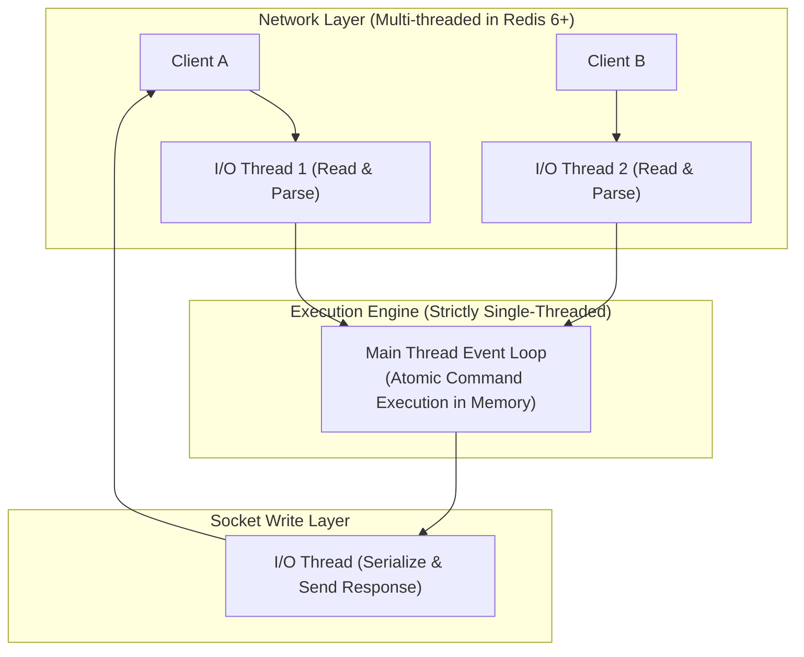

# ⚡ CHUYÊN ĐỀ 03: REDIS ARCHITECTURE & PRODUCTION GUIDE

---

## 1. Bản chất cốt lõi & Cơ chế hoạt động (Redis Internals)

### 1.1. I/O Multiplexing & Mô hình luồng
* **Core Execution**: Tiến trình xử lý command của Redis là **Single-Threaded**. Nó sử dụng cơ chế **I/O Multiplexing** (như `epoll` trên Linux hoặc `kqueue` trên BSD) để giám sát hàng chục nghìn kết nối socket đồng thời mà không bị nghẽn.
* **Threaded I/O (Từ Redis 6.0+)**: Redis bổ sung đa luồng chỉ riêng cho việc **đọc/ghi dữ liệu từ socket mạng** và parse giao thức RESP. Việc thực thi logic command và truy cập dữ liệu trong RAM vẫn hoàn toàn là **đơn luồng (Single-Threaded)** để bảo toàn tính Atomic tuyệt đối mà không cần Mutex khóa dữ liệu.



---

## 2. Bảng cấu trúc dữ liệu & Ứng dụng thực tế

| Cấu trúc dữ liệu | Độ phức tạp | Ứng dụng thực tế chuẩn mực trong Enterprise |
| :--- | :---: | :--- |
| **String** | $O(1)$ | Caching JSON, Session Store, Distributed Lock, Bộ đếm atomic (`INCRBY`). |
| **Hash** | $O(1)$ field | Lưu trữ Object (User profile, Giỏ hàng E-commerce), tiết kiệm RAM hơn String JSON nhờ mã hóa ZipList/ListPack. |
| **List** | $O(1)$ push/pop | Hàng đợi tin nhắn đơn giản FIFO/LIFO (`LPUSH`, `RPOP`), Timeline bài đăng gần nhất. |
| **Set** | $O(1)$ add/check | Lưu các giá trị duy nhất: Danh sách bạn chung (`SINTER`), Tags của bài viết, Blacklist IP. |
| **Sorted Set (ZSet)** | $O(\log N)$ | **Bảng xếp hạng (Leaderboard)**, **Sliding Window Rate Limiter**, Queue tác vụ theo độ ưu tiên/thời gian (`ZREMRANGEBYSCORE`). |
| **Stream** | $O(1)$ append | Event Sourcing, Message Broker hỗ trợ Consumer Groups và Ack (tương tự Apache Kafka rút gọn). |
| **Bitmap / HyperLogLog** | $O(1)$ | Điểm danh user hàng tháng (Bitmap tốn vài KB), Đếm số lượng User truy cập duy nhất (DAU/MAU) hàng trăm triệu user với sai số ~0.81% chỉ tốn 12KB RAM (HyperLogLog). |

---

## 3. Các mẫu Caching & Xử lý sự cố kinh điển (Failure Modes)

### 3.1. Các sự cố Caching lớn & Giải pháp xử lý

```mermaid
flowchart LR
    subgraph "1. Cache Penetration"
        P_Req["Request Key KHÔNG tồn tại"] -->|Miss Cache| P_Redis["Redis"]
        P_Redis -->|Đâm thủng xuống DB| P_DB[("Database")]
    end
    
    subgraph "2. Cache Stampede (Breakdown)"
        S_Req["10,000 Request đồng thời"] -->|Hot Key vừa hết hạn (TTL=0)| S_Redis["Redis"]
        S_Redis -->|10,000 queries đập vào DB| S_DB[("Database Sập")]
    end
    
    subgraph "3. Cache Avalanche"
        A_Req["Toàn bộ Keys"] -->|Hàng triệu keys cùng hết hạn 1 thời điểm| A_Redis["Redis Rỗng"]
        A_Redis -->|Sập toàn bộ hệ thống| A_DB[("Database Overload")]
    end
```

#### Chi tiết giải pháp:
1. **Cache Penetration (Đâm thủng Cache)**:
   * *Hiện tượng*: Kẻ xấu spam request với các ID ngẫu nhiên không hề có trong hệ thống (ví dụ: `id = -9999`). Cả Redis lẫn DB đều không có, khiến mọi query rơi thẳng xuống DB.
   * *Giải pháp*:
     * **Cache Null Object**: Nếu DB không tìm thấy, vẫn lưu vào Redis với giá trị `null` và TTL ngắn (30s - 60s).
     * **Bloom Filter**: Đặt Bloom Filter phía trước Redis để lọc ngay các ID chắc chắn không tồn tại.
2. **Cache Stampede / Breakdown (Vỡ đập Caching)**:
   * *Hiện tượng*: Một key cực hot (ví dụ: Flash Sale iPhone) vừa hết hạn, hàng chục nghìn request ập đến cùng lúc thấy cache rỗng nên cùng chọc xuống DB để tính toán lại.
   * *Giải pháp*:
     * **Mutex / Distributed Lock**: Chỉ cho phép 1 request đầu tiên được lock để query DB và cập nhật lại Redis. Các request khác chờ 50ms rồi đọc lại cache.
     * **Probabilistic Early Expiration (Thuật toán XFetch)**: Dự đoán key sắp hết hạn và tự động làm mới ngầm ở background trước khi TTL về 0.
3. **Cache Avalanche (Tuyết lở Caching)**:
   * *Hiện tượng*: Hàng loạt key được set cache cùng một lúc với cùng một TTL (ví dụ đúng 2 giờ sáng hết hạn đồng loạt).
   * *Giải pháp*: **Thêm Random Jitter vào TTL**:
     ```typescript
     const ttlSeconds = baseTTL + Math.floor(Math.random() * 300); // lệch 0 - 5 phút
     ```

---

## 4. Distributed Lock chuẩn mực với Redis

### 4.1. Lệnh Atomic Lock
Tuyệt đối không dùng `SETNX` kết hợp `EXPIRE` riêng rẽ vì không đảm bảo atomic nếu app crash ở giữa. Bắt buộc dùng cú pháp tích hợp:
```bash
SET lock:order:100 "unique_token_uuid" NX PX 30000
```
* `NX`: Chỉ tạo key nếu key chưa tồn tại.
* `PX 30000`: Tự động giải phóng sau 30,000 ms (tránh deadlock nếu node giữ lock bị chết).

### 4.2. Giải phóng Lock an toàn bằng Lua Script
Nếu transaction chạy lâu hơn 30 giây, một worker khác có thể đã cướp được lock. Worker cũ hoàn tất không được phép xóa nhầm lock của worker mới. Do đó, phải kiểm tra token trước khi xóa:

```lua
-- unlock.lua
if redis.call("get", KEYS[1]) == ARGV[1] then
    return redis.call("del", KEYS[1])
else
    return 0
end
```

### 4.3. Cơ chế gia hạn tự động (Watchdog / Lease Renewal)
Nếu công việc chưa xong, một background timer phải định kỳ gia hạn TTL (ví dụ: sau mỗi 10 giây gia hạn thêm 30 giây).

---

## 5. Chính sách bộ nhớ (Eviction) & Big Keys Alert

### 5.1. Bảng Eviction Policies (`maxmemory-policy`)
* `volatile-lru` / `volatile-lfu`: Xóa các key ít được dùng nhất trong số các key **có cài TTL**.
* `allkeys-lru` / `allkeys-lfu`: Xóa các key ít được dùng nhất trên **toàn bộ dữ liệu** (Thích hợp nhất khi dùng Redis thuần làm Cache).
* `noeviction`: Báo lỗi `OOM command not allowed` khi bộ nhớ chạm ngưỡng `maxmemory` (Bắt buộc dùng khi Redis lưu Token/Queue).

### 5.2. Hiểm họa từ Big Keys & Lệnh Chặn
* **Lệnh cấm kỵ**: `KEYS *`, `FLUSHALL` đồng bộ, `HGETALL` trên hash có 500,000 phần tử.
* **Giải pháp xóa Big Key**: Dùng lệnh bất đồng bộ `UNLINK` thay vì `DEL`. `UNLINK` sẽ giải phóng key khỏi keyspace ngay lập tức và thu hồi bộ nhớ ngầm ở background thread.
* **Lệnh quét an toàn**:
  ```bash
  # Tìm key an toàn theo batch:
  SCAN 0 MATCH user:* COUNT 100
  # Phân tích Big Keys:
  redis-cli --bigkeys
  ```

---

## 6. Tính bền vững: RDB vs AOF

| Tiêu chí | RDB (Snapshot) | AOF (Append-Only File) |
| :--- | :--- | :--- |
| **Cơ chế** | Tạo bản snapshot toàn bộ dữ liệu ra file dump nhị phân định kỳ (vd: mỗi 15 phút). | Ghi log tuần tự từng lệnh thay đổi dữ liệu vào file log. |
| **Tốc độ phục hồi** | Cực nhanh (chỉ cần load file dump vào RAM). | Chậm hơn (phải replay lại từng câu lệnh trong file log). |
| **Nguy cơ mất dữ liệu** | Có thể mất dữ liệu trong khoảng thời gian giữa 2 lần snapshot (5 - 15 phút). | Tối thiểu (mất tối đa 1 giây dữ liệu nếu dùng `appendfsync everysec`). |
| **Khuyến nghị Enterprise** | **Bật cả hai đồng thời**: AOF để bảo toàn dữ liệu, RDB để khôi phục nhanh hoặc làm bản backup định kỳ. |

---

## 7. Bộ câu hỏi phỏng vấn chuyên sâu (Senior / Staff Level)

1. **Hỏi**: *“Thuật toán Redlock của Salvatore Sanfilippo hoạt động ra sao và Martin Kleppmann đã chỉ ra lỗ hổng gì của nó?”*
   * **Đáp chuẩn**: Redlock dùng $N$ node Redis độc lập (thường là 5 nodes), client acquire lock thành công nếu lấy được trên đa số node ($N/2 + 1$) trong khoảng thời gian nhỏ hơn lock validity time. Martin Kleppmann chỉ ra rằng Redlock không an toàn trong các hệ thống đòi hỏi tính đúng đắn tuyệt đối vì: (1) Hiện tượng trôi đồng hồ hệ thống (NTP clock drift) làm một node hết hạn lock sớm hơn các node khác; (2) Tiến trình bị tạm dừng (GC Pause dài hoặc VM migration) khiến client tưởng mình còn lock trong khi lock đã bị cấp cho người khác. Khắc phục bằng cách dùng Fencing Token (số thứ tự đơn điệu tăng dần) để kiểm tra tại tầng Database.
2. **Hỏi**: *“Làm sao để hiện thực một Sliding Window Rate Limiter 100 requests/phút trên Redis cho một User ID?”*
   * **Đáp chuẩn**: Dùng **Sorted Set (ZSet)**: Key là `rate:user_id`. Khi request đến:
     1. Xóa các record cũ hơn 1 phút trước: `ZREMRANGEBYSCORE key 0 (now - 60000)`.
     2. Đếm số lượng record còn lại: `ZCARD key`.
     3. Nếu count $\ge 100 \rightarrow$ Từ chối request (HTTP 429).
     4. Nếu count $< 100 \rightarrow$ Thêm timestamp hiện tại vào: `ZADD key now now` và đặt TTL 60s cho key.
     * Toàn bộ các bước trên được bọc trong một **Redis Transaction (`MULTI/EXEC`)** hoặc một **Lua Script** để đảm bảo atomic.
