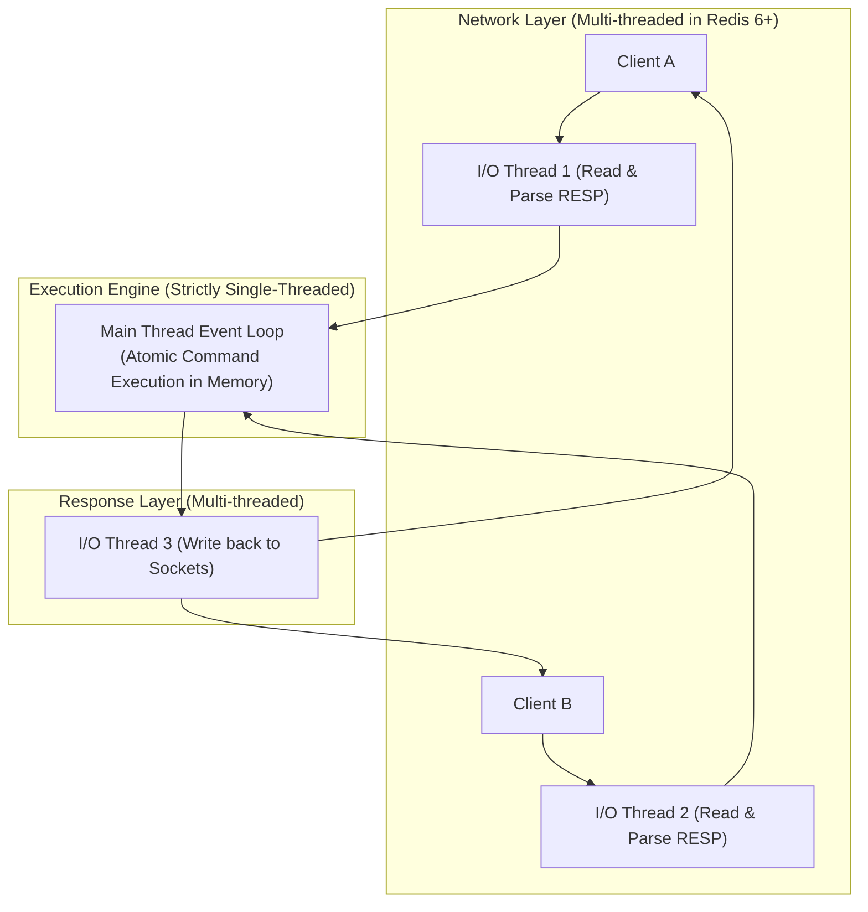

# 📗 CHUYÊN ĐỀ 03.1: REDIS ARCHITECTURE – LÝ THUYẾT & KIẾN TRÚC LÕI

> **Mục tiêu**: Nắm vững bản chất kiến trúc in-memory của Redis, mô hình I/O Multiplexing, Threaded I/O từ Redis 6+, cấu trúc dữ liệu nội tại, các chiến lược phân vùng bộ nhớ và tính bền vững của dữ liệu.

---

## 1. Bản chất cốt lõi & Cơ chế hoạt động (Redis Internals)

### 1.1. I/O Multiplexing & Mô hình Threading
* **Cơ chế thực thi đơn luồng (Strictly Single-Threaded Execution)**: Mọi thao tác truy xuất dữ liệu trong RAM và chạy command của Redis diễn ra trên **một Main Thread duy nhất**. Điều này đảm bảo tính **Atomic tuyệt đối** cho các lệnh mà không cần cơ chế khóa dữ liệu (Locks/Mutexes), loại bỏ hoàn toàn chi phí Context Switching của CPU.
* **I/O Multiplexing (epoll / kqueue)**: Main Thread sử dụng lời gọi hệ thống của Kernel OS để lắng nghe đồng thời hàng chục nghìn kết nối Socket TCP. Khi một socket có dữ liệu sẵn sàng để đọc/ghi, Kernel thông báo cho Redis Event Loop xử lý.
* **Threaded I/O (Từ Redis 6.0+)**:
  * Đa luồng (I/O Threads) **chỉ được sử dụng để đọc dữ liệu từ Socket, parse giao thức RESP và serialize kết quả trả về socket**.
  * Quá trình thực thi command vẫn chuyển về **Main Thread** duy nhất.



---

## 2. Các Cấu trúc Dữ liệu Lõi & Hiện thực Tầng thấp

| Cấu trúc dữ liệu | Cấu trúc bên dưới | Độ phức tạp | Trường hợp ứng dụng chuẩn Enterprise |
| :--- | :--- | :---: | :--- |
| **String** | SDS (Simple Dynamic String) | $O(1)$ | Caching JSON, Session Token, Distributed Lock, Atomic Counter (`INCRBY`). |
| **Hash** | Listpack / Dict (Hash Table) | $O(1)$ | Đối tượng nhiều trường (User Profile, Giỏ hàng). Tiết kiệm RAM hơn String JSON. |
| **List** | Quicklist (Linked list của các Listpack) | $O(1)$ push/pop | Hàng đợi FIFO/LIFO đơn giản (`LPUSH`, `RPOP`), Timeline hoạt động gần nhất. |
| **Set** | Intset / Dict | $O(1)$ | Dữ liệu duy nhất không trùng: Tag bài viết, Blacklist IP, Phép giao tập hợp (`SINTER`). |
| **Sorted Set (ZSet)** | Skiplist + Dict | $O(\log N)$ | **Bảng xếp hạng (Leaderboard)**, **Sliding Window Rate Limiter**, Queue trễ theo thời gian (`ZREMRANGEBYSCORE`). |
| **Stream** | Radix Tree | $O(1)$ append | Event Sourcing, Message Broker hỗ trợ Consumer Groups, Ack, và Pending Entries List (PEL). |
| **Bitmap / HyperLogLog** | Bit array / Probabilistic register | $O(1)$ | Điểm danh user hàng tháng (Bitmap), Đếm Unique Visitors (DAU/MAU) hàng trăm triệu user với sai số ~0.81% chỉ tốn 12KB RAM (HyperLogLog). |

---

## 3. Các sự cố Caching kinh điển (Failure Modes) & Giải pháp

```mermaid
flowchart LR
    subgraph "1. Cache Penetration"
        P_Req["Request ID = -9999 (Rác)"] -->|Miss| P_Redis["Redis"]
        P_Redis -->|Đâm thủng xuống DB| P_DB[("Database Overload")]
    end
    
    subgraph "2. Cache Stampede (Breakdown)"
        S_Req["10,000 Request đồng thời"] -->|Hot Key vừa hết hạn (TTL=0)| S_Redis["Redis"]
        S_Redis -->|10,000 queries đập vào DB| S_DB[("Database Sập")]
    end
    
    subgraph "3. Cache Avalanche"
        A_Req["Toàn bộ Keys"] -->|Hàng triệu keys cùng hết hạn 1 thời điểm| A_Redis["Redis Rỗng"]
        A_Redis -->|Sập toàn bộ hệ thống| A_DB[("Database Overload")]
    end
```

1. **Cache Penetration (Đâm thủng Cache)**:
   * *Hiện tượng*: Query liên tục với các ID không tồn tại trong hệ thống. Cả Redis và DB đều không có, khiến mọi request rơi thẳng vào DB.
   * *Giải pháp*:
     * **Cache Null Object**: Nếu DB không tìm thấy, ghi vào Redis `value: null` với TTL ngắn (30s – 60s).
     * **Bloom Filter**: Đặt Bloom Filter phía trước Redis để kiểm tra chắc chắn key có tồn tại hay không trước khi chạm vào cache.
2. **Cache Stampede / Breakdown (Vỡ đập Cache)**:
   * *Hiện tượng*: Một Hot Key (ví dụ: Sản phẩm Flash Sale) vừa hết hạn, hàng chục nghìn request ập vào cùng lúc thấy cache rỗng và cùng chọc xuống DB tính toán lại.
   * *Giải pháp*:
     * **Mutex / Distributed Lock**: Chỉ cho phép 1 request đầu tiên lấy lock để query DB và cập nhật lại Redis. Các request khác chờ 50ms rồi đọc lại cache.
     * **XFetch Algorithm**: Làm mới ngầm ở background trước khi key hết hạn thật sự dựa trên xác suất truy cập.
3. **Cache Avalanche (Tuyết lở Caching)**:
   * *Hiện tượng*: Hàng triệu keys được set cache cùng thời điểm với cùng một giá trị TTL, dẫn đến việc cùng hết hạn đồng loạt.
   * *Giải pháp*: Thêm **Random Jitter** vào TTL (ví dụ: `TTL = 3600 + Math.random() * 300`).

---

## 4. Distributed Lock chuẩn mực với Redis

### 4.1. Cú pháp Atomic Lock
Tuyệt đối không dùng `SETNX` kết hợp `EXPIRE` riêng rẽ vì không atomic nếu server bị crash ở giữa:
```bash
SET lock:order:100 "random_token_uuid" NX PX 30000
```
* `NX`: Chỉ tạo nếu key chưa tồn tại.
* `PX 30000`: Tự động giải phóng sau 30,000 ms.

### 4.2. Giải phóng Lock an toàn bằng Lua Script
Tránh trường hợp transaction chạy quá hạn TTL, worker khác đã lấy lock mới, worker cũ chạy xong không được phép xóa nhầm lock của worker mới:
```lua
-- unlock.lua
if redis.call("get", KEYS[1]) == ARGV[1] then
    return redis.call("del", KEYS[1])
else
    return 0
end
```

---

## 5. Chính sách bộ nhớ (Eviction) & Big Keys Alert

### 5.1. Bảng Eviction Policies (`maxmemory-policy`)
* `volatile-lru` / `volatile-lfu`: Xóa các key ít được dùng nhất trong số các key **có cài TTL**.
* `allkeys-lru` / `allkeys-lfu`: Xóa các key ít được dùng nhất trên **toàn bộ dữ liệu** (Tối ưu nhất khi Redis thuần túy làm Cache).
* `noeviction`: Báo lỗi `OOM command not allowed` khi chạm ngưỡng `maxmemory` (Bắt buộc dùng khi Redis lưu Token hoặc Message Queue để tránh mất dữ liệu).

### 5.2. Hiểm họa Big Keys & Lệnh Chặn
* **Lệnh cấm kỵ**: `KEYS *`, `FLUSHALL` đồng bộ, `HGETALL` trên hash có hàng trăm nghìn fields làm block Main Thread trong vài giây.
* **Giải pháp xóa Big Key**: Dùng **`UNLINK`** thay vì `DEL`. `UNLINK` tách key ra khỏi namespace ngay lập tức và thu hồi bộ nhớ ngầm ở background thread.
* **Quét key an toàn**: Dùng `SCAN 0 MATCH prefix:* COUNT 100`.

---

## 6. Tính bền vững: RDB vs AOF

| Tiêu chí | RDB (Snapshot) | AOF (Append-Only File) |
| :--- | :--- | :--- |
| **Cơ chế** | Tạo snapshot toàn bộ dữ liệu ra file nhị phân định kỳ (vd: mỗi 15 phút). | Ghi log tuần tự từng command thay đổi dữ liệu vào file log. |
| **Tốc độ phục hồi** | Cực nhanh (chỉ cần nạp file dump vào RAM). | Chậm hơn (phải replay lại các câu lệnh trong file log). |
| **Nguy cơ mất dữ liệu** | Có thể mất dữ liệu trong khoảng giữa 2 lần snapshot (5 – 15 phút). | Tối thiểu (mất tối đa 1 giây nếu dùng `appendfsync everysec`). |
| **Khuyến nghị Enterprise** | **Bật cả hai đồng thời**: AOF để bảo toàn dữ liệu, RDB để khôi phục nhanh hoặc làm backup định kỳ. |
