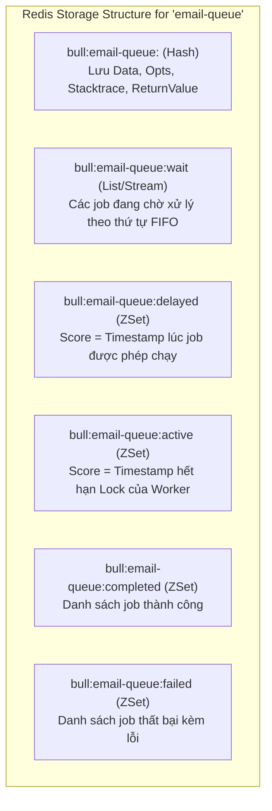
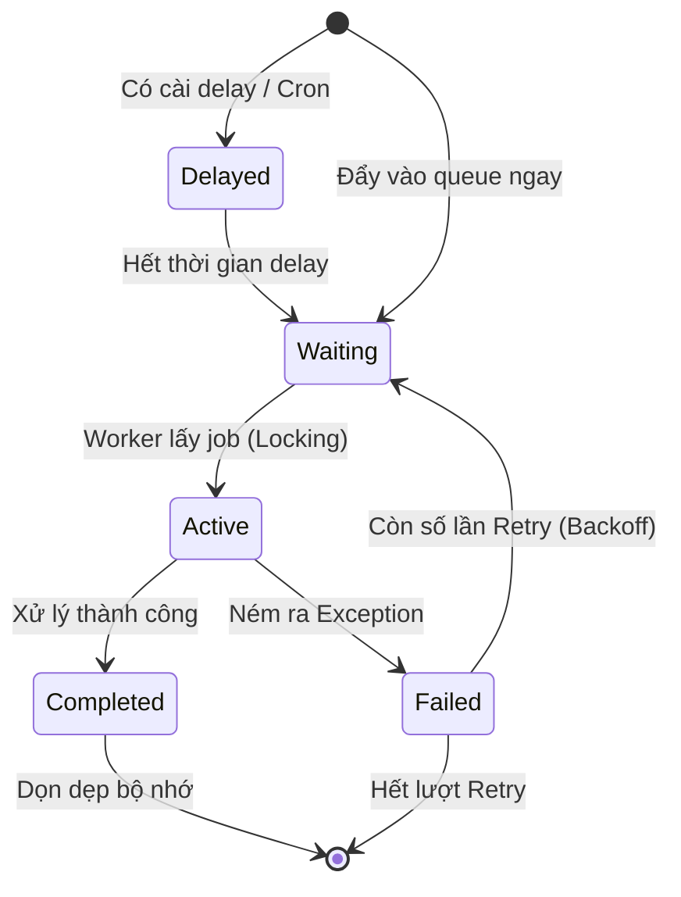

# 📋 CHUYÊN ĐỀ 04: BULLMQ ARCHITECTURE & PRODUCTION GUIDE

---

## 1. Bản chất cốt lõi & Cơ chế hoạt động (BullMQ Internals)

### 1.1. BullMQ là gì và tại sao nên dùng?
BullMQ là thư viện quản lý hàng đợi tác vụ (Job/Message Queue) phân tán cho Node.js, được xây dựng hoàn toàn trên nền tảng **Redis Streams** và **Lua Scripts**. Khác với việc tự viết queue bằng Redis `LPUSH/RPOP` (dễ mất message khi worker crash), BullMQ đảm bảo:
* **Tính nguyên tử (Atomicity)**: Mọi chuyển đổi trạng thái job đều được thực thi bằng Lua script trên Redis.
* **Độ tin cậy (At-Least-Once Delivery)**: Job đang xử lý dở mà worker bị chết sẽ được tự động phát hiện và phục hồi.
* **Tính năng phong phú**: Delay jobs, Repeatable (Cron) jobs, Parent-child job pipelines, Rate-limiting, Priority queue.

### 1.2. Cấu trúc dữ liệu Redis ngầm mà BullMQ sử dụng
Mỗi một Queue (ví dụ: `email-queue`) trong Redis được biểu diễn qua nhiều cấu trúc liên kết:



### 1.3. Vòng đời của một Job (Job Lifecycle)



---

## 2. Các mẫu triển khai chuẩn (Production Patterns)

### 2.1. Cấu hình Worker & Job Options chuẩn mực
```typescript
import { Queue, Worker, Job } from 'bullmq';
import IORedis from 'ioredis';

const redisConnection = new IORedis({
  host: process.env.REDIS_HOST,
  port: Number(process.env.REDIS_PORT),
  maxRetriesPerRequest: null, // BẮT BUỘC với BullMQ để tránh đứt connection
});

// 1. Khởi tạo Queue với tùy chọn tự động dọn dẹp
export const orderQueue = new Queue('order-processing', {
  connection: redisConnection,
  defaultJobOptions: {
    attempts: 5, // Tối đa 5 lần retry
    backoff: {
      type: 'exponential',
      delay: 2000, // Thử lại sau 2s, 4s, 8s, 16s...
    },
    removeOnComplete: {
      age: 3600 * 24, // Giữ tối đa 24 giờ
      count: 1000,    // Giữ tối đa 1000 jobs gần nhất
    },
    removeOnFail: {
      age: 3600 * 24 * 7, // Giữ 7 ngày để điều tra lỗi
      count: 5000,
    },
  },
});

// 2. Khởi tạo Worker với xử lý lỗi
export const orderWorker = new Worker(
  'order-processing',
  async (job: Job) => {
    console.log(`Processing job ${job.id} with payload:`, job.data);
    await processOrder(job.data);
    return { status: 'SUCCESS' };
  },
  {
    connection: redisConnection,
    concurrency: 10, // Xử lý song song 10 jobs trên 1 worker process
    lockDuration: 30000, // Khóa job trong 30 giây
    lockRenewTime: 15000, // Tự động gia hạn lock sau mỗi 15 giây
  }
);

orderWorker.on('failed', (job, err) => {
  console.error(`Job ${job?.id} failed with error: ${err.message}`);
});
```

### 2.2. Sandboxed Process Worker (Tránh sập Main Thread)
Khi xử lý các job nặng về CPU (như parse PDF, render video, xử lý ảnh), chạy trực tiếp trên worker thông thường có thể làm nghẽn Event Loop. BullMQ hỗ trợ chạy worker trong tiến trình con (Child Process) riêng biệt:

```typescript
// main-app.ts
import { Worker } from 'bullmq';
import path from 'path';

const processorFile = path.join(__dirname, 'pdf-processor.js');
const worker = new Worker('pdf-rendering', processorFile, {
  connection: redisConnection,
  concurrency: 4, // Tự động fork tối đa 4 child processes
});
```

---

## 3. Các cạm bẫy kỹ thuật & Lưu ý sống còn (Production Caveats)

### 3.1. Hiện tượng "Stalled Jobs" (Job bị treo)
* **Nguyên nhân**: Khi một Worker nhận job, nó giữ một Lock trên Redis trong thời gian `lockDuration` (mặc định 30s). Nếu:
  1. Node.js Event Loop bị nghẽn (do tác vụ CPU nặng, sync I/O).
  2. Worker container bị Kubernetes kill đột ngột (OOMKilled hoặc restart pod).
  * Worker không thể gửi tín hiệu gia hạn lock (Heartbeat). BullMQ sẽ coi job này là **Stalled** và tự động gắp job đó giao cho Worker khác chạy lại!
* **Hậu quả**: Nếu tác vụ không có tính **Idempotent** (ví dụ: trừ tiền tài khoản), người dùng sẽ bị trừ tiền 2 lần.
* **Cách phòng tránh**:
  * Đảm bảo mọi job logic đều có tính **Idempotency** (kiểm tra `order_status` hoặc dùng transaction key).
  * Tách tác vụ nặng CPU ra Sandboxed Worker.
  * Tăng `lockDuration: 60000` nếu job cần thời gian I/O dài.

### 3.2. Cạn kiệt Connection DB do Concurrency quá lớn
* Nếu cài đặt `concurrency: 50` trên 1 Worker Pod, và bạn scale 4 Worker Pods $\rightarrow$ Có thể có đồng thời 200 job chạy cùng lúc.
* Nếu mỗi job mở một query hoặc transaction giữ connection tới PostgreSQL, toàn bộ Connection Pool (ví dụ pool size 50) sẽ lập tức cạn kiệt, kéo theo sập luôn cả hệ thống Web API chính.
* *Nguyên tắc*: **Tổng Worker Concurrency trên tất cả Pods phải $\le$ Connection Pool giới hạn dành riêng cho Worker**.

### 3.3. Tràn RAM Redis do quên xóa Job đã hoàn tất
* Nếu không đặt cấu hình `removeOnComplete` và `removeOnFail`, mọi payload, return value và stacktrace lỗi của hàng chục triệu job sẽ nằm vĩnh viễn trong RAM của Redis.
* Chỉ sau vài tuần, Redis sẽ chạm ngưỡng `maxmemory` và từ chối nhận job mới.

---

## 4. Giám sát & Quản trị Dashboard

* Tích hợp **Bull-Board** (`@bull-board/nestjs` hoặc `@bull-board/express`) để có giao diện trực quan theo dõi:
  * Số lượng job Waiting, Active, Completed, Failed.
  * Tỷ lệ throughput (jobs/giây).
  * Chức năng "Retry All Failed" hoặc "Clean Queue" chỉ với một click.

```typescript
import { createBullBoard } from '@bull-board/api';
import { BullMQAdapter } from '@bull-board/api/bullMQAdapter';
import { ExpressAdapter } from '@bull-board/express';

const serverAdapter = new ExpressAdapter();
serverAdapter.setBasePath('/admin/queues');

createBullBoard({
  queues: [new BullMQAdapter(orderQueue)],
  serverAdapter: serverAdapter,
});

app.use('/admin/queues', serverAdapter.getRouter());
```

---

## 5. Bộ câu hỏi phỏng vấn chuyên sâu (Senior / Staff Level)

1. **Hỏi**: *“Làm thế nào BullMQ hiện thực được tính năng Delayed Job (chạy sau 2 tiếng nữa) trên Redis?”*
   * **Đáp chuẩn**: BullMQ lưu delayed job vào một **Sorted Set (ZSet)** có tên `bull:<queue>:delayed`. Điểm số (`score`) của mỗi item chính là timestamp trong tương lai khi job được phép thực thi (`Date.now() + delayMs`). Khi thời gian chạm ngưỡng, worker hoặc scheduler chạy lệnh Lua script quét bằng `ZREMRANGEBYSCORE` để bốc các job có score $\le$ timestamp hiện tại và chuyển (atomic move) sang List `wait` để worker xử lý.
2. **Hỏi**: *“Sự khác biệt giữa BullMQ và RabbitMQ là gì? Khi nào bạn chọn BullMQ và khi nào chọn RabbitMQ?”*
   * **Đáp chuẩn**:
     * **BullMQ**: Bản chất là *Task/Job Queue* xây dựng trên Redis, phù hợp nhất cho các tác vụ nội bộ của một service (background jobs, scheduled/cron jobs, rate-limiting, pipeline phụ thuộc). Rất dễ setup nếu đã có Redis, quản lý trạng thái và retry trực quan.
     * **RabbitMQ**: Là một *Enterprise Message Broker* chuyên nghiệp (chuẩn AMQP). Hỗ trợ định tuyến phức tạp (Topic/Fanout Exchange), phân tách hoàn toàn giữa hàng chục microservice viết bằng nhiều ngôn ngữ khác nhau, hỗ trợ clustering chịu lỗi quy mô lớn.
3. **Hỏi**: *“Nếu một Worker đang xử lý job nhưng bị crash giữa chừng, BullMQ phục hồi job đó như thế nào?”*
   * **Đáp chuẩn**: Khi nhận job, nó được chuyển vào tập `active` kèm theo một lock TTL. Các worker khác định kỳ chạy tiến trình kiểm tra stalled jobs (`checkStalledJobs`). Nếu một job trong `active` có lock bị hết hạn (do worker cũ chết không gia hạn được), nó sẽ phát hiện job bị stalled, tăng bộ đếm `stalledCounter`, và chuyển job ngược lại danh sách `wait` (nếu chưa vượt quá số lần retry cho phép) để worker còn sống khác nhận lại.
