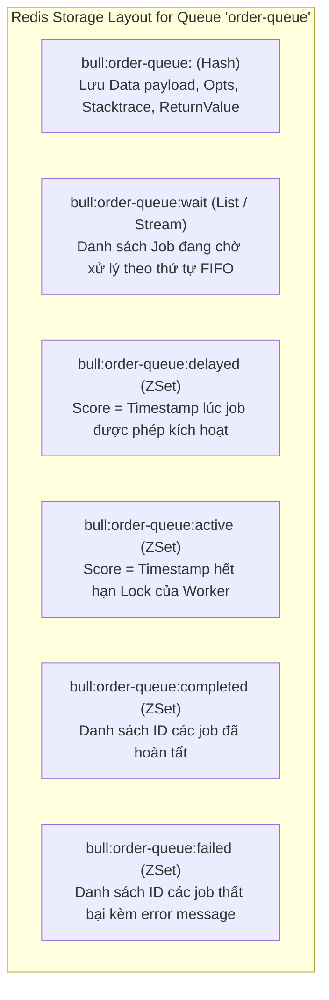
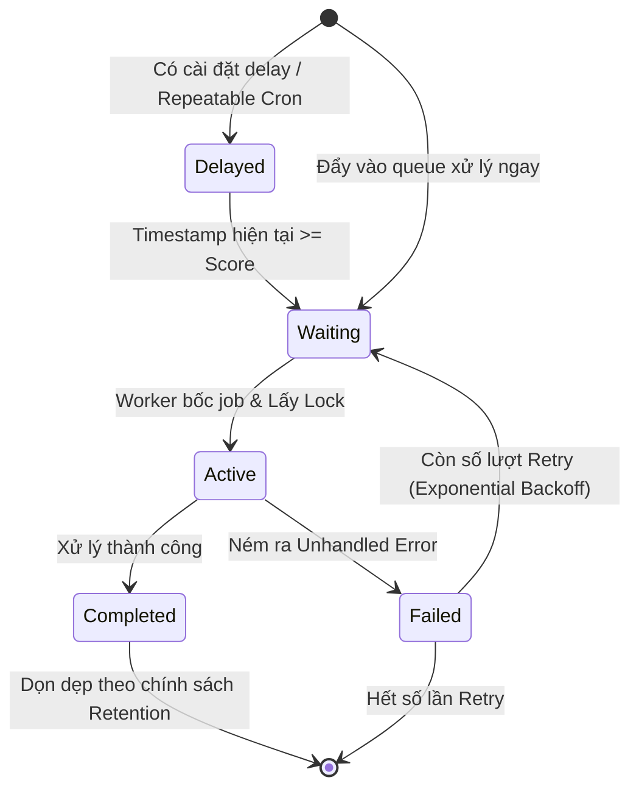

# 📗 CHUYÊN ĐỀ 04.1: BULLMQ ARCHITECTURE – LÝ THUYẾT & KIẾN TRÚC LÕI

> **Mục tiêu**: Nắm vững cơ chế hàng đợi phân tán BullMQ trên nền tảng Redis Streams & Lua Scripts, vòng đời của Job, các cấu trúc dữ liệu nội tại, mô hình Sandboxed Worker và các kỹ thuật xử lý sự cố nâng cao.

---

## 1. Bản chất cốt lõi & Cơ chế hoạt động (BullMQ Internals)

### 1.1. BullMQ là gì và tại sao nên dùng?
BullMQ là thư viện quản lý hàng đợi tác vụ phân tán (Distributed Task Queue) chuẩn mực cho hệ sinh thái Node.js/TypeScript, được xây dựng trên **Redis Streams, Sorted Sets, Hashes và Lua Scripts**.
* **Nguyên tử tuyệt đối (Atomicity)**: Mọi thao tác chuyển trạng thái job (Waiting $\rightarrow$ Active $\rightarrow$ Completed / Failed) đều được đóng gói trong các **Lua script** chạy trực tiếp trên Redis.
* **Độ tin cậy cao (At-Least-Once Delivery)**: Tự động phát hiện và thu hồi job bị treo khi worker bị chết đột ngột (Stalled Job Recovery).
* **Tính năng phong phú**: Delay jobs, Repeatable/Cron jobs, Parent-child job dependencies (Flows), Rate-limiting per worker/queue, Priority queue.

### 1.2. Cấu trúc dữ liệu Redis ngầm mà BullMQ sử dụng
Mỗi một Queue (ví dụ: `order-queue`) được biểu diễn thông qua tập hợp các keys liên kết chặt chẽ trong Redis:



### 1.3. Vòng đời của một Job (Job Lifecycle)



---

## 2. Các mẫu triển khai chuẩn (Production Patterns)

### 2.1. Cấu hình Worker & Queue chuẩn Enterprise
```typescript
import { Queue, Worker, Job } from 'bullmq';
import IORedis from 'ioredis';

const redisConnection = new IORedis({
  host: process.env.REDIS_HOST,
  port: Number(process.env.REDIS_PORT),
  maxRetriesPerRequest: null, // BẮT BUỘC: Ngăn ioredis tự hủy kết nối khi blocking pop
  enableReadyCheck: false,
});

// 1. Queue với cấu hình tự động dọn dẹp RAM
export const orderQueue = new Queue('order-processing', {
  connection: redisConnection,
  defaultJobOptions: {
    attempts: 5,
    backoff: {
      type: 'exponential',
      delay: 2000, // Retry sau 2s, 4s, 8s, 16s...
    },
    removeOnComplete: {
      age: 24 * 3600, // Giữ 24 giờ
      count: 1000,    // Giữ tối đa 1000 jobs
    },
    removeOnFail: {
      age: 7 * 24 * 3600, // Giữ 7 ngày để truy vết lỗi
      count: 5000,
    },
  },
});

// 2. Worker với cấu hình Heartbeat an toàn
export const orderWorker = new Worker(
  'order-processing',
  async (job: Job) => {
    return await handleOrderProcessing(job.data);
  },
  {
    connection: redisConnection,
    concurrency: 10,       // Xử lý song song 10 jobs trên 1 worker process
    lockDuration: 30000,   // Lock job trong 30 giây
    lockRenewTime: 15000,  // Tự động gia hạn lock sau mỗi 15 giây
  }
);
```

### 2.2. Sandboxed Worker (Child Process Isolation)
Với các tác vụ ngốn CPU (như tạo hóa đơn PDF, parse file Excel 100MB, xử lý ảnh):
```typescript
// main-worker.ts
import { Worker } from 'bullmq';
import path from 'path';

const processorPath = path.join(__dirname, 'pdf-generator.worker.js');

// Chạy worker trong Child Process riêng biệt, không block Event Loop của main app
export const pdfWorker = new Worker('pdf-queue', processorPath, {
  connection: redisConnection,
  concurrency: 4, // Tối đa 4 child processes song song
});
```

---

## 3. Các cạm bẫy kỹ thuật sống còn (Production Caveats)

| STT | Bẫy kỹ thuật | Hậu quả thực tế | Giải pháp chuẩn Production |
| :--- | :--- | :--- | :--- |
| **1** | **Hiện tượng "Stalled Jobs"** | Worker bị block Event Loop hoặc container bị K8s OOM-kill đột ngột $\rightarrow$ Không thể gia hạn lock $\rightarrow$ Job bị coi là chết và tự động giao cho Worker khác chạy lại $\rightarrow$ **Xử lý 2 lần (Double Processing)**. | Logic job bắt buộc phải có tính **Idempotency** (kiểm tra trạng thái đơn trước khi xử lý). Tách tác vụ nặng CPU sang Sandboxed Worker. |
| **2** | **Cạn kiệt Connection DB do Concurrency cao** | Đặt `concurrency: 50` trên mỗi Pod, scale 4 Pods $\rightarrow$ 200 jobs cùng mở transaction tới DB $\rightarrow$ Vượt quá Connection Pool (50) của PostgreSQL $\rightarrow$ Sập Web API. | Quy tắc vàng: **Tổng Concurrency của tất cả Worker Pods phải $\le$ Connection Pool dành riêng cho Worker**. |
| **3** | **Tràn RAM Redis do quên dọn Job cũ** | Quên cấu hình `removeOnComplete` và `removeOnFail` $\rightarrow$ Hàng triệu job lưu vĩnh viễn trong RAM kèm error stacktrace $\rightarrow$ Redis chạm ngưỡng `maxmemory` và OOM. | Luôn cấu hình `removeOnComplete: { age: 3600, count: 1000 }` và `removeOnFail: { age: 86400, count: 5000 }`. |
| **4** | **Thiếu `maxRetriesPerRequest: null`** | Khi kết nối Redis qua `ioredis`, nếu không set cờ này, các câu lệnh blocking queue (`BRPOPLPUSH` ngầm) sẽ văng exception khi mạng chập chờn $\rightarrow$ Worker dừng nhận job. | Bắt buộc cấu hình `maxRetriesPerRequest: null` trong connection options của BullMQ. |
