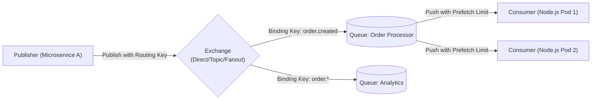
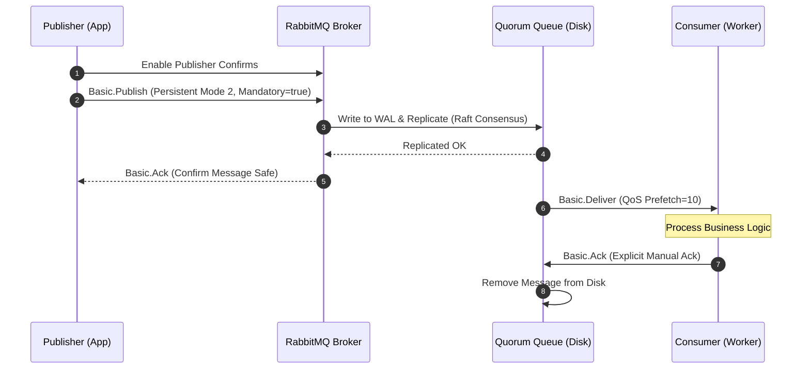

# 🐇 CHUYÊN ĐỀ 05: RABBITMQ ARCHITECTURE & PRODUCTION GUIDE

---

## 1. Bản chất cốt lõi & Cơ chế hoạt động (AMQP 0-9-1 Internals)

### 1.1. Kiến trúc AMQP Model
RabbitMQ hoạt động dựa trên giao thức **AMQP 0-9-1 (Advanced Message Queuing Protocol)**. Khác với Kafka (Client đọc từ phân vùng log), RabbitMQ đẩy message (Push model) từ Queue đến các Consumer đã đăng ký.



### 1.2. Phân loại Exchanges & Cách định tuyến
1. **Direct Exchange**: So khớp **chính xác 100%** giữa `Routing Key` của message và `Binding Key` của Queue (Ví dụ: `payment.success` $\rightarrow$ `payment.success`).
2. **Fanout Exchange**: **Broadcast** message tới tất cả các Queue đã được bind vào nó, bỏ qua hoàn toàn Routing Key (Dùng cho Notification hoặc Pub/Sub diện rộng).
3. **Topic Exchange**: So khớp mẫu linh hoạt dựa trên ký tự đại diện (Wildcards):
   * `*` (Asterisk): Đại diện cho **đúng 1 từ** (ví dụ: `order.*.europe` khớp `order.created.europe`, không khớp `order.created.express.europe`).
   * `#` (Hash): Đại diện cho **0 hoặc nhiều từ** (ví dụ: `audit.#` khớp mọi log bắt đầu bằng `audit.`).
4. **Headers Exchange**: Định tuyến dựa trên các thuộc tính trong Message Header thay vì Routing Key.

---

## 2. Đảm bảo độ tin cậy tuyệt đối (High Reliability & Durability)

Để đảm bảo **không bao giờ mất message** (Zero Message Loss) trong hệ thống tài chính / đơn hàng:



### 3 điều kiện tiên quyết chống mất Message:
1. **Queue Durability**: Khai báo Queue có cờ `durable: true`.
2. **Message Persistence**: Publisher phải gửi message với `deliveryMode: 2` (Persistent) để ép RabbitMQ ghi message xuống đĩa cứng (Disk/WAL).
3. **Publisher Confirms**: Publisher phải lắng nghe sự kiện `ack` từ RabbitMQ trước khi coi là gửi thành công. Nếu nhận `nack`, phải thực hiện retry.

---

## 3. Kiến trúc Quorum Queues (HA hiện đại thay thế Mirrored Queues)

* **Classic Mirrored Queues (Đã deprecated)**: Dùng cơ chế master-slave đồng bộ trên toàn cluster. Rất dễ bị split-brain và chậm khi mạng lag.
* **Quorum Queues (Chuẩn mới từ RabbitMQ 3.8+)**:
  * Dựa trên thuật toán đồng thuận **Raft Consensus** (tương tự etcd, Consul).
  * Đảm bảo tính nhất quán dữ liệu cao (Linearizability), tự động bầu Leader mới cực nhanh khi một node trong cluster bị sập.
  * Tối ưu cho throughput cao và an toàn dữ liệu trên môi trường Kubernetes.

---

## 4. Xử lý lỗi: Dead Letter Exchange (DLX) & Retry Pattern

### 4.1. Vấn đề "Poison Pill" (Thuốc độc)
Nếu worker gặp lỗi logic (bug code, dữ liệu sai format) mà bạn gọi `channel.nack(msg, false, true)` (requeue = true), message sẽ được đẩy ngay vào đầu hàng đợi và gửi lại cho worker $\rightarrow$ Gây ra **vòng lặp vô tận (Infinite Crash Loop)**, làm tê liệt toàn bộ worker.

### 4.2. Mô hình DLX & Retry Queue chuẩn

```mermaid
flowchart TD
    MainQ[("Main Queue: order.process")] -->|Worker xử lý lỗi Nack(requeue=false)| DLX{"Dead Letter Exchange (DLX)"}
    
    DLX -->|Routing Key| RetryQ[("Retry Queue (Có TTL: 30s)<br/>Không có Consumer")]
    
    RetryQ -->|Sau 30s hết TTL -> Message Expired| MainExchange{"Main Exchange"}
    MainExchange -->|Đẩy ngược lại| MainQ
    
    RetryQ -->|Nếu vượt quá 3 lần Retry| ParkingQ[("Parking / Final DLQ<br/>(Chờ Dev kiểm tra manual)")]
```

### 4.3. Code mẫu TypeScript (`amqplib`)
```typescript
import amqp, { Channel, Connection } from 'amqplib';

async function setupQueues(channel: Channel) {
  const DLX = 'order.dlx';
  const MAIN_QUEUE = 'order.process';
  const RETRY_QUEUE = 'order.retry';

  // 1. Khai báo DLX
  await channel.assertExchange(DLX, 'direct', { durable: true });

  // 2. Main Queue: Khi NACK hoặc Reject sẽ tự động bắn vào DLX
  await channel.assertQueue(MAIN_QUEUE, {
    durable: true,
    arguments: {
      'x-dead-letter-exchange': DLX,
      'x-dead-letter-routing-key': 'retry',
    },
  });

  // 3. Retry Queue: Giữ message trong 30 giây rồi đẩy ngược về Main Queue
  await channel.assertQueue(RETRY_QUEUE, {
    durable: true,
    arguments: {
      'x-dead-letter-exchange': '', // Default exchange
      'x-dead-letter-routing-key': MAIN_QUEUE,
      'x-message-ttl': 30000, // 30 giây
    },
  });

  await channel.bindQueue(RETRY_QUEUE, DLX, 'retry');
}
```

---

## 5. Các bẫy kỹ thuật & Lưu ý sống còn (Production Caveats)

| STT | Vấn đề / Bẫy kỹ thuật | Hậu quả | Giải pháp xử lý |
| :--- | :--- | :--- | :--- |
| **1** | **Quản lý Connection sai lầm** | Mở một Connection TCP mới cho mỗi message được publish $\rightarrow$ Tiêu hao socket, CPU và handshake overhead cực lớn. | **Mở DUY NHẤT 1 Connection cho mỗi ứng dụng**, sau đó mở nhiều Channel để tái sử dụng. |
| **2** | **Quên cài đặt Prefetch (QoS)** | Mặc định RabbitMQ đẩy toàn bộ message trong queue vào RAM của Consumer. Consumer nhận hàng nghìn message cùng lúc $\rightarrow$ OOM Crash. | Bắt buộc gọi `channel.prefetch(10)` hoặc `prefetch(1)` trên mỗi channel của Consumer. |
| **3** | **Flow Control Blocking** | Khi RAM hoặc Disk của RabbitMQ chạm ngưỡng báo động (High Watermark, vd 40% RAM), RabbitMQ **chặn toàn bộ TCP socket của Publishers**. | Giám sát dung lượng ổ cứng và RAM trên Grafana; cấu hình alarm trước khi chạm ngưỡng 80%. |
| **4** | **Phá vỡ thứ tự Message (Message Ordering)** | Dùng nhiều Consumer song song trên cùng 1 Queue sẽ làm mất thứ tự xử lý của message. | Nếu nghiệp vụ yêu cầu thứ tự tuyệt đối: **Chỉ dùng 1 Consumer duy nhất trên Queue**, hoặc định tuyến theo Key bằng **Consistent Hash Exchange**. |

---

## 6. Bộ câu hỏi phỏng vấn chuyên sâu (Senior / Staff Level)

1. **Hỏi**: *“Làm thế nào để đảm bảo tính Idempotency (chống xử lý lặp) ở phía Consumer trong RabbitMQ?”*
   * **Đáp chuẩn**: RabbitMQ chỉ đảm bảo chuẩn *At-Least-Once Delivery* (có thể gửi lặp khi mạng lag làm mất ACK). Consumer phải tự bảo vệ tính đúng đắn bằng cách:
     1. Mỗi message khi publish phải đính kèm một `message_id` duy nhất (UUID) trong phần properties.
     2. Khi nhận message, Consumer kiểm tra `message_id` trong Redis/Database:
        * Nếu đã có trạng thái `PROCESSED` $\rightarrow$ Bỏ qua và `basic.ack` ngay.
        * Nếu chưa có $\rightarrow$ Dùng Database Transaction để ghi dữ liệu nghiệp vụ và lưu `message_id` vào bảng `processed_messages` trong cùng một transaction.
2. **Hỏi**: *“So sánh ưu nhược điểm giữa RabbitMQ và Apache Kafka trong kiến trúc Microservices?”*
   * **Đáp chuẩn**:
     * **RabbitMQ**: Message Broker theo mô hình "Smart Broker, Dumb Consumer". Message sau khi ack sẽ bị xóa khỏi queue. Hỗ trợ định tuyến phức tạp (Topic/Fanout/Header), quản lý từng message độc lập, phù hợp cho các workflow nghiệp vụ giao tiếp giữa các services cần tính tin cậy cao và xử lý theo từng giao dịch.
     * **Kafka**: Distributed Streaming Platform theo mô hình "Dumb Broker, Smart Consumer". Message lưu trữ dưới dạng Append-Only Log phân vùng (Partition), không bị xóa sau khi đọc. Rất mạnh về throughput (hàng triệu sự kiện/giây), replay lại dữ liệu cũ, thích hợp cho Big Data, Real-time Event Streaming, Clickstream và Metrics.
