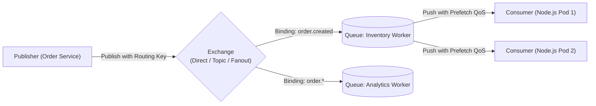
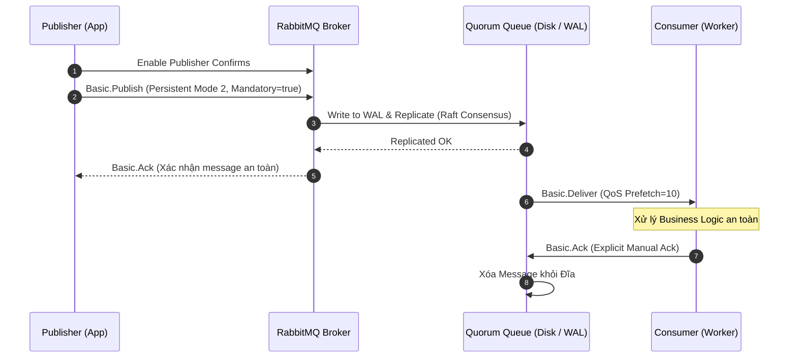
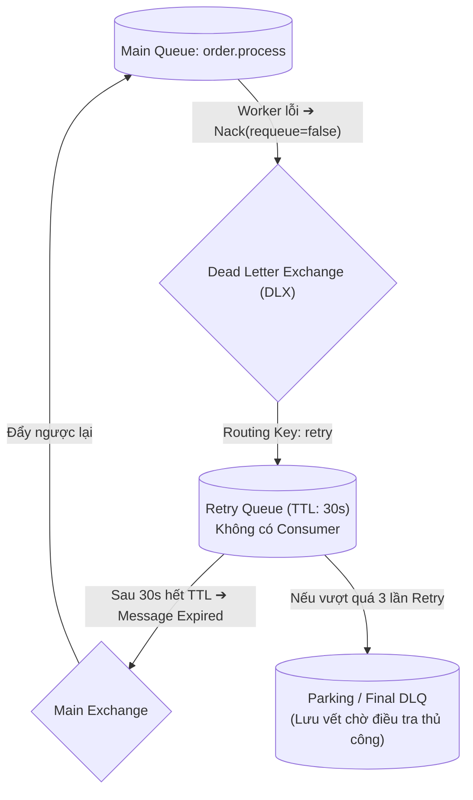

# 📗 CHUYÊN ĐỀ 05.1: RABBITMQ ARCHITECTURE – LÝ THUYẾT & KIẾN TRÚC LÕI

> **Mục tiêu**: Nắm vững bản chất kiến trúc AMQP 0-9-1, các loại Exchange, cơ chế đảm bảo Zero Message Loss, Quorum Queues (Raft Consensus), Dead Letter Exchange (DLX) và các quy chuẩn vận hành RabbitMQ ở cấp độ Enterprise.

---

## 1. Bản chất cốt lõi & Cơ chế hoạt động (AMQP 0-9-1 Internals)

### 1.1. Kiến trúc AMQP Model
RabbitMQ hoạt động dựa trên chuẩn giao thức **AMQP 0-9-1 (Advanced Message Queuing Protocol)** theo mô hình **Smart Broker, Dumb Consumer**: Broker chủ động định tuyến và đẩy message (Push model qua giao thức socket) đến các Consumer đã đăng ký.

### 1.2. Phân loại 4 loại Exchanges & Cơ chế định tuyến
1. **Direct Exchange**: So khớp **chính xác 100% (Exact Match)** giữa `Routing Key` của message và `Binding Key` của Queue (Ví dụ: `payment.success` $\rightarrow$ `payment.success`).
2. **Fanout Exchange**: **Broadcast** message tới tất cả các Queue đã được bind vào nó, bỏ qua hoàn toàn Routing Key (Dùng cho Notification hoặc Pub/Sub diện rộng tới nhiều service).
3. **Topic Exchange**: Định tuyến linh hoạt dựa trên ký tự đại diện (Wildcards) phân tách bằng dấu chấm:
   * `*` (Asterisk): Đại diện cho **đúng 1 từ** (ví dụ: `order.*.vn` khớp `order.created.vn`, không khớp `order.created.express.vn`).
   * `#` (Hash): Đại diện cho **0 hoặc nhiều từ** (ví dụ: `audit.#` khớp mọi log bắt đầu bằng `audit.`).
4. **Headers Exchange**: Định tuyến dựa trên các cặp key-value trong Message Header thay vì Routing Key.

---

## 2. Đảm bảo độ tin cậy tuyệt đối (Zero Message Loss Architecture)

Để đảm bảo không bao giờ mất message trong các hệ thống đơn hàng / tài chính, bắt buộc phải thỏa mãn đồng thời **3 điều kiện**:

1. **Queue Durability**: Khai báo Queue có cờ `durable: true` để metadata và cấu trúc queue tồn tại qua các lần broker restart.
2. **Message Persistence**: Publisher phải gửi message với thuộc tính `deliveryMode: 2` (Persistent) để ép RabbitMQ ghi message xuống file WAL trên đĩa cứng.
3. **Publisher Confirms**: Publisher phải kích hoạt kênh xác nhận và chỉ coi là gửi thành công khi nhận được `Basic.Ack` từ Broker. Nếu nhận `Basic.Nack` hoặc timeout, phải thực hiện retry.
4. **Manual Consumer Acknowledgment**: Consumer không bao giờ bật `noAck: true`. Chỉ gửi `channel.ack(msg)` sau khi đã xử lý xong và commit dữ liệu vào Database thành công.

---

## 3. Quorum Queues (Chuẩn High Availability hiện đại)

* **Classic Mirrored Queues (Đã bị Deprecated)**: Dùng cơ chế master-slave đồng bộ trên toàn cluster. Rất dễ bị split-brain, dữ liệu không nhất quán khi mạng lag.
* **Quorum Queues (Chuẩn mới từ RabbitMQ 3.8+)**:
  * Dựa trên thuật toán đồng thuận **Raft Consensus** (tương tự etcd, Consul).
  * Đảm bảo tính nhất quán dữ liệu cao (Linearizability), tự động bầu Leader mới cực nhanh khi một node trong cluster bị sập.
  * Được thiết kế riêng cho môi trường Kubernetes và lưu trữ bền vững trên SSD.

---

## 4. Xử lý sự cố: Dead Letter Exchange (DLX) & Exponential Retry

### 4.1. Vấn đề "Poison Pill" (Thuốc độc)
Nếu worker gặp bug code hoặc dữ liệu sai format mà gọi `channel.nack(msg, false, true)` (requeue = true), message sẽ được đẩy ngay vào đầu hàng đợi và gửi lại cho worker $\rightarrow$ Gây ra **vòng lặp crash vô tận (Infinite Crash Loop)** làm sập toàn bộ cụm worker.

### 4.2. Mô hình DLX & Retry Queue chuẩn

---

## 5. Các cạm bẫy kỹ thuật sống còn (Production Caveats)

| STT | Bẫy kỹ thuật | Hậu quả thực tế | Giải pháp chuẩn Production |
| :--- | :--- | :--- | :--- |
| **1** | **Mở Connection bừa bãi** | Mở một Connection TCP mới cho mỗi message được publish $\rightarrow$ Tiêu hao socket, CPU và handshake overhead cực lớn. | **Mở DUY NHẤT 1 Connection cho mỗi tiến trình**, sau đó mở nhiều Channel để tái sử dụng. |
| **2** | **Quên cài đặt Prefetch (QoS)** | Mặc định RabbitMQ đẩy toàn bộ message trong queue vào RAM của Consumer. Consumer nhận hàng nghìn message cùng lúc $\rightarrow$ OOM Crash. | Bắt buộc gọi `channel.prefetch(10)` hoặc `prefetch(1)` trên mỗi channel của Consumer. |
| **3** | **Flow Control Blocking** | Khi RAM hoặc Disk của RabbitMQ chạm ngưỡng báo động (High Watermark, vd 40% RAM), RabbitMQ **chặn toàn bộ TCP socket của Publishers**. | Giám sát dung lượng ổ cứng và RAM trên Grafana; cấu hình alarm trước khi chạm ngưỡng 80%. |
| **4** | **Mất thứ tự Message** | Dùng nhiều Consumer song song trên cùng 1 Queue sẽ làm mất thứ tự xử lý của message. | Nếu nghiệp vụ yêu cầu thứ tự tuyệt đối: **Chỉ dùng 1 Consumer duy nhất trên Queue**, hoặc phân luồng theo Key bằng **Consistent Hash Exchange**. |
