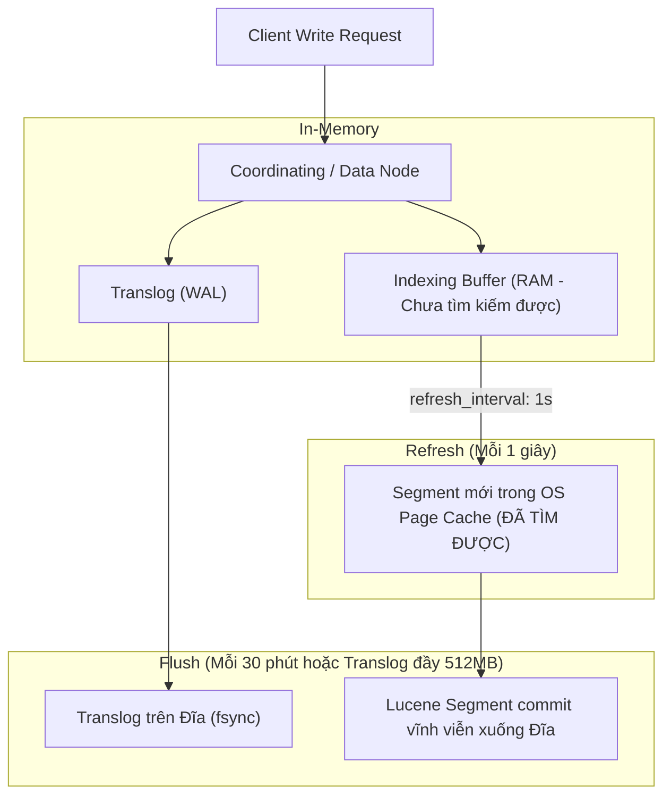
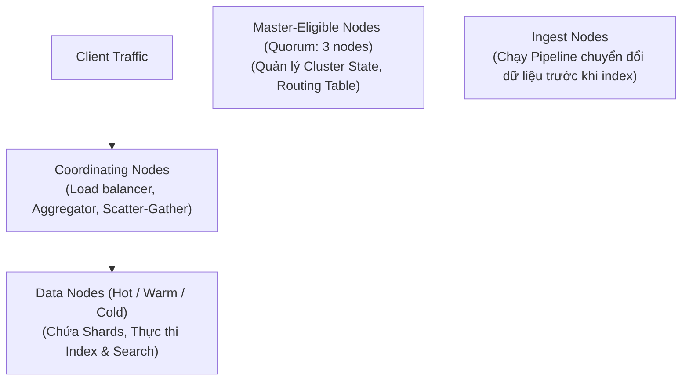

# 🔍 CHUYÊN ĐỀ 06: ELASTICSEARCH ARCHITECTURE & PRODUCTION GUIDE

---

## 1. Bản chất cốt lõi & Cơ chế hoạt động (Elasticsearch & Lucene Internals)

### 1.1. Inverted Index (Chỉ mục đảo ngược)
Trái tim của Elasticsearch là thư viện **Apache Lucene**. Thay vì tìm kiếm tuần tự từ văn bản sang từ khóa, Lucene bóc tách văn bản thành các từ tố (Tokens/Terms) và lưu trữ ngược lại:
* **Term Dictionary**: Danh sách các từ đã được sắp xếp bảng chữ cái.
* **Posting List**: Danh sách ID các tài liệu chứa từ đó, kèm theo tần suất xuất hiện (Term Frequency) và vị trí trong câu (Positions).

```
Văn bản 1: "Hệ thống phân tán Node.js"
Văn bản 2: "Thiết kế phân tán hiệu năng cao"

Inverted Index:
Term        -> Posting List
"hệ thống"  -> [Doc 1]
"phân tán"  -> [Doc 1, Doc 2]
"node.js"   -> [Doc 1]
"thiết kế"  -> [Doc 2]
```

### 1.2. Vòng đời ghi dữ liệu (Write Path: Refresh vs Flush vs Translog)
Elasticsearch là hệ thống tìm kiếm **Gần thời gian thực (Near Real-Time - NRT)** vì dữ liệu vừa ghi không thể tìm thấy ngay lập tức:



* **Refresh**: Đẩy dữ liệu từ Indexing Buffer sang OS Page Cache để tạo Segment mới. Sau bước này, tài liệu **đã có thể được tìm kiếm**. Mặc định diễn ra mỗi 1 giây (`refresh_interval: 1s`).
* **Flush**: Thực hiện lệnh `fsync` ghi toàn bộ dữ liệu từ OS Page Cache xuống đĩa cứng và làm rỗng Translog để giải phóng dung lượng.

---

## 2. Các Node Roles trong Kiến trúc Cluster



* **Master-Eligible Nodes**: Quản lý metadata của toàn cụm, trạng thái shard. Tuyệt đối không để master nodes xử lý search nặng để tránh mất liên lạc gây ra split-brain.
* **Data Nodes**: Lưu trữ các Shards dữ liệu và thực thi tính toán search, aggregation.
* **Coordinating Nodes**: Nhận request từ Client, phân tán query tới các Data Nodes (Scatter) và tổng hợp kết quả trả về cho Client (Gather).

---

## 3. Mapping Strategy & Phân biệt Kiểu dữ liệu

### 3.1. `text` vs `keyword`
| Tiêu chí | Kiểu `text` | Kiểu `keyword` |
| :--- | :--- | :--- |
| **Phân tích (Analyzer)** | Được phân tách từ, lowercase, loại bỏ dấu (Tokenized). | Giữ nguyên 100% chuỗi ký tự gốc (Exact match). |
| **Ứng dụng** | Tìm kiếm toàn văn mờ (Full-text search), mô tả sản phẩm, bài viết. | Tìm kiếm chính xác (`term`), lọc (`filter`), sắp xếp (`sort`), gom nhóm (`aggregations`). |

### 3.2. Cấu trúc Multi-Fields chuẩn
```json
{
  "mappings": {
    "dynamic": "strict",
    "properties": {
      "product_name": {
        "type": "text",
        "analyzer": "standard",
        "fields": {
          "raw": {
            "type": "keyword"
          }
        }
      },
      "price": { "type": "scaled_float", "scaling_factor": 100 },
      "category_id": { "type": "keyword" },
      "created_at": { "type": "date" }
    }
  }
}
```
* Tìm kiếm mờ: search vào `product_name`.
* Sắp xếp bảng chữ cái hoặc lọc chính xác: dùng `product_name.raw`.

### 3.3. `nested` vs `object` (Hiểm họa Array of Objects)
* Với kiểu `object` mặc định, Elasticsearch sẽ làm phẳng mảng:
  `[{"name": "Alice", "age": 30}, {"name": "Bob", "age": 20}]` $\rightarrow$ `name: ["Alice", "Bob"]`, `age: [20, 30]`.
  $\rightarrow$ Query `name = "Alice" AND age = 20` **vẫn trả về kết quả đúng** (False Positive!).
* *Giải pháp*: Dùng kiểu **`nested`**. Mỗi item trong mảng sẽ được lưu thành 1 Lucene Document ẩn độc lập, giữ nguyên mối quan hệ cha-con.

---

## 4. Các bẫy kỹ thuật & Lưu ý sống còn (Production Caveats)

### 4.1. Quy tắc phân bổ RAM JVM Heap (Quy tắc 50% & <= 31GB)
1. **Không cấp quá 50% tổng RAM vật lý cho Elasticsearch Heap**:
   * Nếu server có 64GB RAM $\rightarrow$ Chỉ cấp tối đa **31GB Heap**.
   * 33GB RAM còn lại dành riêng cho **OS Page Cache**, nơi Apache Lucene lưu trữ các Segment trên RAM để tìm kiếm với tốc độ microsecond.
2. **Không vượt quá ngưỡng 31–32 GB Heap**:
   * Khi Heap $\le 31\text{GB}$, máy ảo Java sử dụng kỹ thuật **Compressed OOPs** (Ordinary Object Pointers - nén con trỏ 64-bit thành 32-bit), giúp tiết kiệm một nửa RAM con trỏ.
   * Vượt qua 32GB, JVM buộc phải dùng con trỏ 64-bit $\rightarrow$ Lãng phí hàng GB RAM vô ích và làm Garbage Collector (GC) chạy rất nặng.

### 4.2. Hiểm họa "Mapping Explosion"
* Nếu để cấu hình mặc định `dynamic: true`, khi lập trình viên hoặc người dùng đẩy vào các JSON tùy biến có hàng nghìn key ngẫu nhiên (ví dụ log trace), số lượng field của cluster tăng vọt $\rightarrow$ Cluster State phình to hàng trăm MB, làm treo toàn bộ cụm.
* *Nguyên tắc*: **Luôn đặt `"dynamic": "strict"` trên môi trường Production**.

### 4.3. Over-sharding (Quá nhiều Shard nhỏ)
* Mỗi Shard là một Lucene Index độc lập, tiêu tốn File Descriptors, RAM và luồng CPU riêng.
* Có hàng trăm shard kích thước chỉ vài chục MB là nguyên nhân số 1 làm cạn kiệt Heap.
* *Quy chuẩn*: **Dung lượng 1 Shard lý tưởng nên nằm trong khoảng từ 10GB đến 50GB**.

### 4.4. Deep Paging với `from + size`
* Câu lệnh `GET /orders/_search?from=100000&size=10` buộc tất cả các Shard phải lấy ra 100,010 bản ghi, gửi về Coordinating node để sắp xếp lại $\rightarrow$ Tiêu tốn hàng GB RAM và làm sập Node.
* *Giải pháp*: Mặc định Elasticsearch giới hạn `max_result_window = 10,000`. Nếu muốn phân trang vô tận, bắt buộc dùng **`search_after` kết hợp Point in Time (PIT)**.

---

## 5. Truy vấn tối ưu: Tận dụng Filter Context (Caching)

```json
POST /products/_search
{
  "query": {
    "bool": {
      "must": [
        { "match": { "description": "bàn phím cơ không dây" } }
      ],
      "filter": [
        { "term": { "status": "ACTIVE" } },
        { "range": { "price": { "gte": 500000, "lte": 2000000 } } }
      ]
    }
  }
}
```
* `must`: Tính toán điểm phù hợp (**Relevance Score** - TF/IDF hoặc BM25). Tiêu tốn CPU.
* `filter`: Chỉ kiểm tra Có/Không (`true/false`), **không tính điểm số** và **tự động được Elasticsearch lưu vào Bitset Cache trong RAM** $\rightarrow$ Tốc độ tìm kiếm cực nhanh cho các lần query tiếp theo.

---

## 6. Bộ câu hỏi phỏng vấn chuyên sâu (Senior / Staff Level)

1. **Hỏi**: *“Thuật toán tính điểm mặc định của Elasticsearch là gì? Nó khác gì so với TF-IDF truyền thống?”*
   * **Đáp chuẩn**: Từ phiên bản 5.0+, Elasticsearch sử dụng thuật toán **Okapi BM25**. Khác biệt cốt lõi so với TF-IDF là: (1) BM25 có tính năng **bão hòa tần suất từ (Term Frequency Saturation)**: khi số lần xuất hiện của một từ tăng lên rất cao trong văn bản, điểm số của nó tiệm cận một ngưỡng trần chứ không tăng tuyến tính vô hạn như TF-IDF; (2) Tối ưu hóa việc phạt độ dài văn bản (Document Length Normalization) linh hoạt hơn.
2. **Hỏi**: *“Làm thế nào để đồng bộ dữ liệu Real-time từ PostgreSQL sang Elasticsearch mà không làm mất mát dữ liệu và không làm chậm API?”*
   * **Đáp chuẩn**: Áp dụng mô hình **Change Data Capture (CDC)**:
     1. Dùng **Debezium** đọc trực tiếp WAL (Write-Ahead Log) của PostgreSQL.
     2. Đẩy các sự kiện thay đổi (Insert/Update/Delete) vào **Apache Kafka** hoặc **RabbitMQ**.
     3. Service đồng bộ (Sync Worker) đọc từ Queue và thực thi lệnh Bulk API (`_bulk`) đẩy sang Elasticsearch.
     * Giải pháp này giải phóng hoàn toàn ứng dụng Node.js khỏi việc quản lý dual-write và đảm bảo tính nhất quán cuối cùng (Eventual Consistency).
