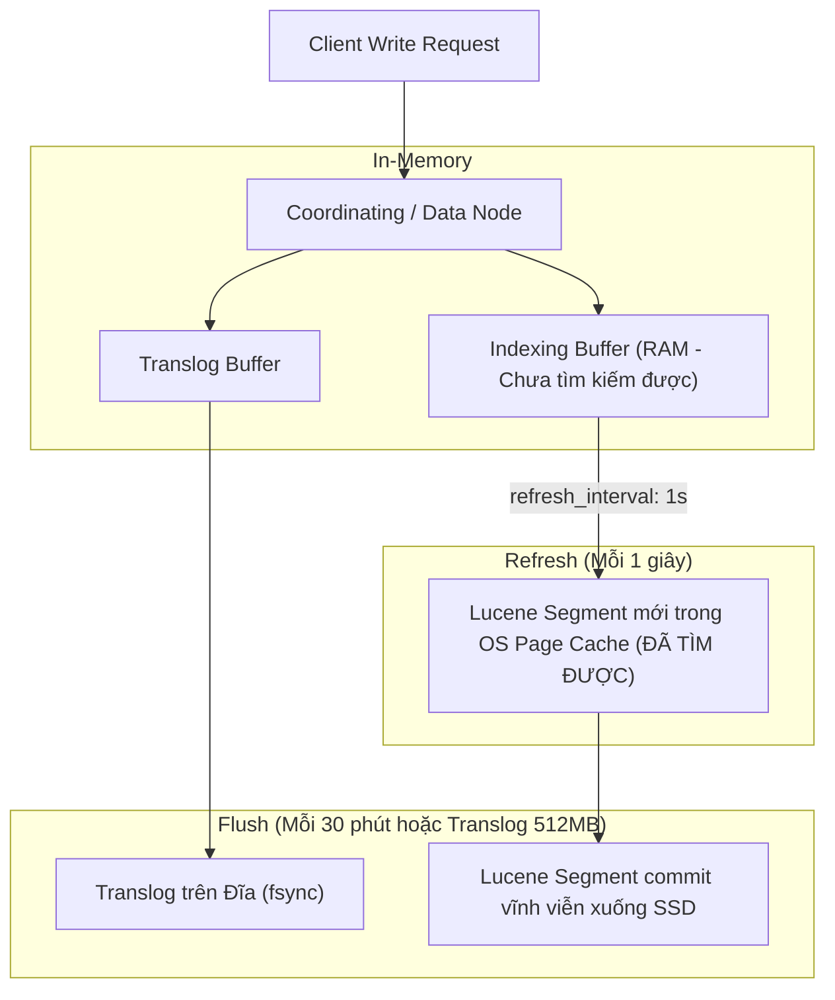
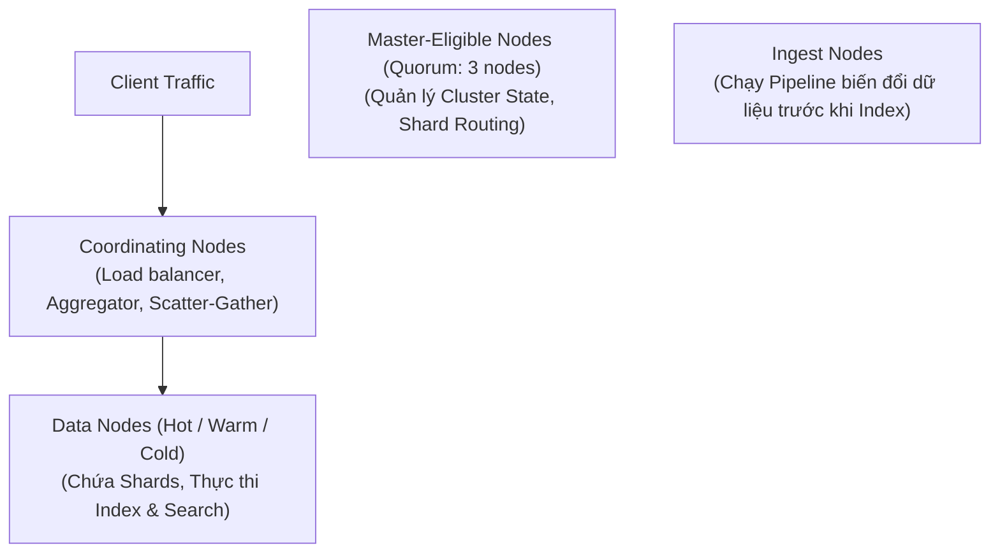

# 📗 CHUYÊN ĐỀ 06.1: ELASTICSEARCH ARCHITECTURE – LÝ THUYẾT & KIẾN TRÚC LÕI

> **Mục tiêu**: Nắm vững bản chất kiến trúc Apache Lucene, Inverted Index, vòng đời ghi dữ liệu Near Real-Time (Refresh vs Flush), chiến lược phân bổ JVM Heap & OS Page Cache, Mapping Strategy và các kỹ thuật tối ưu hóa Search / Aggregations.

---

## 1. Bản chất cốt lõi & Cơ chế hoạt động (Elasticsearch & Lucene Internals)

### 1.1. Inverted Index (Chỉ mục đảo ngược)
Trái tim của Elasticsearch là thư viện tìm kiếm mã nguồn mở **Apache Lucene**. Khác với cơ sở dữ liệu quan hệ (quét dòng để kiểm tra từ khóa), Lucene phân tích văn bản (Analysis) thành các từ tố (**Terms**) và lưu trữ theo mô hình đảo ngược:
* **Term Dictionary**: Bảng từ vựng đã được chuẩn hóa (Lowercase, Stemming, Stopwords) và sắp xếp theo thứ tự bảng chữ cái.
* **Term Index (FST - Finite State Transducer)**: Cây tiền tố nén nằm trong RAM giúp nhảy nhanh đến vị trí của Term trong Dictionary mà không cần duyệt đĩa.
* **Posting List**: Danh sách ID các tài liệu (Document IDs) chứa từ đó, kèm theo tần suất xuất hiện (**Term Frequency - TF**) và vị trí xuất hiện trong câu (**Positions** để phục vụ Phrase Query).

```
Văn bản 1: "Hệ thống phân tán Node.js"
Văn bản 2: "Thiết kế phân tán hiệu năng cao"

Inverted Index:
Term        -> Posting List
"hệ thống"  -> [Doc 1]
"phân tán"  -> [Doc 1, Doc 2]
"node.js"   -> [Doc 1]
"thiết kế"  -> [Doc 2]
```

### 1.2. Vòng đời ghi dữ liệu (Write Path: Refresh vs Flush vs Translog)
Elasticsearch là hệ thống tìm kiếm **Gần thời gian thực (Near Real-Time - NRT)**: dữ liệu vừa gửi lên không thể tìm thấy tức thì mà phải qua chu kỳ **Refresh**.



* **Refresh (`refresh_interval: 1s`)**: Đẩy dữ liệu từ Indexing Buffer trong JVM Heap sang **OS Page Cache** của hệ điều hành để tạo Segment mới. Sau bước này, tài liệu **đã có thể được tìm kiếm**.
* **Flush**: Thực hiện lệnh `fsync` ép toàn bộ các Segment từ OS Page Cache xuống đĩa cứng vật lý và xóa sạch Translog.
* **Translog (Write-Ahead Log)**: Lưu mọi thao tác ghi tuần tự để phục hồi dữ liệu trong RAM nếu server bị sập trước khi diễn ra Flush.

---

## 2. Kiến trúc Cluster & Phân quyền Node Roles



* **Master-Eligible Nodes**: Quản lý Metadata và Cluster State. Cần ít nhất 3 nodes để tạo Quorum bầu cử và **không được xử lý search/index nặng** để tránh mất kết nối làm split-brain.
* **Data Nodes**: Lưu trữ các Primary và Replica Shards, chịu tải tính toán tìm kiếm và tính aggregation.
* **Coordinating Nodes**: Nhận request từ Client, phân tán query tới các Data Nodes (Scatter) và tổng hợp kết quả (Gather) trả về cho Client.

---

## 3. Mapping Strategy & Phân biệt Kiểu dữ liệu

### 3.1. `text` vs `keyword`
| Tiêu chí | Kiểu `text` | Kiểu `keyword` |
| :--- | :--- | :--- |
| **Phân tích (Analyzer)** | Được phân tách từ, lowercase, loại bỏ dấu (Tokenized). | Giữ nguyên 100% chuỗi ký tự gốc (Exact match). |
| **Ứng dụng** | Tìm kiếm toàn văn mờ (Full-text search), mô tả sản phẩm, bài viết. | Tìm kiếm chính xác (`term`), lọc (`filter`), sắp xếp (`sort`), gom nhóm (`aggregations`). |

### 3.2. Cấu trúc Multi-Fields chuẩn
```json
{
  "mappings": {
    "dynamic": "strict",
    "properties": {
      "course_title": {
        "type": "text",
        "analyzer": "standard",
        "fields": {
          "raw": { "type": "keyword" }
        }
      },
      "category_id": { "type": "keyword" },
      "price": { "type": "scaled_float", "scaling_factor": 100 },
      "published_at": { "type": "date" }
    }
  }
}
```
* Tìm kiếm toàn văn theo từ khóa: Search vào `course_title`.
* Lọc chính xác hoặc sắp xếp bảng chữ cái: Dùng `course_title.raw`.

### 3.3. `nested` vs `object` (Hiểm họa Array of Objects)
* Với kiểu `object` mặc định, Elasticsearch sẽ làm phẳng mảng (Flattening):
  `[{"author": "Alice", "role": "EDITOR"}, {"author": "Bob", "role": "REVIEWER"}]` $\rightarrow$ `author: ["Alice", "Bob"]`, `role: ["EDITOR", "REVIEWER"]`.
  $\rightarrow$ Query `author = "Alice" AND role = "REVIEWER"` **vẫn trả về True (False Positive!)**.
* **Giải pháp**: Khai báo kiểu **`nested`**. Mỗi object con được lưu thành một Lucene Document ẩn độc lập, bảo toàn trọn vẹn mối quan hệ cha-con.

---

## 4. Các cạm bẫy kỹ thuật sống còn (Production Caveats)

| STT | Bẫy kỹ thuật | Hậu quả thực tế | Giải pháp chuẩn Production |
| :--- | :--- | :--- | :--- |
| **1** | **Cấp quá 50% RAM cho JVM Heap** | Cấp 60GB RAM cho Heap $\rightarrow$ OS Page Cache bị đói RAM $\rightarrow$ Lucene không thể cache segments trên RAM $\rightarrow$ Tốc độ search tụt dốc thảm hại. | **Quy tắc 50% & $\le$ 31GB**: Cấp tối đa 31GB RAM cho Heap, phần còn lại dành cho OS Page Cache để tận dụng **Compressed OOPs**. |
| **2** | **Hiểm họa "Mapping Explosion"** | Để `"dynamic": true`, client đẩy vào JSON tùy biến có hàng nghìn dynamic keys $\rightarrow$ Cluster State phình to hàng trăm MB $\rightarrow$ Treo toàn bộ cụm cluster. | Luôn đặt `"dynamic": "strict"` trên môi trường Production. |
| **3** | **Over-Sharding (Quá nhiều Shard nhỏ)** | Tạo hàng trăm Shard kích thước chỉ vài chục MB $\rightarrow$ Tiêu tốn File Descriptors, RAM và luồng CPU riêng của Lucene $\rightarrow$ Cạn kiệt Heap. | Kích thước 1 Shard lý tưởng nên nằm trong khoảng **10GB đến 50GB**. |
| **4** | **Deep Paging với `from + size`** | Query `from=100000&size=10` buộc tất cả Shards lấy 100,010 bản ghi gửi về Coordinating node để sort $\rightarrow$ OOM Crash. | Sử dụng **`search_after` kết hợp Point in Time (PIT)** cho bài toán phân trang sâu. |
