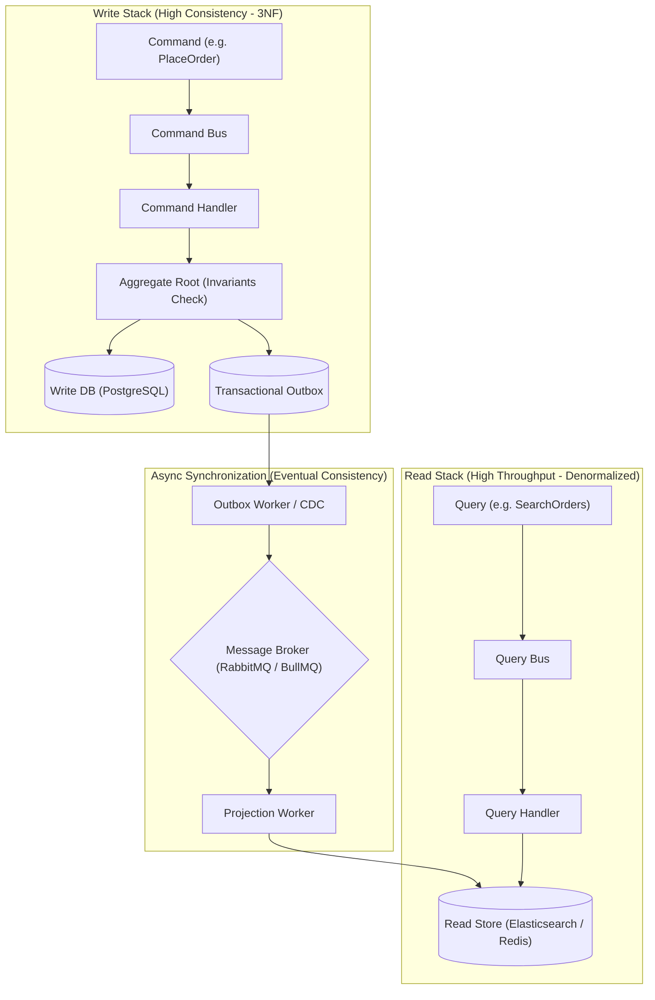

# 📗 CHUYÊN ĐỀ 07.2: CQRS ARCHITECTURE – LÝ THUYẾT & KIẾN TRÚC LÕI

> **Mục tiêu**: Nắm vững bản chất kiến trúc CQRS (Command Query Responsibility Segregation), sự khác biệt giữa Single Database CQRS và Polyglot Persistence CQRS, giải quyết triệt để bài toán Dual-Write bằng Transactional Outbox Pattern, và các chiến lược hóa giải độ trễ nhất quán (Eventual Consistency Delay).

---

## 1. Bản chất cốt lõi: Tại sao phải tách biệt Read và Write?

Trong các hệ thống CRUD truyền thống, một Data Model duy nhất thường được dùng cho cả việc đọc và ghi:
* **Mâu thuẫn căn bản**:
  * **Tầng Ghi (Write)**: Đòi hỏi tính nhất quán cao (ACID), chuẩn hóa dữ liệu (3NF) để tránh dị thường dữ liệu, kiểm tra các bất biến nghiệp vụ khắt khe, thực thi các Transaction ngắn hạn.
  * **Tầng Đọc (Read)**: Đòi hỏi độ trễ cực thấp, dữ liệu phi chuẩn hóa (Denormalized) để tránh các phép `JOIN` 5–10 bảng phức tạp, tối ưu hóa tìm kiếm toàn văn, phân trang và tổng hợp số liệu.
* **Nguyên lý CQRS**:
  * **Command**: Thay đổi trạng thái hệ thống, không trả về dữ liệu nghiệp vụ phức tạp (chỉ trả về `id`, `status` hoặc `void`).
  * **Query**: Chỉ đọc dữ liệu, tuyệt đối không bao giờ làm thay đổi trạng thái của hệ thống (Idempotent và Side-effect free).



---

## 2. Sự kết hợp hoàn hảo giữa DDD (Domain-Driven Design) và CQRS

Trong các hệ thống phần mềm Enterprise quy mô lớn, **DDD và CQRS là cặp bài trùng kiến trúc (Architectural Synergy)** không thể tách rời:

### 2.1. Bế tắc của DDD thuần túy khi không có CQRS (The Query Impasse)
* Trong DDD chuẩn, mọi truy cập và biến đổi dữ liệu bắt buộc phải đi qua **Aggregate Root** để đảm bảo tính toàn vẹn và bất biến (Business Invariants).
* **Vấn đề nảy sinh ở Tầng Đọc (Read Side)**:
  * Khi giao diện người dùng (UI) cần hiển thị một màn hình Dashboard tổng hợp (ví dụ: Danh sách đơn hàng gồm tên khách hàng, địa chỉ, danh sách mã SKU, tổng tiền, trạng thái giao vận):
    * Nếu tuân thủ DDD thuần túy: Bạn buộc phải dùng Repository nạp cả Aggregate `Order`, Aggregate `Customer`, Aggregate `Inventory` vào bộ nhớ RAM.
    * Hậu quả: **Aggregate Bloating** (Aggregate Root bị nhồi nhét hàng tá trường và hàm getter chỉ để phục vụ UI), ngốn tài nguyên CPU/RAM khủng khiếp, và không thể thực hiện các phép phân trang, tìm kiếm toàn văn hay sắp xếp linh hoạt trên Database.
    * Nếu "lách luật" bằng cách viết các câu Query phức tạp xuyên qua các Aggregate: Bạn phá vỡ hoàn toàn ranh giới bao đóng (Encapsulation) và tính độc lập của DDD.

### 2.2. CQRS giải phóng DDD như thế nào?
CQRS chia tách bài toán làm hai nửa độc lập:
1. **Command Stack (DDD tỏa sáng tối đa)**:
   * Toàn bộ sức mạnh của Tactical DDD (Aggregate Root, Entity, Value Object, Invariant Validation, Domain Events) được tập trung 100% cho việc bảo vệ tính toàn vẹn khi thay đổi trạng thái.
   * Aggregate Root trở nên thanh thoát, **chỉ chứa dữ liệu và logic phục vụ cho việc kiểm tra bất biến**, hoàn toàn không chứa bất kỳ trường hay logic nào phục vụ việc hiển thị UI.
2. **Query Stack (Bypass hoàn toàn DDD)**:
   * Bỏ qua hoàn toàn Aggregate Root, Repository, Domain Service.
   * Query Handler đọc trực tiếp từ Database Views, Read Replicas, Redis hoặc Elasticsearch để map thẳng ra DTO với độ trễ thấp nhất.
3. **Cầu nối: Domain Events**:
   * Khi Aggregate Root thực thi Command thành công, nó phát sinh (emit) các **Domain Events** (ví dụ: `OrderCreatedEvent`, `StockDeductedEvent`).
   * Các Domain Events này được lưu vào `outbox_events` và bắn qua Message Broker để các **Projection Workers** cập nhật dữ liệu sang Read Store.

---

## 3. Các cấp độ triển khai CQRS

### 3.1. Cấp độ 1: Phân tách Logic trên cùng 1 Database (Single Database CQRS)
* Vẫn sử dụng chung một Database PostgreSQL:
  * **Command Stack**: Đi qua Domain Model, nạp Aggregate Root, kiểm tra validation, lưu vào các bảng chuẩn quan hệ (Normalized Tables).
  * **Query Stack**: Bỏ qua hoàn toàn Domain Model, dùng query SQL trực tiếp (Dapper, raw SQL, hoặc Database Views) map thẳng vào DTO trả về cho UI.
* *Ưu điểm*: Đơn giản, đảm bảo tính **Nhất quán tức thì (Strong Consistency)**, không phát sinh độ trễ đồng bộ.

### 3.2. Cấp độ 2: Đa cơ sở dữ liệu (Polyglot Persistence CQRS)
* **Write DB**: PostgreSQL (ACID, Transactional Ledger, 3NF).
* **Read DB**: Elasticsearch (Tìm kiếm, phân loại), Redis (Top view, Leaderboard), MongoDB (Document denormalized sẵn cho UI).
* *Ưu điểm*: Scale độc lập 100% giữa đọc và ghi (Read có thể chịu tải gấp hàng trăm lần Write).

---

## 4. Bài toán kinh điển: Dual-Write & Transactional Outbox Pattern

### 4.1. Hiểm họa của việc ghi 2 nơi (Dual-Write Anti-Pattern)
```typescript
// ❌ ANTI-PATTERN NGUY HIỂM:
async function handleCreateOrder(command: CreateOrderCommand) {
  await postgres.orders.insert(orderData); // Bước 1: Thành công
  
  // Bước 2: Gọi publish ra broker hoặc update sang Elasticsearch
  // NẾU APP CRASH Ở ĐÂY HOẶC MẠNG RỚT -> ELASTICSEARCH BỊ LỆCH DỮ LIỆU VĨNH VIỄN!
  await rabbitMQ.publish('order.created', orderData); 
}
```

### 4.2. Giải pháp: Transactional Outbox Pattern
Lưu Domain Event trực tiếp vào bảng `outbox_events` **trong cùng một Database Transaction với bản ghi nghiệp vụ**:

```sql
BEGIN;
  -- 1. Lưu đơn hàng vào Write DB
  INSERT INTO orders (id, customer_id, total_amount) VALUES ('ord_123', 'cus_99', 500000);
  
  -- 2. Lưu event vào bảng Outbox (Đảm bảo ATOMIC 100%)
  INSERT INTO outbox_events (id, aggregate_type, aggregate_id, event_type, payload, status, created_at)
  VALUES (
    gen_random_uuid(), 
    'Order', 
    'ord_123', 
    'OrderCreated', 
    '{"id": "ord_123", "total": 500000}', 
    'PENDING',
    NOW()
  );
COMMIT;
```

Một tiến trình nền (Outbox Relay Worker với `SELECT ... FOR UPDATE SKIP LOCKED` hoặc Debezium CDC đọc WAL) sẽ đảm bảo sự kiện được gửi tới Broker một cách an toàn (At-Least-Once Delivery).

---

## 5. Xử lý độ trễ nhất quán (Eventual Consistency Delay)

* **Vấn đề**: Người dùng vừa ấn "Tạo đơn hàng", API trả về `201 Created`. Frontend điều hướng về danh sách đơn. Do Projection Worker trễ 200ms, danh sách chưa có đơn mới $\rightarrow$ Người dùng hoang mang ấn tạo lại.
* **3 Chiến lược giải quyết thực tế**:
  1. **Optimistic UI Updates (Frontend)**: Tự động chèn tạm thời đơn hàng vào state của giao diện hiển thị ngay khi nhận mã `201 Created`.
  2. **Read-Your-Own-Writes Pattern**: Gắn cookie `last_mutation_timestamp`. Trong vòng 5 giây tiếp theo, các query của chính user đó sẽ được định tuyến thẳng xuống **Write Database** thay vì Read Store.
  3. **Server-Sent Events (SSE) / WebSocket**: API trả về `202 Accepted` kèm Job ID. Frontend lắng nghe trạng thái qua SSE cho đến khi Projection hoàn tất.

---

## 6. Các cạm bẫy kỹ thuật sống còn (Production Caveats)

| STT | Bẫy kỹ thuật | Hậu quả thực tế | Giải pháp chuẩn Production |
| :--- | :--- | :--- | :--- |
| **1** | **Đồng nhất CQRS với Event Sourcing** | Cho rằng làm CQRS là bắt buộc phải lưu toàn bộ lịch sử bằng Event Sourcing $\rightarrow$ Độ phức tạp tăng vọt 500%. | CQRS hoàn toàn có thể hoạt động độc lập với State-based DB (PostgreSQL). Chỉ dùng Event Sourcing khi nghiệp vụ thực sự cần Audit Trail pháp lý. |
| **2** | **Xử lý Projection không có tính Idempotent** | Message bị delivery lặp khiến Projection Worker tăng số lượng đơn hàng lên 2 lần trên Read Store. | Luôn lưu `last_processed_version` hoặc sử dụng lệnh Upsert (`ON CONFLICT DO UPDATE`) trên Read Store. |
| **3** | **Tái dựng Read Model khi đổi Schema** | Khi Read Model cần thêm một trường mới, không có cách nào cập nhật lại hàng triệu bản ghi cũ. | Thiết kế kịch bản **Rebuild Projection**: Cho phép worker chạy lại sự kiện từ đầu hoặc query batch từ Write DB để build lại index mới song song (Blue-Green Indexing). |
| **4** | **Lạm dụng CQRS cho CRUD đơn giản** | Tốn gấp đôi nhân lực bảo trì 2 data store, viết gấp 3 lần lượng code cho tính năng đơn giản. | Chỉ áp dụng CQRS cho các Bounded Context thực sự có độ phức tạp cao hoặc tỷ lệ Read/Write lệch nhau nghiêm trọng. |
