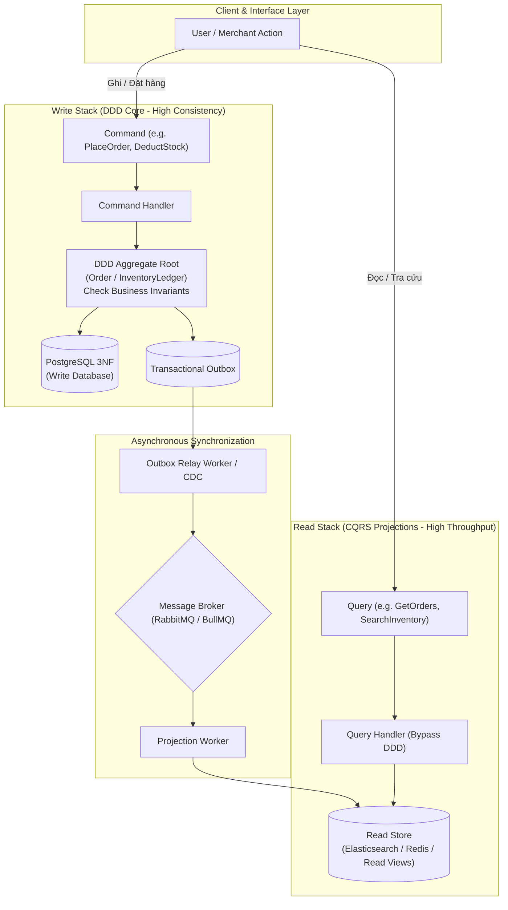

# 🏛️ CHUYÊN ĐỀ: ARCHITECTURAL PATTERNS (KIẾN TRÚC PHẦN MỀM ENTERPRISE)

> Thư mục tổng hợp các mẫu kiến trúc phần mềm cốt lõi (Architectural Patterns) được áp dụng trực tiếp trong dự án **ViShop WMS/OMS Platform** và hệ thống phân tán quy mô lớn.

---

## 📑 Danh mục các mẫu kiến trúc chi tiết

| STT | Chuyên đề kiến trúc | Trọng tâm nội dung chính | File đính kèm |
| :---: | :--- | :--- | :--- |
| **07.1** | **Domain-Driven Design (DDD)** | Strategic Design (Bounded Context, Anti-Corruption Layer ACL), Tactical Design (Aggregate Root, Entity, Value Object, Domain Events), Rich Domain Model & Transaction Boundary Invariants. | • [01-theory-architecture.md](file:///c:/Users/Admin/Documents/Project/interview/07-architectural-patterns/01-domain-driven-design/01-theory-architecture.md) • [02-interview-questions-cv.md](file:///c:/Users/Admin/Documents/Project/interview/07-architectural-patterns/01-domain-driven-design/02-interview-questions-cv.md) |
| **07.2** | **CQRS Architecture** | Tách biệt hoàn toàn Read Stack & Write Stack, Polyglot Persistence, Chống lỗi Dual-Write với Transactional Outbox Pattern, Xử lý Eventual Consistency Delay bằng SSE & Optimistic Concurrency Control (OCC). | • [01-theory-architecture.md](file:///c:/Users/Admin/Documents/Project/interview/07-architectural-patterns/02-cqrs/01-theory-architecture.md) • [02-interview-questions-cv.md](file:///c:/Users/Admin/Documents/Project/interview/07-architectural-patterns/02-cqrs/02-interview-questions-cv.md) |

---

## 🎯 Sự phối hợp hoàn hảo: DDD + CQRS Synergy

### Tại sao DDD và CQRS là "Cặp bài trùng"?
1. **Hóa giải bài toán Aggregate Bloating**: Trong DDD thuần túy, việc cố gắng nhồi nhét dữ liệu hiển thị vào Aggregate Root làm cho model bị phình to và nghẽn bộ nhớ. CQRS giải phóng Aggregate Root để nó chỉ tập trung 100% vào việc bảo vệ tính toàn vẹn (Invariants) ở tầng Ghi.
2. **Tối ưu tốc độ Đọc tối đa**: Tầng Đọc bỏ qua hoàn toàn Domain Model, đọc trực tiếp từ các Read Projections phẳng (PostgreSQL Views, Elasticsearch) với độ trễ $< 20\text{ms}$.
3. **Cầu nối Domain Events**: Các sự kiện nghiệp vụ phát sinh từ Aggregate Root trong DDD chính là dữ liệu đầu vào chuẩn mực để Transactional Outbox đồng bộ sang Read Model của CQRS.
