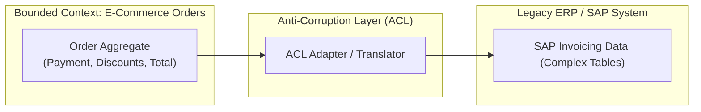
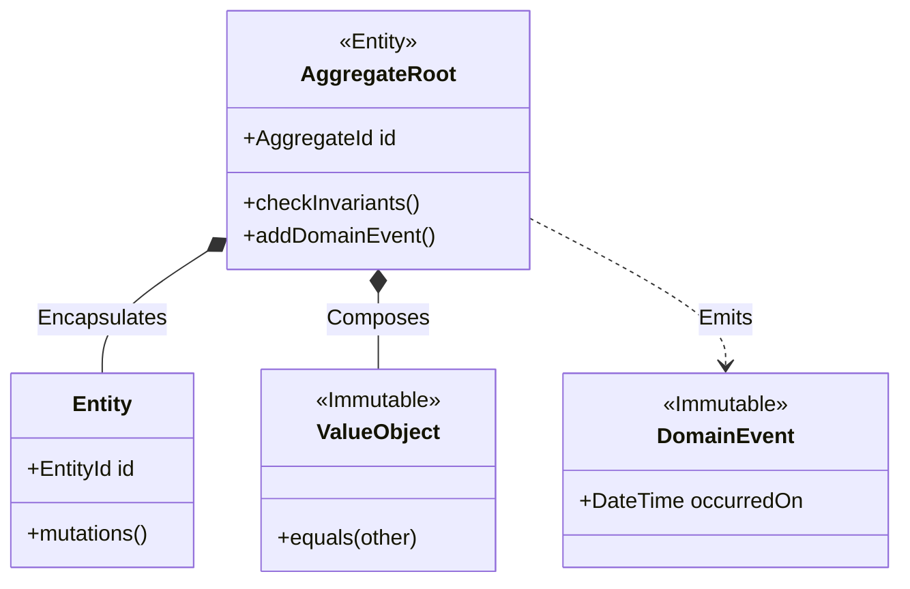

# 🏛️ CHUYÊN ĐỀ 07: DOMAIN-DRIVEN DESIGN (DDD) ARCHITECTURE & PRODUCTION GUIDE

---

## 1. Bản chất cốt lõi: Thiết kế Chiến lược & Chiến thuật

Domain-Driven Design (DDD) do Eric Evans khởi xướng, là phương pháp luận tập trung giải quyết độ phức tạp của **nghiệp vụ cốt lõi (Core Business Logic)** bằng cách đặt mô hình nghiệp vụ làm trung tâm của toàn bộ kiến trúc phần mềm.

### 1.1. Thiết kế Chiến lược (Strategic Design)
1. **Ubiquitous Language (Ngôn ngữ chung)**:
   * Từ vựng nghiêm ngặt được thống nhất 100% giữa Domain Expert (chuyên viên nghiệp vụ, PO, BA) và Kỹ sư phần mềm.
   * Cấm tuyệt đối: Code đặt tên là `tbl_usr_acc` trong khi nghiệp vụ gọi là `CustomerAccount`.
2. **Bounded Context (Ngữ cảnh ranh giới)**:
   * Mỗi Bounded Context là một ranh giới rõ ràng mà trong đó một mô hình nghiệp vụ cụ thể được áp dụng trọn vẹn.
   * *Ví dụ*: Đối tượng `Product` trong Bounded Context **Sales** (chứa giá bán, khuyến mãi) có ý nghĩa và thuộc tính hoàn toàn khác với `Product` trong Bounded Context **Warehouse/WMS** (chứa kích thước đóng gói, trọng lượng, vị trí kệ hàng).
3. **Anti-Corruption Layer (ACL - Tầng chống tha hóa)**:
   * Tầng Adapter chuyển đổi dữ liệu khi hệ thống hiện tại phải tích hợp với hệ thống Legacy bên ngoài, ngăn chặn mô hình dữ liệu cũ làm "ô nhiễm" Domain Model nội bộ.



---

## 2. Thiết kế Chiến thuật (Tactical Design Patterns)



| Thành phần | Đặc điểm nhận dạng | Quy tắc vàng trong Code |
| :--- | :--- | :--- |
| **Aggregate Root (AR)** | Là Entity đầu não của một cụm đối tượng, chịu trách nhiệm **bảo toàn các bất biến nghiệp vụ (Invariants)**. | Mọi tương tác từ bên ngoài **bắt buộc phải đi qua AR**. Không được phép sửa trực tiếp các Entity con bên trong AR. |
| **Entity** | Có định danh duy nhất (`ID`) xuyên suốt vòng đời. Hai entity có cùng thuộc tính nhưng khác ID là hai đối tượng khác nhau. | Có trạng thái biến đổi theo thời gian. |
| **Value Object (VO)** | Không có ID. Được định nghĩa hoàn toàn bởi giá trị của các thuộc tính. | **Bất biến (Immutable)**. Mọi thao tác thay đổi phải trả về một instance mới. Hỗ trợ so sánh cấu trúc (`equals`). |
| **Domain Event** | Đại diện cho một sự kiện nghiệp vụ quan trọng đã diễn ra trong quá khứ (`OrderPlaced`, `AccountDebited`). | Đặt tên ở thì quá khứ. Bất biến. |
| **Domain Service** | Chứa logic nghiệp vụ liên quan đến nhiều Aggregate hoặc không thuộc về một Entity cụ thể nào (ví dụ: `CurrencyExchangeService`). | Không lưu trạng thái (Stateless). |
| **Repository** | Cung cấp giao diện giả lập như một Collection trong bộ nhớ để load/save toàn bộ Aggregate Root. | **Chỉ tạo Repository cho Aggregate Root**. Không tạo Repository cho Entity con. |

---

## 3. Mã nguồn triển khai chuẩn mực (TypeScript Rich Domain Model)

### 3.1. Value Object: `Money`
```typescript
export class Money {
  private constructor(
    public readonly amount: number,
    public readonly currency: string
  ) {
    if (amount < 0) throw new Error('Số tiền không được âm');
    if (!currency) throw new Error('Đơn vị tiền tệ không được để trống');
  }

  public static create(amount: number, currency = 'VND'): Money {
    return new Money(amount, currency);
  }

  public add(other: Money): Money {
    if (this.currency !== other.currency) {
      throw new Error(`Không thể cộng hai loại tiền khác nhau: ${this.currency} vs ${other.currency}`);
    }
    return new Money(this.amount + other.amount, this.currency);
  }

  public equals(other: Money): boolean {
    return this.amount === other.amount && this.currency === other.currency;
  }
}
```

### 3.2. Aggregate Root: `Order`
```typescript
export class Order {
  private _items: OrderItem[] = [];
  private _status: 'PENDING' | 'PAID' | 'CANCELLED' = 'PENDING';
  private _domainEvents: any[] = [];

  constructor(
    public readonly id: string,
    public readonly customerId: string
  ) {}

  // Bảo vệ bất biến nghiệp vụ: Thêm sản phẩm và kiểm tra giới hạn
  public addItem(productId: string, unitPrice: Money, quantity: number): void {
    if (this._status !== 'PENDING') {
      throw new Error('Không thể thêm sản phẩm vào đơn hàng đã thanh toán hoặc đã hủy');
    }
    if (quantity <= 0 || quantity > 99) {
      throw new Error('Số lượng sản phẩm mỗi dòng phải từ 1 đến 99');
    }

    const existingItem = this._items.find((i) => i.productId === productId);
    if (existingItem) {
      existingItem.increaseQuantity(quantity);
    } else {
      this._items.push(new OrderItem(productId, unitPrice, quantity));
    }
  }

  // Thay đổi trạng thái và bắn Domain Event
  public markAsPaid(paymentTransactionId: string): void {
    if (this._items.length === 0) {
      throw new Error('Không thể thanh toán đơn hàng rỗng');
    }
    if (this._status !== 'PENDING') {
      throw new Error('Đơn hàng không ở trạng thái chờ thanh toán');
    }

    this._status = 'PAID';
    
    // Ghi nhận Domain Event
    this._domainEvents.push({
      eventName: 'OrderPaidEvent',
      orderId: this.id,
      customerId: this.customerId,
      totalAmount: this.calculateTotal(),
      occurredOn: new Date(),
    });
  }

  public calculateTotal(): Money {
    return this._items.reduce(
      (total, item) => total.add(item.totalPrice),
      Money.create(0, 'VND')
    );
  }

  public pullDomainEvents(): any[] {
    const events = [...this._domainEvents];
    this._domainEvents = [];
    return events;
  }
}
```

---

## 4. Các bẫy kỹ thuật & Lưu ý sống còn (Production Caveats)

### 4.1. Anemic Domain Model (Mô hình thực thể thiếu máu)
* **Hiện tượng**: Class Entity chỉ gồm các trường dữ liệu và hàng loạt các hàm `getter`/`setter` công khai. Toàn bộ validation, kiểm tra điều kiện nghiệp vụ bị đẩy ra các tầng `OrderService`.
* **Hậu quả**: Vi phạm tính đóng gói (Encapsulation). Bất kỳ service nào cũng có thể sửa đổi trạng thái của Entity một cách tùy tiện mà không qua kiểm tra, làm hỏng tính toàn vẹn dữ liệu.
* **Nguyên tắc**: **Biến private, không viết public setter vô tội vạ. Mọi hành động thay đổi trạng thái phải là một hàm nghiệp vụ có ý nghĩa (vd: `order.cancel(reason)` thay vì `order.setStatus('CANCELLED')`)**.

### 4.2. Aggregate Quá Lớn (Fat Aggregates)
* **Sai lầm**: Nhúng toàn bộ danh sách khách hàng, lịch sử thanh toán 10 năm vào trong 1 Aggregate `Customer`.
* **Hậu quả**:
  1. Tốn RAM khi load toàn bộ graph từ DB lên bộ nhớ.
  2. Xung đột ghi đồng thời (Concurrency Lock Conflict): Hai giao dịch cùng sửa 2 thông tin không liên quan của cùng 1 Aggregate sẽ đụng độ version Optimistic Lock.
* **Nguyên tắc**: **Một Aggregate chỉ nên nhỏ gọn vừa đủ để bảo vệ các bất biến nghiệp vụ trực tiếp**.

### 4.3. Quan hệ giữa các Aggregate: Tham chiếu bằng ID
* **Cấm kỵ**: Aggregate Root A giữ con trỏ/object trực tiếp đến Aggregate Root B (`order.customer.address`).
* **Chuẩn**: **Chỉ tham chiếu nhau bằng Identifier** (`order.customerId: string`). Nếu cần dữ liệu của Customer, Use Case sẽ load riêng thông qua `CustomerRepository`.

### 4.4. Đừng lạm dụng DDD cho các module CRUD đơn giản
* Áp dụng toàn bộ cấu trúc Entity, Value Object, Repository cho một bảng quản lý danh mục (Category) chỉ có 3 cột sẽ dẫn đến **Over-engineering**, làm chậm tiến độ dự án mà không mang lại giá trị nào.

---

## 5. Bộ câu hỏi phỏng vấn chuyên sâu (Senior / Staff Level)

1. **Hỏi**: *“Làm sao để đảm bảo Transaction Boundary khi một use case cần cập nhật dữ liệu trên hai Aggregate Root khác nhau?”*
   * **Đáp chuẩn**: Quy tắc cốt lõi của DDD là: **Một Database Transaction chỉ được phép chỉnh sửa DUY NHẤT một Aggregate Root**. Nếu cần cập nhật Aggregate B sau khi Aggregate A thay đổi, ta phải sử dụng **Eventual Consistency (Nhất quán cuối cùng)**:
     1. Transaction 1: Lưu thay đổi của Aggregate A vào DB và ghi Domain Event vào bảng Transactional Outbox (commit atomic).
     2. Event Bus / Message Broker đẩy sự kiện đó tới một Event Handler riêng biệt.
     3. Transaction 2: Event Handler nạp Aggregate B từ DB, thực thi nghiệp vụ và commit riêng.
2. **Hỏi**: *“Phân biệt Domain Event và Integration Event trong kiến trúc Microservices?”*
   * **Đáp chuẩn**:
     * **Domain Event**: Phát sinh và được tiêu thụ ngay trong phạm vi nội bộ của cùng một Bounded Context. Thường chứa chi tiết mô hình nghiệp vụ nội bộ.
     * **Integration Event**: Được thiết kế để phát hành ra thế giới bên ngoài (qua RabbitMQ/Kafka) cho các Bounded Context hoặc Microservice khác tiêu thụ. Schema của Integration Event phải được bảo vệ nghiêm ngặt (dùng hợp đồng dữ liệu/contract), tránh làm lộ chi tiết nội bộ của domain ra bên ngoài.
