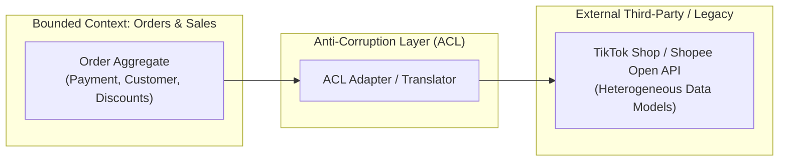

# 📗 CHUYÊN ĐỀ 07.1: DOMAIN-DRIVEN DESIGN – LÝ THUYẾT & KIẾN TRÚC LÕI

> **Mục tiêu**: Nắm vững phương pháp luận Domain-Driven Design (DDD), phân biệt rạch ròi giữa Thiết kế Chiến lược (Strategic Design) và Thiết kế Chiến thuật (Tactical Design), cấu trúc Rich Domain Model, ranh giới Aggregate Root và nguyên tắc Transaction Boundary.

---

## 1. Thiết kế Chiến lược (Strategic Design)

DDD tập trung giải quyết độ phức tạp của **nghiệp vụ cốt lõi (Core Domain Logic)** bằng cách đặt mô hình nghiệp vụ làm trung tâm của toàn bộ kiến trúc phần mềm.



1. **Ubiquitous Language (Ngôn ngữ chung)**:
   * Tập từ vựng thống nhất 100% giữa Domain Expert (PO, BA, chuyên viên nghiệp vụ) và Kỹ sư phần mềm.
   * Mọi tên biến, class, domain event, tài liệu kỹ thuật đều phải phản ánh chính xác ngôn ngữ nghiệp vụ thực tế (Ví dụ: `InventoryTransferLedger` thay vì `tbl_inv_trans`).
2. **Bounded Context (Ngữ cảnh ranh giới)**:
   * Một ranh giới phân định rõ ràng mà trong đó một Domain Model cụ thể được áp dụng trọn vẹn và nhất quán.
   * *Ví dụ*: Cùng là khái niệm `Product`, nhưng trong Bounded Context **Sales** nó chứa giá niêm yết, chính sách khuyến mãi; còn trong Bounded Context **Warehouse (WMS)** nó chứa trọng lượng đóng gói, thể tích m3 và vị trí kệ chứa hàng.
3. **Anti-Corruption Layer (ACL - Tầng chống tha hóa)**:
   * Tầng chuyển đổi (Translator/Adapter) đứng giữa hệ thống nội bộ và hệ thống bên thứ ba (hoặc Legacy System).
   * Ngăn chặn các cấu trúc dữ liệu lộn xộn từ API bên ngoài làm "ô nhiễm" hoặc phá vỡ cấu trúc Clean Domain Model nội bộ.

---

## 2. Thiết kế Chiến thuật (Tactical Design Patterns)

```mermaid
classDiagram
    class AggregateRoot {
        <<Entity>>
        +AggregateId id
        +checkInvariants()
        +addDomainEvent()
    }
    class Entity {
        +EntityId id
        +mutations()
    }
    class ValueObject {
        <<Immutable>>
        +equals(other)
    }
    class DomainEvent {
        <<Immutable>>
        +DateTime occurredOn
    }
    AggregateRoot *-- Entity : Encapsulates
    AggregateRoot *-- ValueObject : Composes
    AggregateRoot ..> DomainEvent : Emits
```



| Khái niệm | Đặc điểm nhận dạng | Quy tắc vàng khi Code |
| :--- | :--- | :--- |
| **Aggregate Root (AR)** | Là Entity đầu não của một cụm đối tượng, chịu trách nhiệm **bảo vệ các bất biến nghiệp vụ (Invariants)**. | Mọi thao tác từ bên ngoài **bắt buộc phải gọi thông qua method của AR**. Cấm sửa trực tiếp Entity con bên trong AR. |
| **Entity** | Có định danh duy nhất (`ID`) xuyên suốt vòng đời. Hai entity trùng thuộc tính nhưng khác ID là hai đối tượng khác nhau. | Có trạng thái biến đổi theo thời gian. |
| **Value Object (VO)** | Không có ID. Được định nghĩa hoàn toàn bởi giá trị của các thuộc tính. | **Bất biến (Immutable)**. Mọi thao tác thay đổi phải trả về instance mới. So sánh theo giá trị cấu trúc (`equals`). |
| **Domain Event** | Bản ghi mô tả một sự kiện nghiệp vụ quan trọng đã diễn ra trong quá khứ (`OrderPlaced`, `InventoryDeducted`). | Đặt tên ở thì quá khứ. Bất biến. |
| **Domain Service** | Chứa logic nghiệp vụ liên quan đến nhiều Aggregate hoặc không thuộc về một Entity cụ thể nào. | Không lưu trạng thái (Stateless). |
| **Repository** | Cung cấp interface lưu trữ/truy vấn toàn bộ một Aggregate Root như một collection trong bộ nhớ. | **Chỉ tạo Repository cho Aggregate Root**. Tuyệt đối không tạo Repository riêng cho Entity con. |

---

## 3. Triển khai Code Rich Domain Model (TypeScript)

### 3.1. Value Object: `Money` (Bất biến)
```typescript
export class Money {
  private constructor(
    public readonly amount: number,
    public readonly currency: string
  ) {
    if (amount < 0) throw new Error('Số tiền không được âm');
    if (!currency) throw new Error('Currency không được rỗng');
  }

  public static create(amount: number, currency = 'VND'): Money {
    return new Money(amount, currency);
  }

  public add(other: Money): Money {
    if (this.currency !== other.currency) {
      throw new Error(`Không thể cộng hai loại tiền khác nhau: ${this.currency} vs ${other.currency}`);
    }
    return new Money(this.amount + other.amount, this.currency);
  }

  public equals(other: Money): boolean {
    return this.amount === other.amount && this.currency === other.currency;
  }
}
```

### 3.2. Aggregate Root: `Order` (Bảo vệ Bất biến)
```typescript
export class Order {
  private _items: OrderItem[] = [];
  private _status: 'PENDING' | 'PAID' | 'CANCELLED' = 'PENDING';
  private _domainEvents: any[] = [];

  constructor(
    public readonly id: string,
    public readonly customerId: string
  ) {}

  // Kiểm soát Invariant: Không thêm item khi đơn đã chốt
  public addItem(productId: string, unitPrice: Money, quantity: number): void {
    if (this._status !== 'PENDING') {
      throw new Error('Không thể thêm sản phẩm vào đơn hàng đã thanh toán hoặc đã hủy');
    }
    if (quantity <= 0 || quantity > 99) {
      throw new Error('Số lượng sản phẩm mỗi dòng phải từ 1 đến 99');
    }

    const existing = this._items.find((item) => item.productId === productId);
    if (existing) {
      existing.increaseQuantity(quantity);
    } else {
      this._items.push(new OrderItem(productId, unitPrice, quantity));
    }
  }

  // Chuyển dịch trạng thái & Phát sinh Domain Event
  public markAsPaid(paymentTransactionId: string): void {
    if (this._items.length === 0) throw new Error('Không thể thanh toán đơn hàng rỗng');
    if (this._status !== 'PENDING') throw new Error('Đơn hàng không ở trạng thái chờ thanh toán');

    this._status = 'PAID';
    this._domainEvents.push({
      eventName: 'OrderPaidEvent',
      orderId: this.id,
      customerId: this.customerId,
      totalAmount: this.calculateTotal(),
      occurredOn: new Date(),
    });
  }

  public calculateTotal(): Money {
    return this._items.reduce(
      (total, item) => total.add(item.totalPrice),
      Money.create(0, 'VND')
    );
  }

  public pullDomainEvents(): any[] {
    const events = [...this._domainEvents];
    this._domainEvents = [];
    return events;
  }
}
```

---

## 4. Các cạm bẫy kỹ thuật sống còn (Production Caveats)

| STT | Bẫy kỹ thuật | Hậu quả thực tế | Giải pháp chuẩn Production |
| :--- | :--- | :--- | :--- |
| **1** | **Anemic Domain Model (Mô hình thiếu máu)** | Entity chỉ gồm trường dữ liệu và hàng loạt hàm `getter/setter` rỗng. Toàn bộ validation bị đẩy ra Service. | Biến `private`. Mọi đột biến trạng thái phải là hàm nghiệp vụ có ý nghĩa (`order.cancel(reason)`). |
| **2** | **Fat Aggregates (Aggregate quá lớn)** | Nhúng toàn bộ danh sách khách hàng, đơn hàng 5 năm vào trong 1 Aggregate `Customer`. | Tốn RAM, xung đột Optimistic Lock liên tục. **Aggregate chỉ nên nhỏ gọn vừa đủ để bảo vệ bất biến trực tiếp**. |
| **3** | **Vi phạm Transaction Boundary** | 1 Database Transaction sửa đồng thời 2 Aggregate Root khác nhau. | Quy tắc vàng: **1 Transaction chỉ được sửa DUY NHẤT 1 Aggregate Root**. Cập nhật Aggregate thứ 2 thông qua **Eventual Consistency & Domain Events**. |
| **4** | **Aggregate giữ object tham chiếu** | Aggregate A giữ con trỏ/object trực tiếp đến Aggregate B (`order.customer.address`). | **Chỉ tham chiếu nhau bằng Identifier ID** (`order.customerId: string`). |
