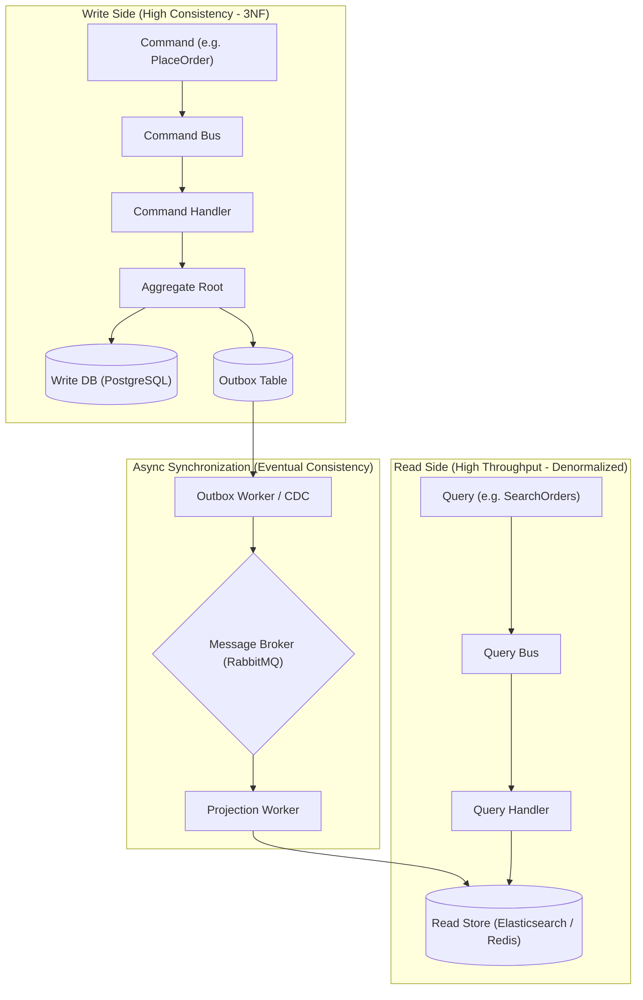

# ⚖️ CHUYÊN ĐỀ 08: CQRS (COMMAND QUERY RESPONSIBILITY SEGREGATION) ARCHITECTURE & PRODUCTION GUIDE

---

## 1. Bản chất cốt lõi: Tại sao phải tách biệt Read và Write?

Trong các hệ thống CRUD truyền thống, một Data Model duy nhất thường được dùng cho cả việc đọc và ghi:
* **Mâu thuẫn cốt lõi**:
  * **Tầng Ghi (Write)**: Đòi hỏi tính nhất quán cao, chuẩn hóa cơ sở dữ liệu (3NF) để tránh trùng lặp dữ liệu, kiểm tra các bất biến nghiệp vụ khắt khe, thực thi các Transaction ngắn hạn.
  * **Tầng Đọc (Read)**: Đòi hỏi tốc độ cực nhanh, phi chuẩn hóa (Denormalized) để tránh các phép `JOIN` 5–10 bảng phức tạp, hỗ trợ tìm kiếm toàn văn, phân trang, lọc đa chiều.
* **CQRS giải quyết vấn đề này** bằng cách tách rời hoàn toàn:
  * **Command**: Thay đổi trạng thái hệ thống, không trả về dữ liệu phức tạp (chỉ trả về ID hoặc Status).
  * **Query**: Chỉ đọc dữ liệu, không bao giờ thay đổi trạng thái hệ thống.



---

## 2. Các cấp độ triển khai CQRS

### 2.1. Cấp độ 1: Phân tách Logic trên cùng 1 Database (Single Database CQRS)
* Vẫn dùng chung một Database PostgreSQL:
  * **Command Stack**: Đi qua Domain Model, nạp Aggregate, kiểm tra validation, lưu vào bảng quan hệ chuẩn.
  * **Query Stack**: Bỏ qua toàn bộ Domain Model, dùng query SQL trực tiếp (Dapper, raw SQL, hoặc Database Views) map thẳng vào DTO trả về cho UI.
* *Ưu điểm*: Đơn giản, tính nhất quán tức thì (Strong Consistency), không lo trễ dữ liệu.

### 2.2. Cấp độ 2: Đa cơ sở dữ liệu (Polyglot Persistence CQRS)
* **Write DB**: PostgreSQL / MySQL (ACID, Transactional).
* **Read DB**: Elasticsearch (Tìm kiếm, bộ lọc), Redis (Top view, Leaderboard), MongoDB (Lưu trữ document denormalized cho màn hình Dashboard).
* *Ưu điểm*: Scale độc lập 100% giữa đọc và ghi (Read có thể chịu tải gấp 100 lần Write).

---

## 3. Bài toán kinh điển: Dual-Write & Transactional Outbox Pattern

### 3.1. Hiểm họa của việc ghi 2 nơi (Dual-Write Problem)
```typescript
// ❌ ANTI-PATTERN NGUY HIỂM:
async function handleCreateOrder(command) {
  await postgres.orders.insert(orderData); // Bước 1: Thành công
  
  // Bước 2: Gọi publish ra broker hoặc update sang Elasticsearch
  // NẾU ỨNG DỤNG BỊ CRASH Ở ĐÂY HOẶC MẠNG LAG -> ES KHÔNG BAO GIỜ CẬP NHẬT
  await rabbitMQ.publish('order.created', orderData); 
}
```

### 3.2. Giải pháp: Transactional Outbox Pattern
Lưu Domain Event trực tiếp vào bảng `outbox` **trong cùng một Database Transaction với bản ghi nghiệp vụ**:

```sql
BEGIN;
  -- 1. Lưu đơn hàng
  INSERT INTO orders (id, customer_id, total_amount) VALUES ('ord_123', 'cus_99', 500000);
  
  -- 2. Lưu event vào bảng Outbox (Đảm bảo ATOMIC 100%)
  INSERT INTO outbox_events (id, aggregate_type, aggregate_id, event_type, payload, status)
  VALUES (
    gen_random_uuid(), 
    'Order', 
    'ord_123', 
    'OrderCreated', 
    '{"id": "ord_123", "total": 500000}', 
    'PENDING'
  );
COMMIT;
```

* Một tiến trình nền (Worker quét bảng outbox với `SKIP LOCKED` hoặc **Debezium CDC** đọc WAL log) sẽ đảm bảo sự kiện được gửi tới RabbitMQ/Kafka một cách an toàn mà không bao giờ thất lạc.

---

## 4. Xử lý độ trễ nhất quán (Eventual Consistency Delay)

### 4.1. Kịch bản "Vừa tạo xong nhưng không thấy trên màn hình"
* Người dùng ấn "Tạo đơn hàng". API trả về `201 Created`.
* Ứng dụng điều hướng người dùng về trang danh sách đơn. Vì Worker chưa kịp đồng bộ sang Elasticsearch (trễ 200ms - 500ms), danh sách vẫn chưa có đơn hàng mới $\rightarrow$ Người dùng hoang mang ấn tạo lại.

### 4.2. Các chiến lược giải quyết thực tế trong Production:
1. **Optimistic UI Updates (Cập nhật lạc quan ở Frontend)**:
   * Ngay khi nhận mã `201 Created`, Frontend tự chèn tạm thời dữ liệu đơn hàng vào state của giao diện hiển thị mà không cần query lại ngay.
2. **Read-Your-Own-Writes Pattern**:
   * Khi người dùng vừa thực hiện mutation (Write), gắn một cookie hoặc header `last_mutation_timestamp`.
   * Trong vòng 5 giây tiếp theo, các query của chính người dùng đó sẽ được định tuyến thẳng xuống **Write Database** thay vì Read Store để đảm bảo dữ liệu mới nhất.
3. **Polling / SSE Status Update**:
   * API trả về `202 Accepted` kèm theo Job ID. Frontend lắng nghe qua WebSocket/SSE hoặc poll nhẹ trạng thái đến khi hệ thống báo `SYNCED`.

---

## 5. Các bẫy kỹ thuật & Lưu ý sống còn (Production Caveats)

| STT | Vấn đề / Bẫy kỹ thuật | Hậu quả | Giải pháp xử lý |
| :--- | :--- | :--- | :--- |
| **1** | **Nhầm lẫn CQRS với Event Sourcing** | Cho rằng làm CQRS là bắt buộc phải lưu toàn bộ lịch sử biến động bằng Event Sourcing $\rightarrow$ Độ phức tạp tăng vọt 500%. | CQRS hoàn toàn có thể hoạt động độc lập với State-based DB truyền thống. Chỉ dùng Event Sourcing khi nghiệp vụ thực sự cần Audit Trail (Ngân hàng, bảo hiểm). |
| **2** | **Xử lý sự kiện không Idempotent ở Projection** | Message bị delivery lặp khiến Projection Worker tăng số lượng đơn hàng lên 2 lần trên Read Store. | Luôn lưu `last_processed_version` hoặc dùng lệnh Upsert/Idempotent Query trên Read Store. |
| **3** | **Tái dựng Read Model khi đổi Schema (Re-indexing)** | Khi Read Model cần thêm một trường mới từ Write Model, không có cách nào cập nhật lại hàng triệu bản ghi cũ. | Thiết kế kịch bản Rebuild Projection: Cho phép worker chạy lại toàn bộ sự kiện từ đầu hoặc query một batch từ Write DB để build lại index mới song song (Blue-Green Indexing). |
| **4** | **Áp dụng CQRS cho hệ thống quá đơn giản** | Tốn gấp đôi nhân lực bảo trì 2 data store, viết gấp 3 lần số lượng code cho các tính năng CRUD cơ bản. | Chỉ áp dụng CQRS cho các Bounded Context thực sự có độ phức tạp cao hoặc tỷ lệ Read/Write lệch nhau nghiêm trọng. |

---

## 6. Bộ câu hỏi phỏng vấn chuyên sâu (Senior / Staff Level)

1. **Hỏi**: *“Khi nào bạn KHÔNG NÊN sử dụng CQRS?”*
   * **Đáp chuẩn**: Không nên dùng CQRS khi:
     1. Hệ thống chủ yếu là CRUD đơn giản, logic nghiệp vụ không phức tạp, không có xung đột giữa cấu trúc đọc và cấu trúc ghi.
     2. Nghiệp vụ đòi hỏi tính nhất quán tức thì tuyệt đối (Strict Strong Consistency) trên tất cả các màn hình mà không chấp nhận độ trễ (Eventual Consistency).
     3. Đội ngũ kỹ sư chưa có kinh nghiệm vận hành hệ thống phân tán và xử lý các bài toán Distributed Tracing, Event Replay, Idempotency.
2. **Hỏi**: *“Làm thế nào để xử lý xung đột nếu 2 Command đồng thời cùng cố gắng sửa đổi 1 Aggregate trong mô hình CQRS?”*
   * **Đáp chuẩn**: Sử dụng **Optimistic Concurrency Control (OCC)**:
     * Mỗi Aggregate Root mang theo một thuộc tính `version` (bắt đầu từ 1).
     * Khi Command Handler nạp Aggregate, nó đọc `version = N`.
     * Khi lưu vào Database, câu lệnh SQL sẽ là:
       `UPDATE aggregates SET data = ..., version = N + 1 WHERE id = ... AND version = N;`
     * Nếu có Command khác đã cập nhật trước đó, số dòng bị ảnh hưởng sẽ là 0 (`rowCount == 0`). Command Handler phát hiện xung đột (`ConcurrencyException`), tự động rollback và có thể retry lại sau một khoảng thời gian ngắn (Exponential Backoff).
