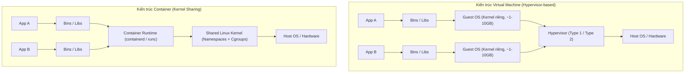
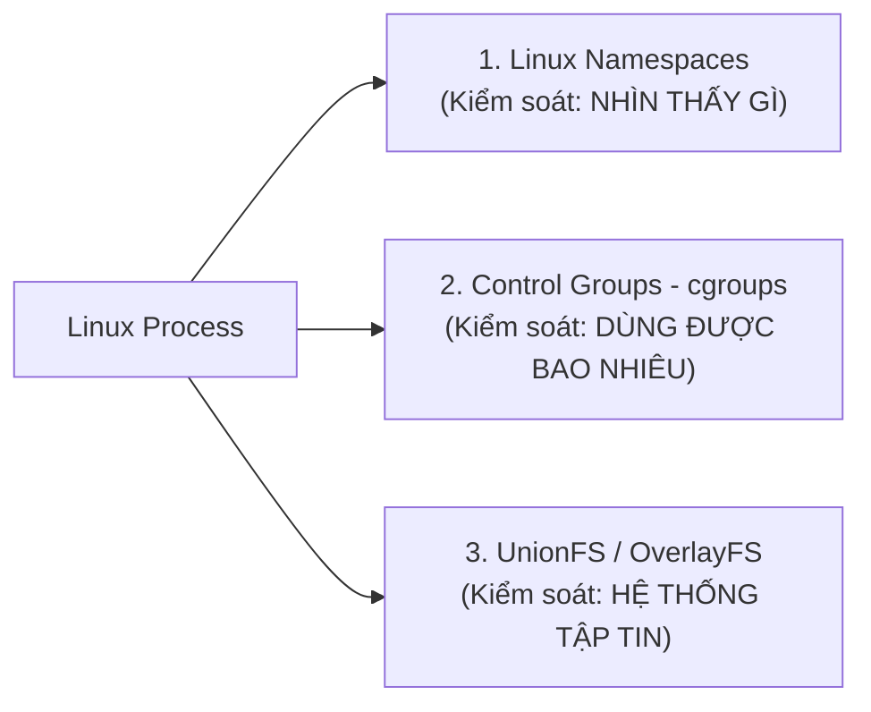
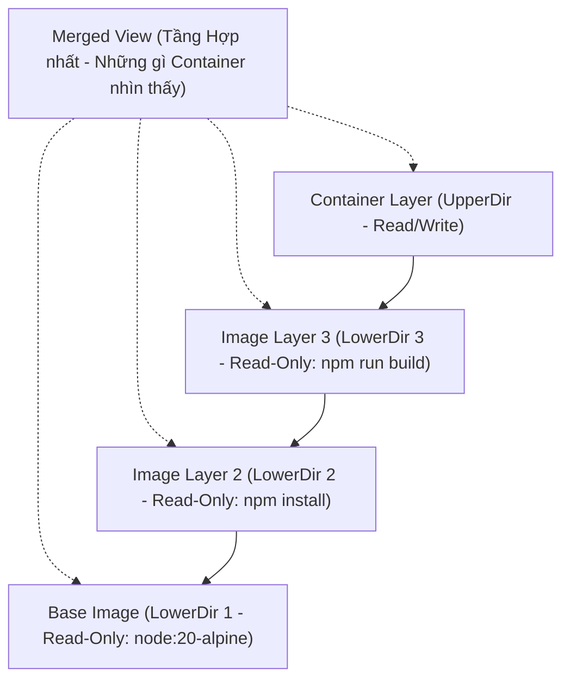
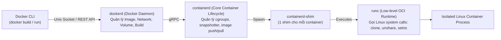
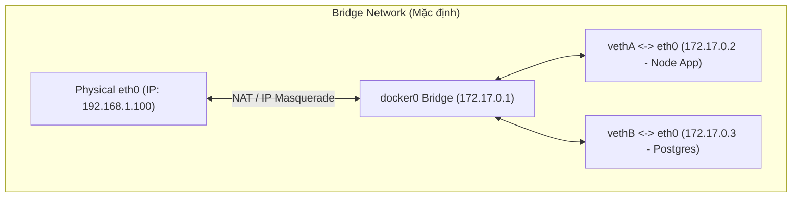
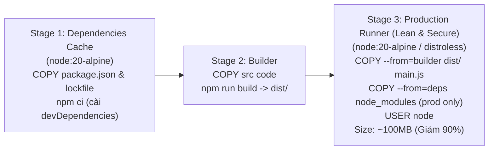
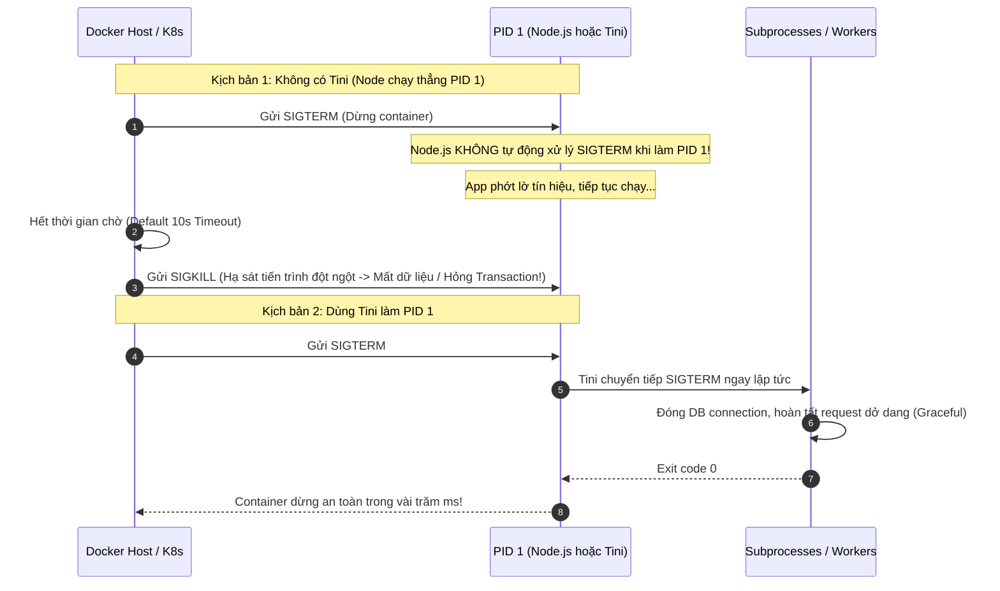

# 📗 CHUYÊN ĐỀ 08.1: DOCKER ARCHITECTURE – LÝ THUYẾT & KIẾN TRÚC LÕI

> **Mục tiêu**: Nắm vững bản chất tầng thấp của Linux Containers (Namespaces, Cgroups, OverlayFS), kiến trúc Docker Engine (dockerd, containerd, runc), cơ chế Docker Networking & Iptables, Multi-stage Builds tối ưu kích thước Image, và giải quyết triệt để vấn đề PID 1 & Signal Handling trong môi trường Enterprise.

---

## 1. Bản chất cốt lõi: Containers vs Virtual Machines (VMs)

Một Container **không phải là một máy ảo (Virtual Machine)** và không chứa một hệ điều hành riêng biệt. Về mặt bản chất của Linux Kernel:

> **Container thực chất chỉ là một tiến trình thông thường của Linux (Standard Linux Process) được cô lập bằng Namespaces và kiểm soát tài nguyên bằng Control Groups (Cgroups).**



| Tiêu chí | Virtual Machine (VM) | Linux Container |
| :--- | :--- | :--- |
| **Cơ chế cô lập** | Hardware Virtualization qua Hypervisor | Process-level Isolation qua Linux Kernel |
| **Kernel** | Mỗi VM có **1 Guest Kernel riêng biệt** | Dùng chung **duy nhất Host Linux Kernel** |
| **Thời gian khởi động** | Vài chục giây đến vài phút (boot OS) | Vài mili-giây đến vài giây (chạy 1 process) |
| **Tiêu tốn tài nguyên** | Cố định (RAM, CPU cấp phát trước kể cả khi idle) | Động (Chỉ tốn đúng lượng RAM/CPU process dùng) |
| **Kích thước** | Rất lớn (Hàng GB đến hàng chục GB) | Nhỏ gọn (Vài MB đến vài trăm MB) |

---

## 2. Ba trụ cột của Linux Container Internals

Mọi Container Engine (Docker, Podman, Containerd) đều được xây dựng trên **3 công nghệ cốt lõi của Linux Kernel**:



### 2.1. Linux Namespaces (Cô lập không gian quan sát)
Namespaces quy định process bên trong container **có thể nhìn thấy những tài nguyên nào**:

1. **PID Namespace**: Cô lập cây tiến trình. Tiến trình chính bên trong container nhìn thấy mình là **`PID 1`**, nhưng trên Host OS nó chỉ là một tiến trình bình thường có PID thực tế (ví dụ `PID 41582`).
2. **NET Namespace**: Cô lập network stack. Mỗi container sở hữu card mạng ảo (`eth0`), bảng định tuyến (routing table), địa chỉ IP riêng biệt và iptables rules độc lập.
3. **MNT (Mount) Namespace**: Cô lập cây thư mục mount. Container chỉ nhìn thấy root filesystem riêng (`/`) của image mà không thấy filesystem của Host.
4. **IPC Namespace**: Cô lập bộ nhớ chia sẻ (Shared Memory, POSIX Message Queues, Semaphores). Tiến trình trong container không thể can thiệp IPC của Host.
5. **UTS Namespace**: Cô lập Hostname và Domain name riêng cho container.
6. **USER Namespace**: Ánh xạ UID/GID bên trong container sang UID/GID thông thường trên Host (chìa khóa cho **Rootless Container**).

### 2.2. Control Groups (cgroups v1 / cgroups v2 – Giới hạn tài nguyên)
Cgroups quy định process **được phép sử dụng tối đa bao nhiêu tài nguyên phần cứng**:

* **CPU**: Giới hạn lượng CPU cycle (`cpu.cfs_quota_us`, `cpu.cfs_period_us`, `cpu.shares`).
* **Memory**: Giới hạn RAM tối đa (`memory.max` / `memory.limit_in_bytes`). Nếu container cố tình cấp phát vượt ngưỡng memory limit, Linux Kernel sẽ kích hoạt **OOM Killer (Out Of Memory Killer)** để `SIGKILL` ngay lập tức tiến trình tiêu tốn RAM nhiều nhất (exit code `137`).
* **PIDs Limit**: Giới hạn tổng số lượng threads/subprocesses được spawn (`pids.max`) nhằm ngăn chặn tấn công **Fork Bomb** làm treo toàn bộ máy chủ.
* **Block I/O**: Giới hạn tốc độ đọc/ghi đĩa (IOPS, byte rate) tránh việc một container nghẽn ổ đĩa ảnh hưởng các service khác.

### 2.3. OverlayFS & Cơ chế Copy-on-Write (CoW)
Docker sử dụng **Storage Driver OverlayFS** để xếp chồng các lớp (Layers) của image lên nhau tạo thành một Filesystem duy nhất:



* **Image Layers (LowerDir)**: Toàn bộ các layer tạo ra từ các chỉ thị `FROM`, `RUN`, `COPY` trong Dockerfile đều là **Read-Only (Bất biến)** và được chia sẻ (share) giữa hàng trăm container cùng image.
* **Container Layer (UpperDir)**: Khi container khởi chạy, Docker cấp một lớp mỏng **Read-Write** nằm trên cùng.
* **Cơ chế Copy-on-Write (CoW)**:
  * Khi container muốn đọc file: Hệ thống tìm từ layer trên cùng xuống layer dưới cùng.
  * Khi container muốn sửa một file từ Base Image: OverlayFS **sao chép (copy) file đó từ LowerDir lên UpperDir** rồi mới thực hiện sửa. File gốc ở Image Layer hoàn toàn không bị ảnh hưởng.
  * Khi container bị xóa (`docker rm`), chỉ có UpperDir bị hủy, Base Image vẫn nguyên vẹn.

---

## 3. Kiến trúc Docker Engine & Hệ sinh thái OCI (Open Container Initiative)

Trước đây, Docker là một khối nguyên khối (monolithic daemon). Hiện nay, theo chuẩn OCI, kiến trúc Docker Engine đã được mô-đun hóa:



1. **Docker CLI**: Giao diện dòng lệnh nhận lệnh từ người dùng, giao tiếp với `dockerd` qua Unix socket (`/var/run/docker.sock`).
2. **dockerd**: Chịu trách nhiệm cấp cao: Docker API, build image, quản lý storage driver, quản lý Docker networks.
3. **containerd**: Bộ điều phối vòng đời container chuẩn công nghiệp (được Kubernetes dùng trực tiếp làm CRI).
4. **containerd-shim**: Cho phép `dockerd` hoặc `containerd` khởi động lại hoặc nâng cấp mà **không làm sập các container đang chạy**; đồng thời giữ STDIN/STDOUT của container.
5. **runc**: Công cụ cấp thấp gọn nhẹ tuân thủ chuẩn OCI, trực tiếp thực hiện các system call của Linux (`clone()`, `unshare()`, `pivot_root()`) để tạo namespaces và cgroups, sau đó bàn giao process lại cho shim và tự hủy.

---

## 4. Mạng trong Docker (Docker Networking & Iptables Internals)

Docker cung cấp 4 driver mạng cơ bản:



1. **Bridge Network (Mặc định)**:
   * Docker tạo ra một bridge ảo tên `docker0` trên host và gán dải mạng con (ví dụ `172.17.0.0/16`).
   * Mỗi container được cấp một card mạng ảo `eth0` nối với host thông qua cặp **veth pair (Virtual Ethernet pair)**.
   * Giao tiếp ra ngoài Internet được định tuyến qua iptables bằng cơ chế **NAT / IP Masquerading**.
   * Khi mở cổng với `-p 3000:3000`, Docker tự động tạo quy tắc `DNAT` trong bảng `PREROUTING` của iptables để chuyển tiếp gói tin từ IP Host vào IP Container.
   * *Lưu ý*: Trên **User-defined Bridge**, Docker cung cấp sẵn **Embedded DNS Server (127.0.0.11)** cho phép các container phân giải tên miền service bằng name (ví dụ: `postgres:5432`) thay vì IP tĩnh.
2. **Host Network (`--net=host`)**:
   * Loại bỏ hoàn toàn sự cô lập mạng. Container dùng chung network namespace với Host OS.
   * Không có overhead của iptables NAT. Cho hiệu năng throughput cao nhất, nhưng gây xung đột cổng nếu 2 service cùng listen một port.
3. **None Network (`--net=none`)**:
   * Container chỉ có loopback interface (`lo`), hoàn toàn không có kết nối mạng bên ngoài. Dùng cho các tác vụ batch processing hoặc sandbox bảo mật cao.
4. **Overlay Network**:
   * Sử dụng công nghệ **VXLAN Encapsulation** để đóng gói gói tin mạng, kết nối các container nằm trên nhiều Host vật lý khác nhau (Docker Swarm / Kubernetes CNI).

---

## 5. Multi-Stage Builds: Tối ưu hóa kích thước & Bảo mật Image

Trong môi trường Production, image chứa compiler, toolchain hoặc devDependencies là thảm họa về cả **kích thước truyền tải** lẫn **lỗ hổng bảo mật (CVEs)**. Kỹ thuật **Multi-stage Build** giải quyết triệt để vấn đề này.



### Dockerfile chuẩn Production cho Node.js (NestJS / Fastify):
```dockerfile
# ==========================================
# GIAI ĐOẠN 1: Cài đặt dependencies
# ==========================================
FROM node:20-alpine AS dependencies
WORKDIR /app
# Tận dụng Docker Layer Cache: chỉ copy file khai báo thư viện trước
COPY package.json package-lock.json ./
RUN npm ci

# ==========================================
# GIAI ĐOẠN 2: Build mã nguồn TypeScript
# ==========================================
FROM node:20-alpine AS builder
WORKDIR /app
COPY --from=dependencies /app/node_modules ./node_modules
COPY . .
RUN npm run build
# Loại bỏ devDependencies để chỉ giữ lại runtime packages
RUN npm prune --production

# ==========================================
# GIAI ĐOẠN 3: Runtime cực nhẹ & Bảo mật cao
# ==========================================
FROM node:20-alpine AS runner
WORKDIR /app

# Biến môi trường production
ENV NODE_ENV=production
ENV PORT=3000

# Bảo mật: Cài đặt init process và chạy dưới quyền non-root user
RUN apk add --no-cache tini
COPY --from=builder --chown=node:node /app/node_modules ./node_modules
COPY --from=builder --chown=node:node /app/dist ./dist

# Đổi quyền sang user node (UID 1000) để chống leo thang đặc quyền
USER node

EXPOSE 3000

# Sử dụng tini làm PID 1 để bắt đúng tín hiệu SIGTERM / SIGINT
ENTRYPOINT ["/sbin/tini", "--"]
CMD ["node", "dist/main.js"]
```

---

## 6. Hiểm họa PID 1, Zombie Processes & Signal Handling

Trong Linux, tiến trình mang **`PID 1` (Init process - vd: systemd)** giữ 2 trọng trách tối thượng:
1. **Xử lý tín hiệu tắt máy (Signal Handling)**: Nhận `SIGTERM`, `SIGINT` và chuyển tiếp cho các tiến trình con để thực hiện Graceful Shutdown.
2. **Thu dọn tiến trình con mồ côi (Zombie Process Reaping)**: Khi một tiến trình con kết thúc nhưng cha của nó chưa gọi hàm `wait()`, tiến trình con trở thành **Zombie (`<defunct>`)**. PID 1 có trách nhiệm nhận nuôi và thu dọn các zombie này khỏi bảng Process Table.



* **Vấn đề khi chạy trực tiếp `CMD ["node", "main.js"]`**:
  * Node.js khi đóng vai trò PID 1 sẽ không áp dụng các signal handler mặc định. Nếu code không tự viết `process.on('SIGTERM')`, `docker stop` sẽ đợi đủ **10 giây timeout** rồi mới dùng `SIGKILL` để ép dừng service $\rightarrow$ Làm đứt gãy kết nối cơ sở dữ liệu và hỏng dữ liệu dở dang.
  * Node.js không tự dọn zombie process của các child process (`child_process.fork()`).
* **Giải pháp chuẩn**: Luôn sử dụng init tool siêu nhẹ như **`tini`** hoặc **`dumb-init`**, hoặc truyền cờ `--init` khi chạy `docker run`.

---

## 7. Các cạm bẫy kỹ thuật sống còn (Production Caveats)

| STT | Bẫy kỹ thuật | Hậu quả thực tế | Giải pháp chuẩn Production |
| :--- | :--- | :--- | :--- |
| **1** | **Chạy Container với quyền `root`** | Nếu ứng dụng dính lỗ hổng RCE (Remote Code Execution), hacker có thể thoát khỏi container (Container Escape) và chiếm toàn quyền kiểm soát Host OS. | Luôn khai báo `USER node` (hoặc tạo non-root UID `10001`). Cấu hình `--cap-drop=ALL` và chạy filesystem dạng `--read-only`. |
| **2** | **Quên đặt giới hạn RAM (`--memory`)** | Một truy vấn SQL lỗi ngốn 10GB RAM trong 1 container sẽ khiến Linux Kernel kích hoạt OOM Killer tiêu diệt ngẫu nhiên các container quan trọng khác trên Host. | Luôn khai báo `resources.limits.memory` (Docker Compose / K8s). Đặt `max-old-space-size` của Node.js nhỏ hơn cgroup limit khoảng 20% để Node kịp garbage collect trước khi bị OOMKilled. |
| **3** | **Sai thứ tự các lệnh trong Dockerfile** | Đặt `COPY . .` trước `RUN npm install`. Bất kỳ thay đổi nhỏ nào trong file `.md` hay `.ts` cũng làm vô hiệu hóa Docker Cache $\rightarrow$ CI/CD build lại toàn bộ dependencies mất 15-20 phút. | `COPY package*.json ./` $\rightarrow$ `RUN npm ci` $\rightarrow$ Sau đó mới `COPY . .`. Luôn có file `.dockerignore` để loại bỏ `node_modules`, `.git`, `.env`. |
| **4** | **Sử dụng thẻ tag `:latest` trên Production** | Mỗi lần container restart hoặc auto-scale có thể kéo về các phiên bản image khác nhau $\rightarrow$ Gây bất đồng bộ mã nguồn giữa các Pod/Node trong cùng cụm. | Tuyệt đối **không dùng `:latest`**. Sử dụng Git Commit SHA hoặc Semantic Versioning (ví dụ: `v1.4.2-b4c81a2`) hoặc ghim digest SHA256 cố định. |
| **5** | **Bẫy DNS Caching trong Container** | Node.js mặc định cache DNS lookup vĩnh viễn (hoặc rất lâu). Khi service bên cạnh restart và nhận IP mới trong Docker network, service gọi tới vẫn bắn request vào IP cũ $\rightarrow$ Lỗi `ECONNREFUSED`. | Tắt DNS caching của Node hoặc cấu hình lookup qua round-robin IP của Docker Embedded DNS. |
