# 📗 CHUYÊN ĐỀ 08.1: DOCKER ARCHITECTURE – LÝ THUYẾT & KIẾN TRÚC LÕI

> **Mục tiêu**: Nắm vững bản chất tầng thấp của Linux Containers (Namespaces, Cgroups, OverlayFS), từ điển các khái niệm cốt lõi (Dockerfile, Image, Container, Volume, Network, Compose), kiến trúc Docker Engine & OCI Runtime (dockerd, containerd, runc, shim), mạng & Iptables, kiến trúc lưu trữ, Docker Compose & Service Discovery, BuildKit Cache Mounts, bảo mật Hardening (Capabilities, Seccomp, Rootless), Logging Drivers và xử lý triệt để bài toán PID 1 & Signal Handling trong môi trường Enterprise.

---

## 0. Bản đồ khái niệm cốt lõi (Core Mental Model & Terminology)

Trước khi đi sâu vào các cơ chế tầng thấp của Linux Kernel, đây là bức tranh toàn cảnh và sự liên kết giữa các khái niệm nền tảng trong Docker:

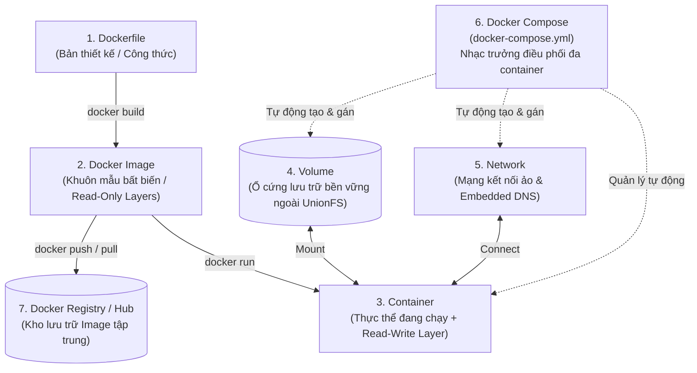

### Bảng từ điển đối chiếu khái niệm (OOP & Đời thực)

| Thuật ngữ | Ẩn dụ lập trình (OOP) | Ẩn dụ đời thực | Bản chất kỹ thuật trong Docker |
| :--- | :--- | :--- | :--- |
| **Dockerfile** | Mã nguồn khai báo Class (`class OrderService { ... }`) | **Bản vẽ thiết kế** (Blueprint) hoặc **Công thức nấu ăn** | File text chứa chuỗi các chỉ thị tuần tự (`FROM`, `WORKDIR`, `COPY`, `RUN`, `CMD`) chỉ dẫn Docker Engine cách đóng gói ứng dụng. |
| **Docker Image** | Định nghĩa **Class** (Khuôn mẫu) | Chiếc **đĩa CD cài đặt** hoặc chiếc **khuôn đúc bánh** | Một gói đóng gói hoàn chỉnh gồm: OS base, runtime, libraries, source code và biến môi trường. Image là **BẤT BIẾN (Read-Only)**, được cấu tạo từ nhiều Image Layers xếp chồng lên nhau. |
| **Container** | Một **Object / Instance** cụ thể (`new OrderService()`) | Chiếc **bánh đúc ra từ khuôn** đang được sử dụng | Một **tiến trình Linux (Process)** đang chạy thực tế, được cô lập bằng Namespaces và giới hạn bằng Cgroups. Container có thêm một lớp mỏng **Read-Write Layer** trên cùng. Từ 1 Image có thể chạy hàng trăm Containers giống nhau. |
| **Volume** | Bộ nhớ ngoài / Ổ cứng gắn ngoài | Chiếc **USB / Ổ cứng di động** | Vùng nhớ lưu trữ dữ liệu bền vững nằm ngoài UnionFS của Container (tại `/var/lib/docker/volumes/` trên host). Khi Container bị xóa, dữ liệu trong Volume **vẫn tồn tại vĩnh viễn** (dành cho Database). |
| **Network** | Interface kết nối / Socket | Dây cáp mạng ảo và **Switch mạng ảo** | Hệ sinh thái card mạng ảo (`veth pairs`) và bridge mạng ảo (`docker0`) giúp các container nói chuyện được với nhau và kết nối ra Internet; tích hợp sẵn **Embedded DNS** tự động phân giải tên service. |
| **Docker Compose** | Design Pattern: **Orchestrator / Facade** | **Nhạc trưởng** chỉ huy cả dàn nhạc giao hưởng | Công cụ định nghĩa và khởi chạy **hệ thống đa container** qua file `docker-compose.yml`. Thay vì gõ 10 lệnh `docker run` phức tạp, chỉ cần gõ `docker compose up -d` để khởi động đồng loạt Web, DB, Redis, Queue. |
| **Docker Registry** | **GitHub** (nhưng cho Image) | **Kho hàng tổng** phân phối sản phẩm | Nơi lưu trữ, đánh tag phiên bản và chia sẻ Docker Image tập trung (Docker Hub, AWS ECR, Google Artifact Registry, GitHub Container Registry `ghcr.io`). |
| **Docker Daemon (`dockerd`)** | Background Daemon Service | **Nhà máy sản xuất** | Tiến trình chạy ngầm liên tục trên Host OS, trực tiếp lắng nghe lệnh từ Docker CLI qua Unix socket để quản lý image, container, network và storage. |

---

## 1. Bản chất cốt lõi: Containers vs Virtual Machines (VMs)

Một Container **không phải là một máy ảo (Virtual Machine)** và không chứa một hệ điều hành riêng biệt. Về mặt bản chất của Linux Kernel:

> **Container thực chất chỉ là một tiến trình thông thường của Linux (Standard Linux Process) được cô lập không gian nhìn bằng Namespaces và kiểm soát hạn mức tài nguyên bằng Control Groups (Cgroups).**

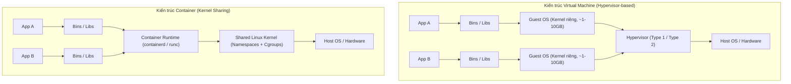

| Tiêu chí | Virtual Machine (VM) | Linux Container |
| :--- | :--- | :--- |
| **Cơ chế cô lập** | Hardware Virtualization qua Hypervisor | Process-level Isolation qua Linux Kernel |
| **Kernel** | Mỗi VM có **1 Guest Kernel riêng biệt** | Dùng chung **duy nhất Host Linux Kernel** |
| **Thời gian khởi động** | Vài chục giây đến vài phút (boot OS) | Vài mili-giây đến vài giây (chạy 1 process) |
| **Tiêu tốn tài nguyên** | Cố định (RAM, CPU cấp phát trước kể cả khi idle) | Động (Chỉ tốn đúng lượng RAM/CPU process dùng) |
| **Kích thước** | Rất lớn (Hàng GB đến hàng chục GB) | Nhỏ gọn (Vài MB đến vài trăm MB) |

---

## 2. Ba trụ cột của Linux Container Internals

Mọi Container Engine (Docker, Podman, Containerd) đều được xây dựng trên **3 công nghệ cốt lõi của Linux Kernel**:

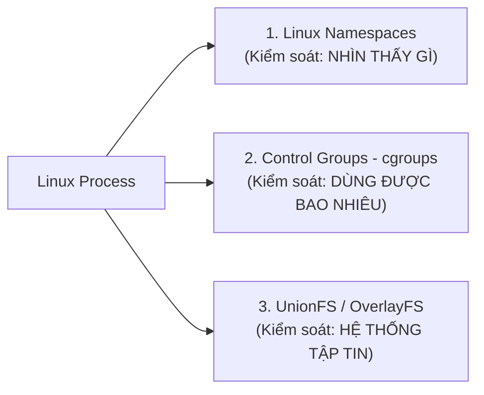

### 2.1. Linux Namespaces (Cô lập không gian quan sát)
Namespaces quy định process bên trong container **có thể nhìn thấy những tài nguyên nào**:

1. **PID Namespace**: Cô lập cây tiến trình. Tiến trình chính bên trong container nhìn thấy mình là **`PID 1`**, nhưng trên Host OS nó chỉ là một tiến trình bình thường có PID thực tế (ví dụ `PID 41582`).
2. **NET Namespace**: Cô lập network stack. Mỗi container sở hữu card mạng ảo (`eth0`), bảng định tuyến (routing table), địa chỉ IP riêng biệt và iptables rules độc lập.
3. **MNT (Mount) Namespace**: Cô lập cây thư mục mount. Container chỉ nhìn thấy root filesystem riêng (`/`) của image mà không thấy filesystem của Host.
4. **IPC Namespace**: Cô lập bộ nhớ chia sẻ (Shared Memory, POSIX Message Queues, Semaphores). Tiến trình trong container không thể can thiệp IPC của Host.
5. **UTS Namespace**: Cô lập Hostname và Domain name riêng cho container.
6. **USER Namespace**: Ánh xạ UID/GID bên trong container sang UID/GID thông thường trên Host (chìa khóa cho **Rootless Container**).

### 2.2. Control Groups (cgroups v1 / cgroups v2 – Giới hạn tài nguyên)
Cgroups quy định process **được phép sử dụng tối đa bao nhiêu tài nguyên phần cứng**:

* **CPU**: Giới hạn lượng CPU cycle (`cpu.cfs_quota_us`, `cpu.cfs_period_us`, `cpu.shares`).
* **Memory**: Giới hạn RAM tối đa (`memory.max` / `memory.limit_in_bytes`). Nếu container cố tình cấp phát vượt ngưỡng memory limit, Linux Kernel sẽ kích hoạt **OOM Killer (Out Of Memory Killer)** để `SIGKILL` ngay lập tức tiến trình tiêu tốn RAM nhiều nhất (exit code `137`).
* **PIDs Limit**: Giới hạn tổng số lượng threads/subprocesses được spawn (`pids.max`) nhằm ngăn chặn tấn công **Fork Bomb** làm treo toàn bộ máy chủ.
* **Block I/O**: Giới hạn tốc độ đọc/ghi đĩa (IOPS, byte rate) tránh việc một container nghẽn ổ đĩa ảnh hưởng các service khác.

### 2.3. OverlayFS & Cơ chế Copy-on-Write (CoW)
Docker sử dụng **Storage Driver OverlayFS** để xếp chồng các lớp (Layers) của image lên nhau tạo thành một Filesystem duy nhất:

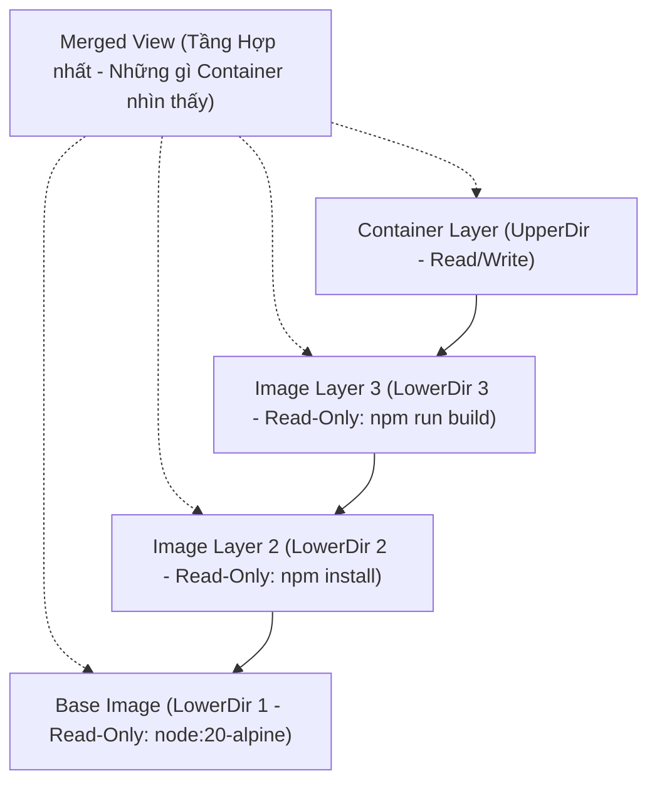

* **Image Layers (LowerDir)**: Toàn bộ các layer tạo ra từ các chỉ thị `FROM`, `RUN`, `COPY` trong Dockerfile đều là **Read-Only (Bất biến)** và được chia sẻ (share) giữa hàng trăm container cùng image.
* **Container Layer (UpperDir)**: Khi container khởi chạy, Docker cấp một lớp mỏng **Read-Write** nằm trên cùng.
* **Cơ chế Copy-on-Write (CoW)**:
  * Khi container muốn đọc file: Hệ thống tìm từ layer trên cùng xuống layer dưới cùng.
  * Khi container muốn sửa một file từ Base Image: OverlayFS **sao chép (copy) file đó từ LowerDir lên UpperDir** rồi mới thực hiện sửa. File gốc ở Image Layer hoàn toàn không bị ảnh hưởng.
  * Khi container bị xóa (`docker rm`), chỉ có UpperDir bị hủy, Base Image vẫn nguyên vẹn.

---

## 3. Kiến trúc Docker Engine & Hệ sinh thái OCI (Open Container Initiative)

Trước đây, Docker là một khối nguyên khối (monolithic daemon). Hiện nay, theo chuẩn OCI, kiến trúc Docker Engine đã được mô-đun hóa:

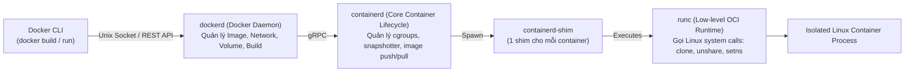

1. **Docker CLI**: Giao diện dòng lệnh nhận lệnh từ người dùng, giao tiếp với `dockerd` qua Unix socket (`/var/run/docker.sock`).
2. **dockerd**: Chịu trách nhiệm cấp cao: Docker API, build image, quản lý storage driver, quản lý Docker networks.
3. **containerd**: Bộ điều phối vòng đời container chuẩn công nghiệp (được Kubernetes dùng trực tiếp làm Container Runtime Interface - CRI).
4. **containerd-shim**: Cho phép `dockerd` hoặc `containerd` khởi động lại hoặc nâng cấp mà **không làm sập các container đang chạy**; đồng thời giữ STDIN/STDOUT của container.
5. **runc**: Công cụ cấp thấp gọn nhẹ tuân thủ chuẩn OCI, trực tiếp thực hiện các system call của Linux (`clone()`, `unshare()`, `pivot_root()`) để tạo namespaces và cgroups, sau đó bàn giao process lại cho shim và tự hủy.

---

## 4. Mạng trong Docker (Docker Networking & Iptables Internals)

Docker cung cấp các driver mạng cơ bản:

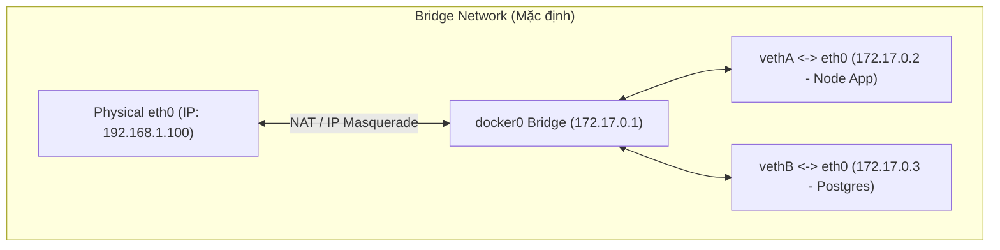

1. **Bridge Network (Mặc định)**:
   * Docker tạo ra một bridge ảo tên `docker0` trên host và gán dải mạng con (ví dụ `172.17.0.0/16`).
   * Mỗi container được cấp một card mạng ảo `eth0` nối với host thông qua cặp **veth pair (Virtual Ethernet pair)**.
   * Giao tiếp ra ngoài Internet được định tuyến qua iptables bằng cơ chế **NAT / IP Masquerading**.
   * Khi mở cổng với `-p 3000:3000`, Docker tự động tạo quy tắc `DNAT` trong bảng `PREROUTING` của iptables để chuyển tiếp gói tin từ IP Host vào IP Container.
   * *Lưu ý*: Trên **User-defined Bridge**, Docker cung cấp sẵn **Embedded DNS Server (127.0.0.11)** cho phép các container phân giải tên miền service bằng name (ví dụ: `postgres:5432`) thay vì IP tĩnh.
2. **Host Network (`--net=host`)**:
   * Loại bỏ hoàn toàn sự cô lập mạng. Container dùng chung network namespace với Host OS.
   * Không có overhead của iptables NAT. Cho hiệu năng throughput cao nhất, nhưng gây xung đột cổng nếu 2 service cùng listen một port.
3. **None Network (`--net=none`)**:
   * Container chỉ có loopback interface (`lo`), hoàn toàn không có kết nối mạng bên ngoài. Dùng cho các tác vụ batch processing hoặc sandbox bảo mật cao.
4. **Overlay Network**:
   * Sử dụng công nghệ **VXLAN Encapsulation** để đóng gói gói tin mạng, kết nối các container nằm trên nhiều Host vật lý khác nhau (Docker Swarm / Kubernetes CNI).
5. **Macvlan Network**:
   * Gán trực tiếp một địa chỉ MAC vật lý cho container, khiến container xuất hiện như một thiết bị mạng vật lý độc lập trên switch mạng LAN của doanh nghiệp.

---

## 5. Lưu trữ & Dữ liệu bền vững (Docker Storage Architecture)

Do tính chất của Container Layer là **Ephemeral (Tạm thời - bị xóa sạch khi container bị hủy)**, việc lưu trữ dữ liệu bền vững (Database, Logs, Uploaded Files) bắt buộc phải sử dụng các cơ chế Mount ngoài UnionFS.

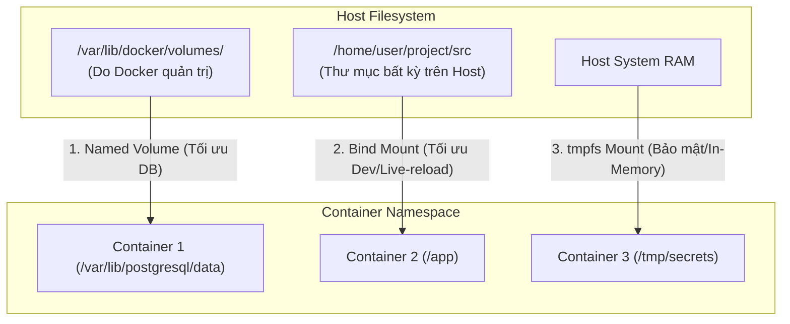

### So sánh 4 loại cơ chế Lưu trữ trong Docker

| Tiêu chí | Named Volume | Bind Mount | tmpfs Mount | Anonymous Volume |
| :--- | :--- | :--- | :--- | :--- |
| **Vị trí lưu trên Host** | `/var/lib/docker/volumes/<name>/_data` | Thư mục bất kỳ do dev chỉ định (`/opt/data`, `./src`) | **Bộ nhớ RAM** của Host | `/var/lib/docker/volumes/<uuid>/_data` |
| **Quản lý bởi** | Docker Daemon CLI (`docker volume ...`) | Hệ điều hành Host (Permissions, Paths) | Linux Kernel Memory | Docker Daemon (Tự sinh UUID ngẫu nhiên) |
| **Tác động khi `docker rm`** | **Tồn tại vĩnh viễn** (Phải xóa bằng `docker volume rm`) | Tồn tại vĩnh viễn trên Host | **Mất sạch dữ liệu ngay lập tức** | Bị xóa nếu chạy `docker rm -v` |
| **Hiệu năng I/O** | Tối ưu cao nhất cho I/O (Database Engine) | Phụ thuộc filesystem của Host (chậm trên macOS/Windows) | **Cực nhanh (Tốc độ RAM)** | Tương tự Named Volume |
| **Use Case điển hình** | **Production Databases** (PostgreSQL, MySQL, Redis, MinIO) | **Local Development** (Mount mã nguồn để live-reload) | Lưu mật khẩu, Private Key, Session tạm, cache ngắn hạn | **Bảo vệ `node_modules`** không bị bind mount host ghi đè |

---

## 6. Docker Compose & Cơ chế Service Discovery

Docker Compose là công cụ điều phối (Orchestration) đa container trên một máy chủ đơn lẻ, tuân thủ chuẩn **Compose Specification**.

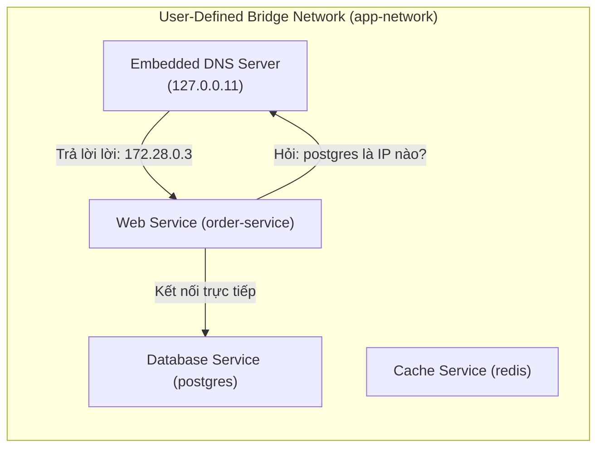

### 6.1. Cơ chế Embedded DNS Service Discovery
* Khi chạy qua Docker Compose, Docker tự động tạo ra một **User-defined Bridge Network**.
* Mỗi container trong mạng này đều trỏ DNS resolver nội bộ về địa chỉ **`127.0.0.11` (Docker Embedded DNS)**.
* Nhờ đó, các service không cần quan tâm IP thay đổi: `order-service` chỉ cần kết nối tới host `postgres:5432` hoặc `redis:6379`. Docker DNS sẽ tự động phân giải tên service ra IP container hiện tại.

### 6.2. Container Healthcheck & Startup Dependency Orchestration
* **Bẫy kinh điển của `depends_on`**: Mặc định `depends_on: [postgres]` chỉ đợi container Postgres ở trạng thái **Started**, chứ **chưa chắc Postgres Engine đã sẵn sàng nhận kết nối TCP socket**. Service khởi chạy lập tức sẽ bị lỗi `Connection Refused` và crash loop.
* **Giải pháp chuẩn Enterprise**: Kết hợp chỉ thị `healthcheck` với `condition: service_healthy`:

```yaml
services:
  postgres:
    image: postgres:16-alpine
    environment:
      POSTGRES_DB: vishop
      POSTGRES_USER: postgres
      POSTGRES_PASSWORD: secretpassword
    healthcheck:
      test: ["CMD-SHELL", "pg_isready -U postgres -d vishop"]
      interval: 5s       # Chu kỳ kiểm tra
      timeout: 5s        # Thời gian tối đa cho mỗi lần test
      retries: 5         # Số lần thử lại trước khi đánh dấu UNHEALTHY
      start_period: 10s  # Thời gian chờ DB khởi động trước khi bắt đầu tính fail
    volumes:
      - postgres_data:/var/lib/postgresql/data

  order-service:
    build: .
    depends_on:
      postgres:
        condition: service_healthy # Chỉ khởi động khi Postgres ĐÃ HEALTHY!
      redis:
        condition: service_healthy

volumes:
  postgres_data:
```

---

## 7. Multi-Stage Builds & Docker BuildKit Nâng cao

Trong môi trường Production, image chứa compiler, toolchain hoặc devDependencies là thảm họa về cả **kích thước truyền tải** lẫn **lỗ hổng bảo mật (CVEs)**. Kỹ thuật **Multi-stage Build** kết hợp với **BuildKit** giải quyết triệt để vấn đề này.

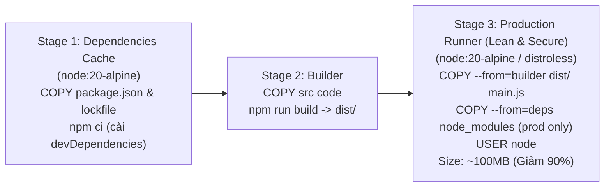

### 7.1. Docker BuildKit: DAG Execution & Mount Cache
BuildKit (`DOCKER_BUILDKIT=1`) phân tích Dockerfile thành đồ thị có hướng không chu trình (**DAG - Directed Acyclic Graph**), cho phép chạy song song các stage độc lập và hỗ trợ các loại mount đặc biệt:

1. **Cache Mount (`--mount=type=cache`)**:
   * Lưu thư mục cache của package manager (`~/.npm`, `~/.cache/pip`, `~/.m2`) trên máy host CI/CD xuyên suốt các lần build.
   * Khi mã nguồn đổi, `npm ci` không cần tải lại toàn bộ package từ internet mà lấy trực tiếp từ cache mount, **rút ngắn thời gian build từ 5 phút xuống còn 20 giây mà không làm tăng dù chỉ 1 byte dung lượng Image!**
2. **Secret Mount (`--mount=type=secret`)**:
   * Truyền an toàn token bí mật (NPM token, SSH private key kết nối git nội bộ):
     ```dockerfile
     RUN --mount=type=secret,id=npmrc,target=/root/.npmrc npm publish
     ```
   * Secret chỉ tồn tại tạm thời trong bộ nhớ của lệnh `RUN`, **hoàn toàn không bị lưu lại trong bất kỳ Image Layer hay `docker history` nào!**

### 7.2. Dockerfile chuẩn Production cho Node.js / NestJS (BuildKit & Multi-Stage):
```dockerfile
# syntax=docker/dockerfile:1.4
# ==========================================
# GIAI ĐOẠN 1: Cài đặt dependencies (Tận dụng Cache Mount)
# ==========================================
FROM node:20-alpine AS dependencies
WORKDIR /app
COPY package.json package-lock.json ./
# Cache thư mục ~/.npm trên host máy build
RUN --mount=type=cache,target=/root/.npm npm ci

# ==========================================
# GIAI ĐOẠN 2: Build mã nguồn TypeScript
# ==========================================
FROM node:20-alpine AS builder
WORKDIR /app
COPY --from=dependencies /app/node_modules ./node_modules
COPY . .
RUN npm run build
# Tỉa bỏ devDependencies để chỉ giữ lại runtime packages
RUN npm prune --production

# ==========================================
# GIAI ĐOẠN 3: Runtime cực nhẹ & Bảo mật cao
# ==========================================
FROM node:20-alpine AS runner
WORKDIR /app

ENV NODE_ENV=production
ENV PORT=3000

# Cài đặt tini làm Init process PID 1
RUN apk add --no-cache tini

# Copy artifact với quyền user node
COPY --from=builder --chown=node:node /app/node_modules ./node_modules
COPY --from=builder --chown=node:node /app/dist ./dist

# Đổi sang Non-Root user (UID 1000) chống leo thang đặc quyền
USER node

EXPOSE 3000

# Sử dụng tini làm PID 1 để bắt đúng tín hiệu SIGTERM / SIGINT
ENTRYPOINT ["/sbin/tini", "--"]
CMD ["node", "dist/main.js"]
```

---

## 8. Hiểm họa PID 1, Zombie Processes & Signal Handling

Trong Linux, tiến trình mang **`PID 1` (Init process - vd: systemd)** giữ 2 trọng trách tối thượng:
1. **Xử lý tín hiệu tắt máy (Signal Handling)**: Nhận `SIGTERM`, `SIGINT` và chuyển tiếp cho các tiến trình con để thực hiện Graceful Shutdown.
2. **Thu dọn tiến trình con mồ côi (Zombie Process Reaping)**: Khi một tiến trình con kết thúc nhưng cha của nó chưa gọi hàm `wait()`, tiến trình con trở thành **Zombie (`<defunct>`)**. PID 1 có trách nhiệm nhận nuôi và thu dọn các zombie này khỏi bảng Process Table.

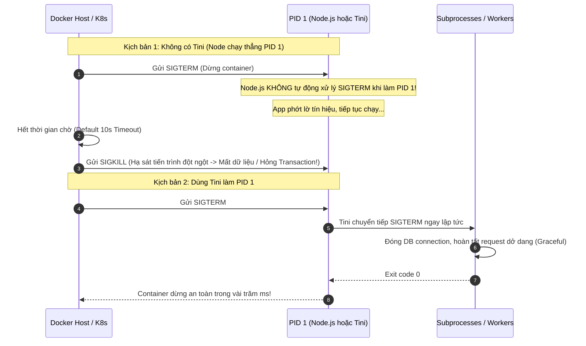

* **Vấn đề khi chạy trực tiếp `CMD ["node", "main.js"]`**:
  * Node.js khi đóng vai trò PID 1 sẽ không áp dụng các signal handler mặc định. Nếu code không tự viết `process.on('SIGTERM')`, `docker stop` sẽ đợi đủ **10 giây timeout** rồi mới dùng `SIGKILL` để ép dừng service $\rightarrow$ Làm đứt gãy kết nối cơ sở dữ liệu và hỏng dữ liệu dở dang.
  * Node.js không tự dọn zombie process của các child process (`child_process.fork()`).
* **Giải pháp chuẩn**: Luôn sử dụng init tool siêu nhẹ như **`tini`** hoặc **`dumb-init`**, hoặc truyền cờ `--init` khi chạy `docker run`.

---

## 9. Bảo mật Container Nâng cao (Security Hardening & Rootless)

Chạy container mặc định với quyền `root` là lỗ hổng an ninh nguy hiểm nhất. Nếu ứng dụng dính lỗi RCE (Remote Code Execution), kẻ tấn công có thể khai thác lỗ hổng Kernel để **thoát khỏi container (Container Escape)** và chiếm quyền root của máy chủ vật lý.

### 9.1. Linux Capabilities (Thu hồi đặc quyền)
Theo mặc định, Docker cấp cho container khoảng 14 đặc quyền của Linux Kernel (Capabilities).
* **Nguyên tắc Zero Trust**: Tước bỏ toàn bộ và chỉ cấp phát lại những gì tối thiểu cần thiết:
  ```bash
  docker run --cap-drop=ALL --cap-add=NET_BIND_SERVICE my-app
  ```
  *(Chỉ cấp quyền bind cổng dưới 1024, tước bỏ quyền mount filesystem, can thiệp clock, network raw, kernel module)*.

### 9.2. Read-Only Root Filesystem
Biến toàn bộ hệ thống file của container thành Read-Only. Kẻ tấn công không thể tải về mã độc, tạo web-shell hay sửa đổi file nhị phân:
```bash
docker run --read-only --tmpfs /tmp --tmpfs /run my-app
```
*(Chỉ cho phép ghi tạm vào RAM tại `/tmp` để ứng dụng lưu file tạm)*.

### 9.3. Seccomp (Secure Computing Mode) & AppArmor
* **Seccomp**: Bộ lọc system call ở cấp Kernel. Docker có sẵn một hồ sơ seccomp mặc định chặn hơn 44 system calls nguy hiểm (như `reboot`, `swapon`, `sys_ptrace`).
* Có thể định nghĩa file JSON Seccomp profile riêng để chỉ cho phép các system call hợp lệ của Node.js/Go runtime.

### 9.4. Rootless Docker Mode
* `dockerd` và container chạy hoàn toàn dưới quyền của một User thông thường (non-root UID 1000) trên host nhờ **User Namespaces**.
* Ngay cả khi container bị chiếm quyền và user bên trong là `root (UID 0)`, khi thoát ra máy host nó vẫn chỉ là user không có quyền hạn gì $\rightarrow$ **Triệt tiêu 100% nguy cơ Host Takeover**.

---

## 10. Docker Logging Drivers & Quản trị Log Chống tràn ổ đĩa

Mặc định, Docker sử dụng logging driver là **`json-file`**. Nó ghi toàn bộ STDOUT/STDERR của container vào file:
`/var/lib/docker/containers/<container-id>/<container-id>-json.log`

> ⚠️ **Sự cố Production kinh điển**: Mặc định Docker **không giới hạn dung lượng file log**. Với các ứng dụng bắn log liên tục, file này sẽ âm thầm phình to lên 50GB – 100GB, làm **đầy ổ cứng 100% (Disk Full)** khiến Docker Daemon và toàn bộ cơ sở dữ liệu trên máy chủ bị sập hoàn toàn!

### Cấu hình Log Rotation bắt buộc:
Cấu hình tập trung tại `/etc/docker/daemon.json` trên máy chủ Host:
```json
{
  "log-driver": "json-file",
  "log-opts": {
    "max-size": "50m",
    "max-file": "5"
  }
}
```
*(Mỗi container tối đa 5 file log, mỗi file tối đa 50MB $\rightarrow$ Tổng dung lượng log của 1 container không bao giờ vượt quá 250MB)*.

Hoặc cấu hình trực tiếp trong `docker-compose.yml`:
```yaml
logging:
  driver: "json-file"
  options:
    max-size: "20m"
    max-file: "3"
```

---

## 11. Vòng đời Container, Trạng thái & Bảng giải mã Exit Codes

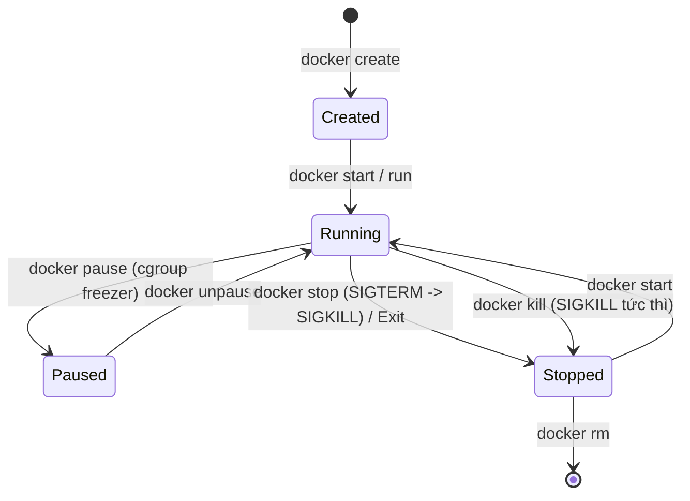

### Bảng tra cứu Exit Codes quan trọng khi Debug sự cố

| Exit Code | Tên tín hiệu / Nguyên nhân | Ý nghĩa bản chất & Cách xử lý |
| :---: | :--- | :--- |
| **`0`** | Success | Container hoàn thành nhiệm vụ và tắt bình thường (thường gặp ở task chạy migration, batch job). |
| **`1`** | Application Error | Ứng dụng gặp Unhandled Exception, syntax error, hoặc lỗi logic và chủ động gọi `process.exit(1)`. Kiểm tra Application Log. |
| **`137`** | **SIGKILL (`128 + 9`)** | **Bị hạ sát cưỡng bức**. Có 2 nguyên nhân chính:<br/>1. **OOMKilled**: Container dùng vượt RAM limit của cgroup $\rightarrow$ Kernel OOM Killer hạ sát.<br/>2. Chạy `docker kill` hoặc `docker stop` quá 10s timeout. Kiểm tra lệnh `docker inspect <id>` xem trường `"OOMKilled": true` hay không. |
| **`143`** | **SIGTERM (`128 + 15`)** | Container nhận tín hiệu dừng bình thường từ Docker (`docker stop`) và kết thúc Graceful Shutdown thành công. |
| **`126`** | Permission Denied | Command/Entrypoint không có quyền thực thi (`chmod +x entrypoint.sh`). |
| **`127`** | Command Not Found | File nhị phân hoặc shell script khai báo trong `CMD` / `ENTRYPOINT` không tồn tại trong image (vd: gọi `bash` trong khi base image alpine chỉ có `sh`). |

---

## 12. Bảng tổng hợp các cạm bẫy kỹ thuật sống còn (Production Caveats)

| STT | Bẫy kỹ thuật | Hậu quả thực tế | Giải pháp chuẩn Production |
| :--- | :--- | :--- | :--- |
| **1** | **Chạy Container với quyền `root`** | Nếu ứng dụng dính lỗ hổng RCE, hacker có thể chiếm toàn quyền kiểm soát máy chủ Host. | Khai báo `USER node` (UID 1000). Cấu hình `--cap-drop=ALL` và chạy filesystem dạng `--read-only`. |
| **2** | **Quên đặt giới hạn RAM (`--memory`)** | Một truy vấn SQL lỗi ngốn 10GB RAM sẽ kích hoạt OOM Killer tiêu diệt ngẫu nhiên các container quan trọng khác trên Host. | Khai báo `limits.memory`. Đặt `max-old-space-size` của Node.js nhỏ hơn cgroup limit 20% để Node kịp GC trước khi bị OOMKilled. |
| **3** | **Quên cấu hình Log Rotation** | File log `json-file` phình to hàng trăm GB làm tràn ổ cứng, crash máy chủ. | Cấu hình `max-size: 50m`, `max-file: 5` trong `/etc/docker/daemon.json`. |
| **4** | **Đặt sai thứ tự lệnh Dockerfile** | Đặt `COPY . .` trước `RUN npm install` làm mất Layer Cache mỗi khi sửa 1 dòng code $\rightarrow$ CI/CD build mất 15-20 phút. | `COPY package*.json ./` $\rightarrow$ `RUN npm ci` $\rightarrow$ Sau đó mới `COPY . .`. Luôn có `.dockerignore`. |
| **5** | **Dùng `depends_on` thông thường** | Service app chạy trước khi Database kịp mở socket TCP $\rightarrow$ Bị lỗi `ECONNREFUSED` và crash loop. | Dùng `healthcheck` trên DB service kết hợp `depends_on: { condition: service_healthy }`. |
| **6** | **Sử dụng thẻ tag `:latest` trên Prod** | Container restart có thể kéo về phiên bản image khác nhau $\rightarrow$ Mất đồng bộ code giữa các Pods. | Tuyệt đối không dùng `:latest`. Luôn dùng Git Commit SHA hoặc Semantic Versioning (`v1.4.2`). |
| **7** | **Bẫy Mount đè `node_modules` ở Local Dev** | Mount `./:/app` từ Windows/macOS ghi đè lên `node_modules` của container Linux $\rightarrow$ Lỗi tương thích C++ binary. | Khai báo thêm Anonymous Volume: `- /app/node_modules`. |
| **8** | **Không dùng Init Process (PID 1)** | Node.js phớt lờ `SIGTERM` $\rightarrow$ Docker đợi 10s rồi bắn `SIGKILL` $\rightarrow$ Hỏng transaction DB dở dang. | Thêm `tini` (`ENTRYPOINT ["/sbin/tini", "--"]`) hoặc truyền cờ `--init`. |
| **9** | **Nhúng Secret vào Dockerfile Build** | Dùng `ARG NPM_TOKEN` rồi `RUN echo $NPM_TOKEN > .npmrc` $\rightarrow$ Token bị lưu vĩnh viễn trong Image Layer History. | Dùng BuildKit Secret Mount: `RUN --mount=type=secret,id=npmrc ...`. |
| **10**| **Bẫy DNS Caching trong Container** | Node.js cache IP vĩnh viễn. Khi service bên cạnh restart nhận IP mới, service gọi tới vẫn bắn vào IP cũ. | Cấu hình DNS lookup qua round-robin IP của Docker Embedded DNS (`127.0.0.11`). |
