# 📗 CHUYÊN ĐỀ 09.1: JAVA & SPRING BOOT ARCHITECTURE – LÝ THUYẾT & KIẾN TRÚC LÕI

> **Mục tiêu**: Nắm vững bản chất tầng thấp của Java Virtual Machine (JVM Internals, Memory Model, Garbage Collection), phân tích chuyên sâu cấu trúc dữ liệu Collections (HashMap, ConcurrentHashMap), cơ chế đa luồng (JMM, volatile, synchronized, Virtual Threads), nguyên lý OOP/SOLID và kiến trúc lõi của Spring Boot / Hibernate trong hệ thống Enterprise chịu tải cao.

---

## 1. Kiến trúc máy ảo Java (JVM Internals) & Quản lý bộ nhớ

### 1.1. Phân biệt JDK, JRE, JVM và Luồng thực thi Bytecode
Một chương trình Java không chạy trực tiếp trên phần cứng OS mà chạy thông qua một máy ảo trừu tượng (**Java Virtual Machine - JVM**).

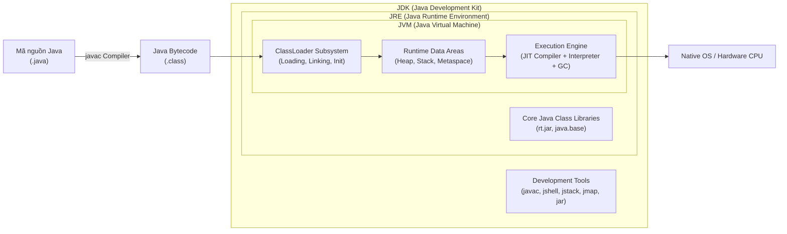

* **Javac**: Trình biên dịch mã nguồn `.java` thành mã nhị phân trung gian **Bytecode (`.class`)**. Bytecode là nền tảng giúp Java đạt được triết lý *"Write Once, Run Anywhere (WORA)"*.
* **JVM**: Máy ảo chịu trách nhiệm nạp file `.class`, thông dịch hoặc biên dịch sang mã máy (Machine Code) và thực thi trên CPU.
* **JRE**: Cung cấp JVM kèm theo toàn bộ thư viện chuẩn của Java (`java.lang.*`, `java.util.*`, I/O, Network...) để ứng dụng có thể chạy được.
* **JDK**: Bộ công cụ phát triển phần mềm đầy đủ bao gồm JRE + Trình biên dịch (`javac`), trình gỡ lỗi (`jdb`), công cụ đóng gói (`jar`), và các công cụ profiling hiệu năng (`jstack`, `jmap`, `jcmd`).
* **JIT (Just-In-Time) Compiler & HotSpot**: Để giải quyết nhược điểm chậm chạp của trình thông dịch (Interpreter) đọc từng dòng, JVM sử dụng JIT Compiler. JIT đếm số lần một đoạn code được thực thi (Profiling). Các đoạn mã lặp lại nhiều lần (gọi là **Hot Spot**) sẽ được JIT biên dịch thẳng sang Native Machine Code và lưu vào Code Cache, giúp Java chạy với tốc độ tiệm cận C/C++.

---

### 1.2. Phân vùng bộ nhớ JVM (JVM Memory Areas)
Bộ nhớ khi chạy ứng dụng Java được chia thành 2 nhóm: **Thread-private (riêng cho từng luồng)** và **Thread-shared (dùng chung cho toàn bộ ứng dụng)**.

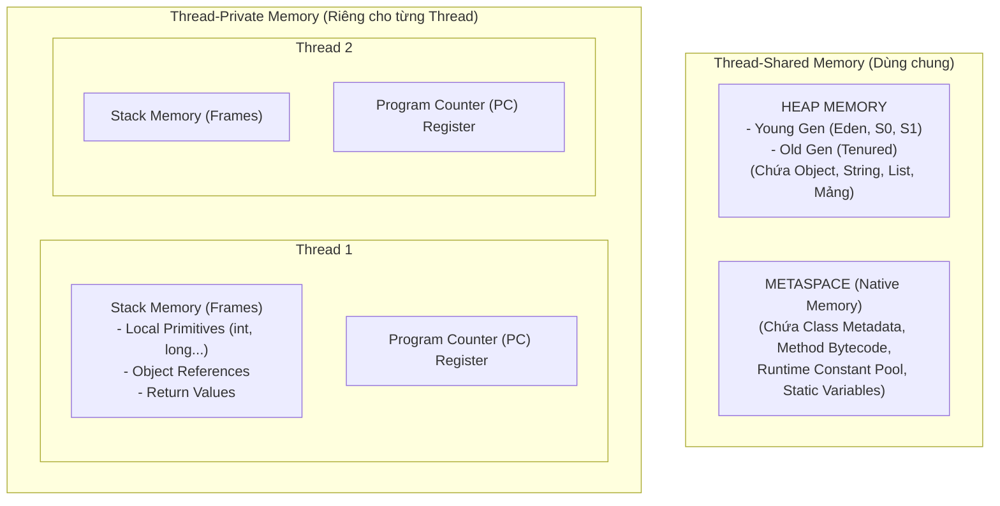

| Tiêu chí | Stack Memory | Heap Memory | Metaspace (Java 8+) |
| :--- | :--- | :--- | :--- |
| **Bản chất** | Ngăn xếp LIFO theo từng luồng | Bộ nhớ động dùng chung toàn app | Vùng nhớ Native RAM của máy chủ |
| **Dữ liệu lưu trữ** | Biến nguyên thủy (`int`, `double`, `boolean`), con trỏ địa chỉ tham chiếu, Frame gọi hàm | Tất cả các đối tượng (`Object`, `String`, `List`, `Array`, `Map`...) | Định nghĩa Class, Method Metadata, Constant Pool, biến `static` |
| **Thời điểm giải phóng** | Tự động hủy sạch sẽ ngay khi hàm kết thúc (Pop Frame) | Do bộ thu gom rác **Garbage Collector (GC)** quản lý | Tự giải phóng khi ClassLoader bị dỡ bỏ (Unloaded) |
| **Tốc độ truy cập** | Siêu nhanh (cấp phát liên tục trên CPU cache/con trỏ đỉnh stack) | Chậm hơn Stack (cần giải mã con trỏ tham chiếu) | N/A |
| **Nguy cơ lỗi bộ nhớ** | `java.lang.StackOverflowError` (Đệ quy vô hạn, lồng hàm quá sâu) | `java.lang.OutOfMemoryError: Java heap space` (Tạo object tràn bộ nhớ) | `java.lang.OutOfMemoryError: Metaspace` (Nạp quá nhiều class động) |

> ⚠️ **Tại sao Java 8 khai tử PermGen để thay bằng Metaspace?**  
> Trước Java 8, thông tin Class được lưu trong **PermGen (Permanent Generation)** nằm trực tiếp bên trong JVM Heap với dung lượng cố định (`-XX:MaxPermSize`). Khi ứng dụng enterprise nạp quá nhiều class (Spring CGLIB proxy, thư viện động), hệ thống thường xuyên chết đứng vì lỗi `OutOfMemoryError: PermGen space`. Từ Java 8, **Metaspace** được chuyển hẳn sang **Native Memory** của hệ điều hành, tự động mở rộng theo RAM vật lý máy chủ, giải quyết triệt để rủi ro này.

---

### 1.3. Cơ chế Thu gom rác (Garbage Collection - GC) & Memory Leak
Garbage Collector (GC) là tiến trình chạy nền của JVM tự động giải phóng các vùng nhớ Heap không còn được sử dụng để tránh tràn RAM.

#### 1. Thuật toán phân tích khả năng tiếp cận (Reachability Analysis)
GC xác định một đối tượng trên Heap có "còn sống" hay không bằng cách truy vết đồ thị liên kết xuất phát từ các **GC Roots**:
* Các biến cục bộ và tham số hàm nằm trong **Stack Frames** của các Thread đang chạy.
* Các biến tĩnh (**`static` variables**) của các lớp đang nạp.
* Các tham chiếu JNI (Java Native Interface) trong mã C/C++.
* Các Thread đang hoạt động (Active Threads).

> **Nguyên lý**: Bất kỳ đối tượng nào trên Heap **không có đường dẫn liên kết (unreachable)** dẫn tới ít nhất một GC Root thì đối tượng đó được coi là rác và sẽ bị quét sạch ở chu kỳ GC tiếp theo.

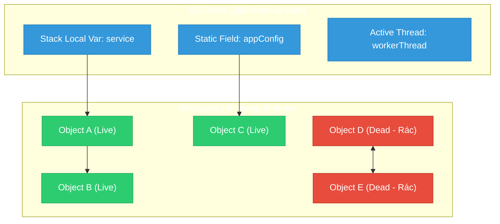
*(Object D và E dù tham chiếu vòng sang nhau nhưng hoàn toàn bị cô lập khỏi GC Roots $\rightarrow$ Vẫn bị GC tiêu diệt!)*

#### 2. Phân vùng thế hệ của Heap (Generational Heap)
Dựa trên giả thuyết thực nghiệm *"Hầu hết các đối tượng sinh ra đều chết rất trẻ (Weak Generational Hypothesis)"*, Heap được chia thành:
* **Young Generation**:
  * **Eden Space**: Nơi mọi đối tượng mới khởi tạo bằng toán tử `new` bước vào đầu tiên.
  * **Survivor Spaces (S0 & S1)**: Sau mỗi đợt **Minor GC**, các đối tượng còn sống ở Eden sẽ được dọn sang S0 hoặc S1 kèm theo việc tăng biến đếm tuổi (**Age**).
* **Old Generation (Tenured)**:
  * Khi đối tượng sống sót qua một số chu kỳ Minor GC nhất định (mặc định ngưỡng `TenuringThreshold = 15`), nó được thăng hạng (**Promote**) lên Old Gen.
  * Khi Old Gen đầy, JVM kích hoạt **Major GC (hoặc Full GC)**. Đợt GC này sẽ quét toàn bộ Heap, gây ra hiện tượng **STW (Stop The World)** – đóng băng toàn bộ các luồng ứng dụng người dùng, gây giật lag request nếu không được tối ưu.

#### 3. Cạm bẫy Rò rỉ bộ nhớ (Memory Leak) trong Java
Java có GC nhưng **vẫn hoàn toàn có thể bị Memory Leak**. Hiện tượng xảy ra khi lập trình viên vô tình duy trì liên kết từ GC Roots tới các đối tượng không còn dùng nữa:
1. **Biến `static` giữ đối tượng**: `public static List<Order> cache = new ArrayList<>();` liên tục thêm phần tử mà không bao giờ dọn dẹp $\rightarrow$ Vì biến `static` gắn liền với ClassLoader, nó sẽ tồn tại vĩnh viễn suốt vòng đời ứng dụng.
2. **Không đóng các tài nguyên I/O & Network**: Mở `FileInputStream`, `Socket`, `Connection` JDBC nhưng quên đóng trong `finally` (Cách khắc phục chuẩn: Dùng cấu trúc `try-with-resources`).
3. **Lạm dụng `ThreadLocal`**: Khi sử dụng với Web Container (Tomcat Thread Pool tái sử dụng luồng), nếu không gọi `ThreadLocal.remove()` trong filter/interceptor, dữ liệu của request trước sẽ kẹt lại mãi mãi trên thread đó.
4. **Không override cặp `equals()` / `hashCode()`**: Đẩy các đối tượng Custom làm Key trong `HashSet` hoặc `HashMap`. Khi tìm kiếm hoặc xóa, hashcode bị tính sai khiến phần tử cũ không thể lấy ra để xóa mà tiếp tục tích tụ.

---

### 1.4. Bản chất Java là "Truyền tham trị" (Pass-by-Value) 100%
Một trong những câu hỏi phỏng vấn kinh điển: *Java truyền tham trị (pass-by-value) hay truyền tham chiếu (pass-by-reference)?*

> **ĐÁP ÁN CHUẨN XÁC**: **Java 100% là Pass-by-Value! Không có ngoại lệ.**

```java
public class ValueDemo {
    public static void modify(int x, Person p) {
        x = 99;                 // 1. Gán lại biến nguyên thủy
        p.setName("Bob");       // 2. Thay đổi thuộc tính đối tượng qua con trỏ
        p = new Person("Eve");  // 3. Gán con trỏ p sang một vùng nhớ mới trên Heap
    }

    public static void main(String[] args) {
        int a = 10;
        Person person = new Person("Alice");
        modify(a, person);

        System.out.println(a);                // Vẫn in ra 10!
        System.out.println(person.getName()); // In ra "Bob" chứ KHÔNG PHẢI "Eve"!
    }
}
```

* **Giải thích cơ chế ngầm**:
  1. Với biến nguyên thủy `a`: Giá trị `10` được sao chép nguyên bản sang biến `x` trên Frame của hàm `modify`. Sửa `x` không ảnh hưởng `a`.
  2. Với biến đối tượng `person`: Giá trị được sao chép vào tham số `p` chính là **bản sao của địa chỉ ô nhớ (copy of reference value)**. Cả 2 con trỏ `person` và `p` cùng trỏ tới 1 ô nhớ trên Heap $\rightarrow$ Lệnh `p.setName("Bob")` sửa đổi trực tiếp dữ liệu bên trong ô nhớ đó.
  3. Nhưng khi gọi `p = new Person("Eve")`, bản thân con trỏ `p` bị chuyển hướng trỏ sang một ô nhớ mới. Con trỏ gốc `person` ở hàm `main` **vẫn nguyên vẹn trỏ về ô nhớ cũ**. Do đó Java hoàn toàn là **truyền bản sao của giá trị tham chiếu**, không hề truyền trực tiếp tham chiếu gốc!

---

## 2. Bản chất Ngôn ngữ, Từ khóa & Cú pháp Chuyên sâu

### 2.1. Bảng phạm vi truy cập (Access Modifiers)
Access Modifiers là công cụ cốt lõi để thực thi nguyên lý **Đóng gói (Encapsulation)** trong OOP:

| Access Modifier | Trong cùng 1 Class | Cùng Package (Thư mục) | Khác Package nhưng Kế thừa (Subclass) | Khác Package hoàn toàn (Bên ngoài) |
| :--- | :---: | :---: | :---: | :---: |
| **`public`** | ✅ Có | ✅ Có | ✅ Có | ✅ Có |
| **`protected`** | ✅ Có | ✅ Có | ✅ Có | ❌ Không |
| **`default` (package-private)** | ✅ Có | ✅ Có | ❌ Không | ❌ Không |
| **`private`** | ✅ Có | ❌ Không | ❌ Không | ❌ Không |

---

### 2.2. Từ khóa `static`, `final`, `this`, `super`

#### 1. Từ khóa `static` (Thuộc về Class, không thuộc về Instance)
* **Static Variable**: Biến dùng chung duy nhất cho toàn bộ các instance của class, nằm tại Metaspace.
* **Static Method**: Có thể gọi trực tiếp thông qua tên lớp: `ClassName.methodName()`.
  * ⚠️ *Nguyên tắc cốt tử*: **Static method KHÔNG THỂ truy cập biến thường (instance variable) hay hàm thường (instance method)**, và không thể dùng từ khóa `this` hay `super`. Lý do: Tại thời điểm static method chạy, các instance có thể chưa hề được tạo ra trên Heap!
* **Static Block**: Khối mã `static { ... }` chạy duy nhất **1 lần** khi ClassLoader nạp lớp vào bộ nhớ, dùng để khởi tạo tài nguyên tĩnh nặng hoặc nạp thư viện C++ qua JNI.

#### 2. Từ khóa `final` (Bất biến)
* **Final Variable**: Biến chỉ được gán giá trị 1 lần duy nhất, trở thành hằng số. (Nếu là Object thì địa chỉ tham chiếu không đổi, nhưng các thuộc tính bên trong Object đó vẫn có thể bị sửa đổi trừ khi bản thân Object đó là Immutable).
* **Final Method**: Phương thức ở lớp cha **không cho phép lớp con Override** (bảo vệ các logic lõi nhạy cảm).
* **Final Class**: Lớp **ngăn chặn tuyệt đối việc bị kế thừa** (Ví dụ kinh điển: `java.lang.String`, `Integer` là final class để đảm bảo tính bất biến và an toàn bảo mật).

#### 3. `this` vs `super`
* `this`: Tham chiếu tới chính thực thể (instance) hiện tại đang thực thi code (`this.name = name`).
* `super`: Tham chiếu tới phiên bản của lớp cha (`super.doAction()`, gọi constructor cha `super(id)`).

#### 4. Java Record (Java 16+)
`record` là cấu trúc dữ liệu đặc biệt thay thế boilerplate code cho các class DTO (Data Transfer Object):
```java
// Thay vì viết 50 dòng code (getter, constructor, equals, hashCode, toString)
public record OrderDto(Long id, String orderCode, BigDecimal amount) {}
```
* Bản chất của `record`: Tự động kế thừa `java.lang.Record`, tự động là `final class`, mọi trường đều là `private final`, sinh sẵn Constructor, Getter (không có tiền tố `get`, ví dụ: `orderDto.orderCode()`), `equals()`, `hashCode()` và `toString()`.

---

### 2.3. Wrapper Class, Autoboxing & Cạm bẫy Integer Cache
* **Primitive vs Wrapper**: Kiểu nguyên thủy (`int`, `boolean`, `double`) lưu trực tiếp giá trị trên Stack; Wrapper class (`Integer`, `Boolean`, `Double`) là Object đầy đủ lưu trên Heap.
* **Autoboxing / Unboxing**: Trình biên dịch tự động chuyển đổi giữa `int` và `Integer`:
  ```java
  Integer a = 100; // Autoboxing: tương đương Integer.valueOf(100)
  int b = a;       // Unboxing: tương đương a.intValue()
  ```
* **Cạm bẫy Integer Cache (-128 đến 127)**:
  ```java
  Integer a = 100;
  Integer b = 100;
  System.out.println(a == b); // TRUE (Do nằm trong bộ đệm IntegerCache)

  Integer c = 1000;
  Integer d = 1000;
  System.out.println(c == d); // FALSE! (Tạo 2 đối tượng độc lập trên Heap)
  System.out.println(c.equals(d)); // TRUE! (So sánh bằng giá trị nội tại)
  ```
  > 💡 **Bài học phỏng vấn**: JVM tự động cache các đối tượng `Integer` có giá trị từ `-128` đến `127` trong một mảng tĩnh để tiết kiệm RAM. So sánh 2 đối tượng Wrapper **bắt buộc phải dùng `.equals()`**, tuyệt đối không dùng toán tử `==` (vì `==` so sánh địa chỉ ô nhớ).

---

### 2.4. Bản chất của String, String Pool & StringBuilder vs StringBuffer
* **String Immutability (Tính bất biến của String)**:
  * Lớp `String` được đánh dấu `final` và mảng ký tự bên trong (`byte[] value` từ Java 9) là `final private`.
  * Mỗi khi bạn thực hiện nối chuỗi `s = s + "abc"`, JVM không sửa chuỗi cũ mà tạo ra **một đối tượng String hoàn toàn mới trên Heap** và trỏ biến `s` sang đó.
  * *Tại sao String phải bất biến?*
    1. **Bảo mật**: Chuỗi chứa mật khẩu DB, URL, file descriptor không bị can thiệp lén lút.
    2. **Đa luồng**: Bất biến đồng nghĩa với Thread-safe 100% mà không cần lock.
    3. **String Pool**: Cho phép JVM tái sử dụng cùng 1 chuỗi để tiết kiệm bộ nhớ.
* **So sánh String, StringBuilder và StringBuffer**:

| Tiêu chí | `String` | `StringBuilder` | `StringBuffer` |
| :--- | :--- | :--- | :--- |
| **Tính biến đổi** | Bất biến (Immutable) | Biến đổi được (Mutable) | Biến đổi được (Mutable) |
| **Thread-Safe** | Có (Do bất biến) | **Không an toàn đa luồng** | **An toàn đa luồng** |
| **Cơ chế đồng bộ** | Không | Không đồng bộ hóa | Dùng `synchronized` trên mọi method |
| **Hiệu năng** | Chậm khi nối chuỗi nhiều lần | **Cực nhanh** | Chậm hơn StringBuilder do chi phí Lock |
| **Trường hợp dùng** | Dữ liệu tĩnh, ít sửa đổi | Vòng lặp đơn luồng, tạo query SQL | Môi trường nhiều luồng dùng chung biến nối chuỗi |

---

## 3. Kiến trúc Hướng đối tượng nâng cao (OOP & S.O.L.I.D)

### 3.1. Bốn trụ cột OOP qua lăng kính Enterprise
1. **Encapsulation (Đóng gói)**: Giấu kín trạng thái nội tại bằng `private`, chỉ cho phép thay đổi thông qua các Business Methods/Getters/Setters kèm validation bảo vệ toàn vẹn dữ liệu.
2. **Inheritance (Kế thừa)**: Tái sử dụng logic cha thông qua `extends`. (Tuy nhiên cần cẩn trọng tránh việc lớp con kế thừa những hành vi mà nó không mong muốn).
3. **Polymorphism (Đa hình)**:
   * **Compile-time Polymorphism (Overloading)**: Các hàm cùng tên nhưng khác nhau về số lượng hoặc kiểu tham số trong cùng 1 class. Trình biên dịch phân giải ngay lúc build.
   * **Runtime Polymorphism (Overriding)**: Lớp con ghi đè implementation của lớp cha. JVM phân giải động lúc chạy thông qua bảng phương thức ảo (**vtable**).
4. **Abstraction (Trừu tượng hóa)**: Định nghĩa bộ khung giao tiếp thông qua `interface` hoặc `abstract class`, ẩn đi các chi tiết cài đặt phức tạp.

---

### 3.2. So sánh chuyên sâu: Interface vs Abstract Class
Từ Java 8 và Java 9, ranh giới giữa Interface và Abstract Class đã thay đổi đáng kể:

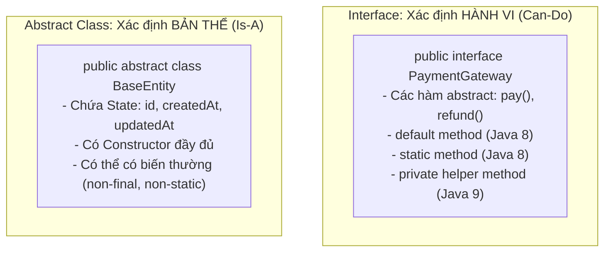

| Tiêu chí | `Interface` | `Abstract Class` |
| :--- | :--- | :--- |
| **Mục đích thiết kế** | Định nghĩa một **Hợp đồng hành vi (Contract / Can-do)** | Định nghĩa **Bản chất lớp cơ sở (Blueprint / Is-a)** |
| **Đa kế thừa** | Một lớp có thể `implements` **nhiều Interface** | Một lớp chỉ có thể `extends` **duy nhất 1 Abstract Class** |
| **Biến trạng thái (Fields)** | Chỉ cho phép `public static final` (hằng số) | Chứa mọi loại biến: `private`, `protected`, instance variables |
| **Constructor** | **Không có constructor** | **Có constructor** (để lớp con gọi qua `super()`) |
| **Phương thức có thân hàm** | Chỉ có `default` method, `static` method, và `private` method (Java 9) | Mọi loại method (abstract hoặc non-abstract) |

---

### 3.3. Composition over Inheritance & Loose Coupling

#### 1. Tại sao Composition tốt hơn Inheritance?
* Kế thừa kế thừa cả lỗi: Khi lớp cha thay đổi signature hoặc behavior, hàng chục lớp con có thể bị vỡ vụn (**Fragile Base Class Problem**).
* Kế thừa vi phạm đóng gói vì lớp con được thò tay vào các trường `protected` của cha.
* **Nguyên tắc "Ưu tiên cấu thành hơn kế thừa (Favor Composition over Inheritance)"**: Thay vì bắt `Class A extends Class B`, ta biến Class B thành một thuộc tính bên trong Class A (**HAS-A** thay vì **IS-A**).

```java
// Tight Coupling (Kế thừa cứng nhắc - KHÔNG NÊN DÙNG)
public class SuperHero extends FighterRobot { ... }

// Loose Coupling (Composition qua Interface - NÊN DÙNG)
public class Hero {
    private Skill skill; // Composition: Hero CÓ (HAS-A) một Skill

    public Hero(Skill skill) { // Dependency Injection qua Constructor
        this.skill = skill;
    }

    public void executeAttack() {
        this.skill.cast(); // Ủy quyền thực thi cho component
    }
}
```

#### 2. Loose Coupling vs Tight Coupling
* **Tight Coupling (Gắn kết chặt)**: Lớp A trực tiếp `new` lớp B bên trong thân hàm. Khi lớp B sửa constructor, lớp A lập tức gãy code. Không thể viết Mock Unit Test cho lớp A.
* **Loose Coupling (Gắn kết lỏng)**: Lớp A chỉ phụ thuộc vào `Interface B`. Cụ thể implementation nào của B được đưa vào sẽ do bên ngoài tiêm vào (**Dependency Injection**). Đây chính là nền tảng sống còn của toàn bộ hệ sinh thái Spring Framework!

---

### 3.4. Áp dụng 5 nguyên lý S.O.L.I.D trong Java Enterprise

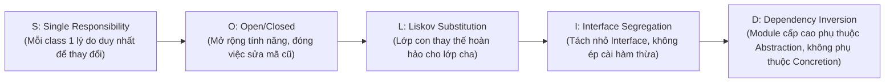

1. **S - Single Responsibility Principle (SRP)**:
   * *Vi phạm*: `UserService` vừa xử lý logic tạo user, vừa sinh file PDF hóa đơn, vừa gửi email qua SMTP.
   * *Chuẩn*: Tách thành 3 class độc lập: `UserService`, `PdfExportService`, `NotificationEmailService`.
2. **O - Open/Closed Principle (OCP)**:
   * Khi thêm phương thức thanh toán mới (VNPay, Momo, Stripe), thay vì nhảy vào sửa hàm `switch-case` to đùng trong `PaymentService`, ta tạo interface `PaymentMethod` và implement thêm class `VNPayPaymentMethod`. Code cũ được "đóng" lại an toàn.
3. **L - Liskov Substitution Principle (LSP)**:
   * Lớp con phải có khả năng thay thế hoàn hảo cho lớp cha mà không làm thay đổi tính đúng đắn của chương trình.
   * *Ví dụ vi phạm kinh điển*: Class `Square` kế thừa `Rectangle`. Khi gọi `setWidth(10)` thì `Square` tự đổi cả `height`, phá vỡ mong đợi của người dùng `Rectangle`.
4. **I - Interface Segregation Principle (ISP)**:
   * Không ép class phải implements những phương thức mà nó không dùng tới.
   * *Chuẩn*: Thay vì tạo 1 `SuperInterface` có cả `swim()`, `fly()`, `drive()`, ta xé nhỏ thành `Swimmable`, `Flyable`, `Drivable`.
5. **D - Dependency Inversion Principle (DIP)**:
   * Các module cấp cao (Service Layer) không được phụ thuộc trực tiếp vào các module cấp thấp (SQL Repository, Third-party SDK cụ thể). Cả hai phải cùng phụ thuộc vào Interface trừu tượng.

---

## 4. Java Collections Framework Deep-Dive

Toàn bộ cấu trúc lưu trữ dữ liệu của Java được chia thành 2 phân nhánh độc lập: Giao diện **`Collection<E>`** và Giao diện **`Map<K, V>`**.

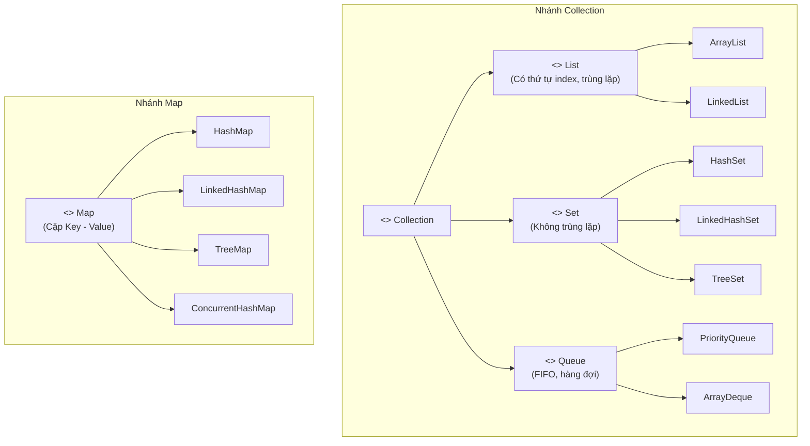

---

### 4.1. List: ArrayList vs LinkedList

| Tiêu chí | `ArrayList` | `LinkedList` |
| :--- | :--- | :--- |
| **Cấu trúc dữ liệu ngầm** | Mảng động có thể co giãn (`Object[] elementData`) | Danh sách liên kết đôi (Doubly-Linked List: `Node` có `prev`, `next`, `item`) |
| **Truy cập theo Index (`get(i)`)** | **$O(1)$** (Truy xuất trực tiếp ô nhớ qua công thức con trỏ) | **$O(n)$** (Phải duyệt từ đầu hoặc cuối tới vị trí chỉ định) |
| **Chèn/Xóa ở cuối (`add`)** | **$O(1)$ amortized** (Thỉnh thoảng tốn $O(n)$ khi phải resize mảng) | **$O(1)$** |
| **Chèn/Xóa ở đầu/giữa** | **$O(n)$** (Phải dịch chuyển toàn bộ các phần tử phía sau qua `System.arraycopy`) | **$O(1)$** nếu đã có sẵn con trỏ Node (nhưng tìm node tốn $O(n)$) |
| **Chi phí bộ nhớ** | Nhỏ gọn, liên tục trên RAM | Tốn nhiều RAM hơn (mỗi Node tiêu tốn thêm ~24 bytes cho 2 con trỏ `prev`/`next`) |
| **Cache Locality (CPU)** | **Rất tốt** (Dữ liệu nằm liền kề, tận dụng CPU Cache Lines) | **Kém** (Các node phân tán rải rác trên Heap, gây nhiều CPU Cache Misses) |

> 💡 **Khuyên dùng thực tế**: Trong 95% bài toán Enterprise, **luôn ưu tiên dùng `ArrayList`** vì CPU hiện đại duyệt mảng liên tục nhanh hơn gấp nhiều lần việc nhảy con trỏ ngẫu nhiên qua các node của `LinkedList`.

---

### 4.2. Map: HashMap Internals & Cơ chế Cây Đỏ-Đen (Java 8+)
`HashMap` là cấu trúc dữ liệu quan trọng bậc nhất trong các buổi phỏng vấn Java.

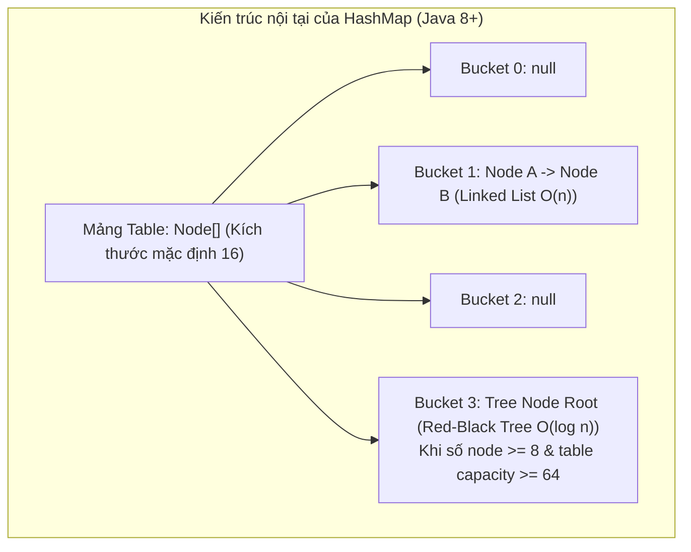

#### 1. Luồng hoạt động của hàm `put(key, value)`
1. **Tính Hash**: Tính toán mã băm thông qua hàm làm mịn (Hash Spreading):
   $$\text{hash} = (\text{key.hashCode}()) \oplus (\text{key.hashCode}() \gg 16)$$
   *(Thao tác XOR với 16 bit cao giúp giảm thiểu tối đa hiện tượng đụng độ hash khi mảng kích thước nhỏ).*
2. **Tính vị trí Bucket**: `index = hash & (n - 1)` (với $n$ là dung lượng mảng, luôn là lũy thừa của 2).
3. **Nếu Bucket trống**: Tạo mới `Node(hash, key, value, null)` và lưu vào ô mảng.
4. **Nếu xảy ra đụng độ (Collision - ô đã có phần tử)**:
   * Duyệt qua danh sách: So sánh nếu trùng cả `hash` và `(k == key || key.equals(k))` thì **ghi đè value**.
   * Nếu không trùng, gắn thêm node mới vào cuối danh sách liên kết.
   * **Cơ chế Treeify (Chuyển đổi thành Cây Đỏ-Đen)**: Nếu số node trong 1 bucket vượt quá ngưỡng **TREEIFY_THRESHOLD = 8** và tổng kích thước mảng table $\ge 64$, danh sách liên kết sẽ tự động chuyển thành **Cây Đỏ-Đen (Red-Black Tree)** để đảm bảo thời gian tìm kiếm tệ nhất chỉ là **$O(\log n)$** thay vì $O(n)$.
5. **Kiểm tra Resize**: Nếu số lượng phần tử vượt quá ngưỡng `threshold = capacity * loadFactor` (mặc định $16 \times 0.75 = 12$), dung lượng mảng sẽ tự động nhân đôi ($16 \rightarrow 32 \rightarrow 64$).

#### 2. Hợp đồng sống còn: `equals()` và `hashCode()`
Khi dùng một Object tùy chỉnh làm Key trong `HashMap` hoặc phần tử trong `HashSet`:
* **Quy tắc 1**: Nếu `obj1.equals(obj2) == true` thì **bắt buộc** `obj1.hashCode() == obj2.hashCode()`.
* **Quy tắc 2**: Nếu 2 object có `hashCode` bằng nhau thì chúng **chưa chắc** đã `equals` với nhau (hiện tượng Hash Collision).
* ⚠️ **Hậu quả nếu vi phạm**: Nếu bạn override `equals` mà quên override `hashCode`, hai đối tượng có cùng thuộc tính nhưng lại sinh ra 2 hashcode khác nhau. Khi gọi `map.get(key)` JVM sẽ tìm sang bucket khác và trả về `null` dù dữ liệu thực sự đang nằm trong Map!

---

### 4.3. Map đa luồng: ConcurrentHashMap vs Hashtable vs Collections.synchronizedMap
Khi làm việc trong môi trường đa luồng (Multi-threaded Web App):

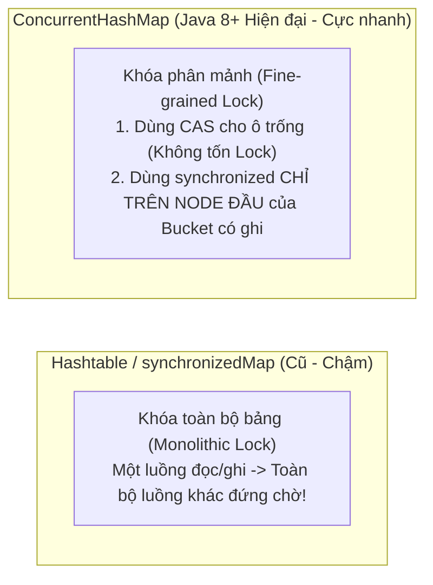

* **Hashtable / SynchronizedMap**: Sử dụng từ khóa `synchronized` bọc trên toàn bộ phương thức. Bất kỳ luồng nào truy cập đều khóa chết toàn bộ Map, khiến hiệu năng hệ thống tụt dốc thảm hại.
* **ConcurrentHashMap (Java 8+)**:
  * Đọc dữ liệu (`get`): Hoàn toàn **không dùng lock**, tận dụng thuộc tính `volatile` trên giá trị node để đảm bảo tính nhìn thấy (Visibility) giữa các luồng.
  * Ghi dữ liệu (`put`):
    * Nếu ô bucket đang trống: Dùng thuật toán **CAS (Compare-And-Swap)** không cần lock để gán node mới vào.
    * Nếu ô bucket đã có node: Chỉ dùng `synchronized` **trên đúng Node đầu tiên (Head Node)** của bucket đó. Các luồng khác ghi vào các bucket khác vẫn chạy song song hoàn toàn!
  * **Tại sao cấm `null` key và `null` value?**: Để loại trừ trạng thái bất định (Ambiguity) trong môi trường concurrency: không thể biết được `null` trả về là do key không tồn tại hay do giá trị của key đó bằng null.

---

### 4.4. Phân biệt các loại Set & Queue

| Collection | Đặc tính cốt lõi | Độ phức tạp tìm kiếm | Ứng dụng thực tế |
| :--- | :--- | :---: | :--- |
| **`HashSet`** | Không thứ tự, không trùng lặp (Dùng `HashMap` ngầm bên dưới) | $O(1)$ | Lọc danh sách ID người dùng duy nhất |
| **`LinkedHashSet`** | Duy trì thứ tự chèn (Dùng `LinkedHashMap` ngầm) | $O(1)$ | Khử trùng lặp nhưng vẫn giữ nguyên thứ tự ban đầu |
| **`TreeSet`** | Tự động sắp xếp tăng dần theo Comparator (Cây Đỏ-Đen) | $O(\log n)$ | Duy trì bảng xếp hạng điểm số liên tục |
| **`PriorityQueue`** | Hàng đợi ưu tiên dựa trên cấu trúc Heap nhị phân | $O(\log n)$ | Lập lịch tiến trình, thuật toán Dijkstra |
| **`ArrayDeque`** | Hàng đợi 2 đầu mảng động, nhanh hơn `Stack` và `LinkedList` | $O(1)$ | Triển khai ngăn xếp (Stack LIFO) hoặc Queue (FIFO) |

---

## 5. Đa luồng (Multithreading) & Mô hình bộ nhớ Concurrency

### 5.1. Khởi tạo Thread & Vòng đời của một Luồng
Có 3 cách tạo luồng trong Java:
1. `class MyThread extends Thread`: Kém linh hoạt do Java không hỗ trợ đa kế thừa.
2. `class MyTask implements Runnable`: Tách biệt logic công việc khỏi luồng thực thi, không trả về kết quả.
3. `class MyCallable implements Callable<V>`: Thực thi bất đồng bộ, có khả năng trả về giá trị hoặc ném Exception, quản lý kết quả qua đối tượng `Future<V>`.

> ⚠️ **Sự khác biệt sống còn giữa `start()` và `run()`**:  
> Gọi `.run()` chỉ là một lời gọi hàm thông thường trên chính luồng hiện tại (Main thread). Muốn hệ điều hành cấp phát một Thread độc lập mới chạy song song, bạn **bắt buộc phải gọi hàm `.start()`**.

---

### 5.2. Java Memory Model (JMM), `volatile` và `synchronized`

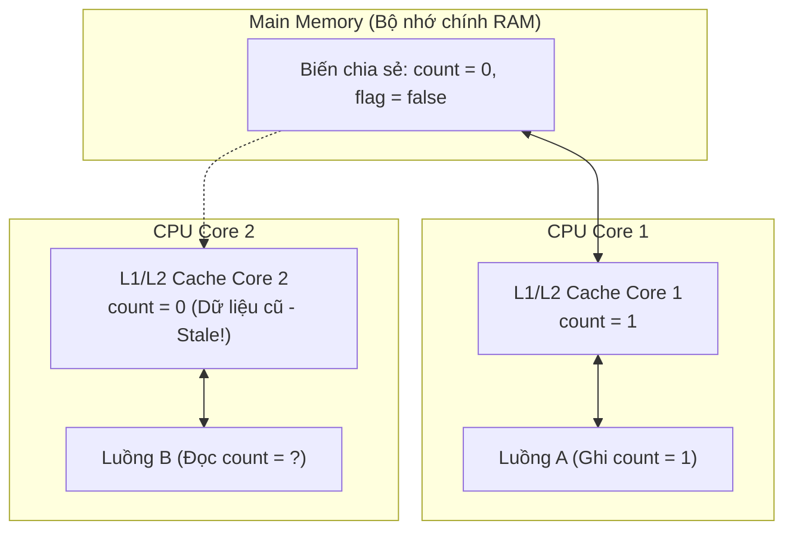

#### 1. Vấn đề bộ nhớ đệm CPU & Từ khóa `volatile`
* Trong kiến trúc đa lõi hiện đại, mỗi CPU Core đều có Cache riêng (L1, L2, L3). Khi Thread A cập nhật biến, dữ liệu có thể mới chỉ nằm trên CPU Cache của Core 1 mà chưa được đẩy xuống RAM. Thread B chạy trên Core 2 đọc từ RAM hoặc Cache của mình sẽ nhìn thấy dữ liệu cũ (**Visibility Problem**).
* Khi khai báo `volatile`:
  1. **Visibility**: Mọi thao tác ghi vào biến `volatile` đều được đẩy ngay lập tức xuống Main Memory. Mọi thao tác đọc đều phải đọc trực tiếp từ Main Memory, bỏ qua CPU cache.
  2. **Instruction Reordering Prevention**: JVM chèn các rào chắn bộ nhớ (**Memory Barriers**) ngăn trình biên dịch và CPU sắp xếp lại trật tự thực thi của các lệnh trước và sau biến `volatile`.
  3. ⚠️ **Giới hạn**: `volatile` **KHÔNG đảm bảo tính nguyên tử (Atomicity)**! Biến `volatile int count = 0;` nếu cho 10 luồng cùng chạy `count++` thì kết quả cuối cùng vẫn sẽ bị thất thoát do `count++` gồm 3 thao tác máy tính độc lập (Read - Modify - Write). Để nguyên tử, phải dùng `AtomicInteger` (sử dụng lệnh phần cứng CAS) hoặc `synchronized`.

#### 2. Từ khóa `synchronized` (Monitor Lock)
* `synchronized` đảm bảo cả 2 tính chất: **Atomicity (Nguyên tử)** và **Visibility (Nhìn thấy)**.
* Chỉ cho phép duy nhất một luồng tại một thời điểm nắm giữ Monitor Lock của đối tượng để đi vào khối lệnh.
* Các mức khóa:
  * Khóa trên Instance Method: `public synchronized void doWork()` $\rightarrow$ Khóa trên đối tượng `this`.
  * Khóa trên Static Method: `public static synchronized void doWork()` $\rightarrow$ Khóa trên đối tượng `ClassName.class` trong Metaspace.
  * Khóa trên Block: `synchronized(lockObject) { ... }` $\rightarrow$ Tối ưu hơn vì chỉ khóa đúng đoạn code nhạy cảm.

---

### 5.3. Bế tắc luồng (Deadlock) & 4 Điều kiện Coffman
Deadlock xảy ra khi 2 hoặc nhiều luồng bị đóng băng vô thời hạn vì luồng này đang nắm tài nguyên mà luồng kia cần và ngược lại.

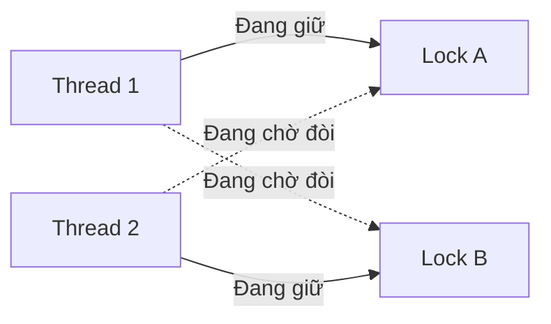

* **4 điều kiện dẫn tới Deadlock (Coffman Conditions)**:
  1. *Mutual Exclusion*: Tài nguyên chỉ cho 1 luồng dùng tại 1 thời điểm.
  2. *Hold and Wait*: Luồng vừa giữ tài nguyên vừa đòi thêm tài nguyên mới.
  3. *No Preemption*: Không thể cưỡng chế giật lại tài nguyên luồng khác đang giữ.
  4. *Circular Wait*: Tồn tại một chu trình chờ đợi khép kín giữa các luồng.
* **Cách phòng chống Deadlock**:
  * Luôn mua khóa theo một thứ tự toàn cục thống nhất (**Lock Ordering**): Ví dụ mọi luồng đều phải lấy Lock A trước rồi mới được lấy Lock B.
  * Dùng `ReentrantLock.tryLock(timeout)`: Nếu sau 3 giây không lấy được lock thì tự động nhả hết các lock đang giữ và thử lại sau.
  * Khi xảy ra sự cố trên Production: Dùng lệnh **`jstack <pid>`** để dump toàn bộ trạng thái các luồng. JVM sẽ tự động phát hiện và in ra dòng chữ *"Found 1 deadlock"*.

---

### 5.4. ThreadPoolExecutor & Cuộc cách mạng Virtual Threads (Java 21)

#### 1. Kiến trúc điều phối của ThreadPoolExecutor
Không bao giờ tạo luồng thủ công bằng `new Thread()` trong ứng dụng Enterprise vì chi phí cấp phát OS thread rất đắt đỏ (mặc định tốn ~1MB bộ nhớ Stack cho mỗi thread). Ta phải dùng **Thread Pool**:

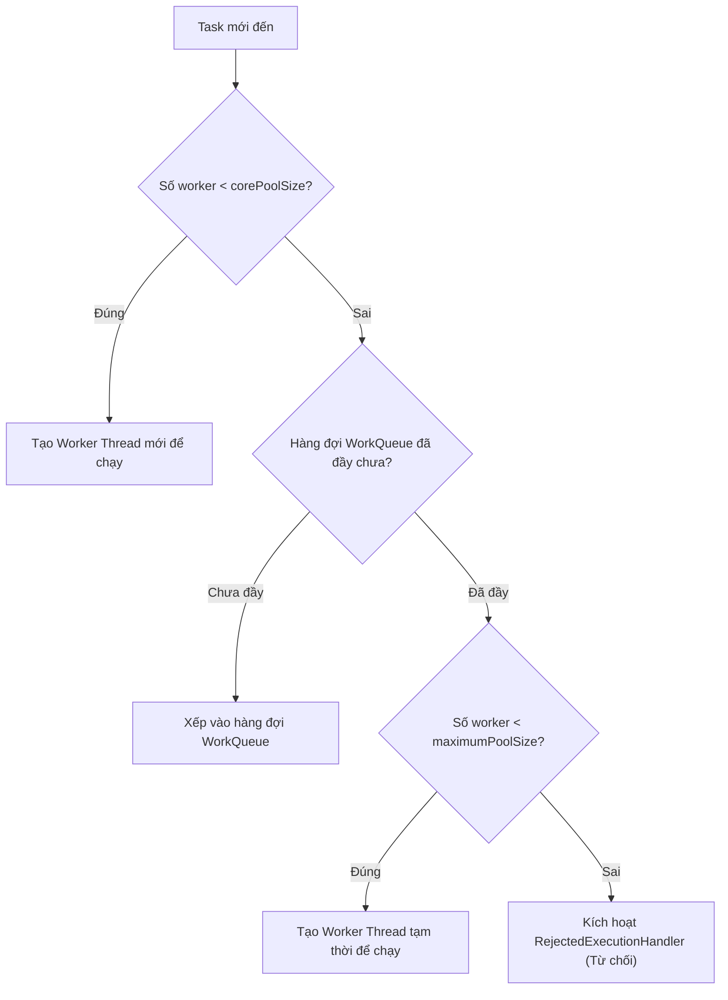

#### 2. Virtual Threads (Project Loom - Java 21 LTS)
* **Vấn đề của Platform Threads (OS Threads)**: Java truyền thống sử dụng mô hình luồng 1:1 với OS. Khi thread thực hiện I/O (chờ database query, chờ gọi API bên ngoài), OS thread đó bị chặn hoàn toàn (Blocked), lãng phí tài nguyên CPU.
* **Cơ chế của Virtual Threads**:
  * Virtual Thread là các luồng siêu nhẹ do chính JVM quản lý (chỉ tốn vài trăm bytes RAM thay vì hàng MB).
  * Hàng triệu Virtual Threads có thể chạy trên một số lượng nhỏ các **Carrier Threads (OS Threads)**.
  * Khi một Virtual Thread gặp tác vụ Blocking I/O, JVM sẽ tự động "tháo gỡ" (unmount) nó khỏi Carrier Thread để nhường luồng đó phục vụ việc khác. Khi I/O xong, JVM lại gắn (mount) nó trở lại và chạy tiếp.
  * **Tác động**: Viết code đồng bộ (Imperative) tuần tự, dễ debug bằng stack trace thông thường nhưng lại đạt được thông lượng xử lý tương đương mô hình Reactive (Spring WebFlux)!

---

## 6. Kiến trúc lõi Spring Boot & Data JPA / Hibernate

### 6.1. Inversion of Control (IoC) & Dependency Injection (DI)
* **IoC Container**: Thay vì lập trình viên tự quản lý vòng đời và dùng lệnh `new` để tạo đối tượng, quyền kiểm soát được giao lại cho Spring Container (**ApplicationContext**).
* **3 hình thức Dependency Injection**:
  1. *Field Injection (`@Autowired` trên biến)*: ❌ **Không khuyên dùng** (Khó viết Unit Test cô lập nếu không khởi động Spring Context, che giấu các phụ thuộc vi phạm SRP).
  2. *Setter Injection*: Dùng cho các phụ thuộc tùy chọn (Optional dependencies).
  3. *Constructor Injection*: ✅ **Best Practice tuyệt đối** (Đảm bảo tính bất biến với `final`, ép buộc phải truyền đủ dependencies khi test, và giúp phát hiện lỗi **Circular Dependency** ngay lúc khởi động ứng dụng).

---

### 6.2. Vòng đời của một Spring Bean (Bean Lifecycle)

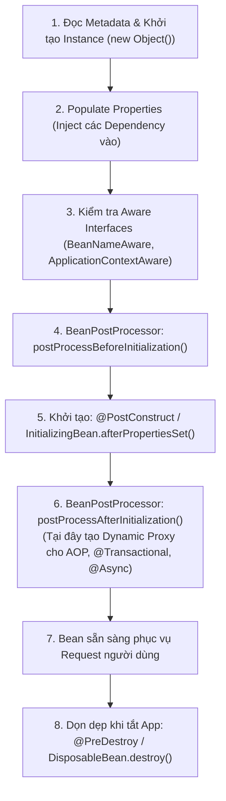

> 💡 **Điểm mấu chốt phỏng vấn**: Các annotation như `@Transactional`, `@Cacheable`, `@Async` **không chạy trên code gốc của bạn**! Tại bước `BeanPostProcessor (After Initialization)`, Spring bọc đối tượng của bạn vào một **CGLIB hoặc JDK Dynamic Proxy**. Khi có request gọi vào, Proxy sẽ chặn lại để mở Transaction trước, sau đó mới gọi hàm thực của bạn.

---

### 6.3. Spring Data JPA & Hibernate Internals

#### 1. Bốn trạng thái của Entity trong Persistence Context (EntityManager)
* **Transient (New)**: Đối tượng vừa được tạo bằng lệnh `new`, chưa có ID, chưa liên kết với EntityManager, chưa lưu vào Database.
* **Managed (Persistent)**: Đối tượng đã liên kết với Persistence Context (vừa `persist()` hoặc vừa load từ DB lên). Mọi thay đổi thuộc tính trên đối tượng này sẽ được theo dõi tự động.
* **Detached**: Đối tượng từng nằm trong Persistence Context nhưng Session/Transaction đã bị đóng.
* **Removed**: Đối tượng được đánh dấu để xóa khỏi DB khi Transaction commit (`em.remove()`).

#### 2. Cơ chế Dirty Checking (Tự động cập nhật không cần gọi `.save()`)
Khi load một Entity vào trạng thái **Managed**, Hibernate tự động chụp một bản sao lưu trạng thái ban đầu của đối tượng đó (**Snapshot**).
* Khi Transaction sắp commit, Hibernate thực hiện cơ chế **Dirty Checking**: So sánh trạng thái hiện tại của Entity với bản Snapshot.
* Nếu phát hiện có bất kỳ trường nào thay đổi, Hibernate sẽ **tự động sinh câu lệnh SQL `UPDATE` tương ứng** đẩy xuống DB.
* Do đó, trong một hàm `@Transactional`, việc gọi thêm lệnh `userRepository.save(user)` sau khi vừa `user.setName("Mới")` là **hoàn toàn thừa thãi**!

#### 3. Cạm bẫy N+1 Query & Giải pháp triệt để
* **Nguyên nhân**: Bạn truy vấn một danh sách gồm $N$ bản ghi cha (`Order`), sau đó duyệt qua từng bản ghi để lấy thông tin bảng con có quan hệ Lazy (`OrderLine`). Hibernate sẽ phát sinh:
  * 1 câu query để lấy $N$ bản ghi `Order`.
  * $N$ câu query tiếp theo để lấy `OrderLine` cho từng đơn hàng $\rightarrow$ Tổng cộng: $1 + N$ queries, làm tê liệt Database!
* **Cách khắc phục chuẩn Enterprise**:
  1. Dùng **`JOIN FETCH`** trong câu lệnh JPQL: `SELECT o FROM Order o JOIN FETCH o.orderLines`.
  2. Dùng annotation **`@EntityGraph(attributePaths = {"orderLines"})`** trên Spring Data JPA Repository.
  3. Cấu hình Batch Fetching trong `application.yml`:
     ```yaml
     spring:
       jpa:
         properties:
           hibernate:
             default_batch_fetch_size: 50
     ```
     *(Hibernate sẽ tự động gom các ID con lại thành câu lệnh `WHERE order_id IN (?, ?, ...)` thay vì query lẻ từng dòng).*

---

### 6.4. Cơ chế Quản trị Transaction (`@Transactional`) & Cạm bẫy Self-Invocation
* **Rollback Rules**: Mặc định Spring `@Transactional` chỉ tự động rollback khi gặp **`RuntimeException`** (Unchecked Exception) hoặc **`Error`**. Nếu ứng dụng ném ra một Checked Exception (kế thừa trực tiếp từ `Exception`), transaction vẫn sẽ **COMMIT** bình thường!
  * *Cách viết chuẩn*: Luôn chỉ định rõ:
    ```java
    @Transactional(rollbackFor = Exception.class)
    ```
* **Cạm bẫy Tự gọi hàm trong cùng lớp (Self-Invocation Trap)**:
  ```java
  @Service
  public class OrderService {
      public void placeOrder() {
          // LỖI: Gọi nội bộ không đi qua Spring Proxy!
          // Transaction sẽ KHÔNG HỀ được kích hoạt!
          this.processPayment();
      }

      @Transactional(propagation = Propagation.REQUIRES_NEW)
      public void processPayment() {
          // Logic thanh toán...
      }
  }
  ```
  * *Nguyên nhân*: `@Transactional` hoạt động nhờ cơ chế AOP Proxy. Khi gọi `this.processPayment()`, lời gọi hàm diễn ra trực tiếp trên instance nội bộ, không đi qua lớp vỏ Proxy bên ngoài nên logic quản lý transaction bị bỏ qua hoàn toàn.
  * *Cách sửa*: Tách `processPayment()` sang một Bean độc lập (`PaymentProcessorService`) và inject vào, hoặc dùng `AopContext.currentProxy()`.
