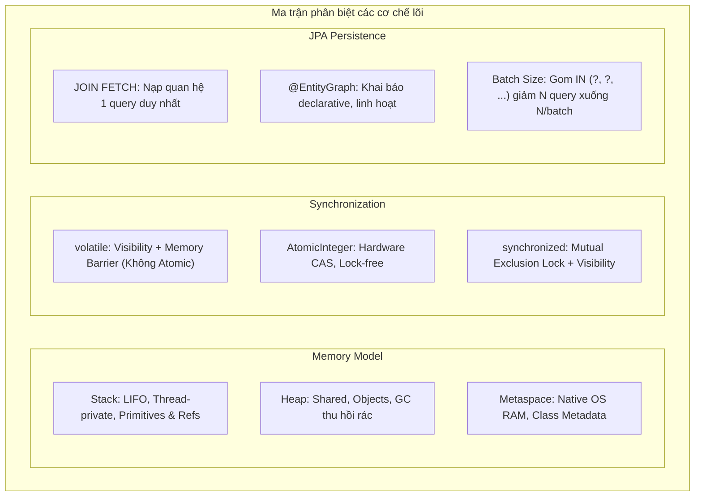

# 🎯 CHUYÊN ĐỀ 09.2: JAVA & SPRING BOOT – BỘ CÂU HỎI PHỎNG VẤN SENIOR & BẢO VỆ DỰ ÁN THỰC CHIẾN

> **Ứng viên**: Nguyễn Đức Quỳnh – Backend / Fullstack Engineer  
> **Mục tiêu**: Bộ câu hỏi phỏng vấn chuyên sâu dành cho vị trí Senior Java / Spring Boot Backend Engineer. Bộ tài liệu kết hợp giữa lý thuyết tầng sâu (JVM internals, Concurrency, Collections) với các bài toán kiến trúc thực chiến: **Xử lý Transaction phân tán**, **Tối ưu Hibernate N+1 & Dirty Checking**, **Quản trị Connection Pool HikariCP**, **Troubleshooting Memory Leak & Deadlock**, và **Tối ưu thông lượng với Java 21 Virtual Threads**.

---

## PHẦN 1: BẢO VỆ THIẾT KẾ KIẾN TRÚC & DỰ ÁN THỰC CHIẾN

### Case 1: Xử lý Race Condition & Deadlock trong Hệ thống Kho hàng (WMS Inventory Lock)
> **Bối cảnh thực tế**: Trong hệ thống thương mại điện tử / kho vận (WMS), khi diễn ra Flash Sale, hàng trăm khách hàng cùng bấm mua một mặt hàng còn số lượng ít (ví dụ còn 5 sản phẩm). Nếu không xử lý concurrency cẩn thận, hệ thống sẽ bị lỗi **Overselling (bán quá số lượng tồn kho)** hoặc xảy ra **Deadlock trong Database**.

#### Q1: Em lựa chọn giải pháp nào trong Java/Spring Boot để giải quyết bài toán trừ tồn kho đồng thời: Pessimistic Locking, Optimistic Locking, hay Distributed Lock với Redis? Khi nào nên chọn cái nào?
* 💡 **Câu trả lời ăn điểm**:
  * **1. Optimistic Locking (Khóa lạc quan - `@Version`)**:
    * *Cơ chế*: Dùng cột version/timestamp trong Entity JPA:
      ```java
      @Entity
      public class Inventory {
          @Id private Long id;
          private Integer stock;
          @Version private Long version; // Hibernate tự động kiểm tra version khi UPDATE
      }
      ```
      Câu lệnh sinh ra: `UPDATE inventory SET stock = stock - 1, version = version + 1 WHERE id = ? AND version = ?`.
    * *Ưu/Nhược điểm*: Không hề khóa dòng ở tầng DB nên throughput cực cao khi tỉ lệ xung đột thấp. Nhưng ở đợt Flash Sale cao điểm (hàng trăm request tranh chấp 1 dòng), 95% request sẽ bị ném ngoại lệ `ObjectOptimisticLockingFailureException` và phải retry liên tục $\rightarrow$ Gây lãng phí CPU và DB load.
  * **2. Pessimistic Locking (Khóa bi quan - `PESSIMISTIC_WRITE`)**:
    * *Cơ chế*: Sinh câu lệnh SQL `SELECT ... FOR UPDATE`:
      ```java
      @Lock(LockModeType.PESSIMISTIC_WRITE)
      @Query("SELECT i FROM Inventory i WHERE i.productId = :productId")
      Optional<Inventory> findByIdForUpdate(@Param("productId") Long productId);
      ```
    * *Ưu/Nhược điểm*: Đảm bảo 100% tính nhất quán, các transaction khác xếp hàng chờ. Tuy nhiên nếu giữ lock quá lâu (do gọi thêm third-party payment bên trong transaction) sẽ làm cạn kiệt Connection Pool HikariCP.
  * **3. Distributed Lock với Redis (Redisson / Lua Script)**:
    * *Cơ chế*: Đẩy việc tranh chấp lock lên RAM của Redis trước khi chạm vào Database.
  * **Kết luận lựa chọn thực chiến**:
    * Với hàng hóa thông thường: Dùng **Optimistic Locking**.
    * Với mặt hàng Flash Sale cực nóng: Dùng **Distributed Lock trên Redis** kết hợp trừ kho trên RAM (Redis Atomic Decr), sau đó dùng Message Queue (RabbitMQ/Kafka) đồng bộ bất đồng bộ xuống Database thông qua Transactional Outbox.

---

### Case 2: Cạm bẫy Transaction Boundary & Gọi Third-Party Payment trong `@Transactional`
> **Bối cảnh thực tế**: Trong service xử lý đơn hàng và thanh toán VNPay/Stripe, luồng xử lý gồm: (1) Lưu đơn hàng vào DB, (2) Gọi API sang cổng thanh toán VNPay để lấy URL, (3) Gửi email thông báo cho khách hàng.

#### Q2: Tại sao việc đặt toàn bộ luồng trên bên trong một phương thức `@Transactional` lại là một Anti-pattern nghiêm trọng có thể đánh sập hệ thống Production? Em khắc phục như thế nào?
* 💡 **Câu trả lời ăn điểm**:
  * **Cơ chế gây sập hệ thống (Connection Pool Exhaustion)**:
    * Khi bước vào hàm `@Transactional`, Spring sẽ mượn một kết nối vật lý (Physical Connection) từ **HikariCP Pool** và mở transaction trên DB. Kết nối này sẽ bị giữ chặt cho đến khi hàm kết thúc.
    * Lệnh gọi API sang VNPay là một tác vụ Network I/O phụ thuộc vào mạng bên ngoài (có thể mất từ 1s đến 5s, hoặc timeout 30s khi đối tác quá tải).
    * Khi có lượng traffic lớn đổ về, toàn bộ các kết nối trong HikariCP (mặc định 10-20 connections) đều bị chiếm giữ bởi các luồng đang "ngồi chờ" VNPay phản hồi. Kết quả: **HikariCP cạn kiệt kết nối**, toàn bộ các API khác trong hệ thống (kể cả API đọc đơn giản) đều bị nghẽn và ném lỗi `SQLTransientConnectionException: Connection is not available`.
  * **Nguyên tắc vàng**: **Tuyệt đối không bao giờ thực hiện Network I/O (gọi HTTP API ngoài, gửi Email, xử lý file nặng) bên trong một Database Transaction.**
  * **Giải pháp tái cấu trúc chuẩn Enterprise**:
    * Rút ngắn phạm vi Transaction bằng cách tách Service hoặc dùng `TransactionTemplate`:
    ```java
    @Service
    @RequiredArgsConstructor
    public class CheckoutService {
        private final OrderTransactionService orderTxService;
        private final VNPayClient vnpayClient;
        private final NotificationEventPublisher eventPublisher;

        public CheckoutResponse processCheckout(OrderRequest request) {
            // Bước 1: Giao dịch DB siêu nhanh (< 10ms)
            Long orderId = orderTxService.createOrderInTransaction(request);

            // Bước 2: Gọi Third-Party ngoài phạm vi Transaction (Không giữ DB Connection!)
            PaymentUrl paymentUrl = vnpayClient.generatePaymentUrl(orderId, request.amount());

            // Bước 3: Đẩy event bất đồng bộ, không chặn luồng
            eventPublisher.publishOrderCreated(orderId);

            return new CheckoutResponse(orderId, paymentUrl);
        }
    }
    ```

---

### Case 3: Tối ưu hóa HikariCP Connection Pool & Troubleshooting
> **Bối cảnh thực tế**: Ứng dụng Spring Boot chạy trên môi trường Docker/Kubernetes thỉnh thoảng xuất hiện lỗi nghẽn request vào giờ cao điểm.

#### Q3: Em căn cứ vào tiêu chí nào để cấu hình kích thước Connection Pool cho HikariCP? Nếu một bạn Junior đề xuất tăng `maximumPoolSize` từ 10 lên 200 để "hệ thống xử lý được nhiều request đồng thời hơn", em sẽ phản biện như thế nào?
* 💡 **Câu trả lời ăn điểm**:
  * **Phản biện đề xuất tăng 200 connections**:
    * Đây là một sai lầm phổ biến. Database Server (như PostgreSQL hay MySQL) cũng bị giới hạn bởi số lõi CPU vật lý và I/O đĩa.
    * Khi mở tới 200 kết nối đồng thời, các luồng trên Database Server sẽ liên tục xảy ra hiện tượng **Context Switching** (tranh chấp CPU và tranh chấp I/O đĩa cứng). Hệ thống thay vì xử lý dữ liệu thì tốn phần lớn thời gian chuyển đổi ngữ cảnh giữa các tiến trình $\rightarrow$ **Hiệu năng tổng thể tụt giảm nghiêm trọng (Throughput giảm, Latency tăng vọt)**.
  * **Công thức vàng của PostgreSQL / HikariCP Team**:
    $$\text{Pool Size} = (\text{CPU Cores} \times 2) + \text{Effective Spindle Count}$$
    *(Ví dụ: Một Database Server 8 Cores gắn ổ cứng NVMe SSD tốc độ cao thì kích thước pool tối ưu chỉ rơi vào khoảng: $(8 \times 2) + 1 = 17$ đến 20 connections!)*
  * **Các thông số cấu hình Production sống còn của HikariCP**:
    * `connectionTimeout = 30000` (30s: thời gian tối đa chờ mượn connection trước khi throw Exception).
    * `idleTimeout = 600000` (10 phút: giải phóng connection nhàn rỗi).
    * `maxLifetime = 1800000` (30 phút: bắt buộc hủy connection cũ để tránh rò rỉ bộ nhớ hoặc kết nối ngầm bị tường lửa firewall ngắt).
    * `leakDetectionThreshold = 2000` (2 giây: cực kỳ quan trọng! Nếu một luồng mượn connection quá 2 giây mà chưa trả về pool, HikariCP sẽ tự động log một Exception kèm theo stack trace để phát hiện ngay lập tức đoạn code nào đang giữ connection quá lâu).

---

## PHẦN 2: BỘ CÂU HỎI PHỎNG VẤN CHUYÊN SÂU (DEEP-DIVE INTERNALS)

### 1. JVM & Memory Management

#### Q4: Em hãy phân biệt lỗi `StackOverflowError` và `OutOfMemoryError: Java heap space`. Khi ứng dụng Java bị lỗi OOM trên Production, em thực hiện các bước điều tra (troubleshooting) như thế nào?
* 💡 **Câu trả lời ăn điểm**:
  * **Phân biệt bản chất**:
    * `StackOverflowError`: Xảy ra trên vùng nhớ Stack riêng của luồng khi số lượng Frame vượt quá giới hạn (điển hình do đệ quy vô hạn không có điểm dừng hoặc chu kỳ gọi vòng giữa các hàm).
    * `OutOfMemoryError: Java heap space`: Xảy ra trên vùng nhớ Heap dùng chung khi ứng dụng tạo quá nhiều đối tượng sống sót nhưng Garbage Collector đã vét cạn toàn bộ các chu kỳ Full GC mà vẫn không thu hồi đủ RAM để cấp phát đối tượng mới.
  * **Quy trình 4 bước điều tra Memory Leak trên Production**:
    1. **Bật cờ tự động sinh Heap Dump khi chết**: Cấu hình tham số JVM khi chạy Docker:
       `-XX:+HeapDumpOnOutOfMemoryError -XX:HeapDumpPath=/var/log/dumps/heap_dump.hprof`.
    2. **Phân tích Heap Dump bằng công cụ chuyên dụng**: Tải file `.hprof` về máy local và mở bằng **Eclipse Memory Analyzer (MAT)** hoặc **JProfiler**.
    3. **Kiểm tra Leak Suspects Report**: MAT sẽ tự động phân tích đồ thị giữ tham chiếu lớn nhất (Dominator Tree) và chỉ ra: Class nào đang chiếm 70-80% dung lượng Heap (Ví dụ: Một mảng `byte[]` trong class xuất file Excel hoặc một `ConcurrentHashMap` lưu cache static không có TTL).
    4. **Khắc phục**: Sửa code dọn dẹp liên kết GC Roots, thay thế cache bằng Caffeine/Redis có giới hạn dung lượng và thời gian hết hạn (Eviction policy).

---

### 2. Java Collections & Concurrency

#### Q5: Trong Java 8, tại sao HashMap lại chuyển từ Linked List sang Cây Đỏ-Đen (Red-Black Tree) khi kích thước bucket $\ge 8$? Tại sao ngưỡng chuyển đổi lại là 8 mà không phải 2 hay 20?
* 💡 **Câu trả lời ăn điểm**:
  * **Lý do chuyển đổi**:
    * Trong trường hợp xấu nhất (xảy ra tấn công Hash Collision hoặc hàm `hashCode()` cài đặt tồi), tất cả các Key đều bị băm vào cùng 1 bucket. Khi đó Linked List biến thành danh sách tuần tự với độ phức tạp tìm kiếm $O(n)$. Cây Đỏ-Đen đảm bảo độ phức tạp tồi nhất được chặn ở mức **$O(\log n)$**.
  * **Tại sao con số lại là 8?**:
    * Đội ngũ kỹ sư thiết kế Java (Brian Goetz và cộng sự) dựa trên **Phân phối xác suất Poisson (Poisson Distribution)**. Với một hàm băm đồng đều ngẫu nhiên tiêu chuẩn, xác suất để 8 phần tử cùng rơi vào một bucket là cực kỳ hiếm: tỉ lệ chỉ vào khoảng **1 trên 10 triệu** ($0.00000006$).
    * Cây Đỏ-Đen tiêu tốn dung lượng bộ nhớ gấp đôi Linked List (vì `TreeNode` phải lưu thêm con trỏ `parent`, `left`, `right` và thuộc tính màu `boolean red`). Do đó, chỉ khi xảy ra đụng độ hash bất thường vượt quá xác suất tự nhiên (ngưỡng 8), JVM mới chấp nhận hy sinh RAM chuyển sang Cây để cứu vãn hiệu năng CPU.

#### Q6: Từ khóa `volatile` khác gì so với `AtomicInteger`? Hãy giải thích tại sao `volatile int count = 0; count++` lại không an toàn trong môi trường đa luồng?
* 💡 **Câu trả lời ăn điểm**:
  * **Bản chất của `count++`**:
    * Phép toán `count++` không phải là một thao tác đơn lẻ mà được phân rã thành **3 lệnh mã máy độc lập**:
      1. Đọc giá trị hiện tại của `count` từ RAM vào thanh ghi CPU.
      2. Cộng thêm `1` vào thanh ghi CPU.
      3. Ghi giá trị mới từ thanh ghi CPU trở lại RAM.
    * Khi 2 luồng cùng thực hiện đồng thời: Cả 2 luồng đều đọc được `count = 5`. Cả 2 cùng cộng thành `6` và cùng ghi đè `6` xuống RAM. Kết quả đúng phải là `7` nhưng bị mất một lần tăng (**Lost Update**).
  * **Vai trò của `volatile`**: Chỉ đảm bảo tính nhìn thấy (Visibility) – khi luồng ghi xong thì luồng khác nhìn thấy ngay lập tức. Nó hoàn toàn **không có khả năng khóa để biến 3 thao tác máy trên thành 1 khối nguyên tử (Atomic)**.
  * **Sức mạnh của `AtomicInteger`**: Sử dụng thuật toán **CAS (Compare-And-Swap)** được hỗ trợ trực tiếp từ tập lệnh phần cứng của CPU (`LOCK CMPXCHG` trên x86). Nó không cần dùng đến khóa nặng `synchronized` mà liên tục kiểm tra: nếu giá trị ở RAM chưa bị luồng khác đổi thì mới ghi đè giá trị mới, nếu bị đổi thì lặp lại vòng xoay (Spin lock) cho đến khi thành công $\rightarrow$ Đạt tính nguyên tử 100% với hiệu năng siêu cao.

---

### 3. Spring Boot, Data JPA & Hibernate

#### Q7: Cơ chế "Dirty Checking" của Hibernate hoạt động như thế nào? Tại sao trong một hàm `@Transactional`, ta không cần gọi `.save()` mà DB vẫn được update? Có khi nào nó gây phản tác dụng không?
* 💡 **Câu trả lời ăn điểm**:
  * **Cơ chế**:
    * Khi một Entity được load từ DB lên trong phạm vi một Transaction, nó rơi vào trạng thái **Managed** trong Persistence Context.
    * Hibernate lập tức tạo một bản sao lưu (Snapshot) trạng thái tất cả các trường dữ liệu của Entity đó tại thời điểm nạp.
    * Trong suốt quá trình chạy hàm, bạn có thể gọi `user.setEmail("new@gmail.com")`.
    * Trước khi Transaction thực hiện Commit, Hibernate tự động kích hoạt quá trình **Flush**: So sánh từng trường của Entity hiện tại với bản Snapshot ban đầu. Nếu có sự khác biệt (bị "dirty"), Hibernate tự động build câu lệnh SQL `UPDATE users SET email = ? WHERE id = ?` và gửi xuống DB.
  * **Điểm trừ / Khi nào phản tác dụng**:
    * Trong các tác vụ chỉ đọc (Read-only query), nếu bạn load hàng chục nghìn bản ghi lên bộ nhớ mà không cần sửa đổi, Hibernate vẫn phải tốn CPU và RAM để lưu bản Snapshot cho từng bản ghi và duyệt so sánh khi đóng transaction.
    * **Cách tối ưu**: Luôn đánh dấu:
      ```java
      @Transactional(readOnly = true)
      ```
      Spring và Hibernate sẽ tự động tắt cơ chế Dirty Checking và không lưu Snapshot, giúp **tiết kiệm bộ nhớ và tăng tốc độ query lên tới 20–30%**.

#### Q8: Tại sao không nên viết `@Async` hoặc `@Transactional` trên phương thức `private`? Tại sao 2 hàm cùng class gọi nhau thì các annotation này bị "vô hiệu hóa"?
* 💡 **Câu trả lời ăn điểm**:
  * **Bản chất cơ chế Proxy của Spring AOP**:
    * Spring quản lý các tính năng xuyên suốt (Cross-cutting Concerns) như Transaction, Security, Caching thông qua **Dynamic Proxy** (JDK Proxy hoặc CGLIB).
    * Spring tạo một class con giả lập bọc lấy class gốc của bạn. Khi Client gọi `orderService.placeOrder()`, thực chất Client đang gọi vào hàm của lớp Proxy:
      ```java
      // Mô phỏng mã ngầm của Spring Proxy
      public class OrderService$$SpringProxy extends OrderService {
          public void placeOrder() {
              transactionManager.begin();
              try {
                  super.placeOrder(); // Gọi code thực tế của bạn
                  transactionManager.commit();
              } catch (Exception e) {
                  transactionManager.rollback();
              }
          }
      }
      ```
  * **Vì sao không đặt trên `private`?**:
    * Lớp Proxy kế thừa lớp cha thì **không thể override phương thức `private`** của cha. Do đó Spring AOP hoàn toàn bất lực và bỏ qua annotation trên hàm `private`.
  * **Vì sao gọi nội bộ (Self-invocation) bị mất tác dụng?**:
    * Khi hàm A gọi hàm B trong cùng class (`this.methodB()`), từ khóa `this` trỏ thẳng tới **đối tượng gốc bên trong**, hoàn toàn không đi qua lớp vỏ Proxy bên ngoài. Do đó toàn bộ logic bắt đầu transaction hay mở luồng mới đều bị bỏ qua!

---

## PHẦN 3: BÀI TOÁN THỰC CHIẾN & LIVE CODING TRONG PHÒNG PHỎNG VẤN

### Bài 1: Cài đặt Thread-Safe Singleton Pattern chuẩn mực (Bill Pugh Singleton)
* ❓ **Đề bài**: Hãy viết một Singleton Class trong Java đảm bảo: (1) Khởi tạo lười (Lazy initialization), (2) An toàn tuyệt đối trong môi trường đa luồng (Thread-safe), (3) Đạt hiệu năng cao nhất mà không dùng từ khóa `synchronized` làm thắt cổ chai.
* 💡 **Code chuẩn Senior**:
  ```java
  public class ConnectionManager {

      // Constructor private ngăn chặn việc new từ bên ngoài
      private ConnectionManager() {
          // Bảo vệ chống tấn công qua Reflection API
          if (InstanceHolder.INSTANCE != null) {
              throw new IllegalStateException("Singleton already initialized!");
          }
      }

      // Static Inner Class chỉ được nạp vào bộ nhớ khi hàm getInstance() được gọi lần đầu!
      private static class InstanceHolder {
          private static final ConnectionManager INSTANCE = new ConnectionManager();
      }

      public static ConnectionManager getInstance() {
          return InstanceHolder.INSTANCE;
      }
  }
  ```
  * *Giải thích cơ chế ngầm*: Phương pháp **Bill Pugh Singleton** tận dụng cơ chế nạp lớp của JVM ClassLoader. Inner class `InstanceHolder` hoàn toàn không được nạp khi class `ConnectionManager` khởi động, mà chỉ được nạp khi có lời gọi `getInstance()`. JVM đảm bảo quá trình khởi tạo một class là an toàn đa luồng tuyệt đối ở tầng máy ảo mà không cần tốn một chi phí Lock nào.

---

### Bài 2: Tự xây dựng bộ nhớ đệm LRU Cache bằng `LinkedHashMap`
* ❓ **Đề bài**: Hãy thiết kế một bộ nhớ đệm LRU (Least Recently Used) Cache có dung lượng cố định $K$ phần tử. Khi thêm phần tử mới vượt quá $K$, phần tử ít được sử dụng nhất trong thời gian dài nhất sẽ tự động bị loại bỏ. Thời gian thao tác `get` và `put` đều phải đạt $O(1)$.
* 💡 **Code chuẩn Senior**:
  ```java
  import java.util.LinkedHashMap;
  import java.util.Map;

  public class LRUCache<K, V> extends LinkedHashMap<K, V> {
      private final int capacity;

      public LRUCache(int capacity) {
          // initialCapacity, loadFactor = 0.75f
          // accessOrder = true: Cực kỳ quan trọng! Sắp xếp thứ tự theo LƯỢT TRUY CẬP thay vì thứ tự chèn
          super(capacity, 0.75f, true);
          this.capacity = capacity;
      }

      // Hibernate / Java Collections hook: Tự động xóa phần tử già cỗi nhất khi vượt quá capacity
      @Override
      protected boolean removeEldestEntry(Map.Entry<K, V> eldest) {
          return size() > this.capacity;
      }

      public static void main(String[] args) {
          LRUCache<Integer, String> cache = new LRUCache<>(3);
          cache.put(1, "A");
          cache.put(2, "B");
          cache.put(3, "C");

          cache.get(1); // 1 được truy cập -> Đưa lên đầu danh sách ưu tiên

          cache.put(4, "D"); // Vượt quá 3 phần tử -> 2 ít dùng nhất bị loại bỏ!

          System.out.println(cache.keySet()); // In ra: [3, 1, 4] (Phần tử 2 đã bị xóa)
      }
  }
  ```

---

## 📊 BẢNG TỔNG KẾT SO SÁNH CÁC KHÁI NIỆM DỄ NHẦM LẪN



---

## 🏁 CHECKLIST ĐI PHỎNG VẤN SENIOR JAVA (BẠN ĐÃ TỰ TIN ĐÁP ỨNG?)
- [x] Nắm rõ cấu trúc phân tầng bộ nhớ JVM (Young Eden/Survivor, Old Gen, Metaspace) và giải thích được nguyên nhân gây STW của GC.
- [x] Thuộc làu cơ chế băm và chuyển đổi Cây Đỏ-Đen $O(\log n)$ của `HashMap` khi bucket chạm ngưỡng 8.
- [x] Phân tích được sự khác biệt giữa `ConcurrentHashMap` và `Hashtable` (CAS + Lock trên Node đầu).
- [x] Hiểu sâu sắc bản chất Spring AOP Proxy, giải thích được lý do lỗi tự gọi hàm trong `@Transactional`.
- [x] Nêu được ít nhất 3 cách triệt tiêu lỗi N+1 Query trong Spring Data JPA.
- [x] Tự tin tính toán kích thước Connection Pool cho HikariCP theo công thức CPU Cores.
- [x] Nắm bắt được xu hướng Java 21 LTS (Virtual Threads - Project Loom và Record classes).
