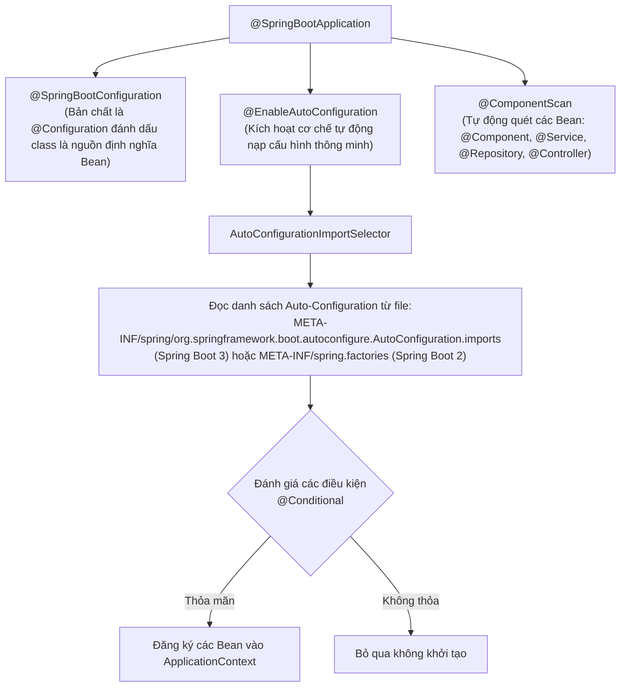
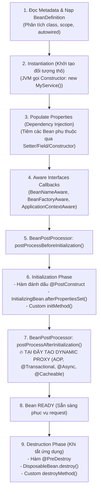
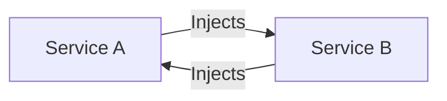
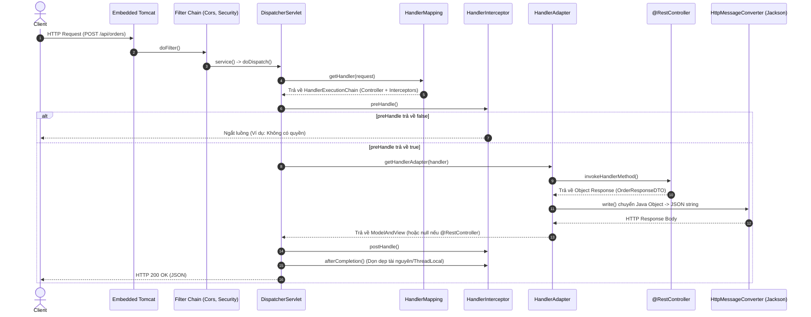
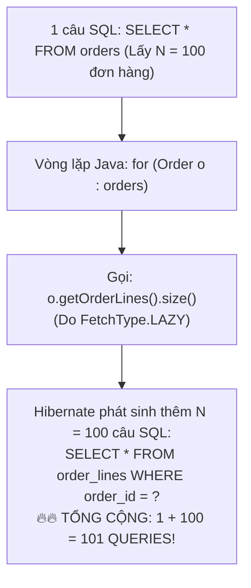
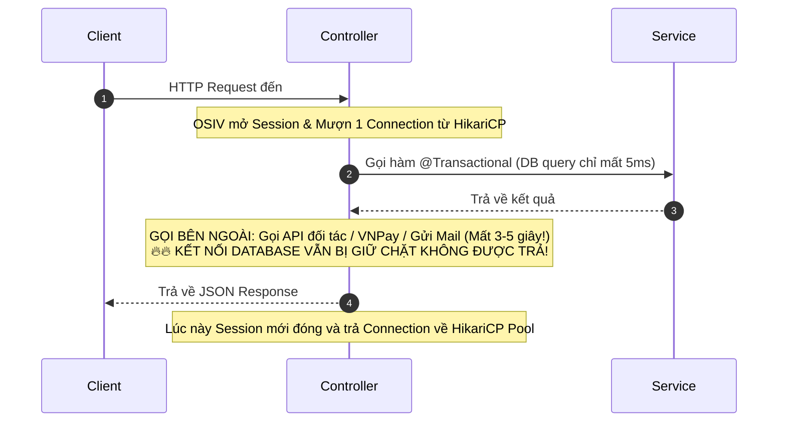
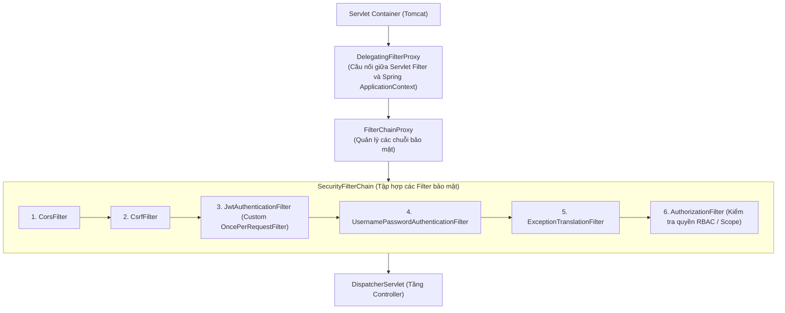
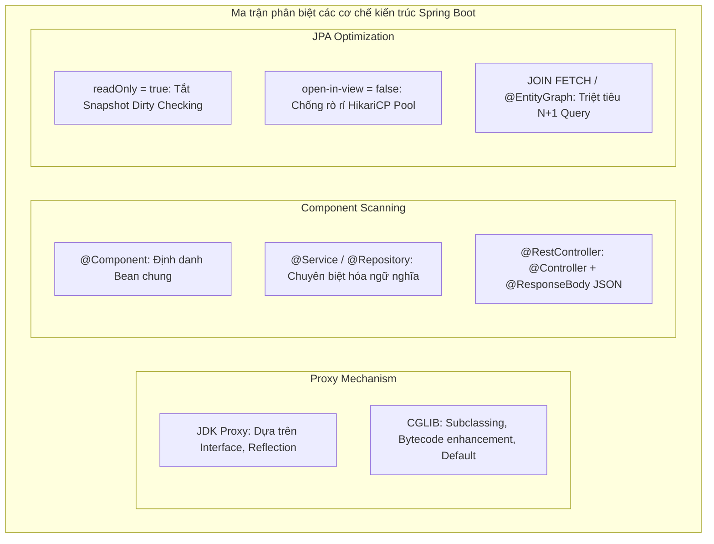

# 📗 CHUYÊN ĐỀ 10.1: SPRING BOOT ARCHITECTURE – LÝ THUYẾT & KIẾN TRÚC LÕI

> **Mục tiêu**: Nắm vững bản chất tầng sâu của hệ sinh thái **Spring Boot 3.x & Spring Framework 6**, từ cơ chế ma thuật của Auto-Configuration, vòng đời Bean trong IoC Container, kiến trúc AOP Proxy (JDK vs CGLIB), luồng xử lý HTTP qua DispatcherServlet, tối ưu Spring Data JPA & Hibernate (Dirty Checking, N+1, cạm bẫy OSIV), quản trị Transaction chuyên sâu, Spring Security 6 Filter Chain, cho đến Actuator giám sát Production và ứng dụng Java 21 Virtual Threads trong kiến trúc chịu tải cao.

---

## 1. Tổng quan Spring Framework vs Spring Boot & Triết lý "Convention over Configuration"

### 1.1. Sự tiến hóa từ Spring Framework truyền thống sang Spring Boot
Trong kỷ nguyên Java EE và Spring Framework sơ khai (Spring 2.x - 3.x), để khởi tạo một ứng dụng web cơ bản, lập trình viên phải vật lộn với hàng tá file XML (`web.xml`, `applicationContext.xml`, `dispatcher-servlet.xml`), cấu hình thủ công DataSource, TransactionManager, ViewResolver, và tự quản lý phiên bản xung đột giữa các thư viện phụ thuộc (`pom.xml` dài hàng nghìn dòng).

**Spring Boot ra đời với mục tiêu "Opinionated view of the Spring platform"**:
1. **Convention over Configuration (Quy ước hơn cấu hình)**: Tự động đưa ra các thiết lập mặc định hợp lý nhất dựa trên các thư viện có sẵn trong classpath. Nếu lập trình viên không chỉ định cấu hình riêng, Spring Boot sẽ sử dụng cấu hình chuẩn của nó.
2. **Starter Dependencies**: Gom các thư viện phụ thuộc thường đi chung với nhau thành các gói starter duy nhất (ví dụ: `spring-boot-starter-web`, `spring-boot-starter-data-jpa`) kèm theo quản lý phiên bản đồng nhất (**BOM - Bill of Materials**), xóa bỏ hoàn toàn nỗi ác mộng "Dependency Hell".
3. **Embedded Web Server**: Đóng gói sẵn web container (mặc định là Tomcat, hoặc cấu hình đổi sang Jetty, Undertow) trực tiếp vào file JAR thực thi, giúp ứng dụng tự chạy độc lập (`java -jar app.jar`) mà không cần cài đặt Tomcat bên ngoài máy chủ.
4. **Production-ready Features**: Cung cấp sẵn cơ chế giám sát sức khỏe, metrics hiệu năng, externalized config thông qua **Spring Boot Actuator**.

---

## 2. Bản chất Ma thuật ngầm của `@SpringBootApplication` & Auto-Configuration

Mọi ứng dụng Spring Boot đều bắt đầu từ một hàm `main` đơn giản với annotation `@SpringBootApplication`:

```java
@SpringBootApplication
public class EnterpriseApplication {
    public static void main(String[] args) {
        SpringApplication.run(EnterpriseApplication.class, args);
    }
}
```



### 2.1. Phân rã 3 Annotation cấu thành `@SpringBootApplication`
* **`@SpringBootConfiguration`**: Kế thừa trực tiếp từ `@Configuration` của Spring Core, cho biết class này đóng vai trò là một điểm cấu hình Java-based, cho phép định nghĩa các Bean thông qua các phương thức `@Bean`.
* **`@ComponentScan`**: Ra lệnh cho Spring IoC quét toàn bộ các class nằm trong package hiện tại và tất cả các sub-packages bên dưới nó để tìm các stereotype annotations (`@Component`, `@Service`, `@Repository`, `@RestController`, `@Configuration`) và khởi tạo chúng thành Bean.
* **`@EnableAutoConfiguration`**: Đây là **trái tim của Spring Boot**, chịu trách nhiệm kích hoạt cơ chế tự động đoán định và nạp các thành phần dựa vào thư viện có mặt trong classpath.

---

### 2.2. Cơ chế nạp Auto-Configuration Internals (SPI Mechanism)
Khi gọi `SpringApplication.run()`:
1. Annotation `@EnableAutoConfiguration` import class **`AutoConfigurationImportSelector`**.
2. Class này quét các file cấu hình chuẩn:
   * **Spring Boot 3.x+**: Đọc file `META-INF/spring/org.springframework.boot.autoconfigure.AutoConfiguration.imports` nằm trong các file JAR thư viện.
   * **Spring Boot 2.x**: Đọc file `META-INF/spring.factories` dưới khóa `EnableAutoConfiguration`.
3. Spring Boot thu thập danh sách hàng trăm cấu hình tự động (ví dụ: `DataSourceAutoConfiguration`, `HibernateJpaAutoConfiguration`, `SecurityAutoConfiguration`, `RabbitAutoConfiguration`...).

---

### 2.3. Bộ lọc điều kiện `@Conditional` (Conditional Annotations)
Không phải tất cả các cấu hình tự động tìm thấy đều được khởi tạo. Spring sử dụng hệ thống `@Conditional` để kiểm tra điều kiện thực tế của môi trường:

| Conditional Annotation | Ý nghĩa & Điều kiện kích hoạt | Ví dụ thực tế |
| :--- | :--- | :--- |
| **`@ConditionalOnClass`** | Chỉ kích hoạt nếu có class cụ thể trong classpath | Chỉ cấu hình HikariCP nếu class `com.zaxxer.hikari.HikariDataSource` có mặt |
| **`@ConditionalOnMissingClass`** | Chỉ kích hoạt nếu class KHÔNG có trong classpath | Cung cấp fallback pool nếu HikariCP vắng mặt |
| **`@ConditionalOnBean`** | Chỉ kích hoạt nếu trong Spring Context đã có sẵn Bean này | Kích hoạt TransactionManager nếu đã có DataSource bean |
| **`@ConditionalOnMissingBean`** | **Cốt lõi để cho phép override**: Chỉ tạo Bean nếu lập trình viên CHƯA tự tạo Bean cùng loại | Tự tạo `ObjectMapper` Jackson mặc định trừ khi bạn tự viết `@Bean ObjectMapper` |
| **`@ConditionalOnProperty`** | Chỉ kích hoạt nếu file cấu hình (`application.yml`) có thuộc tính giá trị tương ứng | `@ConditionalOnProperty(name = "features.sms.enabled", havingValue = "true")` |
| **`@ConditionalOnWebApplication`** | Chỉ kích hoạt nếu ứng dụng đang chạy ở chế độ Web (Servlet hoặc Reactive) | Chỉ khởi tạo `DispatcherServlet` nếu là Servlet Web App |

```java
// Ví dụ mô phỏng bên trong DataSourceAutoConfiguration của Spring Boot
@Configuration(proxyBeanMethods = false)
@ConditionalOnClass({ DataSource.class, EmbeddedDatabaseType.class })
@ConditionalOnMissingBean(type = "javax.sql.DataSource")
public class DataSourceAutoConfiguration {
    @Bean
    @ConfigurationProperties(prefix = "spring.datasource.hikari")
    public HikariDataSource dataSource(DataSourceProperties properties) {
        return properties.initializeDataSourceBuilder().type(HikariDataSource.class).build();
    }
}
```
> 💡 **Ý nghĩa kiến trúc**: Nhờ `@ConditionalOnMissingBean`, Spring Boot cung cấp sẵn các giá trị mặc định tối ưu nhưng lập trình viên luôn có quyền "ghi đè" bằng cách tự định nghĩa Bean riêng của mình mà không sợ xung đột!

---

## 3. Vòng đời Spring Bean & IoC Container Internals

### 3.1. Phân biệt `BeanFactory` vs `ApplicationContext`
* **`BeanFactory`**: Là interface gốc sơ khai nhất của Spring IoC Container (`org.springframework.beans.factory`).
  * Thực hiện cơ chế **Lazy Loading** (chỉ khởi tạo instance của Bean khi có lời gọi `getBean()`).
  * Tiêu tốn ít RAM, phù hợp cho các thiết bị nhúng phần cứng cực kỳ hạn chế bộ nhớ.
* **`ApplicationContext`**: Kế thừa từ `BeanFactory` và mở rộng thêm các tính năng Enterprise:
  * Thực hiện cơ chế **Eager Loading** (khởi tạo toàn bộ Singleton Beans ngay lúc khởi động ứng dụng để phát hiện sớm các lỗi cấu hình/thiếu dependency).
  * Tích hợp tính năng quản lý Event (`ApplicationEventPublisher`), đa ngôn ngữ (i18n `MessageSource`), nạp tài nguyên (`ResourceLoader`), và tích hợp sâu với Spring AOP.
  * Trong 99.9% ứng dụng Spring Boot hiện đại, chúng ta luôn làm việc với `ApplicationContext` (`AnnotationConfigServletWebServerApplicationContext` hoặc `AnnotationConfigApplicationContext`).

---

### 3.2. Vòng đời toàn diện 8 bước của một Spring Bean



> ⚠️ **Bản chất của bước 7 (`BeanPostProcessor.postProcessAfterInitialization`)**:  
> Đây là bước then chốt nhất trong toàn bộ cơ chế của Spring. Nếu một Bean có các phương thức đánh dấu `@Transactional`, `@Async`, `@Cacheable`, hoặc các custom AOP annotations, Spring sẽ **không trả về đối tượng thô gốc**! Thay vào đó, nó bọc đối tượng gốc vào một lớp vỏ bọc **Dynamic Proxy (CGLIB hoặc JDK Proxy)** rồi mới trả Proxy này vào `ApplicationContext`. Khi các service khác gọi tới Bean này, chúng thực chất đang tương tác với Proxy.

---

### 3.3. Các Scopes của Spring Bean & Cạm bẫy Prototype trong Singleton
Spring hỗ trợ các scopes sau:
1. **`singleton` (Mặc định)**: Chỉ duy nhất 1 instance được tạo ra trong toàn bộ vòng đời của `ApplicationContext`. Tiết kiệm RAM và tối ưu hiệu năng.
2. **`prototype`**: Mỗi lần có một lời gọi `getBean()` hoặc inject vào một component khác, Spring lại tạo ra một **instance hoàn toàn mới**.
3. **Web Scopes**: `request` (tạo mới theo từng HTTP request), `session` (tạo mới theo từng phiên HTTP session), `application` (gắn liền với `ServletContext`).

#### Cạm bẫy Prototype bên trong Singleton Bean
Giả sử ta inject một `@Scope("prototype")` Bean vào một `@Scope("singleton")` Service:

```java
@Component
@Scope("prototype")
public class TaskExecutorToken {
    private final String tokenId = UUID.randomUUID().toString();
    // mong muốn mỗi lần gọi là 1 token mới
}

@Service // Singleton
public class OrderProcessingService {
    @Autowired
    private TaskExecutorToken token; // ❌ SAI LẦM PHỔ BIẾN!

    public void process() {
        System.out.println(token.getTokenId());
    }
}
```
* **Vấn đề**: Vì `OrderProcessingService` là **Singleton**, nó chỉ được khởi tạo **duy nhất 1 lần** lúc app khởi động. Tại thời điểm đó, `TaskExecutorToken` được inject đúng 1 lần. Mọi request sau này gọi `process()` đều dùng chung đúng một `token` đó $\rightarrow$ Tính chất `prototype` bị phá vỡ hoàn toàn!
* **Giải pháp chuẩn Senior**:
  1. Dùng **`ObjectProvider<T>`** (Khuyên dùng):
     ```java
     @Service
     @RequiredArgsConstructor
     public class OrderProcessingService {
         private final ObjectProvider<TaskExecutorToken> tokenProvider;

         public void process() {
             TaskExecutorToken freshToken = tokenProvider.getObject(); // Mỗi lần gọi là tạo mới!
         }
     }
     ```
  2. Dùng method injection với **`@Lookup`**:
     ```java
     @Service
     public abstract class OrderProcessingService {
         @Lookup
         public abstract TaskExecutorToken getTaskExecutorToken();
     }
     ```
     *(Spring CGLIB sẽ override phương thức abstract này để gọi `applicationContext.getBean(TaskExecutorToken.class)` mỗi khi được gọi).*

---

### 3.4. Xử lý Vòng lặp Phụ thuộc (Circular Dependency) & 3 Tầng Cache
Circular Dependency xảy ra khi Bean A cần Bean B, và Bean B lại cần Bean A (`A -> B -> A`).



#### Cơ chế giải cứu bằng 3 cấp Cache (`DefaultSingletonBeanRegistry`)
Spring giải quyết việc này (khi dùng Setter/Field Injection) bằng **3 tầng Cache**:
1. **First-level cache (`singletonObjects`)**: Lưu trữ các Bean đã hoàn thiện 100% (đã populate properties, đã chạy xong init và proxy).
2. **Second-level cache (`earlySingletonObjects`)**: Lưu trữ các Bean thô (hoặc early proxy) đã được khởi tạo bằng constructor nhưng chưa xong phần inject properties. Dùng để phá vỡ vòng lặp phụ thuộc.
3. **Third-level cache (`singletonFactories`)**: Lưu trữ các `ObjectFactory` lambda để tạo ra early reference (hoặc early proxy) nếu có circular reference.

#### Tại sao Spring Boot 2.6+ cấm Circular Dependency theo mặc định?
* Kể từ Spring Boot 2.6.0, thuộc tính `spring.main.allow-circular-references` được đặt mặc định là **`false`**. Ứng dụng sẽ bị văng lỗi `BeanCurrentlyInCreationException` ngay khi khởi động nếu phát hiện vòng lặp!
* **Lý do**:
  1. Circular dependency là dấu hiệu rõ ràng của **thiết kế kiến trúc tồi (Code Smell)**, vi phạm nguyên lý Single Responsibility Principle (SRP).
  2. Nếu dùng Constructor Injection (chuẩn mực Clean Code), Spring **hoàn toàn không thể tự giải quyết** circular dependency bằng 3-level cache vì cả 2 class đều không thể hoàn thành lệnh `new ClassName(...)`!
* **Cách khắc phục chuẩn**: Tách logic chung sang một class thứ ba (Mediator/Event-driven) hoặc dùng `@Lazy` như một giải pháp tạm thời.

---

## 4. Cơ chế Spring AOP & Dynamic Proxy Internals

Spring AOP (Aspect-Oriented Programming) cho phép tách biệt các mối quan tâm xuyên suốt (Cross-cutting Concerns) như Logging, Security, Transaction, Caching ra khỏi logic nghiệp vụ cốt lõi.

### 4.1. So sánh JDK Dynamic Proxy vs CGLIB Proxy

```mermaid
flowchart TB
    subgraph JDKProxy ["JDK Dynamic Proxy (java.lang.reflect.Proxy)"]
        Interface["Interface: OrderService"]
        Impl["Class: OrderServiceImpl implements OrderService"]
        ProxyClass["Generated Proxy: $Proxy11 implements OrderService"]
        InvocationHandler["InvocationHandler.invoke()"]
        
        ProxyClass -->|Ủy quyền| InvocationHandler
        InvocationHandler -->|Gọi hàm thực| Impl
    end

    subgraph CGLIBProxy ["CGLIB Proxy (Bytecode Generation / Enhancer)"]
        TargetClass["Class: OrderService (Không cần Interface)"]
        SubClassProxy["Generated Subclass: OrderService$$EnhancerBySpringCGLIB extends OrderService"]
        MethodInterceptor["MethodInterceptor.intercept()"]
        
        SubClassProxy -->|Ghi đè method| MethodInterceptor
        MethodInterceptor -->|super.doWork()| TargetClass
    end
```

| Tiêu chí | JDK Dynamic Proxy | CGLIB Proxy |
| :--- | :--- | :--- |
| **Yêu cầu Interface** | **Bắt buộc** class mục tiêu phải implements ít nhất 1 Interface | **Không cần** Interface, bọc trực tiếp Concrete Class |
| **Cơ chế tạo Proxy** | Tận dụng API chuẩn của Java Reflection (`java.lang.reflect.Proxy`) | Sử dụng thư viện ASM để can thiệp mã nhị phân Bytecode, sinh class con (`subclass`) kế thừa class gốc |
| **Hạn chế** | Chỉ can thiệp được các hàm định nghĩa trong Interface | **Không thể override hàm hoặc class bị đánh dấu `final`**, không thể can thiệp hàm `private` |
| **Tốc độ tạo Proxy** | Rất nhanh khi khởi tạo app | Chậm hơn JDK Proxy một chút khi sinh bytecode |
| **Tốc độ gọi hàm** | Chậm hơn vì phải đi qua Java Reflection lookup | **Nhanh hơn JDK Proxy** do bytecode được biên dịch tối ưu trực tiếp |
| **Mặc định trong Spring Boot** | Mặc định trong Spring Boot 1.x nếu có interface | **Mặc định tuyệt đối từ Spring Boot 2.x trở đi** (`spring.aop.proxy-target-class=true`) |

---

### 4.2. Cạm bẫy Tự gọi nội bộ (Self-Invocation Trap) & 3 Cách khắc phục

```java
@Service
public class OrderService {

    public void processOrder(OrderRequest request) {
        // ... logic kiểm tra đơn
        this.saveWithTransaction(request); // ❌ LỖI: Self-Invocation!
    }

    @Transactional(propagation = Propagation.REQUIRES_NEW)
    public void saveWithTransaction(OrderRequest request) {
        orderRepository.save(new Order(request));
    }
}
```

* **Hiện tượng**: Khi gọi `orderService.processOrder(req)`, transaction trong hàm `saveWithTransaction` **hoàn toàn không được kích hoạt**!
* **Bản chất**: `@Transactional` được cài cắm ở lớp vỏ Proxy bên ngoài. Khi Client gọi `orderService.processOrder()`, nó đi qua Proxy. Nhưng bên trong hàm `processOrder`, lệnh `this.saveWithTransaction()` gọi trực tiếp trên con trỏ `this` (chính là instance gốc bên trong), **hoàn toàn bỏ qua lớp vỏ Proxy**.
* **3 Giải pháp chuẩn**:
  1. **Tách class (Khuyên dùng - Best Practice)**: Chuyển `saveWithTransaction` sang một Service độc lập (`OrderWriteService`) và inject vào `OrderService`.
  2. **Tự inject chính mình (Self-Injection)**:
     ```java
     @Service
     public class OrderService {
         @Autowired @Lazy
         private OrderService self;

         public void processOrder(OrderRequest request) {
             self.saveWithTransaction(request); // Đi qua Proxy thành công!
         }
     }
     ```
  3. **Dùng `AopContext.currentProxy()`**: Cần bật `@EnableAspectJAutoProxy(exposeProxy = true)` và gọi:
     `((OrderService) AopContext.currentProxy()).saveWithTransaction(request);`.

---

## 5. Vòng đời Request & Kiến trúc Spring MVC Internals

### 5.1. Luồng xử lý HTTP Request qua `DispatcherServlet`

`DispatcherServlet` là trung tâm điều phối (**Front Controller Pattern**) của toàn bộ kiến trúc Spring Web.



---

### 5.2. So sánh Filter vs HandlerInterceptor vs AOP Aspect
Một trong những câu hỏi phỏng vấn Senior phổ biến nhất: *"Khi nào dùng Filter, khi nào dùng Interceptor, khi nào dùng Aspect?"*

| Tiêu chí | Servlet Filter | HandlerInterceptor | AOP Aspect (`@Aspect`) |
| :--- | :--- | :--- | :--- |
| **Thuộc về tầng nào?** | Tầng **Servlet Container** (Tomcat/Jetty), nằm ngoài Spring Web MVC | Tầng **Spring MVC Core** (nằm bên trong `DispatcherServlet`) | Tầng **Spring Core Framework** (áp dụng cho bất kỳ Spring Bean nào) |
| **Quyền truy cập đối tượng** | Thao tác trên `HttpServletRequest`, `HttpServletResponse` thô | Thao tác trên `HttpServletRequest`, `response` và đối tượng `Handler` (Controller method) | Thao tác trên tham số hàm (`JoinPoint`), giá trị trả về, Exceptions |
| **Khả năng can thiệp Body** | Có thể bọc (`wrap`) `HttpServletRequest` để đọc Body nhiều lần | **Không thể sửa đổi Body** của Request/Response | Có thể thay đổi tham số truyền vào hàm và giá trị trả về |
| **Ứng dụng tiêu biểu** | Ghi log IP thô, nén Gzip, kiểm tra CORS, Spring Security Authentication | Kiểm tra quyền Handler (`preHandle`), đo thời gian xử lý controller, inject custom headers | Ghi audit log nghiệp vụ, kiểm tra `@CheckPermission`, Distributed Lock, Retry |

---

### 5.3. Global Exception Handling & Chuẩn RFC 7807 (`ProblemDetail`)
Thay vì để lỗi `NullPointerException` hoặc `SQLException` lộ stack trace ra ngoài:
* Dùng kết hợp **`@RestControllerAdvice`** và **`@ExceptionHandler`**:
```java
@RestControllerAdvice
@Slf4j
public class GlobalExceptionHandler {

    @ExceptionHandler(OrderNotFoundException.class)
    public ProblemDetail handleOrderNotFound(OrderNotFoundException ex) {
        log.warn("Order not found: {}", ex.getMessage());
        ProblemDetail problem = ProblemDetail.forStatusAndDetail(HttpStatus.NOT_FOUND, ex.getMessage());
        problem.setTitle("Order Resource Missing");
        problem.setProperty("timestamp", Instant.now());
        problem.setProperty("errorCode", "ERR_ORDER_404");
        return problem;
    }

    @ExceptionHandler(MethodArgumentNotValidException.class)
    public ProblemDetail handleValidationException(MethodArgumentNotValidException ex) {
        Map<String, String> errors = new HashMap<>();
        ex.getBindingResult().getFieldErrors().forEach(err -> 
            errors.put(err.getField(), err.getDefaultMessage())
        );
        ProblemDetail problem = ProblemDetail.forStatusAndDetail(HttpStatus.BAD_REQUEST, "Validation failed");
        problem.setProperty("invalidFields", errors);
        return problem;
    }
}
```
> 🌟 **Spring Boot 3 Feature**: Chuẩn hóa phản hồi lỗi theo đặc tả **RFC 7807 Problem Details for HTTP APIs** với class `ProblemDetail`, giúp định dạng lỗi giữa các Microservices trở nên nhất quán tuyệt đối.

---

## 6. Spring Data JPA & Hibernate Architecture Chuyên Sâu

### 6.1. Bốn trạng thái của Entity trong Persistence Context

```mermaid
flowchart LR
    New["new Order()<br/>(Transient)"] -->|em.persist()| Managed["Managed / Persistent<br/>(Trong Session, Dirty Checking tự động)"]
    DB[("Database Record")] -->|em.find() / JPQL| Managed
    
    Managed -->|em.detach() / session.close()| Detached["Detached<br/>(Ngoài Session, không dirty check)"]
    Detached -->|em.merge()| Managed
    
    Managed -->|em.remove()| Removed["Removed<br/>(Chờ DELETE khi Flush)"]
```

1. **Transient**: Đối tượng mới `new`, chưa có `@Id`, chưa được `EntityManager` theo dõi, chưa liên kết với bất kỳ dòng nào trong Database.
2. **Managed**: Đối tượng đang nằm trong **Persistence Context (First-Level Cache)**. Mọi thay đổi thuộc tính (`setX()`) sẽ được Hibernate âm thầm theo dõi.
3. **Detached**: Đối tượng từng ở trạng thái Managed nhưng Transaction đã kết thúc hoặc bị đẩy ra ngoài bằng `em.detach(entity)`. Gọi setter lúc này **không hề tác động gì tới Database**.
4. **Removed**: Đã gọi `em.remove(entity)`, Hibernate sẽ sinh lệnh SQL `DELETE` ở thời điểm Flush tiếp theo.

---

### 6.2. Cơ chế Dirty Checking & Tối ưu `@Transactional(readOnly = true)`
* **Cách Hibernate thực hiện Dirty Checking**:
  * Khi nạp một Entity vào trạng thái **Managed**, Hibernate chụp lại một mảng sao lưu các giá trị của Entity đó gọi là **Hydrated State (Snapshot)**.
  * Trước khi Transaction commit, Hibernate thực hiện thao tác **Flush**: duyệt qua toàn bộ các Entity trong Persistence Context và so sánh từng trường hiện tại với bản Snapshot.
  * Nếu phát hiện trường nào thay đổi, nó tạo câu lệnh SQL `UPDATE ...` tương ứng.
* **Tại sao phải luôn dùng `@Transactional(readOnly = true)` cho các API đọc?**:
  1. **Tiết kiệm bộ nhớ**: Hibernate sẽ **hoàn toàn không chụp bản lưu Snapshot**, giảm 50% chi phí RAM cho các query nạp hàng chục nghìn bản ghi.
  2. **Bỏ qua bước so sánh Dirty Check**: Giúp tăng tốc độ xử lý câu lệnh lên 20 - 30%.
  3. **Tối ưu tầng Database**: Ở các hệ cơ sở dữ liệu có Master-Slave (Read Replica), Spring RoutingDataSource sẽ tự động điều phối câu lệnh sang Slave Server (chỉ đọc) để giảm tải cho Master Server!

---

### 6.3. Cạm bẫy N+1 Query & 4 Giải pháp Triệt để



#### 4 Giải pháp xử lý N+1 Query chuẩn mực:
1. **Dùng `JOIN FETCH` trong JPQL**:
   ```java
   @Query("SELECT DISTINCT o FROM Order o JOIN FETCH o.orderLines WHERE o.status = :status")
   List<Order> findAllWithLines(@Param("status") OrderStatus status);
   ```
2. **Dùng `@EntityGraph` (Khai báo Declarative)**:
   ```java
   @EntityGraph(attributePaths = {"orderLines", "customer"})
   List<Order> findByStatus(OrderStatus status);
   ```
3. **Cấu hình `default_batch_fetch_size` (Tấm lưới an toàn toàn cục)**:
   Trong file `application.yml`:
   ```yaml
   spring:
     jpa:
       properties:
         hibernate:
           default_batch_fetch_size: 50
   ```
   *Khi đó, Hibernate không query lẻ 100 lần mà gom lại thành: `WHERE order_id IN (?, ?, ..., ?)` (chỉ tốn $1 + 2$ queries thay vì 101 queries).*
4. **Dùng DTO Projection (Tối ưu nhất cho các API Báo cáo / Đọc dữ liệu)**:
   Không load cả Entity lên Managed state mà select trực tiếp vào Java Record:
   ```java
   public record OrderSummaryDto(Long id, String orderCode, BigDecimal totalAmount) {}

   @Query("SELECT new com.example.dto.OrderSummaryDto(o.id, o.orderCode, o.totalAmount) FROM Order o")
   List<OrderSummaryDto> findSummaries();
   ```

---

### 6.4. Cạm bẫy "Open Session in View" (OSIV) – Sát thủ thầm lặng trên Production

* **OSIV là gì?**: Mặc định trong Spring Boot, cấu hình `spring.jpa.open-in-view` được đặt là **`true`**!
* **Mục đích ban đầu của nó**: Giữ `Hibernate Session` (và kết nối Database) **mở liên tục** từ lúc Request bắt đầu đi vào Controller cho tới khi kết thúc việc Render Response JSON tại View layer. Điều này giúp lập trình viên lười biếng có thể thoải mái gọi `order.getCustomer().getName()` ở Controller/DTO Mapper mà không bị lỗi `LazyInitializationException`.
* **Cơ chế đánh sập Production**:



* **Hậu quả**: Khi có vài chục request đồng thời gọi các third-party API chậm, toàn bộ kết nối trong HikariCP Pool (mặc định 10-20 kết nối) bị chiếm dụng chỉ để... "ngồi chờ" mạng ngoài! Toàn bộ ứng dụng bị tê liệt ném lỗi `ConnectionTimeoutException`.
* **Quy tắc vàng**: **LUÔN LUÔN TẮT OSIV TRÊN MỌI MÔI TRƯỜNG PRODUCTION**:
  ```yaml
  spring:
    jpa:
      open-in-view: false
  ```
  *(Khi tắt OSIV, mọi lazy loading bắt buộc phải được xử lý bên trong `@Transactional` ở Service layer bằng DTO Projection hoặc `JOIN FETCH`).*

---

## 7. Cơ chế Quản trị Transaction (`@Transactional`) Deep-Dive

### 7.1. Phân biệt các mức Lan truyền Transaction (Propagation Types)

```mermaid
flowchart TD
    subgraph ClientCall ["Client gọi Service A (Transaction T1 đang chạy)"]
        MethodA["Method A: @Transactional"]
    end
    
    MethodA -->|Gọi sang Method B| PropagationCheck{"Kiểm tra Propagation của Method B"}
    
    PropagationCheck -->|REQUIRED (Mặc định)| Join["Tham gia tiếp vào Transaction T1"]
    PropagationCheck -->|REQUIRES_NEW| Suspend["Treo Transaction T1 lại<br/>Mở Transaction T2 độc lập hoàn toàn<br/>(Dùng 2 DB Connections!)"]
    PropagationCheck -->|NESTED| Savepoint["Tạo SAVEPOINT trong Transaction T1<br/>(Rollback B chỉ quay lại savepoint, không vỡ T1)"]
    PropagationCheck -->|SUPPORTS| Supports["Nếu có T1 thì chạy trong T1, không có thì chạy non-transactional"]
    PropagationCheck -->|MANDATORY| Mandatory["Bắt buộc phải có T1, không có ném ngoại lệ!"]
    PropagationCheck -->|NOT_SUPPORTED| NotSupported["Treo T1 lại, chạy không transaction"]
    PropagationCheck -->|NEVER| Never["Ném ngoại lệ nếu phát hiện có transaction!"]
```

#### Chi tiết 3 Propagation quan trọng nhất:
1. **`REQUIRED` (Mặc định)**: Nếu đang có sẵn transaction thì tham gia vào; nếu chưa có thì tạo mới.
   * ⚠️ *Lưu ý*: Nếu method con bị ném exception và bắt lại bằng `try-catch`, transaction vẫn bị đánh dấu là `rollback-only`. Khi method cha kết thúc commit, Spring sẽ ném `UnexpectedRollbackException`!
2. **`REQUIRES_NEW`**: Luôn luôn mở một transaction mới độc lập. Transaction hiện tại (nếu có) sẽ bị tạm treo (`suspend`).
   * *Ứng dụng*: Ghi Audit Log vào Database kể cả khi giao dịch chính của khách hàng bị thất bại.
   * ⚠️ *Rủi ro*: Chiếm giữ **2 kết nối Database đồng thời** trên cùng 1 thread, dễ gây cạn kiệt HikariCP nếu lạm dụng.
3. **`NESTED`**: Sử dụng cơ chế **Savepoint** của Database. Nếu method con rollback, nó chỉ quay lại điểm Savepoint trước đó, method cha vẫn có thể tiếp tục thực thi và commit bình thường.

---

### 7.2. Quy tắc Rollback Exception
Mặc định Spring Transaction chỉ rollback với **`RuntimeException`** và **`Error`**.

```java
// ❌ SAI: Nếu ném ra IOException (Checked Exception), Transaction VẪN COMMIT!
@Transactional
public void processFile() throws IOException {
    orderRepository.save(order);
    throw new IOException("Lỗi đọc đĩa"); // Dữ liệu order VẪN BỊ LƯU XUỐNG DB!
}

// ✅ ĐÚNG CHUẨN ENTERPRISE: Luôn chỉ định rollbackFor
@Transactional(rollbackFor = Exception.class)
public void processFileSafely() throws IOException {
    orderRepository.save(order);
    throw new IOException("Lỗi đọc đĩa"); // Rollback an toàn 100%!
}
```

---

## 8. Spring Security 6 & JWT Architecture

Trong Spring Boot 3 / Spring Security 6, toàn bộ các class cấu hình cũ như `WebSecurityConfigurerAdapter` đã bị khai tử hoàn toàn, thay thế bằng mô hình **Component-based Security Configuration**.

### 8.1. Cơ chế `DelegatingFilterProxy` và `SecurityFilterChain`



---

### 8.2. Cấu hình Chuẩn SecurityFilterChain trong Spring Boot 3

```java
@Configuration
@EnableWebSecurity
@EnableMethodSecurity // Cho phép dùng @PreAuthorize("hasRole('ADMIN')")
@RequiredArgsConstructor
public class SecurityConfig {

    private final JwtAuthenticationFilter jwtAuthFilter;
    private final AuthenticationProvider authenticationProvider;

    @Bean
    public SecurityFilterChain securityFilterChain(HttpSecurity http) throws Exception {
        return http
            .csrf(AbstractHttpConfigurer::disable) // Tắt CSRF vì dùng JWT Stateless
            .cors(Customizer.withDefaults())
            .sessionManagement(session -> 
                session.sessionCreationPolicy(SessionCreationPolicy.STATELESS) // Không lưu Session trên server
            )
            .authorizeHttpRequests(auth -> auth
                .requestMatchers("/api/v1/auth/**", "/actuator/health").permitAll()
                .requestMatchers("/api/v1/admin/**").hasRole("ADMIN")
                .anyRequest().authenticated()
            )
            .authenticationProvider(authenticationProvider)
            .addFilterBefore(jwtAuthFilter, UsernamePasswordAuthenticationFilter.class)
            .build();
    }
}
```

---

### 8.3. Luồng xác thực Custom JWT Filter & Cạm bẫy `SecurityContextHolder`
Trong `JwtAuthenticationFilter`:
```java
@Component
@RequiredArgsConstructor
public class JwtAuthenticationFilter extends OncePerRequestFilter {

    private final JwtTokenService jwtTokenService;
    private final UserDetailsService userDetailsService;

    @Override
    protected void doFilterInternal(
            @NonNull HttpServletRequest request,
            @NonNull HttpServletResponse response,
            @NonNull FilterChain filterChain
    ) throws ServletException, IOException {

        final String authHeader = request.getHeader("Authorization");
        if (authHeader == null || !authHeader.startsWith("Bearer ")) {
            filterChain.doFilter(request, response);
            return;
        }

        final String jwt = authHeader.substring(7);
        final String userEmail = jwtTokenService.extractUsername(jwt);

        if (userEmail != null && SecurityContextHolder.getContext().getAuthentication() == null) {
            UserDetails userDetails = this.userDetailsService.loadUserByUsername(userEmail);
            if (jwtTokenService.isTokenValid(jwt, userDetails)) {
                UsernamePasswordAuthenticationToken authToken = new UsernamePasswordAuthenticationToken(
                        userDetails, null, userDetails.getAuthorities()
                );
                authToken.setDetails(new WebAuthenticationDetailsSource().buildDetails(request));
                // Lưu vào SecurityContext
                SecurityContextHolder.getContext().setAuthentication(authToken);
            }
        }
        filterChain.doFilter(request, response);
    }
}
```

> ⚠️ **Cạm bẫy đa luồng với `SecurityContextHolder`**:  
> Mặc định `SecurityContextHolder` sử dụng chiến lược **`MODE_THREADLOCAL`** để lưu thông tin người dùng đang đăng nhập. Nếu trong một hàm bạn tạo một luồng bất đồng bộ mới bằng `@Async` hoặc `CompletableFuture.runAsync()`, luồng mới sẽ **hoàn toàn không có thông tin xác thực** (`SecurityContext` bị rỗng)!  
> *Khắc phục*: Cấu hình `SecurityContextHolder.setStrategyName(SecurityContextHolder.MODE_INHERITABLETHREADLOCAL)` hoặc sử dụng `DelegatingSecurityContextAsyncTaskExecutor`.

---

## 9. Production-Ready: Actuator, Configuration & Java 21 Virtual Threads

### 9.1. Quản lý Cấu hình: `@ConfigurationProperties` vs `@Value`
* `@Value("${app.timeout}")`: Phù hợp cho 1-2 biến đơn giản. Không có validation, không có type-safe, khó bảo trì.
* **`@ConfigurationProperties` (Chuẩn Enterprise)**: Gom nhóm cấu hình theo prefix, hỗ trợ kiểm tra kiểu dữ liệu mạnh mẽ (Type-safe), tự động bind vào Record hoặc Class kèm theo Hibernate Validator (`@NotNull`, `@Min`):

```java
@ConfigurationProperties(prefix = "app.payment.vnpay")
@Validated
public record VnPayProperties(
    @NotBlank String tmnCode,
    @NotBlank String hashSecret,
    @NotBlank String paymentUrl,
    @Min(5000) int timeoutMs
) {}
```

---

### 9.2. Spring Boot Actuator & Graceful Shutdown trên Docker/Kubernetes
* **Health Indicators**: Cung cấp các endpoint `/actuator/health/liveness` và `/actuator/health/readiness` cho Kubernetes Liveness/Readiness Probes.
* **Graceful Shutdown**:
  ```yaml
  server:
    shutdown: graceful
  spring:
    lifecycle:
      timeout-per-shutdown-phase: 30s
  ```
  *Khi nhận tín hiệu `SIGTERM` từ Docker/Kubernetes, Spring Boot sẽ ngừng nhận các request HTTP mới nhưng **dành tối đa 30 giây để hoàn thành nốt các request và background job đang dang dở**, ngăn chặn việc ngắt kết nối đột ngột gây lỗi cho người dùng.*

---

### 9.3. Java 21 Virtual Threads trong Spring Boot 3.2+
Từ phiên bản **Spring Boot 3.2+** kết hợp **Java 21 LTS**, chúng ta có thể kích hoạt Virtual Threads chỉ với 1 dòng cấu hình:

```yaml
spring:
  threads:
    virtual:
      enabled: true
```

#### Sức mạnh & Cơ chế hoạt động:
* Toàn bộ các HTTP request gửi đến Tomcat và các task chạy qua `@Async` sẽ được thực thi trên **Virtual Threads** thay vì OS Platform Threads.
* Khi ứng dụng thực hiện Blocking I/O (chờ Database query, chờ gọi API thứ ba), Virtual Thread được unmount khỏi Carrier Thread, giải phóng CPU để xử lý các request khác.
* **Cạm bẫy "Thread Pinning"**: Nếu code vẫn dùng từ khóa cũ `synchronized` hoặc gọi native C code (JNI) xung quanh đoạn Blocking I/O, Virtual Thread sẽ bị "ghim chặt" (pinned) vào Carrier OS Thread, vô hiệu hóa lợi ích của Project Loom!
  * *Khắc phục*: Thay thế toàn bộ khối `synchronized(lock)` bằng **`java.util.concurrent.locks.ReentrantLock`**.

---

## 10. Bảng đối chiếu các Khái niệm & Annotation Cốt lõi


