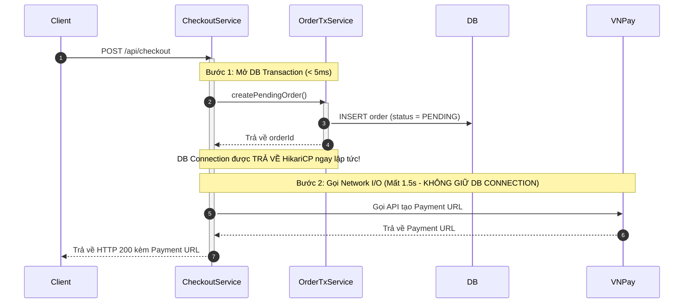
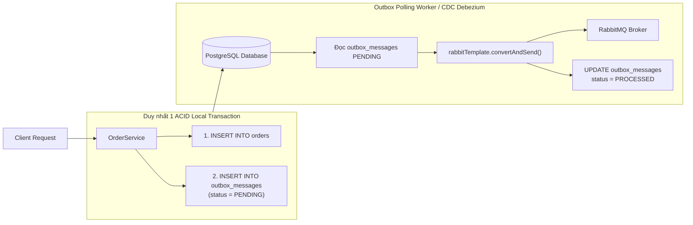

# 🎯 CHUYÊN ĐỀ 10.2: SPRING BOOT – BỘ CÂU HỎI PHỎNG VẤN SENIOR & BẢO VỆ DỰ ÁN THỰC CHIẾN TRONG CV

> **Ứng viên**: Nguyễn Đức Quỳnh – Backend / Fullstack Engineer  
> **Mục tiêu**: Bộ câu hỏi phỏng vấn chuyên sâu dành cho vị trí Senior Spring Boot Backend Engineer. Bộ tài liệu kết hợp giữa kiến trúc tầng sâu của Spring Boot Framework với các bài toán thực chiến tiêu biểu trong CV: **Kiểm soát Concurrency & Deadlock trong ViShop WMS**, **Xử lý Transaction Boundary khi tích hợp VNPay & Third-party Webhook**, **Khắc phục nghẽn HikariCP Connection Pool do Open Session in View (OSIV)**, **Triển khai Transactional Outbox Pattern với Spring Boot & RabbitMQ**, và **Tối ưu hóa thông lượng với Spring Boot 3.2 Virtual Threads**.

---

## PHẦN 1: BẢO VỆ THIẾT KẾ KIẾN TRÚC & DỰ ÁN THỰC CHIẾN

### Case 1: Xử lý Race Condition & Deadlock trong Quản trị Kho hàng (ViShop WMS Inventory Allocation)
> **Trích dẫn CV**: *"Engineered a high-integrity WMS inventory ledger with triggers and command handlers to maintain inventory consistency and prevent race conditions during warehouse transfers and concurrent updates."*

#### Q1: Khi hàng ngàn khách hàng đồng thời đặt mua cùng một mặt hàng trong đợt Flash Sale, nếu triển khai bằng Spring Boot và PostgreSQL, em sẽ lựa chọn giải pháp concurrency nào: `@Version` (Optimistic Lock), `PESSIMISTIC_WRITE`, hay Distributed Lock với Redis? Phân tích trade-off và thiết kế giải pháp chống Deadlock khi đơn hàng có nhiều sản phẩm.
* 💡 **Câu trả lời ăn điểm**:
  * **1. Phân tích 3 giải pháp Concurrency trong Spring Boot**:
    * **Optimistic Locking (`@Version`)**:
      * *Cách hoạt động*: Hibernate kiểm tra cột version: `UPDATE inventory SET stock = stock - ?, version = version + 1 WHERE id = ? AND version = ?`.
      * *Hạn chế*: Trong đợt Flash Sale, hàng trăm request cạnh tranh 1 record. 95% request sẽ nhận ngoại lệ `ObjectOptimisticLockingFailureException` và phải liên tục retry $\rightarrow$ Gây lãng phí CPU, DB connection và tăng độ trễ p99.
    * **Pessimistic Locking (`@Lock(LockModeType.PESSIMISTIC_WRITE)`)**:
      * *Cách hoạt động*: Sinh câu lệnh `SELECT ... FOR UPDATE` khóa dòng ở tầng Database. Các transaction khác phải xếp hàng chờ.
      * *Hạn chế*: Nếu transaction kéo dài hoặc đơn hàng gồm nhiều sản phẩm bị khóa không theo thứ tự, hệ thống sẽ rơi vào **Deadlock** hoặc cạn kiệt Connection Pool.
    * **Redis Distributed Lock kết hợp Atomic Decr (Giải pháp tối ưu cho High Throughput)**:
      * Trừ trực tiếp trên Redis RAM bằng Lua Script (`DECRBY` kèm kiểm tra $\ge 0$). Sau khi trừ kho thành công trên Redis, đẩy Message vào RabbitMQ/BullMQ để ghi nhận bất đồng bộ xuống Database.
  * **2. Giải pháp chống Deadlock khi đơn hàng có nhiều sản phẩm**:
    * Khi một giỏ hàng có 3 sản phẩm A, B, C:
      * Luồng 1 (Khách 1): Khóa A $\rightarrow$ Chờ khóa B.
      * Luồng 2 (Khách 2): Đang giữ B $\rightarrow$ Chờ khóa A $\rightarrow$ **Xảy ra Deadlock (Chu trình Coffman: Circular Wait)**!
    * **Nguyên tắc vàng để triệt tiêu Deadlock 100%**: Luôn sắp xếp danh sách Product ID theo thứ tự tăng dần (**Global Lock Ordering**) trước khi thực hiện câu lệnh query khóa:
      ```java
      @Transactional(rollbackFor = Exception.class)
      public void allocateInventory(List<OrderItemDto> items) {
          // BƯỚC 1: Sắp xếp theo ID tăng dần để ngăn chặn triệt để Circular Wait Deadlock!
          List<Long> productIds = items.stream()
              .map(OrderItemDto::productId)
              .sorted()
              .toList();

          // BƯỚC 2: Khóa theo đúng thứ tự đã sắp xếp
          List<Inventory> inventories = inventoryRepository.findAllByIdInForUpdate(productIds);
          
          // BƯỚC 3: Kiểm tra tồn kho và trừ số lượng
          for (OrderItemDto item : items) {
              Inventory inv = findFromList(inventories, item.productId());
              if (inv.getAvailableQuantity() < item.quantity()) {
                  throw new InsufficientStockException("Sản phẩm hết hàng: " + item.productId());
              }
              inv.setAvailableQuantity(inv.getAvailableQuantity() - item.quantity());
          }
          // Hibernate Dirty Checking tự động sinh UPDATE khi commit transaction!
      }
      ```

---

### Case 2: Cạm bẫy Transaction Boundary & Tích hợp Cổng thanh toán VNPay (MIAPET & ViShop)
> **Trích dẫn CV**: *"Integrated VNPay payment services, including payment processing, IPN webhooks, refunds, and transaction queries... Built reliable asynchronous workflows with idempotency."*

#### Q2: Tại sao việc đặt toàn bộ luồng tạo đơn và gọi API cổng thanh toán VNPay bên trong một phương thức `@Transactional` lại là một lỗi kiến trúc nghiêm trọng? Khi VNPay gửi Webhook IPN thông báo thanh toán thành công, em thiết kế luồng xử lý trong Spring Boot như thế nào để đảm bảo tính Idempotent (chống cộng tiền/cập nhật đơn 2 lần)?
* 💡 **Câu trả lời ăn điểm**:
  * **1. Phân tích cạm bẫy Transaction Boundary (Giữ kết nối DB quá lâu)**:
    * Khi một phương thức đánh dấu `@Transactional` bắt đầu chạy, Spring mượn ngay 1 kết nối vật lý từ **HikariCP Pool**.
    * Lệnh gọi API sang VNPay để tạo mã QR/Payment URL là một tác vụ Network I/O phụ thuộc vào mạng Internet bên ngoài (có thể mất từ 500ms đến 3 giây).
    * Trong suốt 3 giây đó, **kết nối Database bị "giam cầm" vô ích**. Khi có 20 request đồng thời cùng lúc, toàn bộ 20 kết nối trong HikariCP Pool bị chiếm sạch, dẫn tới lỗi `SQLTransientConnectionException: Connection is not available` làm toàn bộ các API khác của hệ thống bị sập!
    * **Quy tắc vàng**: Tách biệt rõ ràng ranh giới: Giao dịch DB chỉ thực hiện trong vài mili-giây, sau đó nhả kết nối ra rồi mới gọi API thanh toán bên ngoài.



  * **2. Thiết kế Webhook IPN Idempotent chống duplicate payment**:
    * VNPay có cơ chế retry gửi IPN Webhook nhiều lần nếu timeout mạng hoặc server phản hồi chậm. Do đó cùng 1 thông báo thành công có thể gửi tới 2-3 lần.
    * **3 lớp bảo vệ Idempotency**:
      1. **Kiểm tra chữ ký số (Checksum HMAC-SHA512)**: Xác thực request xuất phát từ VNPay.
      2. **Redis Distributed Lock theo Order ID**: Ngăn chặn 2 webhook gửi song song chạm vào database cùng một lúc.
      3. **Database State Machine Check**: Chỉ cho phép chuyển trạng thái đơn hàng nếu trạng thái hiện tại là `PENDING`. Nếu đã là `PAID` thì lập tức bỏ qua và trả về mã `97` (Checksum valid / Already confirmed) cho VNPay:
      ```java
      @Service
      @RequiredArgsConstructor
      @Slf4j
      public class VnPayIpnService {
          private final RedissonClient redisson;
          private final OrderRepository orderRepository;

          public VnPayIpnResponse handleIpn(VnPayCallbackParams params) {
              if (!vnPayHelper.verifySignature(params)) {
                  return VnPayIpnResponse.invalidChecksum();
              }

              String lockKey = "lock:vnpay:ipn:" + params.getTxnRef();
              RLock lock = redisson.getLock(lockKey);

              try {
                  // Giữ lock tối đa 3 giây, tự nhả sau 5 giây
                  if (lock.tryLock(3, 5, TimeUnit.SECONDS)) {
                      return processOrderPayment(params);
                  } else {
                      return VnPayIpnResponse.busy();
                  }
              } catch (InterruptedException e) {
                  Thread.currentThread().interrupt();
                  return VnPayIpnResponse.error();
              } finally {
                  if (lock.isHeldByCurrentThread()) {
                      lock.unlock();
                  }
              }
          }

          @Transactional(rollbackFor = Exception.class)
          protected VnPayIpnResponse processOrderPayment(VnPayCallbackParams params) {
              Order order = orderRepository.findByOrderCode(params.getTxnRef())
                      .orElseThrow(() -> new OrderNotFoundException("Order not found"));

              // Kiểm tra tính Idempotent: Nếu đã thanh toán rồi thì không xử lý lại!
              if (order.getStatus() == OrderStatus.PAID) {
                  return VnPayIpnResponse.alreadyConfirmed();
              }

              if ("00".equals(params.getResponseCode())) {
                  order.setStatus(OrderStatus.PAID);
                  order.setPaymentTransactionId(params.getTransactionNo());
                  // Dirty Checking tự động update DB!
              } else {
                  order.setStatus(OrderStatus.PAYMENT_FAILED);
              }
              return VnPayIpnResponse.success();
          }
      }
      ```

---

### Case 3: Sự cố Cạn kiệt HikariCP Connection Pool do "Open Session in View" (OSIV) trên Kubernetes
> **Trích dẫn CV**: *"Built high-throughput multi-tenant services using NestJS/Spring Boot... configured connection pool optimization and troubleshooting on Docker/K8s."*

#### Q3: Trong quá trình triển khai ứng dụng Spring Boot lên Production, nhóm DevOps nhận thấy pod thỉnh thoảng báo lỗi liveness probe thất bại và log xuất hiện hàng loạt lỗi `HikariPool-1 - Connection is not available, request timed out after 30000ms`. Làm sao em phát hiện ra nguyên nhân là do OSIV (`open-in-view=true`) và các bước em xử lý triệt để sự cố này?
* 💡 **Câu trả lời ăn điểm**:
  * **1. Dấu hiệu và công cụ điều tra**:
    * Bật cờ phát hiện rò rỉ kết nối của HikariCP trong `application.yml`:
      ```yaml
      spring:
        datasource:
          hikari:
            leak-detection-threshold: 2000 # 2 giây!
      ```
    * Khi một luồng giữ connection quá 2 giây, HikariCP sẽ log ngay lập tức một Exception kèm theo **Stack Trace chính xác của dòng code đang giữ connection**.
    * Qua stack trace, ta thấy connection được mượn từ `OpenEntityManagerInViewFilter` ngay đầu request, nhưng lại bị giữ liên tục qua các hàm xử lý serialize JSON ở Controller.
  * **2. Khắc phục triệt để**:
    1. **Tắt hoàn toàn OSIV**:
       ```yaml
       spring:
         jpa:
           open-in-view: false
       ```
    2. **Xử lý các lỗi `LazyInitializationException` phát sinh**:
       * Khi tắt OSIV, nếu trong Controller cố gắng gọi getter của quan hệ `@OneToMany(fetch = FetchType.LAZY)`, Hibernate sẽ ném lỗi `LazyInitializationException` vì Session đã đóng khi Service kết thúc.
       * *Khắc phục bằng DTO Projection*: Tất cả dữ liệu cần thiết cho Frontend bắt buộc phải được nạp đầy đủ bên trong Service layer bằng cách dùng `@EntityGraph` hoặc query trực tiếp sang Record DTO.
    3. **Tính toán lại kích thước HikariCP Pool**:
       * Không tăng bừa bãi `maximumPoolSize`. Áp dụng công thức chuẩn:
         $$\text{Pool Size} = (\text{CPU Cores} \times 2) + \text{Effective Spindle Count}$$
       * Một pod container được cấp 2 vCPU thì pool size chỉ cần đặt từ 5 đến 10 connections là đạt thông lượng tối ưu nhất!

---

### Case 4: Triển khai Transactional Outbox Pattern với Spring Boot & RabbitMQ
> **Trích dẫn CV**: *"Implemented the Transactional Outbox Pattern with BullMQ/RabbitMQ for reliable domain event processing, ensuring zero message loss across microservices."*

#### Q4: Khi đơn hàng được tạo thành công, hệ thống cần gửi Message sang RabbitMQ để thông báo cho dịch vụ Kho (WMS) và Dịch vụ Tìm kiếm (Elasticsearch). Nếu ta vừa `orderRepository.save(order)` xong rồi gọi ngay `rabbitTemplate.convertAndSend()`, vấn đề gì có thể xảy ra (Dual-Write Problem)? Em triển khai Transactional Outbox Pattern trong Spring Boot như thế nào?
* 💡 **Câu trả lời ăn điểm**:
  * **1. Vấn đề "Dual-Write Problem"**:
    * Hai thao tác ghi: (1) Lưu vào Database và (2) Gửi Message vào RabbitMQ là hai hệ thống phân tán độc lập, không nằm trong cùng một ACID Transaction.
    * *Kịch bản lỗi 1*: Database lưu đơn hàng thành công, nhưng vừa đến lệnh gửi RabbitMQ thì mạng bị ngắt hoặc broker chết $\rightarrow$ Message bị mất, kho không nhận được đơn!
    * *Kịch bản lỗi 2*: Gửi RabbitMQ thành công, nhưng khi Database thực hiện commit thì bị lỗi vi phạm ràng buộc dữ liệu hoặc timeout $\rightarrow$ Kho nhận được đơn và giao hàng, nhưng trong Database đơn lại không hề tồn tại (Ghost Order)!
  * **2. Giải pháp Transactional Outbox Pattern trong Spring Boot**:



  * **Code triển khai thực chiến**:
    ```java
    @Entity
    @Table(name = "outbox_messages")
    @Getter @Setter @NoArgsConstructor
    public class OutboxMessage {
        @Id
        @GeneratedValue(strategy = GenerationType.IDENTITY)
        private Long id;
        private String aggregateType;
        private String aggregateId;
        private String eventType;
        @Column(columnDefinition = "TEXT")
        private String payload;
        @Enumerated(EnumType.STRING)
        private OutboxStatus status;
        private LocalDateTime createdAt;
    }

    @Service
    @RequiredArgsConstructor
    public class OrderCommandService {
        private final OrderRepository orderRepository;
        private final OutboxMessageRepository outboxRepository;
        private final ObjectMapper objectMapper;

        @Transactional(rollbackFor = Exception.class)
        public OrderResponse createOrder(CreateOrderRequest request) throws JsonProcessingException {
            Order order = orderRepository.save(new Order(request));

            // Lưu event vào bảng Outbox trong CÙNG 1 Transaction với Order!
            OutboxMessage outbox = new OutboxMessage();
            outbox.setAggregateType("ORDER");
            outbox.setAggregateId(order.getId().toString());
            outbox.setEventType("ORDER_CREATED");
            outbox.setPayload(objectMapper.writeValueAsString(new OrderCreatedEvent(order)));
            outbox.setStatus(OutboxStatus.PENDING);
            outbox.setCreatedAt(LocalDateTime.now());
            
            outboxRepository.save(outbox);
            return new OrderResponse(order.getId());
        }
    }

    @Component
    @RequiredArgsConstructor
    @Slf4j
    public class OutboxPublisherTask {
        private final OutboxMessageRepository outboxRepository;
        private final RabbitTemplate rabbitTemplate;

        // Quét định kỳ mỗi 1 giây (hoặc dùng Debezium CDC để đạt real-time)
        @Scheduled(fixedDelay = 1000)
        @Transactional
        public void processOutbox() {
            List<OutboxMessage> pendingMessages = outboxRepository.findTop50ByStatusOrderByCreatedAtAsc(OutboxStatus.PENDING);
            for (OutboxMessage msg : pendingMessages) {
                try {
                    rabbitTemplate.convertAndSend("order.exchange", "order.created", msg.getPayload());
                    msg.setStatus(OutboxStatus.PROCESSED);
                } catch (Exception e) {
                    log.error("Failed to publish message id: {}", msg.getId(), e);
                    msg.setStatus(OutboxStatus.FAILED);
                }
            }
        }
    }
    ```

---

## PHẦN 2: BỘ CÂU HỎI PHỎNG VẤN CHUYÊN SÂU (DEEP-DIVE INTERNALS)

### 1. Spring Boot Core & Auto-Configuration

#### Q5: Phân tích cơ chế Auto-Configuration của Spring Boot. Nếu viết một Custom Starter cho công ty, em sẽ tổ chức cấu trúc thư mục và các class như thế nào?
* 💡 **Câu trả lời ăn điểm**:
  * **Cơ chế**:
    * Khi ứng dụng khởi động, `@EnableAutoConfiguration` kích hoạt `AutoConfigurationImportSelector`.
    * Bộ chọn này nạp toàn bộ danh sách các Configuration class từ file `META-INF/spring/org.springframework.boot.autoconfigure.AutoConfiguration.imports` (Spring Boot 3) hoặc `spring.factories` (Spring Boot 2).
    * Mỗi AutoConfiguration class được gắn kèm các annotation điều kiện: `@ConditionalOnClass`, `@ConditionalOnMissingBean`, `@ConditionalOnProperty`. Chỉ khi tất cả điều kiện thỏa mãn, các Bean bên trong mới được khởi tạo và đăng ký vào `ApplicationContext`.
  * **Quy chuẩn thiết kế một Custom Starter chuẩn Enterprise**:
    * Một Starter chuẩn thường được tách làm 2 module:
      1. `vitech-sms-client` (Module Autoconfigure thuần logic): Chứa Service, Properties, và `SmsAutoConfiguration`.
      2. `vitech-sms-spring-boot-starter` (Module rỗng): Chỉ chứa `pom.xml` gom dependencies lại để các team khác dễ import.
    * Cấu trúc file cấu hình:
      ```
      vitech-sms-client/
      ├── src/main/java/com/vitech/sms/
      │   ├── SmsService.java
      │   ├── SmsProperties.java (@ConfigurationProperties(prefix = "vitech.sms"))
      │   └── SmsAutoConfiguration.java
      └── src/main/resources/
          └── META-INF/spring/
              └── org.springframework.boot.autoconfigure.AutoConfiguration.imports
      ```
    * Nội dung class `SmsAutoConfiguration`:
      ```java
      @AutoConfiguration
      @EnableConfigurationProperties(SmsProperties.class)
      @ConditionalOnClass(SmsService.class)
      @ConditionalOnProperty(prefix = "vitech.sms", name = "enabled", havingValue = "true", matchIfMissing = true)
      public class SmsAutoConfiguration {

          @Bean
          @ConditionalOnMissingBean
          public SmsService smsService(SmsProperties properties) {
              return new SmsServiceImpl(properties);
          }
      }
      ```

---

#### Q6: Hãy giải thích vòng lặp phụ thuộc (Circular Dependency) trong Spring. Spring xử lý nó như thế nào với 3-level Cache? Tại sao Spring Boot 2.6+ lại cấm mặc định?
* 💡 **Câu trả lời ăn điểm**:
  * **Bản chất 3 tầng Cache trong `DefaultSingletonBeanRegistry`**:
    1. `Map<String, Object> singletonObjects`: Cache chứa các Bean đã sẵn sàng 100%.
    2. `Map<String, Object> earlySingletonObjects`: Cache chứa các Bean thô (mới gọi constructor xong, chưa inject thuộc tính) hoặc Early Proxy.
    3. `Map<String, ObjectFactory<?>> singletonFactories`: Cache chứa các Lambda Factory để tạo Early Proxy nếu Bean có AOP.
  * **Quy trình gỡ vòng lặp A -> B -> A**:
    1. Spring khởi tạo A bằng `new A()`. Lúc này A chưa có B.
    2. Spring đẩy một `ObjectFactory` của A vào Cache tầng 3 (`singletonFactories`).
    3. Spring bắt đầu inject thuộc tính của A: phát hiện cần B $\rightarrow$ Đi tạo B.
    4. B gọi constructor `new B()`. Sau đó B inject thuộc tính: phát hiện cần A!
    5. B vào tìm trong Cache: Tầng 1 (không có) $\rightarrow$ Tầng 2 (không có) $\rightarrow$ Tầng 3: Tìm thấy Factory của A!
    6. Factory trả về tham chiếu sớm (early reference) của A. Tham chiếu này được đẩy lên Tầng 2 (`earlySingletonObjects`) và xóa khỏi Tầng 3.
    7. B hoàn thành việc inject A và trở thành Bean hoàn chỉnh ở Tầng 1.
    8. A tiếp tục inject B (vừa xong) và cũng trở thành Bean hoàn chỉnh ở Tầng 1.
  * **Tại sao Spring Boot 2.6+ cấm mặc định (`allow-circular-references = false`)?**:
    * Nếu dùng **Constructor Injection** (Khuyên dùng trong Clean Architecture), giải pháp 3-level cache trên **hoàn toàn vô tác dụng** vì Spring thậm chí không thể gọi xong `new A(B)` để lấy tham chiếu sớm!
    * Circular Dependency là biểu hiện của vi phạm Single Responsibility Principle (SRP) và Bad Design. Việc Spring cấm mặc định giúp các kỹ sư phát hiện và tái cấu trúc mã nguồn ngay lập tức.

---

### 2. Spring AOP & Proxies

#### Q7: Spring Boot sử dụng JDK Dynamic Proxy hay CGLIB Proxy? Khi nào dùng cái nào? Giải thích lỗi Self-Invocation và 3 cách khắc phục.
* 💡 **Câu trả lời ăn điểm**:
  * **So sánh & Lựa chọn**:
    * **JDK Dynamic Proxy**: Dựa trên API chuẩn của Java (`java.lang.reflect.Proxy`). **Bắt buộc target class phải implements Interface**. Nó chỉ chặn được các method nằm trong Interface đó.
    * **CGLIB Proxy**: Sử dụng kỹ thuật can thiệp Bytecode để sinh ra một lớp con (`Subclass`) kế thừa class gốc. Không cần Interface. Tuy nhiên **không thể can thiệp method `final` hoặc class `final`**.
    * **Từ Spring Boot 2.x trở đi**: Cấu hình mặc định là `spring.aop.proxy-target-class=true`, tức là **100% sử dụng CGLIB Proxy** kể cả khi class có implements Interface. Điều này giúp hạn chế lỗi `ClassCastException` khi các lập trình viên inject bằng Concrete Class thay vì Interface.
  * **Lỗi Self-Invocation (Tự gọi nội bộ)**:
    * Khi hàm `methodA()` gọi `this.methodB()` trong cùng một class, từ khóa `this` trỏ thẳng tới instance thô bên trong, hoàn toàn không đi qua lớp vỏ Proxy bên ngoài.
    * Do đó mọi annotation như `@Transactional`, `@Async`, `@Cacheable` trên `methodB()` đều bị vô hiệu hóa!
  * **3 Cách khắc phục chuẩn mực**:
    1. *Tách Service*: Tách `methodB()` sang một Service độc lập và inject vào.
    2. *Self-Injection*: Inject chính class đó vào bản thân bằng `@Autowired @Lazy private MyService self;` rồi gọi qua `self.methodB()`.
    3. *AopContext*: Bật `@EnableAspectJAutoProxy(exposeProxy = true)` và gọi `((MyService) AopContext.currentProxy()).methodB()`.

---

### 3. Spring Data JPA & Hibernate

#### Q8: Transaction Propagation `REQUIRES_NEW` và `NESTED` khác nhau như thế nào? Nếu Transaction con bị ném Exception thì Transaction cha có bị Rollback không?
* 💡 **Câu trả lời ăn điểm**:
  * **`REQUIRES_NEW`**:
    * Mở một Transaction hoàn toàn độc lập (T2), tạm treo Transaction cha (T1).
    * T2 sử dụng **một Database Connection vật lý riêng biệt**.
    * *Cơ chế Exception*: Nếu T2 bị ném exception và T1 **có dùng `try-catch` bọc lại**, thì T2 rollback nhưng **T1 vẫn có thể commit bình thường**. Nếu T1 không bắt exception đó, ngoại lệ trôi lên sẽ làm T1 rollback theo.
  * **`NESTED`**:
    * Không mở transaction mới mà sử dụng **cùng 1 Database Connection** và tạo một **Savepoint** trong Transaction hiện tại.
    * *Cơ chế Exception*: Nếu method con bị lỗi, nó chỉ rollback ngược lại đúng điểm Savepoint đó. Transaction cha vẫn tiếp tục chạy và commit được phần việc của nó.
  * **Bảng so sánh cốt tử**:

| Tiêu chí | `REQUIRES_NEW` | `NESTED` |
| :--- | :--- | :--- |
| **Số kết nối DB tiêu tốn** | **2 Physical Connections** | **Chỉ 1 Physical Connection** |
| **Hỗ trợ từ Database** | Mọi Database | Phải hỗ trợ JDBC 3.0 Savepoints |
| **Trường hợp áp dụng** | Ghi Audit Log độc lập không phụ thuộc kết quả giao dịch chính | Thực hiện một hành động phụ có thể thử lại mà không muốn làm vỡ giao dịch chính |

---

### 4. Spring Security & Virtual Threads

#### Q9: Kích hoạt Virtual Threads trong Spring Boot 3.2+ (`spring.threads.virtual.enabled=true`) mang lại lợi ích gì? Cạm bẫy "Thread Pinning" là gì và cách phòng tránh?
* 💡 **Câu trả lời ăn điểm**:
  * **Lợi ích**:
    * Đưa kiến trúc Thread-per-request của Spring MVC (Tomcat) đạt thông lượng (throughput) tiệm cận với kiến trúc Reactive (Spring WebFlux) mà **vẫn giữ nguyên phong cách code tuần tự (Imperative), dễ viết, dễ debug**.
    * Có thể phục vụ hàng chục ngàn kết nối đồng thời với lượng RAM chỉ tốn một phần nhỏ so với OS Platform Threads.
  * **Cạm bẫy "Thread Pinning"**:
    * Khi một Virtual Thread đang chạy mà gặp tác vụ Blocking I/O (chờ DB, gọi REST template), theo lý thuyết JVM sẽ tự động unmount nó khỏi OS Carrier Thread.
    * Tuy nhiên, nếu đoạn code blocking đó nằm bên trong một khối **`synchronized (lock)`** hoặc gọi hàm Native C qua JNI, JVM **không thể unmount được**! Hiện tượng này gọi là **Thread Pinning (Ghim luồng)**.
    * *Hậu quả*: Toàn bộ OS Carrier Thread bên dưới bị khóa cứng. Khi nhiều Virtual Threads cùng bị pin, pool Carrier Threads cạn kiệt, ứng dụng bị nghẽn hoàn toàn!
  * **Giải pháp phòng tránh**:
    * Rà soát mã nguồn: Thay thế toàn bộ các khối `synchronized` bằng **`ReentrantLock`** trong gói `java.util.concurrent.locks`.
    * Nâng cấp các thư viện driver DB (PostgreSQL JDBC driver mới nhất đã loại bỏ hầu hết các khối `synchronized` để tương thích hoàn hảo với Project Loom).

---

## PHẦN 3: BÀI TOÁN THỰC CHIẾN & LIVE CODING TRONG PHÒNG PHỎNG VẤN

### Bài 1: Xây dựng Custom Idempotent Annotation (`@IdempotentKey`) bằng Spring AOP & Redis Lua Script
* ❓ **Đề bài**: Hãy thiết kế một Custom Annotation `@IdempotentKey` trong Spring Boot để bảo vệ các API nhạy cảm (như Bấm nút Thanh toán, Tạo đơn hàng) chống tình trạng Double-Click hoặc mạng chập chờn gửi 2 request giống hệt nhau trong vòng 5 giây. Nếu request thứ 2 gửi đến khi request 1 đang chạy, API lập tức trả về lỗi `HTTP 409 Conflict`.
* 💡 **Code chuẩn Senior**:

#### 1. Định nghĩa Annotation
```java
@Target(ElementType.METHOD)
@Retention(RetentionPolicy.RUNTIME)
@Documented
public @interface IdempotentKey {
    /**
     * Biểu thức Spring SpEL để lấy giá trị key duy nhất (ví dụ: "#request.orderCode")
     */
    String key();

    /**
     * Thời gian khóa tính bằng giây
     */
    long expireSeconds() default 10;
}
```

#### 2. Cài đặt Aspect xử lý
```java
@Aspect
@Component
@RequiredArgsConstructor
@Slf4j
public class IdempotentAspect {

    private final StringRedisTemplate redisTemplate;
    private final ExpressionParser parser = new SpelExpressionParser();
    private final ParameterNameDiscoverer nameDiscoverer = new DefaultParameterNameDiscoverer();

    // Script Lua đảm bảo tính nguyên tử: Chỉ set key nếu chưa tồn tại (SET NX EX)
    private static final String LUA_ACQUIRE = 
        "if redis.call('set', KEYS[1], 'LOCKED', 'NX', 'EX', ARGV[1]) then return 1 else return 0 end";

    @Around("@annotation(idempotentKey)")
    public Object handleIdempotency(ProceedingJoinPoint joinPoint, IdempotentKey idempotentKey) throws Throwable {
        String dynamicKey = parseSpelKey(joinPoint, idempotentKey.key());
        String redisKey = "idempotency:" + dynamicKey;

        RedisScript<Long> script = RedisScript.of(LUA_ACQUIRE, Long.class);
        Long result = redisTemplate.execute(
            script, 
            Collections.singletonList(redisKey), 
            String.valueOf(idempotentKey.expireSeconds())
        );

        if (result == null || result == 0L) {
            log.warn("Duplicate request detected for key: {}", redisKey);
            throw new DuplicateRequestException("Thao tác đang được xử lý, vui lòng không gửi lại!");
        }

        try {
            return joinPoint.proceed();
        } catch (Throwable ex) {
            // Nếu xử lý thất bại do lỗi hệ thống, có thể cân nhắc nhả key sớm để user thử lại
            redisTemplate.delete(redisKey);
            throw ex;
        }
    }

    private String parseSpelKey(ProceedingJoinPoint joinPoint, String spel) {
        MethodSignature signature = (MethodSignature) joinPoint.getSignature();
        Method method = signature.getMethod();
        Object[] args = joinPoint.getArgs();

        EvaluationContext context = new StandardEvaluationContext();
        String[] paramNames = nameDiscoverer.getParameterNames(method);
        if (paramNames != null) {
            for (int i = 0; i < paramNames.length; i++) {
                context.setVariable(paramNames[i], args[i]);
            }
        }
        return Objects.requireNonNull(parser.parseExpression(spel).getValue(context, String.class));
    }
}
```

#### 3. Sử dụng trong Controller
```java
@RestController
@RequestMapping("/api/v1/orders")
@RequiredArgsConstructor
public class OrderController {
    private final OrderService orderService;

    @PostMapping("/checkout")
    @IdempotentKey(key = "#request.orderCode()", expireSeconds = 10)
    public ResponseEntity<OrderResponse> checkout(@RequestBody @Valid CheckoutRequest request) {
        return ResponseEntity.ok(orderService.processCheckout(request));
    }
}
```

---

### Bài 2: Triển khai Dynamic Query bằng Spring Data JPA Specification & CriteriaBuilder
* ❓ **Đề bài**: Trong màn hình quản lý đơn hàng WMS, người dùng có thể lọc theo nhiều tiêu chí tùy chọn: `orderCode` (tìm kiếm gần đúng like), `status` (exact match), khoảng ngày `fromDate` - `toDate`, và `minAmount`. Hãy viết một phương thức tìm kiếm động an toàn, chống SQL Injection bằng JPA Specification.
* 💡 **Code chuẩn Senior**:

```java
public record OrderSearchCriteria(
    String orderCode,
    OrderStatus status,
    LocalDateTime fromDate,
    LocalDateTime toDate,
    BigDecimal minAmount
) {}

public class OrderSpecification {

    public static Specification<Order> buildSpecification(OrderSearchCriteria criteria) {
        return (root, query, cb) -> {
            List<Predicate> predicates = new ArrayList<>();

            if (criteria.orderCode() != null && !criteria.orderCode().isBlank()) {
                // Tương đương: LOWER(order_code) LIKE %val%
                predicates.add(cb.like(
                    cb.lower(root.get("orderCode")), 
                    "%" + criteria.orderCode().toLowerCase() + "%"
                ));
            }

            if (criteria.status() != null) {
                predicates.add(cb.equal(root.get("status"), criteria.status()));
            }

            if (criteria.fromDate() != null) {
                predicates.add(cb.greaterThanOrEqualTo(root.get("createdAt"), criteria.fromDate()));
            }

            if (criteria.toDate() != null) {
                predicates.add(cb.lessThanOrEqualTo(root.get("createdAt"), criteria.toDate()));
            }

            if (criteria.minAmount() != null) {
                predicates.add(cb.greaterThanOrEqualTo(root.get("totalAmount"), criteria.minAmount()));
            }

            // Kết hợp toàn bộ predicates bằng mệnh đề AND
            return cb.and(predicates.toArray(new Predicate[0]));
        };
    }
}
```

---

## 📊 BẢNG TỔNG KẾT SO SÁNH CÁC KHÁI NIỆM QUAN TRỌNG

| Khái niệm A | Khái niệm B | Bản chất khác biệt cốt lõi |
| :--- | :--- | :--- |
| **`@Component`** | **`@Bean`** | `@Component` dùng Class-level cho mã nguồn nội bộ do ta viết; `@Bean` dùng Method-level để khởi tạo đối tượng từ các thư viện bên thứ 3 đưa vào Spring Context. |
| **`@Mock` (Mockito)** | **`@MockBean` (Spring)** | `@Mock` là Mockito thuần túy (không khởi động Spring Context); `@MockBean` thay thế một Bean thực sự đang có bên trong `ApplicationContext` bằng bản Mock. |
| **`Page<T>`** | **`Slice<T>`** | `Page` phát sinh thêm 1 câu `COUNT(*)` đắt đỏ để tính tổng số trang; `Slice` chỉ query lấy $size + 1$ phần tử để biết có trang tiếp hay không (tối ưu cho Infinite Scroll). |
| **`EntityManager.persist()`** | **`EntityManager.merge()`** | `persist()` đưa thực thể Transient vào Managed; `merge()` copy trạng thái của thực thể Detached vào một Managed instance mới. |
| **`@Valid`** | **`@Validated`** | `@Valid` là chuẩn của JSR-303 (dùng trên method parameter); `@Validated` là của Spring, hỗ trợ thêm tính năng Validation Groups. |

---

## 🏁 CHECKLIST ĐI PHỎNG VẤN SENIOR SPRING BOOT

- [x] Nắm vững cơ chế Auto-Configuration, SPI imports (`AutoConfiguration.imports`), và cách custom starter.
- [x] Giải thích rành mạch 8 bước trong vòng đời Spring Bean và vị trí sinh ra Dynamic Proxy.
- [x] Phân biệt sâu sắc JDK Dynamic Proxy vs CGLIB và giải quyết cạm bẫy Self-Invocation.
- [x] Hiểu cặn kẽ luồng đi của HTTP Request qua DispatcherServlet, HandlerMapping, Interceptor.
- [x] Làm chủ cơ chế Dirty Checking và luôn tắt `spring.jpa.open-in-view=false` trên Production.
- [x] Nêu được 4 cách triệt tiêu N+1 Query (`JOIN FETCH`, `@EntityGraph`, Batch size, DTO Projection).
- [x] Phân tích được sự khác biệt giữa Transaction Propagation `REQUIRES_NEW` và `NESTED`.
- [x] Thành thạo cấu hình SecurityFilterChain không dùng deprecated classes trong Spring Security 6.
- [x] Hiểu rõ cơ chế Virtual Threads trong Spring Boot 3.2 và cách né tránh Thread Pinning (`synchronized` vs `ReentrantLock`).
