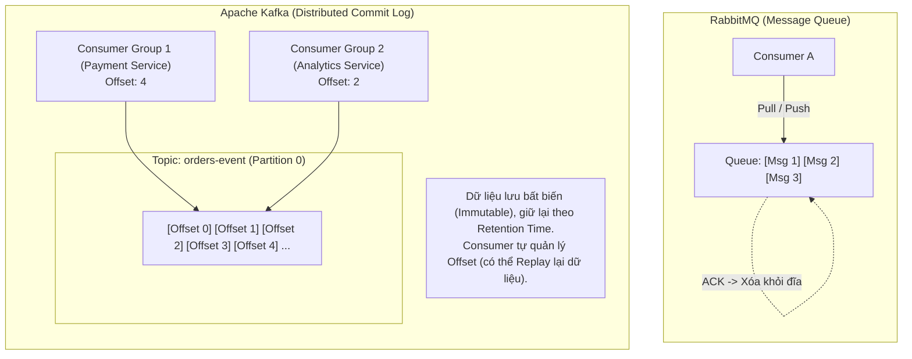
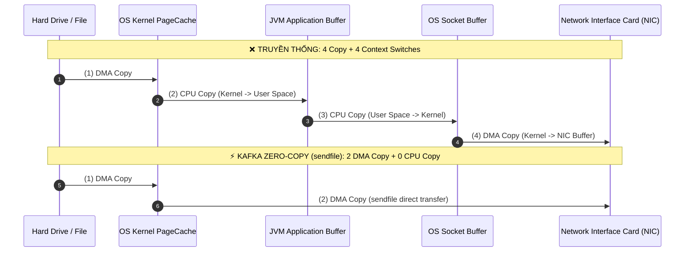
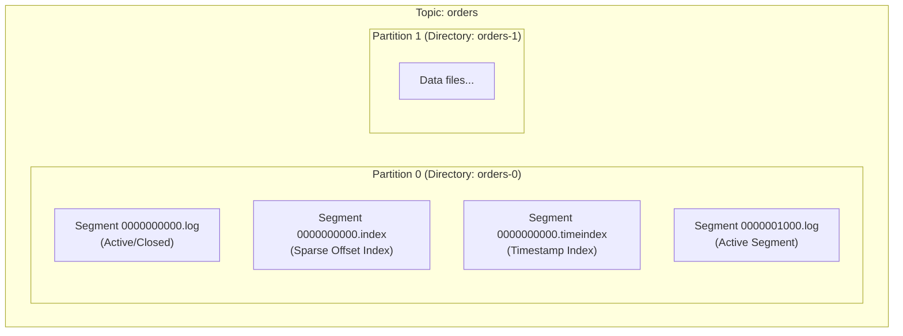
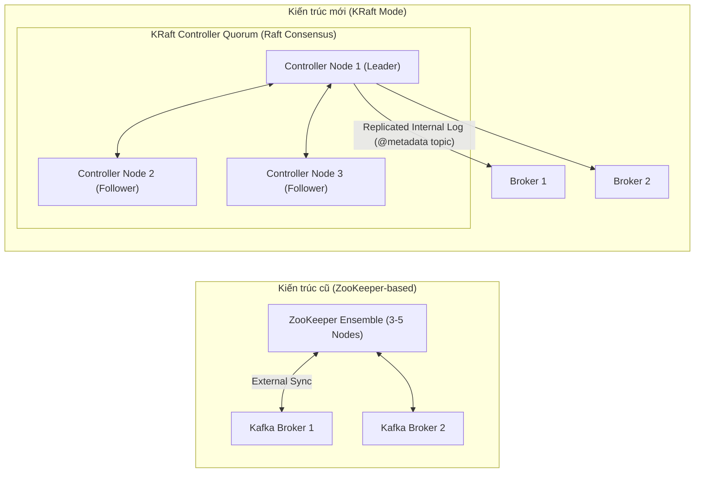
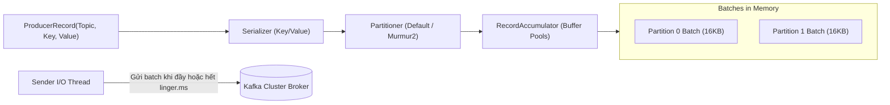
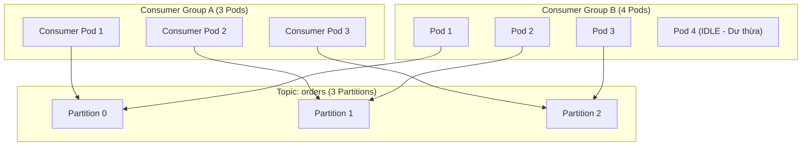

# 📙 CHUYÊN ĐỀ 11.1: APACHE KAFKA ARCHITECTURE – LÝ THUYẾT & KIẾN TRÚC LÕI

> **Mục tiêu**: Nắm vững bản chất kiến trúc Distributed Append-Only Commit Log, cơ chế lưu trữ phân vùng (Partitions & Segments), nguyên lý Zero-Copy & OS PageCache, kiến trúc KRaft (loại bỏ ZooKeeper), Producer Idempotence, Consumer Group Rebalancing và bảng đối chiếu toàn diện giữa **Kafka vs RabbitMQ vs BullMQ**.

---

## 1. Bản chất cốt lõi: Distributed Commit Log vs Traditional Message Queue

Khác với RabbitMQ (mô hình **Smart Broker, Dumb Consumer** - message bị xóa ngay sau khi Consumer gửi ACK), Apache Kafka là một **Distributed Streaming Platform** được thiết kế dựa trên mô hình **Dumb Broker, Smart Consumer** và cấu trúc dữ liệu **Append-Only Commit Log**.

### 1.1. So sánh cốt lõi giữa Kafka, RabbitMQ và BullMQ

| Tiêu chí so sánh | Apache Kafka | RabbitMQ | BullMQ (Redis) |
| :--- | :--- | :--- | :--- |
| **Mô hình kiến trúc** | Distributed Commit Log (Event Streaming) | Smart Broker, Dumb Consumer (AMQP Queue) | In-Memory Task Queue (Redis Streams & ZSets) |
| **Cơ chế phân phối** | **Pull Model** (Consumer chủ động kéo theo lô) | **Push Model** (Broker đẩy theo QoS Prefetch) | **Pull / Worker Model** (Worker fetch job từ Redis) |
| **Xóa Message** | **Không xóa sau Ack** (Lưu theo Retention Time/Size) | **Xóa ngay lập tức** sau khi nhận `Basic.Ack` | Xóa hoặc archive vào completed/failed list |
| **Khả năng Replay** | **Có (Tuyệt vời)**: Đổi Offset để đọc lại từ đầu | **Không**: Đã đọc và Ack là biến mất | **Không**: Chỉ retry được job lỗi |
| **Throughput** | **Siêu cao** ($100k - 1M+$ msg/sec) | **Trung bình - Cao** ($20k - 50k$ msg/sec) | **Cao** ($10k - 50k$ jobs/sec tùy Redis RAM) |
| **Routing linh hoạt** | Kém (chỉ định tuyến qua Topic & Partition Key) | **Rất mạnh** (Direct, Topic Wildcard, Fanout, Header) | Đơn giản theo tên Queue |
| **Message Ordering** | **Strict Order** trong cùng một Partition | Khó khăn khi có nhiều Consumer đồng thời | Hỗ trợ Fifo, Delay, Priority |
| **Use Case tối ưu** | Event Sourcing, Log Aggregation, Clickstream, Big Data | Tác vụ phức tạp, routing đa hướng, RPC, giao dịch tài chính | Background tasks nội bộ ứng dụng (Send Mail, PDF, Sync) |

---

## 2. Bí mật hiệu năng của Kafka: Tại sao Kafka đạt hàng triệu msg/sec?

Nhiều người lầm tưởng Kafka nhanh vì lưu trữ trên RAM. Trên thực tế, Kafka ghi **100% dữ liệu xuống đĩa cứng (Disk-based)**. Tốc độ kinh ngạc của Kafka đến từ 4 trụ cột kỹ thuật:

### 2.1. Sequential Disk I/O (Ghi đĩa tuần tự)
* Thao tác **Random I/O** trên ổ đĩa (tìm kiếm track/sector ngẫu nhiên) cực kỳ chậm (chỉ khoảng $100 - 200$ ops/sec trên HDD và vài chục nghìn IOPS trên SSD).
* Kafka tận dụng **Sequential I/O** (chỉ nối thêm dữ liệu vào cuối file - Append-Only). Tốc độ ghi tuần tự của ổ đĩa có thể đạt tới **$600MB/s - 1GB/s$**, ngang ngửa hoặc thậm chí vượt qua tốc độ Random I/O trên RAM!

### 2.2. Khai thác tối đa OS PageCache (Không dùng JVM Heap cho Cache)
* Kafka Broker chạy trên JVM nhưng **không cache message trên JVM Heap** (tránh Garbage Collection pauses và overhead quản lý object của Java).
* Kafka để hệ điều hành Linux quản lý toàn bộ bộ nhớ trống dưới dạng **PageCache**. Khi Producer ghi message hoặc Consumer đọc message, toàn bộ dữ liệu đi thẳng vào PageCache của Kernel OS.

### 2.3. Kỹ thuật Zero-Copy Data Transfer (`sendfile` System Call)
Trong các ứng dụng truyền thống, việc gửi dữ liệu từ file đĩa ra card mạng (NIC) phải trải qua **4 lần chuyển ngữ cảnh (Context Switches)** và **4 lần copy dữ liệu**:

* Với hàm hệ thống `sendfile()` trong Linux, dữ liệu từ PageCache được đẩy **thẳng trực tiếp sang Network Card (NIC Buffer)** thông qua DMA (Direct Memory Access) mà **không cần copy qua User Space của JVM**. Điều này loại bỏ hoàn toàn gánh nặng CPU và tối ưu 100% băng thông mạng.

### 2.4. Batching & End-to-End Compression
* Kafka không gửi từng message đơn lẻ. Producer gom các message thành các Batch lớn dựa vào `batch.size` và `linger.ms`.
* Dữ liệu được nén trực tiếp tại Producer (Snappy, LZ4, Zstandard), gửi qua mạng ở dạng nén, lưu xuống đĩa Broker ở dạng nén và chỉ được giải nén khi tới Consumer.

---

## 3. Kiến trúc Lưu trữ nội tại: Topics, Partitions & Segment Files

Mỗi Topic trong Kafka được phân chia thành nhiều **Partitions**. Partition chính là đơn vị mở rộng quy mô (Scale) và xử lý song song (Concurrency) của Kafka.

### 3.1. Cấu trúc Segment File (`.log`, `.index`, `.timeindex`)
Trong thư mục dữ liệu của Broker, mỗi Partition là một thư mục riêng biệt (ví dụ: `/var/lib/kafka/data/orders-0/`):
1. **File dữ liệu `.log`**: Chứa payload message thực tế kèm metadata, được ghi nối tiếp. Kích thước mặc định thường là 1 GB (`segment.bytes = 1073741824`). Khi đầy, file sẽ được đóng (roll) và tạo segment mới.
2. **File chỉ mục thưa `.index` (Sparse Index)**: 
   * Không index từng message (để tiết kiệm RAM và dung lượng).
   * Cứ sau mỗi $4KB$ dữ liệu ghi vào file log (`index.interval.bytes`), Kafka ghi một dòng index ánh xạ: `Logical Offset` $\rightarrow$ `Physical Byte Position` trong file `.log`.
   * Khi tìm kiếm Offset, Kafka áp dụng thuật toán **Binary Search (Tìm kiếm nhị phân)** trên file `.index` để tìm vị trí gần nhất, sau đó quét tuần tự một đoạn rất ngắn trong file `.log`.
3. **File chỉ mục thời gian `.timeindex`**: Ánh xạ `Timestamp` $\rightarrow$ `Offset`, phục vụ cho việc tìm kiếm hoặc xóa dữ liệu theo thời gian (Retention cleanup).

---

## 4. Kiến trúc KRaft (Kafka Raft Consensus) – Thay thế hoàn toàn ZooKeeper

Từ phiên bản Kafka 3.3+, Apache Kafka chính thức hỗ trợ **KRaft (Kafka Raft Metadata Mode)** ở mức Production-Ready và loại bỏ hoàn toàn ZooKeeper.

### Tại sao loại bỏ ZooKeeper?
1. **Loại bỏ hiện tượng nghẽn Metadata khi Scale**: Với ZooKeeper, khi cluster có hàng trăm nghìn partitions và Controller bị restart, nó phải tải lại toàn bộ trạng thái từ ZooKeeper qua mạng, mất từ vài phút đến nửa tiếng.
2. **Event-driven Metadata Log**: Trong KRaft, metadata của cluster được lưu như một Partition nội bộ đặc biệt (`@metadata`). Tất cả các Controller duy trì bản sao thông qua thuật toán đồng thuận **Raft**. Khi Leader Controller chết, Failover diễn ra trong **vài phần trăm giây (< 50ms)**!
3. **Đơn giản hóa vận hành**: Chỉ cần cài đặt và quản lý duy nhất một binary Kafka, không cần dựng thêm cụm ZooKeeper riêng.

---

## 5. Producer Internals: Idempotence & Zero Message Loss

### 5.1. Cơ chế Partitioning Strategy
* **Nếu có Key**: Kafka sử dụng thuật toán hash **Murmur2** trên `Record Key`:
  $$\text{Partition} = \text{abs}(\text{Murmur2}(\text{key})) \pmod{\text{Total Partitions}}$$
  $\rightarrow$ Đảm bảo tất cả message có cùng `key` (ví dụ: cùng `order_id` hoặc `customer_id`) luôn luôn rơi vào **cùng 1 Partition duy nhất** $\rightarrow$ Đảm bảo **Strict FIFO Ordering** cho thực thể đó.
* **Nếu Key là `null`**: Kafka sử dụng **Sticky Partitioner** (gom các record vào cùng 1 batch của partition hiện tại cho đến khi đầy batch mới đổi partition) để tối ưu hiệu năng và độ nén.

### 5.2. Bộ ba Cấu hình Vàng đảm bảo Không Mất Dữ Liệu (Zero Data Loss)
Để đạt chuẩn **At-Least-Once Delivery không rủi ro**:
1. **`acks = all` (hoặc `-1`)**: Producer chỉ coi là gửi thành công khi **tất cả các Replicas trong danh sách In-Sync Replicas (ISR)** đã ghi message xuống đĩa an toàn.
2. **`min.insync.replicas = 2`**: Broker từ chối nhận message nếu số lượng replica đồng bộ còn sống ít hơn 2 (ngăn ngừa trường hợp cụm chỉ còn 1 broker sống nhưng vẫn nhận ghi $\rightarrow$ rủi ro mất dữ liệu khi broker đó sập).
3. **`replication.factor >= 3`**: Mỗi topic phải có ít nhất 3 bản sao trên các máy chủ vật lý khác nhau.

### 5.3. Idempotent Producer (`enable.idempotence = true`)
Khi mạng chập chờn, Producer gửi message thành công nhưng không nhận được ACK từ Broker $\rightarrow$ Producer retry lại $\rightarrow$ Dễ bị duplicate message.
* **Cách Kafka giải quyết**:
  * Khi bật `enable.idempotence = true` (mặc định từ Kafka 3.0+), mỗi Producer được cấp một định danh duy nhất: **Producer ID (PID)**.
  * Mỗi batch message gửi đi được gán một số thứ tự tăng dần liên tục: **Sequence Number**.
  * Broker lưu lại cặp `(PID, SequenceNumber)` lớn nhất của từng partition. Nếu Broker nhận được message có Sequence Number nhỏ hơn hoặc bằng số đã lưu $\rightarrow$ Broker bỏ qua (Deduplicate) nhưng vẫn trả về ACK thành công cho Producer!

---

## 6. Consumer Internals: Consumer Group & Rebalance Protocol

### 6.1. Nguyên tắc Consumer Group
* Một Partition trong một thời điểm chỉ được đọc bởi **duy nhất 1 Consumer** trong cùng một Consumer Group.
* Nếu số lượng Consumer **nhiều hơn** số lượng Partition $\rightarrow$ Các Consumer dư thừa sẽ ở trạng thái nhàn rỗi (**Idle**).
* Để tăng độ song song (Concurrency), cách duy nhất là **tăng số lượng Partition** của Topic!

### 6.2. Cơ chế Rebalance: Eager Rebalance vs Cooperative Sticky Rebalance
Khi một Consumer gia nhập, rời nhóm (Crash) hoặc Topic thêm Partition mới, quá trình **Rebalance** được kích hoạt để phân chia lại quyền sở hữu:
* **Eager Rebalance (Cũ - Gây Stop-The-World)**:
  * Tất cả các Consumer trong nhóm phải từ bỏ toàn bộ Partition đang xử lý.
  * Toàn bộ việc tiêu thụ message của Group bị dừng lại hoàn toàn.
  * Sau đó Consumer Group Coordinator mới gán lại partition từ đầu.
* **Cooperative Sticky Rebalance (Hiện đại - Chuẩn từ Kafka 2.4+)**:
  * Áp dụng nguyên lý tái cân bằng cộng tác gia tăng (**Incremental Rebalance**).
  * Các Consumer đang xử lý partition không bị ảnh hưởng vẫn tiếp tục đọc bình thường mà **không bị dừng lại**.
  * Chỉ những Partition cần chuyển nhượng chủ sở hữu mới bị thu hồi và bàn giao cho Consumer mới $\rightarrow$ Triệt tiêu hiện tượng lag đột biến và gián đoạn dịch vụ.

