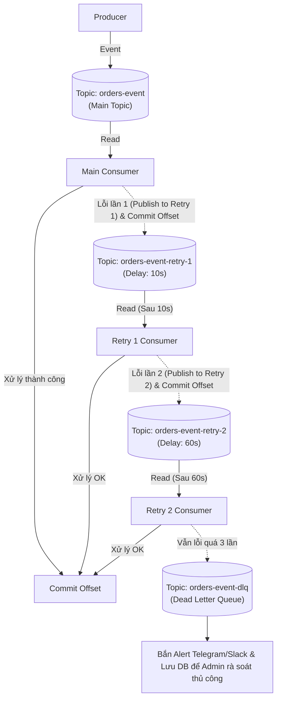

# 🎯 CHUYÊN ĐỀ 11.2: APACHE KAFKA – BỘ CÂU HỎI PHỎNG VẤN SENIOR & XỬ LÝ SỰ CỐ PRODUCTION

> **Ứng viên**: Nguyễn Đức Quỳnh – Backend / Fullstack Engineer  
> **Mục tiêu**: Bộ câu hỏi phỏng vấn thực chiến chuyên sâu về Apache Kafka ở cấp độ Senior/Staff: **Consumer Rebalance Storm**, **Strict Ordering với Key Partitioning**, **Non-blocking Retry & Dead Letter Queue (DLQ) Pattern**, **Consumer Lag Monitoring**, và **So sánh kiến trúc Kafka vs RabbitMQ vs BullMQ**.

---

## PHẦN 1: BỘ CÂU HỎI THỰC CHIẾN VỀ VẬN HÀNH & KIẾN TRÚC LÕI

### Q1: "Rebalance Storm" (Bão tái cân bằng) trong Kafka là gì? Triệu chứng trên Production và cách em cấu hình để triệt tiêu hiện tượng này?

* 💡 **Câu trả lời ăn điểm**:
  * **Bản chất nguyên nhân**:
    * Trong Kafka Consumer, có 2 luồng hoạt động:
      1. **Heartbeat Thread**: Định kỳ gửi tín hiệu sống (`heartbeat.interval.ms`, mặc định 3s) về Group Coordinator để báo Pod vẫn sống.
      2. **Main Poll Loop**: Vòng lặp lấy dữ liệu và xử lý nghiệp vụ (`consumer.poll()`).
    * **Cạm bẫy**: Nếu một batch dữ liệu lấy về chứa 500 messages, và mỗi message xử lý nghiệp vụ tốn 300ms (tổng cộng $500 \times 300\text{ms} = 150\text{s}$). Trong khi cấu hình `max.poll.interval.ms` mặc định là $300\text{s}$ (hoặc trong phiên bản cũ là $30\text{s}$).
    * Nếu thời gian giữa 2 lần gọi `.poll()` vượt quá `max.poll.interval.ms`, Broker sẽ coi Consumer đó là **bị treo (Stuck/Dead)** $\rightarrow$ Đuổi Consumer ra khỏi Group và kích hoạt **Rebalance**.
    * Khi Rebalance xảy ra, các partition được gán cho Consumer khác. Consumer mới lại tiếp tục fetch đúng batch nặng đó và lại bị quá hạn $\rightarrow$ Cả cụm Consumer rơi vào vòng xoáy Rebalance liên tục (**Rebalance Storm**), toàn bộ hệ thống bị tê liệt và Consumer Lag tăng vọt!
  * **Giải pháp 4 bước khắc phục**:
    1. **Giảm `max.poll.records`**: Hạ số lượng message lấy về mỗi batch từ 500 xuống mức phù hợp (ví dụ: $20 - 50$ records) để đảm bảo thời gian xử lý luôn hoàn tất trong vòng vài giây.
    2. **Tăng `max.poll.interval.ms`**: Nâng ngưỡng thời gian tối đa cho phép giữa 2 lần poll (ví dụ từ 5 phút lên 10 - 15 phút nếu có tác vụ gọi API bên thứ ba lâu).
    3. **Chuyển sang Cooperative Sticky Assignor**: Cấu hình `partition.assignment.strategy = org.apache.kafka.clients.consumer.CooperativeStickyAssignor` để khi có rebalance, Kafka chỉ chuyển giao partition bị ảnh hưởng thay vì dừng toàn bộ các Consumer khác.
    4. **Tách luồng xử lý (Decoupled Worker Pool)**: Poll loop chỉ làm nhiệm vụ kéo message và đẩy nhanh vào một In-memory Queue (như Java `ThreadPoolExecutor` hoặc Node.js worker pool) để giải phóng main thread luôn sẵn sàng gọi `poll()`.

---

### Q2: Làm sao để đảm bảo thứ tự xử lý tuyệt đối (Strict Ordering) của chuỗi sự kiện một đơn hàng trong Kafka nhưng vẫn scale được nhiều Consumer Pods?

* 💡 **Câu trả lời ăn điểm**:
  * **1. Phân vùng theo Khóa nghiệp vụ (Record Key)**:
    * Kafka **chỉ đảm bảo thứ tự trong phạm vi duy nhất 1 Partition**. Giữa các Partition khác nhau thì không có cam kết về thứ tự thời gian.
    * Khi Producer bắn các sự kiện (`OrderCreated`, `PaymentSuccess`, `InventoryDeducted`, `OrderShipped`), bắt buộc phải truyền **`key = order_id`**.
    * Thuật toán băm Murmur2 của Kafka sẽ đảm bảo: **Mọi sự kiện có cùng `order_id` chắc chắn sẽ rơi vào cùng một Partition duy nhất** $\rightarrow$ Được lưu và đọc tuần tự chính xác theo thứ tự phát sinh.
  * **2. Cạm bẫy đảo lộn thứ tự tại Producer (`max.in.flight.requests.per.connection`)**:
    * Mặc định Producer có thể gửi tối đa 5 batch song song qua cùng 1 kết nối mạng TCP (`max.in.flight.requests.per.connection = 5`).
    * Nếu Batch 1 gặp lỗi mạng tạm thời và phải retry, trong khi Batch 2 gửi thành công trước $\rightarrow$ Batch 2 sẽ được ghi vào Broker trước Batch 1 $\rightarrow$ **Bị đảo lộn thứ tự ngay từ đầu vào!**
    * **Khắc phục**: Luôn bật **`enable.idempotence = true`**. Khi bật tính năng này, Broker sẽ sử dụng Sequence Number để sắp xếp lại các batch đúng thứ tự ban đầu trước khi commit xuống log, ngay cả khi `max.in.flight.requests.per.connection` lên đến 5.
  * **3. Quy tắc ở phía Consumer**:
    * Không đẩy các message của cùng một partition sang nhiều thread worker xử lý bất đồng bộ không kiểm soát. Nếu dùng đa luồng trong một Consumer, phải hash `key` để route vào đúng thread phụ trách key đó.

---

### Q3: Trong Kafka không có sẵn Dead Letter Exchange (DLX) như RabbitMQ. Em thiết kế giải pháp Retry và Dead Letter Queue (DLQ) như thế nào để không làm tắc nghẽn Partition?

* 💡 **Câu trả lời ăn điểm**:
  * **Hiểm họa của việc Block Partition**:
    * Khác với RabbitMQ có thể `nack(requeue=true)` đưa message về cuối hàng đợi, trong Kafka, nếu Consumer gặp lỗi mà không commit offset và gọi `Thread.sleep(5000)` để thử lại tại chỗ $\rightarrow$ Toàn bộ các message phía sau trong Partition đó sẽ **bị tắc nghẽn hoàn toàn** (Head-of-Line Blocking), ảnh hưởng đến hàng nghìn khách hàng khác!
  * **Kiến trúc Non-blocking Retry Topics & DLQ Topic**:



  * **Quy trình hoạt động**:
    1. Khi `Main Consumer` gặp lỗi xử lý một message (do lỗi DB tạm thời, đối tác 3rd-party timeout):
       * Consumer ghi nhận số lần thử vào Header: `x-retry-count: 1`.
       * Producer bắn message sang Topic phụ: `orders-event-retry-1`.
       * **Lập tức commit offset trên Main Topic** để giải phóng partition tiếp tục xử lý các message của khách hàng khác!
    2. Một Consumer riêng lắng nghe `orders-event-retry-1` với cơ chế tạm dừng (`consumer.pause()`) cho đến khi đủ khoảng thời gian delay 10 giây mới xử lý.
    3. Nếu tiếp tục thất bại, đẩy sang `orders-event-retry-2` (delay 60 giây).
    4. Nếu vượt quá số lần retry cho phép (ví dụ 3 lần) $\rightarrow$ Đẩy sang **`orders-event-dlq`** và phát cảnh báo về hệ thống giám sát để kỹ sư can thiệp.

---

### Q4: Consumer Lag là gì? Em theo dõi và xử lý hiện tượng Consumer Lag tăng vọt trong đợt cao điểm (Flash Sale) như thế nào?

* 💡 **Câu trả lời ăn điểm**:
  * **Định nghĩa**:
    $$\text{Consumer Lag} = \text{Log End Offset (LEO)} - \text{Current Committed Offset}$$
    Consumer Lag đo lường khoảng cách giữa vị trí message mới nhất được ghi vào partition và vị trí message cuối cùng mà Consumer Group đã xử lý xong. Lag càng lớn tức là hệ thống đang bị chậm trễ và tồn đọng dữ liệu.
  * **Công cụ giám sát**: Sử dụng **Kafka Exporter** kết hợp với **Prometheus & Grafana** hoặc công cụ chuyên dụng như **Burrow** để đặt cảnh báo (Alert Rule) khi Lag vượt ngưỡng $10,000$ messages hoặc tốc độ sinh message vượt quá tốc độ tiêu thụ trong 5 phút.
  * **Chiến lược xử lý khi Lag tăng vọt**:
    1. **Tăng số lượng Partition và scale Consumer Pods**:
       * *Nguyên tắc*: Một Partition chỉ gán cho 1 Consumer. Nếu Topic có 6 Partitions và hiện chỉ có 2 Pods $\rightarrow$ Scale ngay Deployment lên 6 Pods để mỗi Pod xử lý độc lập 1 partition.
       * *Lưu ý*: Nếu đã có 6 Pods cho 6 Partitions, scale lên 10 Pods thì 4 Pods sẽ bị nhàn rỗi (Idle). Khi đó cần tăng số lượng Partition của Topic lên (lưu ý cẩn trọng vì việc tăng partition sẽ làm thay đổi quy luật băm Murmur2 của các message có key mới!).
    2. **Tối ưu tầng I/O của Consumer (Batch Processing)**:
       * Thay vì đọc từng record và thực hiện `INSERT INTO mysql ...` 1 record một, gom các record trong đợt `.poll()` thành **Bulk Batch Insert** (`INSERT INTO ... VALUES (...), (...), (...)`) trong 1 Database Transaction duy nhất để giảm 90% số lượng Round-trip mạng tới Database.
    3. **Tăng bộ nhớ đệm Fetch**: Cấu hình `fetch.min.bytes` (ví dụ: $1MB$) và `fetch.max.wait.ms` (ví dụ: $500ms$) để mỗi lần Consumer kéo dữ liệu từ Broker luôn nhận được lượng dữ liệu tối đa thay vì kéo lắt nhắt.

---

### Q5: Khi nào em lựa chọn Apache Kafka và khi nào em lựa chọn RabbitMQ?

* 💡 **Bảng so sánh quyết định kiến trúc (Decision Framework)**:

* 🎯 **Chọn RabbitMQ khi**:
  1. **Nghiệp vụ đòi hỏi Routing phức tạp**: Cần định tuyến linh hoạt theo Header, wildcard routing đa hướng (`order.europe.express`, `payment.*`) mà không muốn tạo hàng loạt topic riêng lẻ.
  2. **Tác vụ nghiệp vụ cần độ trễ cực thấp (Sub-millisecond Latency)**: Xử lý các request-response nhanh, các luồng giao dịch ngân hàng cần xác nhận tức thì.
  3. **Hệ thống Task Queue truyền thống**: Cần các tính năng có sẵn như Priority Queues (ưu tiên khách VIP), Per-message TTL, Consumer Acknowledgement chi tiết cho từng message riêng lẻ.
  4. **Quy mô dữ liệu vừa và nhỏ**: Throughput trong khoảng vài chục nghìn message/giây.

* 🎯 **Chọn Apache Kafka khi**:
  1. **Lưu lượng dữ liệu khổng lồ (High-Throughput Streaming)**: Cần xử lý hàng trăm nghìn đến hàng triệu event/giây (ví dụ: Clickstream người dùng, IoT sensor data, Log aggregation tập trung từ hàng trăm microservices).
  2. **Yêu cầu Replay và Event Sourcing**: Nghiệp vụ cần khả năng tua lại thời gian (Rewind Offset) để đọc lại các event trong quá khứ khi có service mới gia nhập hoặc khi cần tái tạo lại trạng thái hệ thống sau sự cố.
  3. **Event-Driven Architecture đa dịch vụ (Pub/Sub đa nhóm)**: Một sự kiện phát ra có hàng chục hệ thống độc lập cần đọc (Payment Service, Warehouse Service, AI Recommendation Engine, Big Data Lake) theo các tốc độ xử lý khác nhau mà không ảnh hưởng lẫn nhau.
  4. **Tích hợp hệ sinh thái Big Data & CDC**: Dễ dàng kết nối với Flink, Spark, Elasticsearch hoặc MySQL qua Kafka Connect (Debezium) để đồng bộ dữ liệu thời gian thực.

---

### Q6: Bộ cấu hình Producer & Broker chuẩn Enterprise để đảm bảo Không Mất Dữ Liệu (Zero Message Loss) là gì?

* 💡 **Checklist cấu hình vàng trên Production**:

```properties
# ==========================================
# CẤU HÌNH PHÍA PRODUCER (Application Side)
# ==========================================
# 1. Bắt buộc tất cả ISR ghi xong mới xác nhận
acks=all

# 2. Kích hoạt tính năng chống trùng lặp và giữ thứ tự
enable.idempotence=true

# 3. Cho phép retry tối đa khi gặp lỗi mạng tạm thời
retries=2147483647
max.in.flight.requests.per.connection=5

# 4. Thời gian tối đa cho toàn bộ quá trình gửi + retry
delivery.timeout.ms=120000

# ==========================================
# CẤU HÌNH PHÍA BROKER (Cluster Side)
# ==========================================
# 5. Số bản sao tối thiểu phải còn sống và đồng bộ để chấp nhận ghi
min.insync.replicas=2

# 6. Mỗi partition phải có ít nhất 3 bản sao trên 3 máy chủ khác nhau
default.replication.factor=3

# 7. Tuyệt đối không cho phép replica không đồng bộ lên làm Leader khi failover
unclean.leader.election.enable=false

# ==========================================
# CẤU HÌNH PHÍA CONSUMER (Worker Side)
# ==========================================
# 8. Tắt tự động commit offset để tránh mất dữ liệu khi worker chết giữa chừng
enable.auto.commit=false
```

