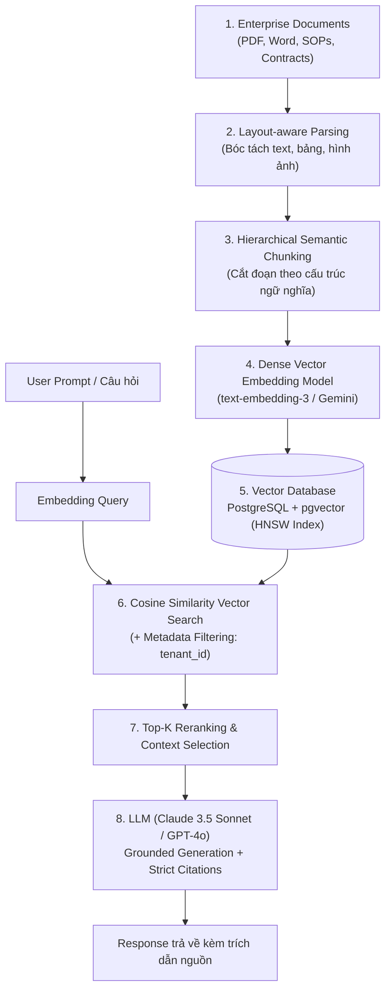
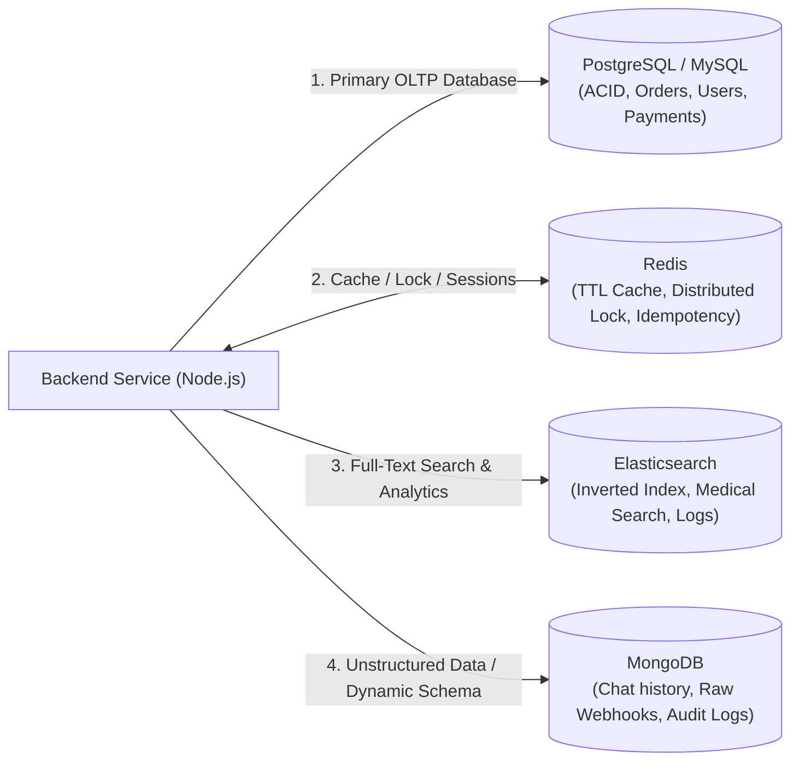

# 🎯 BỘ CẨM NANG PHỎNG VẤN SENIOR BACKEND NODE.JS & AI-NATIVE DEVELOPER
## CÔNG TY CỔ PHẦN SẢN PHẨM SINH THÁI (COZY / PNS)

> **Vị trí ứng tuyển**: Back-end Developer (Node.js & Python / AI-Native with Claude Code & Cursor)  
> **Mức lương mục tiêu**: **1.300 – 1.500 USD/tháng** (~33 – 38 triệu VNĐ)  
> **Ứng viên**: Nguyễn Đức Quỳnh  
> **Điểm nhấn cạnh tranh**: Nắm vững hệ sinh thái Node.js (NestJS, Express), Python, CSDL đa dạng (PostgreSQL, MySQL, Redis, Elasticsearch) VÀ có kinh nghiệm làm chủ quy trình **Agentic Coding (Claude Code, Cursor, `CLAUDE.md`, MCP, RAG Platform thực chiến)**.

---

## 📌 MỤC LỤC CHI TIẾT

1. [Phần 1: Định vị hồ sơ & Kịch bản Deal lương 1.400 – 1.500 USD](#phần-1-định-vị-hồ-sơ--kịch-bản-deal-lương-1400--1500-usd)
2. [Phần 2: Giới thiệu bản thân (Elevator Pitch) – Đậm chất AI-Native Engineer](#phần-2-giới-thiệu-bản-thân-elevator-pitch--đậm-chất-ai-native-engineer)
3. [Phần 3: Trục Kỹ thuật AI-Native, Claude Code, `CLAUDE.md` & MCP (Trọng tâm JD)](#phần-3-trục-kỹ-thuật-ai-native-claude-code-claudemd--mcp-trọng-tâm-jd)
4. [Phần 4: Tích hợp LLM APIs, RAG & Kiến trúc AI trong sản phẩm](#phần-4-tích-hợp-llm-apis-rag--kiến-trúc-ai-trong-sản-phẩm)
5. [Phần 5: Backend Core Node.js, Python & Microservices Architecture](#phần-5-backend-core-nodejs-python--microservices-architecture)
6. [Phần 6: Quản trị Cơ sở dữ liệu (PostgreSQL, MySQL, Redis, Elasticsearch)](#phần-6-quản-trị-cơ-sở-dữ-liệu-postgresql-mysql-redis-elasticsearch)
7. [Phần 7: Bảo mật dữ liệu & Nguyên tắc Zero Data Leakage khi dùng AI](#phần-7-bảo-mật-dữ-liệu--nguyên-tắc-zero-data-leakage-khi-dùng-ai)
8. [Phần 8: Bộ câu hỏi thông minh hỏi ngược Nhà tuyển dụng](#phần-8-bộ-câu-hỏi-thông-minh-hỏi-ngược-nhà-tuyển-dụng)

---

## PHẦN 1: ĐỊNH VỊ HỒ SƠ & KỊCH BẢN DEAL LƯƠNG 1.400 – 1.500 USD

### 1. Phân tích lợi thế cạnh tranh áp đảo của bạn
* **90% ứng viên trên thị trường**: Chỉ dùng AI ở mức cơ bản (Copy/Paste prompt vào ChatGPT để xin code mẫu hoặc giải thích lỗi). Khi gặp bài toán lớn, AI sinh code lung tung, vỡ kiến trúc, không kiểm soát được.
* **Sự khác biệt của Quỳnh**:
  1. **Nền tảng Backend vững chắc**: Đã làm NestJS, Express, MySQL, PostgreSQL, Redis, Elasticsearch ở quy mô lớn (ViShop ERP 15 modules, JIHO E-Learning Nhật Bản).
  2. **Thực chiến xây dựng hệ thống AI**: Trực tiếp xây dựng **Multimodal Document RAG Platform** (Python, pgvector, LLM) và **CRMAgent** (tích hợp Anthropic/OpenAI APIs).
  3. **Làm chủ Agentic Coding**: Đã quen thuộc với **Claude Code**, cấu hình **`CLAUDE.md`**, phân rã ngữ cảnh, giao tiếp công cụ qua **Model Context Protocol (MCP)**, và có tư duy phản biện cao (Code Review & Security Gate).

### 2. Kịch bản Đàm phán Lương (Target: 1.400 – 1.500 USD)
* ❓ **HR/Tech Lead hỏi**: *"Mức lương mong muốn của bạn tại công ty là bao nhiêu?"*
* 🗣️ **Câu trả lời mẫu**:
  > *"Dựa trên bản mô tả công việc, công ty không chỉ tìm kiếm một Backend Developer đơn thuần, mà cần một kỹ sư có tư duy **AI-Native** – người có thể vừa làm chủ kiến trúc Node.js/Python, vừa khai thác tối đa sức mạnh của Claude Code, Cursor để nâng cao năng suất và cùng đội ngũ chuẩn hóa file `CLAUDE.md`, bộ quy ước code cho AI agent.*
  > 
  > *Với việc em đã trực tiếp xây dựng các hệ thống tích hợp LLM (RAG Platform với pgvector, AI Agent với Anthropic Claude API) và đã ứng dụng agentic coding hàng ngày vào quy trình phát triển, em tự tin có thể bàn giao giá trị và giúp chuẩn hóa quy trình AI của team ngay từ tuần đầu tiên.*
  > 
  > *Vì vậy, em mong muốn mức đãi ngộ là **1.400 – 1.500 USD/tháng Net (hoặc tương đương Gross)**. Em tin rằng tốc độ hoàn thành công việc và chất lượng kiến trúc em mang lại sẽ hoàn toàn tương xứng với mức đầu tư này của công ty."*

---

## PHẦN 2: GIỚI THIỆU BẢN THÂN (ELEVATOR PITCH) – ĐẬM CHẤT AI-NATIVE ENGINEER

> **Thời lượng**: 2 phút | **Phong thái**: Tự tin, chuyên nghiệp, sắc bén.

* 🗣️ **Lời thoại gợi ý**:
  > *"Em chào anh/chị. Em là Quỳnh, một Backend Developer tốt nghiệp chuyên ngành CNTT tại Học viện Công nghệ Bưu chính Viễn thông, với hơn 2 năm kinh nghiệm thực chiến chuyên sâu trên hệ sinh thái Node.js (NestJS, Express), Python và hệ thống cơ sở dữ liệu phân tán.*
  > 
  > *Điều đặc biệt ở phong cách làm việc của em là: **Em coi AI là một cộng sự (Pair Programmer / Autonomous Agent) chứ không chỉ là công cụ hỏi đáp**.*
  > 
  > *Cụ thể:*
  > 1. * **Về Backend & Kiến trúc**: Em đã từng tham gia thiết kế và triển khai các hệ thống Microservices quy mô lớn, từ nền tảng thương mại điện tử đa kênh ViShop xử lý hàng nghìn request/giây với NestJS, Redis, BullMQ, đến hệ thống y tế JIHO phục vụ thị trường Nhật Bản sử dụng Elasticsearch và PostgreSQL.*
  > 2. * **Về kinh nghiệm AI thực chiến**: Em trực tiếp phát triển hệ sinh thái **RAG Platform** xử lý tài liệu đa phương thức bằng Python, pgvector và LLM, cũng như tích hợp API của Anthropic (Claude) và OpenAI vào nền tảng CRMAgent.*
  > 3. * **Về làm việc với AI Agent**: Em sử dụng hàng ngày **Claude Code CLI** và Cursor. Em hiểu rõ cách thiết lập file **`CLAUDE.md`**, phân rã task thành các atomic prompts, cấu hình ngữ cảnh ngắn gọn để tránh hallucination, và đặc biệt là luôn có **tư duy phản biện (Critical Review)** – tự động hóa test, linter và rà soát bảo mật để đảm bảo code AI sinh ra luôn đạt chuẩn Production.*
  > 
  > *Đọc JD của công ty, em cảm thấy đây chính là môi trường lý tưởng mà em đang tìm kiếm – nơi tinh thần ứng dụng AI được coi là văn hóa cốt lõi. Em rất mong muốn mang kinh nghiệm này vào đóng góp cho công ty."*

---

## PHẦN 3: TRỤC KỸ THUẬT AI-NATIVE, CLAUDE CODE, `CLAUDE.md` & MCP (TRỌNG TÂM JD)

### Q1: File `CLAUDE.md` là gì? Em thiết lập cấu trúc file `CLAUDE.md` trong một dự án Node.js/TypeScript chuẩn Enterprise như thế nào?

* 💡 **Câu trả lời ăn điểm**:
  * **Bản chất**: `CLAUDE.md` là file chỉ dẫn ngữ cảnh cấp cao (System Context & Operating Guide) nằm ở thư mục gốc của repository, được **Claude Code** (hoặc Claude Agent) tự động đọc đầu tiên mỗi khi khởi chạy phiên làm việc.
  * **Mục đích**: Cung cấp cho Claude kiến thức nền tảng về dự án để AI không phải đoán mò hoặc sinh code sai quy chuẩn (ví dụ: cấm dùng `any`, bắt buộc dùng DTO validation, quy định lệnh build/test).
  * **Cấu trúc mẫu của một file `CLAUDE.md` chuẩn mực**:

```markdown
# CLAUDE.md - Backend Engineering Standards

## 1. Project Overview & Architecture
- Monorepo sử dụng NestJS 11 + Fastify adapter, TypeScript strict mode.
- Kiến trúc Clean Architecture / DDD: Controller -> Application Service -> Domain Entity -> Infrastructure Repository.

## 2. Standard Commands
- Build: `npm run build`
- Dev server: `npm run start:dev`
- Run single test: `npm run test -- src/modules/order/order.service.spec.ts`
- Run all tests: `npm run test:cov`
- Linter & Formatting: `npm run lint` & `npm run format`

## 3. Code Style & Rules
- TypeScript: BẮT BUỘC bật strict mode, TUYỆT ĐỐI KHÔNG dùng kiểu `any` (dùng `unknown` kèm type narrowing).
- Dependency Injection: Chỉ inject qua constructor, dùng interface contract.
- Validation: Mọi request payload bắt buộc validate qua DTO với `class-validator` và `class-transformer`.
- Error Handling: Không bao giờ nuốt lỗi (`catch (e) {}`); luôn ném `HttpException` có mã lỗi nghiệp vụ chuẩn.

## 4. Security & Safety Rules
- KHÔNG BAO GIỜ hardcode credentials, private key, JWT secret vào code; luôn đọc qua `ConfigService`.
- Khi cập nhật Database: BẮT BUỘC tạo TypeORM/Prisma migration file, không dùng `synchronize: true`!
- Khi sinh code mới: Luôn viết kèm Unit Test (Jest) với độ phủ branch tối thiểu 80%.
```

---

### Q2: So sánh sự khác nhau giữa Claude Code (Agentic CLI), Cursor (AI IDE) và GitHub Copilot? Em kết hợp chúng như thế nào?

* 💡 **Câu trả lời ăn điểm**:
  * **Bảng so sánh bản chất**:

| Công cụ | Mô hình hoạt động | Thế mạnh cốt lõi | Hạn chế |
| :--- | :--- | :--- | :--- |
| **Claude Code** | **Autonomous Agent trên Terminal** | Rất mạnh ở cấp độ **toàn bộ Repository**: Có khả năng tự đọc file, chạy lệnh terminal, chạy test, thấy test fail tự sửa code và commit git. | Cần máy có quyền chạy terminal, tốn token nếu không biết giới hạn ngữ cảnh. |
| **Cursor** | **AI-Native IDE (Fork từ VS Code)** | **Inline Editing & File References (`@file`, `@folder`)**: Sửa trực tiếp từng khối code trên màn hình, đa file context, giao diện visual trực quan. | Vẫn cần con người điều hướng nhiều bước thủ công hơn Agent. |
| **GitHub Copilot** | **Autocomplete Assistant** | Gợi ý code theo thời gian thực (tab completion), sinh boilerplate nhanh khi đang gõ. | Tầm nhìn hẹp (chỉ vài dòng trước và sau con trỏ), không tự giải quyết được task phức tạp. |

  * **Quy trình kết hợp thực tế (Hybrid Workflow)**:
    1. **Planning & Complex Refactoring**: Dùng **Claude Code** trên Terminal để thực hiện các task diện rộng: ví dụ *"Refactor module thanh toán từ TypeORM sang Prisma, chạy test và tự fix lỗi"* hoặc *"Viết toàn bộ unit test cho OrderService đạt coverage > 85%"*.
    2. **Daily Coding & Logic Implementation**: Dùng **Cursor** (`Ctrl + K`, `Composer`) để code các hàm nghiệp vụ, tạo nhanh DTOs, Controllers và tra cứu nhanh ngữ cảnh bằng `@docs`.
    3. **Fast Autocomplete**: Giữ Copilot/Cursor Tab chạy ngầm để tự động gõ nhanh các cú pháp lặp lại.

---

### Q3: Model Context Protocol (MCP) là gì? Em ứng dụng MCP như thế nào để mở rộng năng lực cho AI Agent?

* 💡 **Câu trả lời ăn điểm tuyệt đối (Khớp điểm cộng trong JD)**:
  * **Bản chất của MCP**: Là giao thức mã nguồn mở do **Anthropic** khởi xướng, chuẩn hóa cách một AI Model (như Claude) kết nối và tương tác với các nguồn dữ liệu ngoài và công cụ bên thứ ba (Tools & Data Sources).
  * **Trước khi có MCP**: Mỗi công cụ (Database, Git, Slack, Jira) đều phải viết integration riêng lẻ, rất phân mảnh.
  * **Sau khi có MCP (Mô hình Client - Host - Server)**:
    * **MCP Client**: Claude Desktop, Claude Code, Cursor.
    * **MCP Server**: Các adapter nhỏ cung cấp công cụ (Tools), tài nguyên (Resources) và mẫu prompt.
  * **Ứng dụng thực tế em đã làm/triển khai**:
    1. **PostgreSQL / MySQL MCP Server**: Cho phép Claude đọc schema DB thực tế, chạy thử query `EXPLAIN` an toàn (Read-Only) để gợi ý đánh index và tối ưu câu truy vấn chậm mà không cần dev phải chụp màn hình hoặc copy paste schema bằng tay.
    2. **Git / GitHub MCP Server**: Cho phép Claude tự động inspect git diff, tạo PR, tóm tắt commit messages theo chuẩn Conventional Commits.
    3. **Custom Internal API MCP**: Tạo một MCP server bằng Node.js/Python để Claude tra cứu nhanh danh mục API nội bộ (Swagger docs) và dữ liệu log từ Elasticsearch.

---

### Q4: Kỹ thuật chia nhỏ đầu việc (Task Decomposition) và kiểm soát Context Window để AI không bị "ảo giác" (Hallucination) hoặc sinh code lệch kiến trúc?

* 💡 **Quy tắc 4 bước thực chiến**:
  1. **Không bao giờ ném cả task lớn vào 1 prompt duy nhất**:
     * ❌ *Sai lầm*: *"Hãy viết cho tôi toàn bộ hệ thống E-commerce gồm giỏ hàng, thanh toán, kho và webhook"*. (AI sẽ sinh code nửa vời, sơ sài và vỡ nợ kỹ thuật).
     * ✅ *Đúng đắn (Atomic Tasks)*: Chia theo quy trình:
       * *Bước 1*: Yêu cầu AI sinh Interface & Entity Domain model.
       * *Bước 2*: Review và chốt contract.
       * *Bước 3*: Yêu cầu sinh Repository & Service logic.
       * *Bước 4*: Yêu cầu sinh Controller & Unit Test.
  2. **Kiểm soát dung lượng Context (Context Window Management)**:
     * Chỉ cung cấp những file thực sự liên quan (Relevant Context). Không đưa toàn bộ thư mục `node_modules` hay các module không liên quan vào prompt.
     * Sử dụng file `.cursorignore` hoặc `.claudeignore` để loại bỏ các file rác, build artifacts, `.git`, dist files.
  3. **Kỹ thuật "Plan First, Code Later" (CoT - Chain of Thought)**:
     * Luôn yêu cầu AI: *"Trước khi viết code, hãy tóm tắt kế hoạch 5 bước em dự định làm và liệt kê các file sẽ chỉnh sửa để tôi xác nhận"*.
  4. **Kiểm soát chất lượng nghiêm ngặt (Strict Verification Gate)**:
     * Sau khi AI sinh code, bắt buộc chạy lệnh kiểm tra tự động ngay trên terminal:
       ```bash
       npm run lint && npm run test
       ```
     * Nếu có lỗi, đưa log lỗi vào để AI sửa đúng phần đó, không cho phép AI viết đè lại toàn bộ file nếu không cần thiết.

---

## PHẦN 4: TÍCH HỢP LLM APIS, RAG & KIẾN TRÚC AI TRONG SẢN PHẨM

### Q5: Trình bày kiến trúc hệ thống RAG (Retrieval-Augmented Generation) mà em đã xây dựng trong dự án?

* 💡 **Câu trả lời ăn điểm thực tế (Dự án Multimodal RAG trong CV)**:



* **3 Thách thức kỹ thuật lớn nhất em đã xử lý**:
  1. **Layout-aware Chunking**: Không cắt thô bạo theo độ dài ký tự (Fixed-size chunking làm gãy bảng và ý nghĩa). Em áp dụng chunking theo ngữ nghĩa (Header, Section, Table) để bảng biểu giữ nguyên định dạng Markdown Table.
  2. **Tìm kiếm Vector tốc độ cao với `pgvector`**: Sử dụng index **HNSW (Hierarchical Navigable Small World)** thay vì IVFFlat. HNSW cho tốc độ truy vấn mili-giây và độ chính xác (Recall) cao hơn 95% ngay cả khi dữ liệu scale lên hàng triệu vector.
  3. **Chống Hallucination bằng Grounded Prompting**: Ép LLM chỉ trả lời dựa trên context được cung cấp; nếu context không có thông tin thì trả về *"Tài liệu không đề cập"* và bắt buộc đính kèm trích dẫn (Citation: Page X, Document Y).

---

### Q6: Khi tích hợp Claude API (Anthropic SDK) vào Backend Node.js, em xử lý Tool Use (Function Calling), Streaming và Token Optimization như thế nào?

* 💡 **Câu trả lời cốt lõi**:
  * **Tool Use (Function Calling)**:
    * Định nghĩa JSON Schema chặt chẽ cho tool (ví dụ: `check_order_status`, `lookup_customer`).
    * Gửi request lên Claude với cờ `tools: [...]`. Khi Claude phát hiện cần dữ liệu thật, nó trả về `stop_reason: "tool_use"` kèm parameters.
    * Backend Node.js gọi MySQL/Service để lấy dữ liệu thực tế, sau đó gửi kết quả lại cho Claude để tổng hợp câu trả lời tự nhiên cho người dùng.
  * **Streaming Responses**:
    * Với các ứng dụng Chatbot hoặc AI Copilot, không bao giờ để người dùng chờ 10 giây mới nhận kết quả.
    * Sử dụng **Server-Sent Events (SSE)** kết hợp với `anthropic.messages.stream()`:
      ```typescript
      const stream = await anthropic.messages.stream({
        model: "claude-3-5-sonnet-20241022",
        max_tokens: 1024,
        messages: [{ role: "user", content: prompt }],
      });
      for await (const chunk of stream) {
        if (chunk.type === 'content_block_delta') {
          res.write(`data: ${JSON.stringify({ text: chunk.delta.text })}\n\n`);
        }
      }
      ```
  * **Tối ưu chi phí Token với Prompt Caching**:
    * Với các system prompt dài hoặc tài liệu quy chế công ty cố định: Tận dụng tính năng **Prompt Caching** của Claude (header `anthropic-beta: prompt-caching-2024-07-31`).
    * Giúp **giảm tới 90% chi phí token** và giảm 80% độ trễ (Latency) cho các request lặp lại!

---

## PHẦN 5: BACKEND CORE NODE.JS, PYTHON & ARCHITECTURE

### Q7: Giữa Express.js và NestJS, em ưu tiên chọn framework nào cho các dự án Microservices và Enterprise API?

* 💡 **Câu trả lời cốt lõi**:
  * **Express.js**:
    * *Ưu điểm*: Cực kỳ nhẹ, tự do, linh hoạt, khởi động nhanh.
    * *Nhược điểm*: Không có cấu trúc chuẩn (Unopinionated). Khi team đông người (5–10 devs), mỗi người viết một kiểu, cấu trúc thư mục lộn xộn, không có sẵn Dependency Injection (DI).
    * *Phù hợp*: Các microservice nhỏ, API Gateway đơn giản, script xử lý nhanh.
  * **NestJS**:
    * *Ưu điểm*: Kiến trúc chuẩn mực theo phong cách Angular/Spring Boot (Module, Controller, Provider, Middleware, Guard, Interceptor, Pipe). Tích hợp sẵn DI Container, TypeScript 100%, hỗ trợ Microservices (gRPC, Redis, RabbitMQ, Kafka) chỉ qua vài dòng config.
    * *Nhược điểm*: Khởi động nặng hơn Express một chút, đòi hỏi học đường cong (Learning curve) về DI và RxJS.
    * *Phù hợp*: Các hệ thống lớn (Enterprise API, Monorepo đa domain, Microservices phức tạp).

---

### Q8: Khi kết hợp Node.js và Python trong cùng một hệ sinh thái, em phân chia trách nhiệm (Boundary) giữa 2 ngôn ngữ này như thế nào?

* 💡 **Câu trả lời chuẩn kiến trúc**:
  * **Node.js (NestJS / Fastify)**: Đóng vai trò **Core Business & High-Throughput API Gateway**:
    * Xử lý xác thực/phân quyền (JWT, RBAC).
    * Quản lý phiên làm việc, CRUD nghiệp vụ bán hàng, thanh toán, notification.
    * Xử lý I/O nặng và streaming realtime (WebSocket, SSE) nhờ Event Loop non-blocking cực nhẹ.
  * **Python (FastAPI / Celery)**: Đóng vai trò **AI & Data Processing Engine**:
    * Tận dụng hệ sinh thái phong phú về AI/ML của Python (LangChain, LlamaIndex, Pydantic v2, PyTorch, NumPy, HuggingFace).
    * Chạy các pipeline bóc tách PDF, chunking, OCR, tính toán vector embeddings và giao tiếp với các model nội bộ.
  * **Giao tiếp giữa 2 bên**: Thông qua **RESTful API / gRPC** hoặc bất đồng bộ qua Message Queue (**BullMQ / RabbitMQ / Redis Streams**) để đảm bảo loose coupling.

---

## PHẦN 6: QUẢN TRỊ CƠ SỞ DỮ LIỆU (POSTGRESQL, MYSQL, REDIS, ELASTICSEARCH)

### Q9: Trong hệ thống có cả PostgreSQL, MySQL, Redis và Elasticsearch, em phân bổ lưu trữ dữ liệu theo mô hình Polyglot Persistence như thế nào?

* 💡 **Câu trả lời ăn điểm thực tế**:



1. **PostgreSQL / MySQL (Master OLTP Database)**: Lưu trữ các dữ liệu tài chính, đơn hàng, người dùng, giao dịch – nơi đòi hỏi tính toàn vẹn **ACID tuyệt đối** và quan hệ chặt chẽ.
2. **Redis (In-Memory Data Store)**: 
   * Caching dữ liệu đọc nhiều (Cache-Aside pattern).
   * Distributed Locking (`Redlock` / script Lua) chống race condition mua hàng tồn kho.
   * Quản lý Session người dùng và Rate Limiter.
3. **Elasticsearch (Search Engine)**: 
   * Tìm kiếm toàn văn (Full-Text Search) tốc độ cao, xử lý từ đồng nghĩa, phân tích ngôn ngữ (NLP Analyzer).
   * Dùng làm Read Model trong kiến trúc CQRS để giảm tải cho Database chính.
4. **MongoDB (Document NoSQL)**: Lưu trữ các dữ liệu có cấu trúc biến đổi linh hoạt (Dynamic Schema), ví dụ như lưu vết payload của Webhook từ các sàn, log hội thoại chat của khách hàng với AI.

---

## PHẦN 7: BẢO MẬT DỮ LIỆU & NGUYÊN TẮC ZERO DATA LEAKAGE KHI DÙNG AI

### Q10: Khi dùng các công cụ AI lập trình (Claude Code, Cursor, Copilot), làm sao em đảm bảo không làm lộ bí mật kinh doanh, API Keys hay dữ liệu khách hàng?

* 💡 **Nguyên tắc "Zero Data Leakage" 5 lớp**:
  1. **Không bao giờ đưa Secrets vào mã nguồn**: Luôn sử dụng biến môi trường (`.env`) và nạp file `.env` vào `.gitignore`, `.cursorignore`, `.claudeignore`.
  2. **Công cụ tự động chặn Secret (Pre-commit Git Hooks)**: Sử dụng **`gitleaks`** hoặc **`trufflehog`** trong pre-commit hook. Nếu vô tình commit file có chứa chuỗi dạng API Key (OpenAI, AWS, Database URI), hook sẽ chặn ngay lập tức trước khi push.
  3. **Data Masking & Sanitization**: Khi đưa log hoặc dữ liệu mẫu cho AI debug, bắt buộc phải ẩn danh (masking) các thông tin nhạy cảm (PII): số điện thoại `098****176`, email `q****@gmail.com`, số thẻ ngân hàng.
  4. **Cấu hình Privacy trên IDE / Công cụ AI**:
     * Trong Cursor: Bật chế độ **Privacy Mode** (đảm bảo code không bị lưu trữ trên server của bên thứ ba để train model).
     * Với Claude / Anthropic: Sử dụng **Commercial API** (Anthropic cam kết theo điều khoản không dùng dữ liệu gửi qua API để huấn luyện model).

---

## PHẦN 8: BỘ CÂU HỎI THÔNG MINH HỎI NGƯỢC NHÀ TUYỂN DỤNG

> **Chiến thuật**: Hỏi những câu hỏi thể hiện bạn là một kỹ sư có tư duy chiến lược về văn hóa ứng dụng AI và kiến trúc sản phẩm.

1. **Về Văn hóa làm việc với AI**:  
   *"Dạ cho em hỏi hiện tại đội ngũ của mình đã chuẩn hóa file `CLAUDE.md` và bộ custom prompts cho các dự án chưa, hay em sẽ là một trong những người cùng Tech Lead trực tiếp xây dựng và định hình bộ quy chuẩn này ạ?"*
2. **Về Bài toán Kỹ thuật & Hạ tầng**:  
   *"Hệ thống backend hiện tại của công ty đang vận hành chủ yếu theo kiến trúc Monolith module hóa hay Microservices, và quy mô traffic hàng ngày hiện tại của các ứng dụng đang ở mức khoảng bao nhiêu ạ?"*
3. **Về Ứng dụng AI vào Sản phẩm (Product AI)**:  
   *"Ngoài việc dùng Claude Code để lập trình, công ty có định hướng tích hợp sâu các tính năng AI (như Chatbot AI, RAG tìm kiếm thông minh, tự động hóa quy trình) trực tiếp vào sản phẩm cho người dùng cuối không ạ?"*
4. **Về Kế hoạch 3 tháng đầu tiên**:  
   *"Nếu em gia nhập công ty, mục tiêu hoặc kỳ vọng quan trọng nhất mà ban lãnh đạo mong muốn em đạt được trong giai đoạn thử việc là gì ạ?"*

