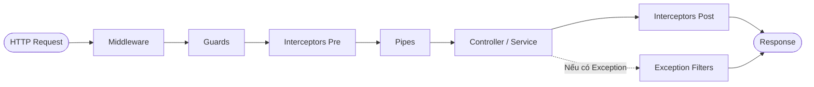

# 🎯 BỘ CẨM NANG ÔN TẬP & CÂU TRẢ LỜI PHỎNG VẤN FULLSTACK DEVELOPER (NESTJS & NEXT.JS)

> **Vị trí ứng tuyển**: Fullstack Developer (NestJS / Next.js / MySQL / Third-Party Integration)  
> **Ứng viên**: Nguyễn Đức Quỳnh  
> **Mục tiêu**: Bộ tài liệu ôn luyện thực chiến toàn diện bám sát 100% bản mô tả công việc (JD), tích hợp kinh nghiệm từ các dự án thực tế trong CV (**ViShop WMS/OMS**, **CRMAgent**, **MIAPET**, **JIHO**, **RAG AI Platform**), trang bị kịch bản đàm phán lương mức cao nhất (**16 – 18 triệu VNĐ**).

---

## 📌 MỤC LỤC CHI TIẾT

1. [Phần 1: Giới thiệu bản thân & Kịch bản Deal lương 16 – 18 triệu](#phần-1-giới-thiệu-bản-thân--kịch-bản-deal-lương-16--18-triệu)
2. [Phần 2: Backend Chuyên sâu – NestJS Architecture & Authentication](#phần-2-backend-chuyên-sâu--nestjs-architecture--authentication)
3. [Phần 3: Tích hợp hệ thống bên thứ 3 (Payment, Webhook, ERP, SMS/Email)](#phần-3-tích-hợp-hệ-thống-bên-thứ-3-payment-webhook-erp-smsemail)
4. [Phần 4: Cơ sở dữ liệu MySQL Chuyên sâu & ORM (TypeORM / Prisma)](#phần-4-cơ-sở-dữ-liệu-mysql-chuyên-sâu--orm-typeorm--prisma)
5. [Phần 5: Frontend Chuyên sâu – Next.js, React & Tối ưu SEO/Performance](#phần-5-frontend-chuyên-sâu--nextjs-react--tối-ưu-seoperformance)
6. [Phần 6: Hàng đợi & Caching (Redis & BullMQ / RabbitMQ)](#phần-6-hàng-đợi--caching-redis--bullmq--rabbitmq)
7. [Phần 7: DevOps, CI/CD, Testing & Ứng dụng AI Nâng cao năng suất](#phần-7-devops-cicd-testing--ứng-dụng-ai-nâng-cao-năng-suất)
8. [Phần 8: Quy trình dự án & Kỹ năng làm việc với Khách hàng](#phần-8-quy-trình-dự-án--kỹ-năng-làm-việc-với-khách-hàng)
9. [Phần 9: Bộ câu hỏi thông minh hỏi ngược Nhà tuyển dụng](#phần-9-bộ-câu-hỏi-thông-minh-hỏi-ngược-nhà-tuyển-dụng)

---

## PHẦN 1: GIỚI THIỆU BẢN THÂN & KỊCH BẢN DEAL LƯƠNG 16 – 18 TRIỆU

### 1. Kịch bản Giới thiệu bản thân (Elevator Pitch - 2 phút)

> **Mục tiêu**: Thể hiện ngay sự trùng khớp 100% với Tech Stack của JD (NestJS + Next.js + MySQL + Tích hợp 3rd-party + AI), phong thái tự tin, tập trung vào giá trị mang lại cho doanh nghiệp.

* 🗣️ **Lời thoại gợi ý**:
  > *"Em chào anh/chị. Em là Quỳnh, một Fullstack Developer với hơn 2 năm kinh nghiệm thực chiến chuyên sâu trên hệ sinh thái JavaScript/TypeScript.*
  > 
  > *Thế mạnh cốt lõi của em nằm ở:*
  > 1. * **Backend với NestJS**: Em có kinh nghiệm xây dựng các hệ thống đa dịch vụ và nguyên khối module hóa, thiết kế RESTful API và GraphQL chuẩn mực, xử lý xác thực/phân quyền chặt chẽ với JWT/OAuth2 và RBAC.*
  > 2. * **Tích hợp bên thứ 3**: Em từng trực tiếp triển khai tích hợp cổng thanh toán VNPay, kết nối đồng bộ đơn hàng đa kênh với TikTok Shop Open API, hệ thống tin nhắn đa kênh qua Facebook Graph API, Zalo ZNS và hệ thống gửi Email OTP.*
  > 3. * **Cơ sở dữ liệu**: Em nắm vững MySQL và PostgreSQL từ thiết kế schema, đánh index B-Tree, tối ưu query qua EXPLAIN, đến xử lý transaction và concurrency lock.*
  > 4. * **Frontend Next.js**: Em thành thạo React, Next.js (cả SSR, SSG và App Router), tối ưu SEO, Core Web Vitals và kết hợp với Tailwind CSS để xây dựng giao diện tối ưu trải nghiệm người dùng.*
  > 5. * **Ứng dụng AI & Năng suất**: Em chủ động sử dụng các công cụ AI (như Cursor, GitHub Copilot, Claude/ChatGPT) vào quy trình hàng ngày để tăng tốc độ viết boilerplate, sinh test case và rà soát lỗi.*
  > 
  > *Đọc qua bản mô tả công việc của công ty, em thấy các yêu cầu về NestJS, Next.js, MySQL và việc trao đổi trực tiếp với khách hàng/đội ngũ để bàn giao sản phẩm hoàn toàn khớp với những gì em đã làm tốt tại các dự án thực tế như ViShop, CRMAgent hay MIAPET. Em rất mong muốn mang kinh nghiệm thực chiến này vào đóng góp cho các dự án của công ty ngay từ ngày đầu tiên."*

---

### 2. Kịch bản Đàm phán Lương (Target: 16 – 18 triệu VNĐ)

* 🎯 **Bối cảnh**: JD đưa ra mức 10 – 18 triệu VNĐ. Mục tiêu của bạn là chạm mức cận trên (16 – 18 triệu).
* 💡 **Nguyên tắc**: Không chỉ đòi hỏi dựa trên "kinh nghiệm số năm", mà dựa trên **phạm vi trách nhiệm**, **khả năng làm được việc độc lập ngay (Zero onboarding time)**, và **tính đa năng Fullstack**.

* ❓ **HR/Tech Lead hỏi**: *"Mức lương mong muốn của em tại công ty là bao nhiêu?"*
* 🗣️ **Câu trả lời chuẩn**:
  > *"Dựa trên phạm vi công việc trong JD – đòi hỏi một kỹ sư có thể vừa làm chủ backend NestJS, xử lý cơ sở dữ liệu MySQL, tích hợp các đối tác thanh toán/vận chuyển phức tạp, vừa xây dựng frontend Next.js chuẩn SEO và trực tiếp trao đổi làm rõ yêu cầu với khách hàng – em thấy đây là vai trò yêu cầu tính toàn diện cao.*
  > 
  > *Với nền tảng em đã trực tiếp đảm nhiệm các bài toán tương tự trên môi trường Production (từ payment webhook, background queue với BullMQ, đến tối ưu render Next.js), em tự tin có thể bắt nhịp và đóng góp hiệu quả vào dự án ngay trong tuần đầu tiên mà không mất thời gian đào tạo lại.*
  > 
  > *Vì vậy, em mong muốn mức lương khởi điểm là **17 – 18 triệu VNĐ Net/Gross** (hoặc 16 triệu trong thời gian thử việc và lên 18 triệu khi ký chính thức kèm thưởng dự án). Em tin rằng năng suất và chất lượng công việc em mang lại sẽ hoàn toàn tương xứng với mức đầu tư này của công ty."*

---

## PHẦN 2: BACKEND CHUYÊN SÂU – NESTJS ARCHITECTURE & AUTHENTICATION

### Q1: Trình bày vòng đời xử lý một HTTP Request (Request Lifecycle) trong NestJS?

* 💡 **Câu trả lời cốt lõi**:
  Thứ tự thực thi tuần tự từ ngoài vào trong và ngược lại:
  1. **Incoming Request** đi qua Web server adapter (Express/Fastify).
  2. **Global / Module Middleware**: Thực thi đầu tiên, truy cập trực tiếp vào `req`, `res`, `next()`. Dùng để parse body, gắn request ID, nạp logging hoặc CORS.
  3. **Global / Controller / Route Guards**: Kiểm tra điều kiện cho phép request đi tiếp hay chặn lại (`canActivate()` trả về `true` hoặc `false` / `UnauthorizedException`). Thường dùng cho Authentication (JWT) và Authorization (RBAC).
  4. **Global / Controller / Route Interceptors (Pre-controller)**: Can thiệp trước khi vào handler (ví dụ: đo thời gian bắt đầu thực thi, transform request).
  5. **Global / Controller / Route / Parameter Pipes**: Thực hiện validate dữ liệu (`class-validator`) và transform kiểu dữ liệu (ví dụ: `ParseIntPipe`, `ValidationPipe`).
  6. **Controller (Route Handler)**: Tiếp nhận dữ liệu sạch, gọi Service tương ứng.
  7. **Service Layer**: Thực thi nghiệp vụ và tương tác với Database.
  8. **Interceptors (Post-controller)**: Bắt dữ liệu trả về từ Controller qua RxJS Observables, biến đổi format response (ví dụ: bọc chuẩn `{ success: true, data: ..., timestamp }`).
  9. **Exception Filters**: Nếu ở bất kỳ bước nào từ Guard đến Service phát sinh lỗi (`HttpException`), luồng sẽ nhảy ngay vào Exception Filter để chuẩn hóa format response lỗi trả về cho client.



---

### Q2: Dependency Injection (DI) trong NestJS hoạt động như thế nào? Phân biệt các Provider Scopes và rủi ro hiệu năng?

* 💡 **Câu trả lời cốt lõi**:
  * **Cơ chế DI**: NestJS dựa trên TypeScript Metadata (`reflect-metadata`) và nguyên lý Inversion of Control (IoC). Khi một class được đánh dấu `@Injectable()`, NestJS IoC Container sẽ phân tích constructor để tự động khởi tạo và tiêm (inject) các dependencies phụ thuộc vào class đó.
  * **3 loại Scope**:
    1. **DEFAULT (Singleton)**: Provider chỉ được tạo đúng 1 lần duy nhất trong toàn bộ vòng đời ứng dụng và được chia sẻ dùng chung cho mọi request. Đây là scope mặc định, có hiệu năng cao nhất và tốn ít RAM nhất.
    2. **REQUEST**: Một instance mới của provider được tạo riêng cho **mỗi HTTP request đến** và bị Garbage Collector thu hồi sau khi response kết thúc.
    3. **TRANSIENT**: Một instance mới được tạo mỗi khi provider đó được inject vào một service khác.
  * ⚠️ **Hiểm họa hiệu năng của `Scope.REQUEST`**:
    * Khi một Service được đặt là `Scope.REQUEST`, **mọi Service hoặc Controller nào phụ thuộc vào nó (và các tầng phía trên) cũng tự động bị kéo theo thành `Scope.REQUEST` (Bubble effect)**.
    * Khi có 1,000 requests/giây, hệ thống phải tạo mới và dọn rác 1,000 instances cùng lúc $\rightarrow$ Gây áp lực cực lớn lên V8 Garbage Collection, làm sụt giảm TPS và tăng đáng kể P99 latency.
    * **Giải pháp**: Thay vì dùng `Scope.REQUEST` để lấy thông tin `user` hay `tenantId`, hãy truyền `user` qua tham số phương thức từ Controller xuống Service, hoặc sử dụng Node.js `AsyncLocalStorage` để lưu trữ Request Context mà không phá vỡ mô hình Singleton!

---

### Q3: Em thiết kế luồng Xác thực (Authentication) & Phân quyền (Authorization) với JWT và Refresh Token như thế nào để đảm bảo an toàn trên Production?

* 💡 **Câu trả lời cốt lõi**:
  * **Kiến trúc Token kép (Dual-Token Pattern)**:
    * **Access Token**: Chứa Payload gồm `userId`, `role`, `tenantId`. Thời gian sống ngắn (15 – 30 phút). Ký bằng thuật toán `RS256` (Public/Private Key) hoặc `HS256` với secret key mạnh.
    * **Refresh Token**: Thời gian sống dài hơn (7 – 30 ngày), lưu trữ chuỗi mã hóa ngẫu nhiên (UUID hoặc cryptographically secure hash).
  * **Lưu trữ an toàn**:
    * Ở Client: Lưu Access Token trong memory (hoặc private state) và Refresh Token trong `HttpOnly`, `Secure`, `SameSite=Strict` Cookie để chống hoàn toàn tấn công XSS.
    * Ở Server: Lưu Refresh Token hash vào Database hoặc Redis gắn liền với `userId` và `deviceId/familyId`.
  * **Cơ chế Refresh Token Rotation & Thu hồi tức thì (Revocation)**:
    * Mỗi khi client gọi endpoint `/auth/refresh`, server xác thực Refresh Token cũ, **hủy bỏ token đó ngay lập tức** và cấp phát một cặp Access/Refresh Token hoàn toàn mới.
    * Nếu một Refresh Token đã bị thu hồi mà lại được sử dụng lần thứ hai $\rightarrow$ Cảnh báo token bị đánh cắp! Hệ thống ngay lập tức thu hồi toàn bộ phiên đăng nhập của `familyId` đó (buộc đăng nhập lại).
    * **Đăng xuất (Logout)**: Đưa Access Token hiện tại vào Redis Blacklist với TTL bằng đúng thời gian sống còn lại của token.
  * **Phân quyền (RBAC)**:
    * Tạo `@Roles(...)` hoặc `@Permissions(...)` Custom Decorator.
    * Xây dựng `RolesGuard` implements `CanActivate`: Sử dụng `Reflector` của NestJS để đọc metadata từ handler, so sánh với `req.user.roles`. Nếu không khớp thì trả về `ForbiddenException (403)`.

---

### Q4: Sự khác biệt bản chất giữa RESTful API và GraphQL? Trong dự án em giải quyết vấn đề N+1 trong GraphQL như thế nào?

* 💡 **Câu trả lời cốt lõi**:
  * **So sánh**:
    * **REST**: Cố định endpoint (`GET /orders`, `GET /users/:id`), cấu trúc dữ liệu trả về do server quyết định. Thường gặp vấn đề **Over-fetching** (lấy thừa trường không dùng) hoặc **Under-fetching** (phải gọi 3-4 API liên tiếp để gom đủ thông tin cho 1 màn hình).
    * **GraphQL**: Một endpoint duy nhất (`POST /graphql`), client gửi query chỉ định chính xác các trường cần thiết. Rất mạnh cho ứng dụng có UI phức tạp, nhiều quan hệ dữ liệu hoặc đa nền tảng (Web, Mobile).
  * **Bài toán N+1 trong GraphQL**:
    * Giả sử query danh sách 10 bài viết (`posts`) và lấy thông tin tác giả (`author`) của từng bài. Nếu resolver chạy ngây thơ: 1 query lấy 10 posts, sau đó với mỗi post lại bắn 1 query `SELECT * FROM users WHERE id = post.authorId` $\rightarrow$ Tổng cộng $1 + 10 = 11$ truy vấn vào Database!
  * **Giải pháp với DataLoader**:
    * Sử dụng thư viện `dataloader` của Facebook/GraphQL Foundation.
    * **Cơ chế**: Dựa vào hàng đợi **Microtask Queue** của Node.js Event Loop (`process.nextTick()`).
    * Khi các resolver chạy, DataLoader gom tất cả các `authorId` cần query vào một mảng trong tick hiện tại.
    * Ngay khi Call Stack rỗng, DataLoader kích hoạt hàm batch function duy nhất:
      ```sql
      SELECT * FROM users WHERE id IN (1, 2, 5, 8, ...);
      ```
    * Giảm từ $N+1$ queries xuống chỉ còn đúng **2 queries** duy nhất vào DB, đồng thời tự động cache kết quả trong phạm vi một HTTP request (Request-scoped Memoization).

---

## PHẦN 3: TÍCH HỢP HỆ THỐNG BÊN THỨ 3 (PAYMENT, WEBHOOK, ERP, SMS/EMAIL)

### Q5: Khi tích hợp cổng thanh toán (như VNPay/Momo/ZaloPay), em xử lý bảo mật, Webhook IPN, kiểm tra chữ ký và Idempotency như thế nào?

* 💡 **Câu trả lời ăn điểm thực tế (Dựa án MIAPET/ViShop)**:
  * **1. Xác thực chữ ký số (Checksum Verification)**:
    * Khi khách hàng thanh toán xong, cổng thanh toán (ví dụ VNPay) gửi một HTTP POST/GET request về webhook IPN (Instant Payment Notification).
    * Server tuyệt đối không tin tưởng body gửi lên mà phải lấy toàn bộ các query params/body (ngoại trừ trường `vnp_SecureHash`), sắp xếp alphabet theo key, ghép chuỗi với format chuẩn của đối tác và tính mã hash HMAC-SHA512 với `Secret Key` lưu trong biến môi trường.
    * So sánh chuỗi hash tính được với `vnp_SecureHash`. Nếu sai lệch $\rightarrow$ Từ chối ngay lập tức (phòng chống Man-In-The-Middle giả mạo dữ liệu).
  * **2. Kiểm tra tính toàn vẹn nghiệp vụ (Business Verification)**:
    * Kiểm tra mã đơn hàng (`orderId`) có tồn tại trong hệ thống không.
    * So khớp số tiền thanh toán (`vnp_Amount / 100`) với tổng giá trị đơn hàng trong Database. Kẻ xấu có thể can thiệp sửa client payload thành 1,000 VNĐ; việc so khớp giá trị ở server giúp ngăn chặn hoàn toàn gian lận.
  * **3. Tính Idempotency & Phòng ngừa Race Condition**:
    * Cổng thanh toán có cơ chế retry tự động nếu server phản hồi chậm, hoặc khách hàng nhấn reload trang kết quả. Webhook có thể bị gọi 2–3 lần cho cùng 1 giao dịch.
    * **Xử lý**:
      * Mở một MySQL Transaction với lock bi quan:
        ```sql
        SELECT id, status FROM orders WHERE id = ? FOR UPDATE;
        ```
      * Kiểm tra trạng thái hiện tại của đơn hàng. Nếu trạng thái đã là `PAID` (Đã thanh toán) $\rightarrow$ Lập tức trả về cho đối tác mã phản hồi thành công (`{ RspCode: '02', Message: 'Order already confirmed' }`) mà không cập nhật lại trạng thái hay cộng dồn tiền lần 2.
      * Nếu trạng thái là `PENDING` $\rightarrow$ Chuyển thành `PAID`, ghi log lịch sử giao dịch vào bảng `payment_transactions`, commit transaction.
    * Đảm bảo phản hồi nhanh cho IPN (trong vòng < 2 giây), các tác vụ phụ trợ như bắn email hóa đơn, trừ kho, thông báo realtime thì đẩy vào BullMQ chạy nền.

---

### Q5.1: Cẩm nang chi tiết Môi trường Sandbox của VNPay (Endpoints, Thẻ test NCB, Mã phản hồi & Kỹ thuật Test Webhook Local)

> **Mục tiêu**: Đây là các câu hỏi kiểm tra tính xác thực kinh nghiệm làm việc ("Bạn đã tích hợp thật chưa hay chỉ đọc tài liệu?"). Nắm rõ các thông số này giúp bạn ghi điểm tuyệt đối.

#### 1. Thông tin Thẻ Test ATM nội địa (Kinh điển nhất)
Khi chọn phương thức thanh toán **ATM / Tài khoản nội địa**, chọn ngân hàng **NCB** (Ngân hàng Quốc Dân - ngân hàng thử nghiệm mặc định của VNPay):
* **Ngân hàng**: `NCB`
* **Số thẻ**: `9704198526191432198`
* **Tên chủ thẻ**: `NGUYEN VAN A`
* **Ngày phát hành**: `07/15`
* **Mật khẩu OTP**: `123456` (Test thành công)
* *Ghi chú test luồng thất bại*: Nhập số tiền > 100 triệu VNĐ hoặc nhấn nút *"Hủy giao dịch"* trên giao diện cổng VNPay.

#### 2. Thông tin Thẻ Quốc tế (Visa / MasterCard Test Sandbox)
* **Visa**: `4111111111111111` hoặc `4000001234567890` | Hạn: Tháng/Năm bất kỳ trong tương lai (vd: `12/28`) | CVV: `123`
* **MasterCard**: `5555555555554444` | Hạn: Trong tương lai | CVV: `123`
* **OTP**: `123456`

#### 3. Cổng kết nối & Biến môi trường (`.env`) Sandbox
```env
# VNPay Sandbox Configuration
VNP_TMN_CODE=YOUR_TMN_CODE            # Mã Terminal ID được cấp khi đăng ký Merchant Sandbox
VNP_HASH_SECRET=YOUR_SECRET_KEY        # Khóa bí mật dùng để hash HMAC-SHA512
VNP_URL=https://sandbox.vnpayment.vn/paymentv2/vpcpay.html
VNP_API_URL=https://sandbox.vnpayment.vn/merchant_webapi/api/transaction

# URLs phản hồi
VNP_RETURN_URL=http://localhost:3000/payment/vnpay-return   # URL chuyển hướng Client
VNP_IPN_URL=https://your-app.ngrok-free.app/api/v1/payments/vnpay-ipn # Webhook IPN Backend
```
* **Trang quản trị Merchant Sandbox**: `https://sandbox.vnpayment.vn/dev-merchant/`

#### 4. Bảng mã phản hồi (`vnp_ResponseCode`) cốt lõi cần nhớ
* **`00`**: **Giao dịch thành công** (Cập nhật đơn hàng sang `PAID`).
* **`07`**: Trừ tiền thành công, giao dịch bị nghi ngờ gian lận (Cần đối soát thủ công).
* **`09`**: Thẻ/Tài khoản chưa đăng ký dịch vụ Internet Banking tại ngân hàng.
* **`10`**: Khách hàng nhập sai thông tin thẻ quá 3 lần.
* **`11`**: **Hết hạn chờ thanh toán (Timeout)** $\rightarrow$ Hủy đơn, hoàn tồn kho.
* **`24`**: **Khách hàng chủ động nhấn Hủy giao dịch**.
* **`51`**: Tài khoản không đủ số dư để thực hiện giao dịch.

#### 5. Kỹ thuật Test Webhook IPN từ máy tính Local (Ngrok Tunneling)
* **Vấn đề**: Server VNPay Sandbox chạy trên Internet nên không thể gửi HTTP Request trực tiếp vào `localhost:3000` của developer.
* **Giải pháp thực chiến**:
  1. Sử dụng công cụ **Ngrok** tạo tunnel: `ngrok http 3000`.
  2. Lấy URL công khai: `https://xxxx.ngrok-free.app/api/v1/payments/vnpay-ipn`.
  3. Cấu hình URL này vào trường `vnp_IpnUrl` khi tạo URL thanh toán hoặc cập nhật trên portal VNPay Sandbox.

#### 6. Phân biệt sống còn giữa `vnp_ReturnUrl` và `vnp_IpnUrl`
* **`vnp_ReturnUrl` (Client Browser Redirect)**: Chỉ dùng để render giao diện thông báo kết quả cho người dùng. Tuyệt đối **không** cập nhật trạng thái đơn hàng tại đây vì người dùng có thể rớt mạng, tắt tab hoặc can thiệp URL params!
* **`vnp_IpnUrl` (Server-to-Server Webhook)**: Lắng nghe cuộc gọi ngầm bảo mật từ server VNPay. Đây là nơi **duy nhất** kiểm tra chữ ký số HMAC-SHA512, đối soát số tiền và cập nhật trạng thái đơn hàng vào Database.

---

### Q6: Khi tích hợp Webhook từ các nền tảng thương mại điện tử (TikTok Shop, Shopee) hoặc Mạng xã hội (Facebook, Zalo ZNS), làm sao để hệ thống không bị nghẽn (crash) khi lượng traffic đột biến?

* 💡 **Câu trả lời ăn điểm thực tế (Dự án ViShop/CRMAgent)**:
  * **Nguyên tắc "Ack Fast, Process Later" (Nhận nhanh, xử lý nền)**:
    * Webhook endpoint không bao giờ xử lý nghiệp vụ nặng hoặc gọi trực tiếp vào Database chính.
    * Khi Webhook đẩy về:
      1. Xác thực webhook signature (Header HMAC).
      2. Đẩy payload trực tiếp vào hàng đợi **BullMQ (Redis)** hoặc **RabbitMQ**.
      3. Lập tức trả về HTTP `200 OK` cho sàn trong vòng < 50ms (nếu quá 3–5 giây sàn sẽ coi là timeout và ngắt kết nối hoặc retry dồn dập).
  * **Chống xử lý trùng lặp (Deduplication)**:
    * Mỗi event của sàn đều có `event_id` hoặc `order_id` + `timestamp`.
    * Dùng Redis làm khóa bảo vệ: `SET webhook_idempotency:<event_id> 1 EX 86400 NX`.
    * Nếu lệnh trả về `null` (key đã tồn tại) $\rightarrow$ Bỏ qua event vì đã được xử lý trước đó.
  * **Xử lý lỗi & Retry thông minh (Exponential Backoff & DLQ)**:
    * Cấu hình Worker với retry 5 lần: lần 1 sau 10s, lần 2 sau 30s, lần 3 sau 2 phút, lần 4 sau 10 phút.
    * Nếu sau 5 lần vẫn lỗi do service bên thứ ba chết $\rightarrow$ Chuyển job sang **Dead Letter Queue (DLQ)** để admin kiểm tra thủ công và bắn alert lên Telegram/Slack cho team trực vận hành.

---

### Q7: Em quản lý Token OAuth2 (Access Token & Refresh Token) của các nền tảng thứ ba (TikTok Shop / Facebook) như thế nào khi hệ thống chạy đa Pods?

* 💡 **Câu trả lời ăn điểm**:
  * **Vấn đề**: Access Token của sàn thương mại điện tử thường hết hạn sau 1 – 4 giờ. Khi có 5 Pods backend cùng phát hiện token hết hạn và cùng gọi API refresh token của sàn, sàn sẽ vô hiệu hóa Refresh Token cũ ngay ở request đầu tiên $\rightarrow$ 4 request sau bị lỗi và mất luôn quyền truy cập shop của khách hàng!
  * **Giải pháp Distributed Lock với Redis**:
    1. Khi cần gọi API sàn, worker kiểm tra token trong Redis Cache.
    2. Nếu token sắp hết hạn (< 5 phút), worker xin cấp **Redis Distributed Lock** (`redlock` hoặc `SET lock:refresh_token:<shop_id> UUID NX PX 10000`).
    3. Pod nào lấy được Lock sẽ chịu trách nhiệm gọi API sàn lấy cặp Token mới, lưu vào Database & Redis với TTL tương ứng, sau đó giải phóng Lock.
    4. Các Pod còn lại không lấy được Lock sẽ đợi (sleep 500ms) rồi đọc lại Token mới từ Redis Cache.

---

## PHẦN 4: CƠ SỞ DỮ LIỆU MYSQL CHUYÊN SÂU & ORM (TYPEORM / PRISMA)

### Q8: Trình bày cấu trúc Index B+Tree trong InnoDB MySQL? Phân biệt Clustered Index và Secondary Index?

* 💡 **Câu trả lời cốt lõi**:
  * **B+Tree là gì**: Là cấu trúc cây tự cân bằng. Điểm khác biệt mấu chốt so với B-Tree chuẩn là: **toàn bộ dữ liệu thực tế chỉ nằm ở các node lá (Leaf Nodes)**; các node trung gian chỉ chứa khóa tìm kiếm và con trỏ. Các node lá được liên kết với nhau bằng danh sách liên kết đôi (Doubly Linked List), giúp các phép duyệt dải (Range Scan: `BETWEEN`, `>`, `<`) cực kỳ nhanh chóng.
  * **Clustered Index**:
    * Trong InnoDB, Clustered Index chính là cấu trúc bảng dữ liệu. Bảng bắt buộc phải có 1 Clustered Index (thường là **Primary Key**).
    * Tại các node lá của Clustered Index, nó lưu trữ **toàn bộ dữ liệu đầy đủ của cả dòng (row data)**.
  * **Secondary Index (Non-Clustered Index)**:
    * Là các index được tạo thêm trên các cột khác (ví dụ: `email`, `created_at`, `status`).
    * Tại các node lá của Secondary Index, nó **không lưu toàn bộ dữ liệu dòng**, mà chỉ lưu: `Giá trị cột index` + `Giá trị Primary Key tương ứng`.
  * **Hiện tượng Tra cứu 2 lần (Table Lookup / Bookmark Lookup)**:
    * Khi bạn truy vấn: `SELECT id, name, email FROM users WHERE email = 'test@gmail.com'`:
    * MySQL dùng Secondary Index trên `email` để tìm ra node lá chứa Primary Key (`id = 100`).
    * Sau đó MySQL phải thực hiện thêm 1 bước nhảy sang Clustered Index của Primary Key `id = 100` để lấy trường `name`. Bước nhảy này tốn thêm thao tác Random I/O trên đĩa.
  * **Covering Index**:
    * Nếu bạn tạo Composite Index `(email, name)`: Khi query trên, toàn bộ dữ liệu cần lấy đã nằm trọn vẹn trong Secondary Index. MySQL không cần nhảy sang Clustered Index nữa $\rightarrow$ Tăng tốc độ truy vấn lên gấp nhiều lần!

---

### Q9: Làm thế nào để phân tích và tối ưu một câu query MySQL bị chậm trong môi trường Production? Đọc `EXPLAIN` như thế nào?

* 💡 **Quy trình 4 bước chuẩn chỉ**:
  1. **Bật Slow Query Log**: Cấu hình `long_query_time = 1` (giây) trên server MySQL để ghi nhận tất cả các truy vấn chạy chậm vượt ngưỡng.
  2. **Chạy `EXPLAIN` hoặc `EXPLAIN ANALYZE`**:
     * Xem xét cột **`type`** (thể hiện cách MySQL quét dữ liệu, từ tốt nhất đến tệ nhất):
       * `system` / `const`: Tuyệt vời (tìm kiếm theo Primary Key hoặc Unique Index).
       * `eq_ref`: Tốt nhất khi JOIN (1-1 matching qua primary key).
       * `ref`: Tốt (tìm qua regular index không unique).
       * `range`: Chấp nhận được (quét một khoảng index: `IN`, `BETWEEN`, `>`, `<`).
       * `index`: Kém (quét toàn bộ cây index).
       * `ALL`: **Nguy hiểm nhất (Full Table Scan)** $\rightarrow$ MySQL phải đọc từng block của toàn bộ bảng từ đĩa!
     * Xem xét cột **`rows`**: Số lượng dòng dự tính MySQL phải duyệt qua. Nếu bảng có 1 triệu dòng mà `rows = 950,000` thì query chắc chắn có vấn đề.
     * Xem xét cột **`Extra`**:
       * `Using filesort`: MySQL phải dùng thuật toán sort ngoài bộ nhớ/đĩa vì không tận dụng được index để ORDER BY.
       * `Using temporary`: MySQL phải tạo bảng tạm (thường gặp khi GROUP BY hoặc DISTINCT không có index).
       * `Using index`: Tối ưu nhất (đạt Covering Index).
  3. **Tối ưu hóa**:
     * Áp dụng quy tắc **Leftmost Prefix** cho Composite Index (ví dụ index `(shop_id, status, created_at)`: query phải có `shop_id` mới tận dụng được index).
     * Bỏ hoàn toàn `SELECT *`: Chỉ lấy đúng các cột cần dùng để tận dụng Covering Index và giảm băng thông truyền tải mạng.
     * Tránh bọc hàm lên cột index (ví dụ: `WHERE DATE(created_at) = '2026-11-04'` làm MySQL điếc index $\rightarrow$ Đổi thành `WHERE created_at >= '2026-11-04 00:00:00' AND created_at < '2026-11-05 00:00:00'`).
  4. **Phân trang dữ liệu lớn**: Tránh `LIMIT 1000000, 20` vì MySQL vẫn phải đọc và loại bỏ 1 triệu dòng đầu tiên. Đổi sang **Keyset Pagination (Cursor-based)**: `WHERE id > last_seen_id ORDER BY id ASC LIMIT 20`.

---

### Q10: Quản lý Transaction và Concurrency Control trong MySQL? Phân biệt Optimistic và Pessimistic Locking?

* 💡 **Câu trả lời cốt lõi**:
  * **4 Cấp độ Cô lập (Isolation Levels) trong MySQL InnoDB**:
    1. *Read Uncommitted*: Cho phép đọc dữ liệu chưa commit $\rightarrow$ Bị lỗi **Dirty Read**.
    2. *Read Committed*: Chỉ đọc dữ liệu đã commit $\rightarrow$ Tránh Dirty Read, nhưng có thể bị **Non-repeatable Read** (đọc 2 lần trong 1 transaction thấy 2 giá trị khác nhau).
    3. *Repeatable Read (Mặc định của InnoDB)*: Đảm bảo đọc cùng 1 snapshot dữ liệu xuyên suốt transaction nhờ cơ chế MVCC (Multi-Version Concurrency Control) và **Next-Key Locks (Record Lock + Gap Lock)** ngăn chặn cả **Phantom Read** (dòng mới được chèn thêm bởi transaction khác).
    4. *Serializable*: Khóa toàn bộ dữ liệu, an toàn tuyệt đối nhưng làm sụt giảm thông lượng nghiêm trọng.
  * **So sánh Optimistic Locking vs Pessimistic Locking**:
    * **Pessimistic Locking (Khóa bi quan)**:
      * Dùng `SELECT ... FOR UPDATE` để giữ lock độc quyền trên dòng dữ liệu ngay từ khi bắt đầu đọc cho đến khi commit transaction.
      * *Khi nào dùng*: Hệ thống có xung đột dữ liệu rất cao (ví dụ: giật Flash Sale chỉ còn 1 sản phẩm cuối cùng, trừ tiền tài khoản ngân hàng).
      * *Nhược điểm*: Các request khác phải xếp hàng chờ, dễ gây nghẽn kết nối và nguy cơ **Deadlock**.
    * **Optimistic Locking (Khóa lạc quan)**:
      * Không giữ lock trên Database. Thêm một cột `version INT DEFAULT 0` vào bảng.
      * Khi cập nhật:
        ```sql
        UPDATE products 
        SET stock = stock - 1, version = version + 1 
        WHERE id = ? AND version = ? AND stock >= 1;
        ```
      * Nếu `affectedRows == 0` có nghĩa là đã có người khác cập nhật trước đó $\rightarrow$ Rollback và cho client thử lại (retry).
      * *Khi nào dùng*: Hệ thống đọc nhiều, tỷ lệ va chạm cập nhật đồng thời thấp hoặc trung bình.
  * **Cách phòng chống Deadlock trong MySQL**:
    * Luôn cập nhật các bảng và các dòng theo một **thứ tự cố định (consistent order)** trong toàn bộ mã nguồn (ví dụ: luôn sort danh sách ID sản phẩm tăng dần trước khi `SELECT ... FOR UPDATE`).
    * Giữ Transaction ngắn nhất có thể: Tuyệt đối không gọi API bên thứ ba hoặc gửi mail/SMS bên trong một Database Transaction!

---

### Q11: So sánh TypeORM và Prisma? Em xử lý bài toán N+1 và quan hệ bảng trong hai ORM này ra sao?

* 💡 **Câu trả lời cốt lõi**:
  * **Bảng so sánh kỹ thuật**:

| Tiêu chí | TypeORM | Prisma |
| :--- | :--- | :--- |
| **Mô hình (Design Pattern)** | Active Record hoặc Data Mapper. Khai báo Entity bằng TypeScript Classes & Decorators. | Schema-driven (`schema.prisma`). Tự động generate Type-safe Client qua binary engine. |
| **Type Safety** | Tương đối. Dễ bị mismatch kiểu dữ liệu nếu cấu hình relations không chặt. | Tuyệt đối 100%. TypeScript types tự động suy diễn theo chính xác các trường `select`/`include`. |
| **Query Flexibility** | Rất linh hoạt nhờ `QueryBuilder` viết truy vấn phức tạp, subquery, raw SQL dễ dàng. | Cú pháp clean cho CRUD; truy vấn phức tạp, window functions phải dùng `$queryRaw`. |
| **Cơ chế hoạt động** | Node.js JavaScript thuần thực thi SQL. | Sử dụng Query Engine được viết bằng **Rust** biên dịch native, tương tác cực nhanh và an toàn. |

  * **Xử lý N+1 trong ORM**:
    * **TypeORM**: Mặc định nếu dùng `relations: ['items']`, TypeORM sử dụng `LEFT JOIN`. Tuy nhiên nếu phân trang (`skip`/`take`) kết hợp với JOIN bảng 1-N, kết quả sẽ bị sai lệch số dòng. Phải sử dụng `createQueryBuilder` kết hợp với query phụ hoặc sử dụng DataLoader.
    * **Prisma**: Khi dùng `include: { items: true }`, Prisma ngầm phân tách thành 2 câu query riêng biệt: `SELECT * FROM orders WHERE id IN (...)` và `SELECT * FROM order_items WHERE orderId IN (...)` rồi tự map trên bộ nhớ $\rightarrow$ **Tự động triệt tiêu N+1 queries** mà không gây bùng nổ dữ liệu như Cartesian product của SQL JOIN!

---

## PHẦN 5: FRONTEND CHUYÊN SÂU – NEXT.JS, REACT & TỐI ƯU SEO/PERFORMANCE

### Q12: Phân tích các chiến lược Rendering trong Next.js (CSR, SSR, SSG, ISR) và sự khác biệt giữa Pages Router và App Router?

* 💡 **Câu trả lời cốt lõi**:
  * **4 Chiến lược Rendering**:
    1. **CSR (Client-Side Rendering)**: Server trả về file HTML rỗng + bundle JS. Trình duyệt tải JS về mới render nội dung. Phù hợp cho màn hình Dashboard quản trị nội bộ cần bảo mật, không cần SEO.
    2. **SSR (Server-Side Rendering)**: Server render đầy đủ HTML cho mỗi request của người dùng (`getServerSideProps`). Dữ liệu luôn cập nhật thời gian thực, SEO tốt nhưng tạo tải liên tục lên máy chủ. Phù hợp cho trang chi tiết đơn hàng, trang cá nhân, trang tìm kiếm có filter động.
    3. **SSG (Static Site Generation)**: Build toàn bộ HTML một lần duy nhất tại thời điểm build (`next build`). Tải trang cực nhanh, cache được hoàn toàn trên CDN. Phù hợp cho trang Giới thiệu công ty, Điều khoản, Blog cố định.
    4. **ISR (Incremental Static Regeneration)**: Cho phép tái tạo lại trang tĩnh ở chế độ nền sau một khoảng thời gian (`revalidate: 60`) mà không cần rebuild toàn bộ website. Cân bằng hoàn hảo giữa tốc độ của SSG và tính mới của SSR (rất chuộng cho trang Chi tiết sản phẩm E-commerce).
  * **App Router (Next.js 13/14/15) vs Pages Router**:
    * **Pages Router**: Mọi component theo mặc định đều được bundle gửi về client để Hydration.
    * **App Router**: Dựa trên **React Server Components (RSC)**:
      * Mặc định mọi component là **Server Component**: Render hoàn toàn trên Node.js server, code và thư viện nặng (như `moment`, `markdown-parser`) không bị đóng gói vào bundle client $\rightarrow$ Bundle JS gửi về trình duyệt giảm tới 50–70%!
      * Chỉ những component nào cần tương tác người dùng (`useState`, `useEffect`, `onClick`) mới gắn cờ `'use client'`.

---

### Q13: Em tối ưu SEO và Hiệu năng (Core Web Vitals) cho ứng dụng Next.js như thế nào?

* 💡 **Câu trả lời ăn điểm thực tế (Dự án JIHO/MIAPET)**:
  * **1. Tối ưu Largest Contentful Paint (LCP) - Thời gian tải nội dung lớn nhất**:
    * Sử dụng component `next/image` thay cho thẻ `` thông thường: Tự động nén ảnh sang định dạng WebP/AVIF, lazy load ảnh nằm ngoài màn hình, sinh `srcset` responsive theo kích thước màn hình.
    * Với ảnh banner chính (Hero Image): Thêm thuộc tính `priority` để trình duyệt tải trước (`preload`), loại bỏ hiện tượng nhảy layout.
  * **2. Tối ưu Cumulative Layout Shift (CLS) - Độ dịch chuyển layout bất ngờ**:
    * Luôn chỉ định rõ `width` và `height` (hoặc aspect ratio) cho ảnh và video để trình duyệt giữ chỗ trước.
    * Sử dụng `next/font/google` hoặc `next/font/local` để tự động nhúng font chữ trực tiếp vào HTML, tránh hiệu ứng nhấp nháy font (FOIT/FOUT).
  * **3. Tối ưu First Input Delay (FID) / Interaction to Next Paint (INP)**:
    * Giảm dung lượng JavaScript thực thi trên luồng chính (Main Thread):
    * Sử dụng `dynamic(() => import(...), { ssr: false })` để lazy load các component nặng chỉ hiển thị khi người dùng tương tác (như Modal, Datepicker, Chart, Rich Text Editor).
  * **4. Tối ưu SEO chuẩn mực**:
    * Khai báo Metadata động thông qua `generateMetadata()` trong App Router: đầy đủ Title, Meta Description, thẻ OpenGraph (Facebook), Twitter Cards và Canonical URL.
    * Tự động sinh `sitemap.xml` và `robots.txt` động bằng route handler của Next.js.
    * Thêm dữ liệu có cấu trúc **JSON-LD (Structured Data)** theo chuẩn Schema.org (Product, BreadcrumbList, Organization) giúp Google hiển thị Rich Snippets (đánh giá sao, giá sản phẩm) trên kết quả tìm kiếm.

---

### Q14: Em quản lý State và Data Fetching ở phía Frontend như thế nào? Tại sao nên dùng TanStack Query (React Query) thay vì lưu data API trong Redux?

* 💡 **Câu trả lời cốt lõi**:
  * **Tách biệt Server State và Client State**:
    * **Client State**: Trạng thái UI thuần túy (Theme Dark/Light, trạng thái đóng mở Sidebar, Form draft). Quản lý nhẹ nhàng bằng `Zustand` hoặc React `Context`.
    * **Server State**: Dữ liệu lấy từ API Backend (danh sách sản phẩm, profile người dùng). Dữ liệu này thuộc quyền sở hữu của Server, không đồng bộ tức thời và có thể bị cũ (stale).
  * **Lợi ích vượt trội của TanStack Query**:
    1. **Tự động Caching & Deduplication**: Nếu 3 components trên cùng 1 trang cùng gọi `useQuery(['user'])`, TanStack Query chỉ gửi đúng 1 HTTP request lên backend và chia sẻ kết quả cho cả 3.
    2. **Background Refetching (Stale-While-Revalidate)**: Trả về dữ liệu trong cache ngay lập tức cho người dùng xem, đồng thời ngầm gọi API để kiểm tra và cập nhật dữ liệu mới nếu có thay đổi.
    3. **Pagination & Infinite Scroll có sẵn**: Quản lý trang trước, trang sau, giữ lại data cũ trong khi fetch trang mới (`placeholderData: keepPreviousData`).
    4. **Optimistic Updates**: Khi người dùng nhấn nút "Thích sản phẩm", UI cập nhật ngay lập tức trạng thái đã thích trước khi API backend phản hồi. Nếu API thất bại thì tự động rollback về trạng thái cũ $\rightarrow$ Đem lại trải nghiệm siêu mượt cho người dùng!

---

## PHẦN 6: HÀNG ĐỢI & CACHING (REDIS & BULLMQ / RABBITMQ)

### Q15: Trình bày các chiến lược Caching với Redis? Làm sao để xử lý Cache Breakdown, Cache Penetration và Cache Avalanche?

* 💡 **Câu trả lời cốt lõi**:
  * **Chiến lược Cache-Aside (Lazy Loading)**:
    * Ứng dụng đọc dữ liệu từ Redis trước. Nếu có (Cache Hit) $\rightarrow$ Trả về ngay.
    * Nếu không có (Cache Miss) $\rightarrow$ Đọc từ MySQL $\rightarrow$ Lưu vào Redis kèm TTL $\rightarrow$ Trả về kết quả.
  * **3 Sự cố Cache kinh điển trên Production & Cách hóa giải**:
    1. **Cache Penetration (Thủng Cache)**:
       * *Hiện tượng*: Kẻ xấu liên tục query các ID không hề tồn tại trong hệ thống (`id = -9999`). Cả Redis lẫn DB đều không có, khiến mọi request đâm thẳng vào làm tê liệt MySQL.
       * *Giải pháp*:
         * **Cache NULL**: Khi DB trả về rỗng, vẫn lưu vào Redis key đó với giá trị rỗng/null kèm TTL ngắn (1 – 3 phút).
         * Dùng **Bloom Filter**: Kiểm tra nhanh xem ID có khả năng tồn tại hay không trước khi truy cập bộ nhớ.
    2. **Cache Breakdown (Sập một điểm nóng)**:
       * *Hiện tượng*: Một key có lượng truy cập khổng lồ (Hotspot Key, ví dụ deal sốc 1k) đột ngột hết hạn (expired). Hàng chục nghìn request cùng lúc ập vào MySQL để query lại.
       * *Giải pháp*: Sử dụng **Mutex Lock (Redis Distributed Lock)**. Request đầu tiên lấy được lock để query DB và nạp lại cache; các request còn lại đợi hoặc nhận dữ liệu cũ.
    3. **Cache Avalanche (Tuyết lở Cache)**:
       * *Hiện tượng*: Hàng loạt key khác nhau cùng được gán TTL giống nhau (ví dụ: cùng set hết hạn sau 1 tiếng) $\rightarrow$ Đồng loạt hết hạn tại cùng một giây, biến toàn bộ traffic dội thẳng vào MySQL.
       * *Giải pháp*: Thêm **Jitter (Độ lệch ngẫu nhiên)** vào TTL: `TTL = 3600 + Math.floor(Math.random() * 300)` (lệch ngẫu nhiên từ 1 đến 5 phút).

---

### Q16: BullMQ hoạt động như thế nào dựa trên Redis? Xử lý Stalled Jobs và đảm bảo không thất thoát dữ liệu ra sao?

* 💡 **Câu trả lời ăn điểm thực tế (Dự án ViShop/MIAPET)**:
  * **Cấu trúc dữ liệu bên dưới của BullMQ**:
    * BullMQ sử dụng kết hợp **Redis Streams** (cho event pub/sub), **Redis Hashes** (lưu job data), và **Redis Sorted Sets (ZSets)** (xếp hạng job theo `timestamp` và `priority` cho các trạng thái Delayed, Waiting, Active).
  * **Cơ chế Stalled Job Detection**:
    * Khi một Worker nhận một Job để xử lý, Job được chuyển sang trạng thái `active`.
    * Trong suốt quá trình thực thi, Worker phải liên tục gửi nhịp tim định kỳ (**Lock Renewal**) về Redis để gia hạn lock của Job.
    * Nếu Worker đột ngột bị sập nguồn (OOM Killed, Server restart) mà chưa kịp gửi báo cáo thành công hay thất bại $\rightarrow$ Khóa hết hạn. Một Worker khác đang chạy sẽ phát hiện đây là **Stalled Job**, tự động đưa Job trở lại hàng đợi `waiting` để xử lý lại (mặc định thử lại 1 lần).
  * **Worker Concurrency vs DB Connection Pool**:
    * Không bao giờ đặt `concurrency` của Worker vượt quá số lượng connection cho phép của Database Connection Pool. Nếu Server có 5 Worker instances, mỗi instance set concurrency = 20 $\rightarrow$ Có thể chiếm tới 100 DB connections, làm cạn kiệt pool của các API thông thường!

---

## PHẦN 7: DEVOPS, CI/CD, TESTING & ỨNG DỤNG AI NÂNG CAO NĂNG SUẤT

### Q17: Em tối ưu Dockerfile cho ứng dụng NestJS và Next.js như thế nào?

* 💡 **Câu trả lời cốt lõi**:
  * Áp dụng kỹ thuật **Multi-stage Build**:
    * **Stage 1 (Dependencies / Builder)**: Dùng `node:20-alpine`, copy `package.json` và lockfile, chạy `npm ci`, copy source code và chạy lệnh build (`npm run build`).
    * **Stage 2 (Production Runner)**: Tạo một container trắng tinh từ `node:20-alpine`. Chỉ copy thư mục `/dist` (đối với NestJS) hoặc `.next/standalone` (đối với Next.js) và thư mục `node_modules` (chỉ chứa production dependencies bằng lệnh `npm prune --production`).
  * **Lợi ích**:
    * Giảm dung lượng Docker Image từ **1.2 GB xuống còn ~120 – 150 MB**.
    * Tăng tốc độ deploy và pull image lên server Linux.
    * **Bảo mật**: Sử dụng `USER node` (Non-root user) để ngăn chặn kẻ tấn công chiếm quyền root của máy chủ Linux nếu ứng dụng bị lộ lỗ hổng.

---

### Q18: Chiến lược viết Automated Test (Unit Test & Integration Test) với Jest?

* 💡 **Câu trả lời cốt lõi**:
  * **Unit Test (Tập trung vào Service Layer)**:
    * Kiểm tra logic nghiệp vụ độc lập mà không kết nối cơ sở dữ liệu thật.
    * Sử dụng `Test.createTestingModule` của NestJS và `@jest-mock` để giả lập (mock) Repository, Cache Service, Mailer.
    * Đảm bảo test đủ các trường hợp: Luồng thành công (Happy Path), Luồng lỗi nghiệp vụ (Entity not found $\rightarrow$ ném ra NotFoundException), và Luồng dữ liệu biên.
  * **Integration / E2E Test (Kiểm thử tích hợp)**:
    * Dùng thư viện `supertest` để giả lập gọi HTTP request thực tế vào ứng dụng (`request(app.getHttpServer()).post('/api/orders')`).
    * Sử dụng Docker / Testcontainers hoặc một Database MySQL test độc lập được tự động migrate trước khi chạy test, đảm bảo test đúng hành vi của Database Trigger, Constraints và Transaction.

---

### Q19: Em sử dụng các công cụ AI như thế nào trong quy trình phát triển thực tế để tăng năng suất công việc?

* 💡 **Câu trả lời ăn điểm tuyệt đối (Khớp yêu cầu JD)**:
  * Em xem AI là một trợ lý ảo đắc lực (Copilot/Pair Programmer) trong toàn bộ quy trình:
    1. **Viết mã nhanh chóng**: Dùng Cursor / GitHub Copilot để tự động hoàn thành (autocomplete) các cấu trúc lặp lại như DTOs, Enums, Swagger decorators, boilerplate code cho Controller/Service.
    2. **Tối ưu truy vấn & Regex**: Dùng Claude / ChatGPT để phân tích độ phức tạp của thuật toán, hỗ trợ viết các biểu thức chính quy (Regex) phức tạp hoặc gợi ý các kịch bản đánh composite index cho MySQL.
    3. **Sinh dữ liệu mẫu & Test Cases**: Dùng AI để phân tích hàm nghiệp vụ và tự động liệt kê các trường hợp ngoại lệ (Edge Cases), sinh nhanh bộ khung Unit Test với Jest.
    4. **Đọc hiểu tài liệu API đối tác**: Khi tích hợp các cổng thanh toán hoặc hệ thống bên thứ ba có tài liệu dài hoặc dịch từ tiếng nước ngoài, em dùng AI để tóm tắt nhanh payload mẫu, mã lỗi và quy tắc sinh chữ ký số.
  * ⚠️ **Nguyên tắc an toàn**: Không bao giờ đưa các dữ liệu bí mật (API Keys, Database Credentials, Thông tin khách hàng thực tế) vào prompt AI công cộng; luôn review và kiểm chứng lại từng dòng code do AI sinh ra trước khi commit.

---

## PHẦN 8: QUY TRÌNH DỰ ÁN & KỸ NĂNG LÀM VIỆC VỚI KHÁCH HÀNG

### Q20: Trình bày quy trình từ khi nhận yêu cầu đến khi bàn giao sản phẩm của em?

* 💡 **Quy trình 6 bước chuẩn**:
  1. **Tiếp nhận & Làm rõ yêu cầu (Requirement Analysis)**: Trao đổi trực tiếp với khách hàng hoặc Product Owner để hiểu rõ bài toán nghiệp vụ, mục tiêu kinh doanh, các luồng hoạt động chính và các ràng buộc phi chức năng (tải dự kiến, thời gian phản hồi).
  2. **Thiết kế Kỹ thuật (Technical Design)**:
     * Thiết kế lược đồ cơ sở dữ liệu (ERD, quan hệ khóa ngoại, chiến lược đánh index).
     * Thiết kế hợp đồng API (API Contract qua Swagger/Postman) để thống nhất giữa Backend và Frontend ngay từ đầu.
  3. **Lập kế hoạch & Quản lý Task**: Chia nhỏ tính năng thành các User Stories/Tasks trên Jira hoặc Trello, ước lượng thời gian (Estimation) và theo dõi qua các Sprint ngắn (Agile/Scrum).
  4. **Lập trình & Tự kiểm thử (Implementation & Testing)**: Lập trình theo chuẩn Clean Code, viết Unit Test cho các logic nhạy cảm, chạy kiểm tra lint và format code qua Git pre-commit hook.
  5. **Code Review & Tích hợp liên tục (CI/CD)**: Tạo Pull Request (PR), tham gia code review cùng đồng đội để phát hiện lỗi chéo; hệ thống CI tự động build và chạy test trước khi merge.
  6. **Triển khai & Bàn giao (Deployment & UAT)**: Deploy lên môi trường Staging bằng Docker, hỗ trợ khách hàng kiểm thử chấp nhận (UAT), fix các feedback phát sinh, sau đó release lên môi trường Production và theo dõi logs/metrics.

---

### Q21: Khi khách hàng đưa ra yêu cầu mơ hồ hoặc liên tục thay đổi scope giữa chừng, em xử lý như thế nào?

* 💡 **Câu trả lời thể hiện tư duy chuyên nghiệp**:
  * **Với yêu cầu mơ hồ**: Em không vội vàng code ngay mà sẽ chủ động đặt câu hỏi theo tình huống cụ thể (Use Cases), vẽ sơ đồ luồng (Flowchart / Wireframe) đơn giản hoặc tạo Mockup giao diện/dữ liệu mẫu để cùng khách hàng xác nhận lại: *"Có phải anh/chị mong muốn luồng đi như thế này không?"*. Khi hai bên cùng nhìn vào một tài liệu cụ thể, sự hiểu lầm sẽ được triệt tiêu.
  * **Với yêu cầu thay đổi scope (Scope Creep)**:
    * Giữ thái độ đồng hành và lắng nghe: Hiểu rằng yêu cầu thay đổi là bình thường khi doanh nghiệp của khách hàng chuyển biến.
    * Tuy nhiên, em sẽ phân tích rõ tác động kỹ thuật (Impact Analysis): *"Nếu bổ sung tính năng X vào lúc này, hệ thống sẽ cần chỉnh sửa lại bảng Database Y, và thời gian hoàn thành Sprint này sẽ bị kéo dài thêm 3 ngày. Hoặc chúng ta có thể ưu tiên hoàn thiện các tính năng cốt lõi trước để kịp ngày ra mắt, và xếp tính năng X này vào giai đoạn tiếp theo"*.
    * Giúp khách hàng đưa ra quyết định dựa trên sự đánh đổi minh bạch về thời gian và chi phí.

---

### Q22: Khi hệ thống đang chạy trên Production gặp sự cố khẩn cấp (Incident/Bug), em xử lý theo các bước nào?

* 💡 **Quy trình xử lý sự cố chuẩn Incident Management**:
  1. **Bước 1: Khắc phục tức thời để giảm thiểu thiệt hại (Mitigation First)**:
     * Ưu tiên số một là phục hồi dịch vụ cho người dùng trước, chưa vội tìm nguyên nhân sâu xa.
     * Nếu lỗi do bản deploy mới $\rightarrow$ **Rollback** ngay về phiên bản Docker Image ổn định trước đó.
     * Nếu lỗi do máy chủ quá tải/treo DB $\rightarrow$ Khởi động lại service hoặc tạm thời chặn các luồng tính năng phụ để bảo vệ luồng chính.
  2. **Bước 2: Truy vết nguyên nhân gốc rễ (Root Cause Analysis - RCA)**:
     * Kiểm tra Application Logs, Database Slow Query Logs, Error Tracking (Sentry) dựa vào Request ID / Transaction ID để xác định chính xác dòng code hoặc truy vấn gây lỗi.
  3. **Bước 3: Hotfix & Kiểm thử cục bộ**:
     * Tạo branch hotfix riêng, tái hiện lỗi, viết test case bắt lỗi đó, sửa code và kiểm thử kỹ lưỡng.
  4. **Bước 4: Deploy & Viết Post-mortem**:
     * Deploy bản vá lỗi lên Production và theo dõi sát sao metrics hệ thống.
     * Họp rút kinh nghiệm cùng team (Post-mortem): Ghi nhận nguyên nhân, tại sao khâu test trước đó bỏ lọt, và bổ sung giải pháp phòng ngừa (thêm alert, thêm index, viết thêm test case) để lỗi tương tự không bao giờ tái diễn.

---

## PHẦN 9: BỘ CÂU HỎI THÔNG MINH HỎI NGƯỢC NHÀ TUYỂN DỤNG

> **Chiến thuật**: Khi người phỏng vấn hỏi *"Em có câu hỏi nào cho anh/chị không?"*, đây là cơ hội vàng để chứng minh bạn là một ứng viên có tư duy chiều sâu về sản phẩm, kiến trúc và vận hành.

1. **Về Sản phẩm & Kiến trúc**:  
   *"Dạ cho em hỏi hiện tại các dự án mà công ty đang phát triển chủ yếu phục vụ tệp khách hàng nào (B2B hay B2C) ạ? Quy mô dữ liệu và lượng truy cập (traffic/tải) đỉnh điểm hiện tại của hệ thống đang ở mức khoảng bao nhiêu để em hình dung rõ hơn về bài toán tối ưu ạ?"*
2. **Về Quy trình Triển khai & DevOps**:  
   *"Hiện tại quy trình từ lúc merge code đến khi deploy lên server của công ty đã được tự động hóa qua CI/CD hoàn toàn chưa, hay đội ngũ đang quản lý hạ tầng và deploy qua hình thức nào ạ?"*
3. **Về Khách hàng & Tích hợp**:  
   *"Trong phần mô tả công việc có đề cập đến việc trao đổi trực tiếp với khách hàng và tích hợp các hệ thống bên thứ ba (như ERP/CRM, thanh toán). Em muốn hỏi team mình thường làm việc với khách hàng nội địa hay nước ngoài, và các hệ sinh thái bên thứ ba nào team đang tích hợp phổ biến nhất ạ?"*
4. **Về Kế hoạch Đội ngũ**:  
   *"Nếu em có cơ hội đồng hành cùng công ty, mục tiêu hoặc thách thức kỹ thuật lớn nhất mà team kỳ vọng em sẽ giải quyết trong 2 tháng thử việc đầu tiên là gì ạ?"*

