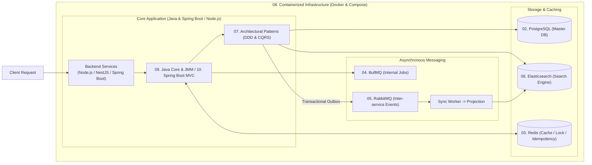

# 📚 BỘ TÀI LIỆU KIẾN TRÚC & CẨM NANG KỸ THUẬT BACKEND ENTERPRISE

> **Dành cho ứng viên**: Nguyễn Đức Quỳnh – Backend / Fullstack Engineer  
> Bộ tài liệu cung cấp toàn cảnh kiến trúc chuyên sâu (Deep Dive), phân tích cơ chế nội tại, các cạm bẫy thực tế trên Production và ngân hàng câu hỏi phỏng vấn Senior/Staff gắn liền trực tiếp với các dự án thực tế trong CV (**ViShop WMS/OMS**, **Multimodal RAG pgvector**, **CRMAgent Dynamic Schema**, **MIAPET & VNPay Payment**).

---

## 📑 Danh mục các chuyên đề chi tiết

| STT | Chuyên đề công nghệ | Trọng tâm nội dung chính | File đính kèm |
| :---: | :--- | :--- | :--- |
| STT | Chuyên đề công nghệ | Trọng tâm nội dung chính | File đính kèm |
| :---: | :--- | :--- | :--- |
| **01** | **Node.js Architecture** | Libuv Event Loop phases, Microtasks priority, Worker Threads, Memory leaks, AsyncLocalStorage, Fastify 5 vs Express, Nx Monorepo. | • [01-theory-architecture.md](file:///c:/Users/Admin/Documents/Project/interview/01-nodejs/01-theory-architecture.md) • [02-interview-questions-cv.md](file:///c:/Users/Admin/Documents/Project/interview/01-nodejs/02-interview-questions-cv.md) |
| **02** | **PostgreSQL & Database** | MVCC & Page Internals, WAL, Isolation Levels & Write Skew, Row-level Locking, Indexing (B-Tree, GIN, BRIN, Covering), SSI, WMS Ledger & pgvector. | • [01-theory-architecture.md](file:///c:/Users/Admin/Documents/Project/interview/02-database/01-theory-architecture.md) • [02-interview-questions-cv.md](file:///c:/Users/Admin/Documents/Project/interview/02-database/02-interview-questions-cv.md) |
| **03** | **Redis Deep-Dive** | I/O Multiplexing, Threaded I/O, Cache Failure Modes, Distributed Lock với Lua, Leader Election, ZSet Sliding Window Rate Limiter. | • [01-theory-architecture.md](file:///c:/Users/Admin/Documents/Project/interview/03-redis/01-theory-architecture.md) • [02-interview-questions-cv.md](file:///c:/Users/Admin/Documents/Project/interview/03-redis/02-interview-questions-cv.md) |
| **04** | **BullMQ & Task Queues** | Cấu trúc Redis ngầm (Streams/ZSets), Job Lifecycle, Stalled Jobs detection, Sandboxed Workers, Worker Concurrency vs DB Pool, Webhook Buffering. | • [01-theory-architecture.md](file:///c:/Users/Admin/Documents/Project/interview/04-bullmq/01-theory-architecture.md) • [02-interview-questions-cv.md](file:///c:/Users/Admin/Documents/Project/interview/04-bullmq/02-interview-questions-cv.md) |
| **05** | **RabbitMQ & Messaging** | AMQP 0-9-1, Exchanges (Topic, Fanout, Direct), Quorum Queues (Raft), Zero Message Loss, DLX & Exponential Retry, Consistent Hash Sharding. | • [01-theory-architecture.md](file:///c:/Users/Admin/Documents/Project/interview/05-rabbitmq/01-theory-architecture.md) • [02-interview-questions-cv.md](file:///c:/Users/Admin/Documents/Project/interview/05-rabbitmq/02-interview-questions-cv.md) |
| **06** | **Elasticsearch Engine** | Inverted Index & Lucene Segments, Xử lý Tiếng Nhật (Kuromoji NLP & N-gram), Refresh vs Flush, Mapping, 50% Heap RAM, BM25, JIHO Medical Search. | • [01-theory-architecture.md](file:///c:/Users/Admin/Documents/Project/interview/06-elasticsearch/01-theory-architecture.md) • [02-interview-questions-cv.md](file:///c:/Users/Admin/Documents/Project/interview/06-elasticsearch/02-interview-questions-cv.md) |
| **07** | **Architectural Patterns (DDD & CQRS)** | **07.1 Domain-Driven Design**: Strategic (Bounded Context, ACL), Tactical (Aggregate Root, Invariants), Domain Events. **07.2 CQRS Architecture**: Read/Write Stack, Polyglot Persistence, Dual-Write & Transactional Outbox, SSE & Eventual Consistency. | • [Chỉ mục Architectural Patterns](file:///c:/Users/Admin/Documents/Project/interview/07-architectural-patterns/README.md) • [07.1 DDD Theory](file:///c:/Users/Admin/Documents/Project/interview/07-architectural-patterns/01-domain-driven-design/01-theory-architecture.md) & [CV](file:///c:/Users/Admin/Documents/Project/interview/07-architectural-patterns/01-domain-driven-design/02-interview-questions-cv.md) • [07.2 CQRS Theory](file:///c:/Users/Admin/Documents/Project/interview/07-architectural-patterns/02-cqrs/01-theory-architecture.md) & [CV](file:///c:/Users/Admin/Documents/Project/interview/07-architectural-patterns/02-cqrs/02-interview-questions-cv.md) |
| **08** | **Docker & Containers** | Linux Namespaces & Cgroups, OverlayFS CoW, OCI Runtime (dockerd/containerd/runc), Docker Networking & iptables, Multi-stage Builds, PID 1 & Tini, OOMKilled. | • [01-theory-architecture.md](file:///c:/Users/Admin/Documents/Project/interview/08-docker/01-theory-architecture.md) • [02-interview-questions-cv.md](file:///c:/Users/Admin/Documents/Project/interview/08-docker/02-interview-questions-cv.md) |
| **09** | **Java Core & Concurrency** | JVM Internals (Stack/Heap, GC G1/ZGC, Metaspace), JMM Concurrency (volatile, synchronized, Virtual Threads), Collections (HashMap, ConcurrentHashMap), OOP/SOLID, Pass-by-value, LRU Cache. | • [01-theory-architecture.md](file:///c:/Users/Admin/Documents/Project/interview/09-java/01-theory-architecture.md) • [02-interview-questions-cv.md](file:///c:/Users/Admin/Documents/Project/interview/09-java/02-interview-questions-cv.md) |
| **10** | **Spring Boot Architecture** | Auto-Configuration SPI, Bean Lifecycle & Proxies (JDK vs CGLIB), DispatcherServlet & Filters/Interceptors, Hibernate Dirty Checking & N+1, OSIV Pool Leak, Transaction Propagation, Spring Security 6, Virtual Threads. | • [01-theory-architecture.md](file:///c:/Users/Admin/Documents/Project/interview/10-spring-boot/01-theory-architecture.md) • [02-interview-questions-cv.md](file:///c:/Users/Admin/Documents/Project/interview/10-spring-boot/02-interview-questions-cv.md) |

---

## 🎯 Bản đồ phối hợp kiến trúc trong dự án thực tế

---

## 💡 Hướng dẫn ôn tập & Chuẩn bị phỏng vấn

1. **File 01 (Lý thuyết & Kiến trúc)**: Giúp bạn hiểu sâu sắc nguyên lý cốt lõi, cơ chế tầng thấp của engine (Libuv, V8, MVCC, Lucene, AMQP, Raft), bảng đối chiếu tính năng và các cạm bẫy kỹ thuật sống còn trên Production.
2. **File 02 (Câu hỏi phỏng vấn & Dự án trong CV)**: Thiết kế riêng theo từng bài toán và dự án thực tế trong CV của **Nguyễn Đức Quỳnh** (**ViShop**, **Multimodal RAG**, **CRMAgent**, **JIHO**, **MIAPET**), trang bị sẵn các câu trả lời "ăn điểm", code mẫu thực chiến và câu trả lời phản biện trước các câu hỏi vặn của Tech Lead / Staff Engineer.
