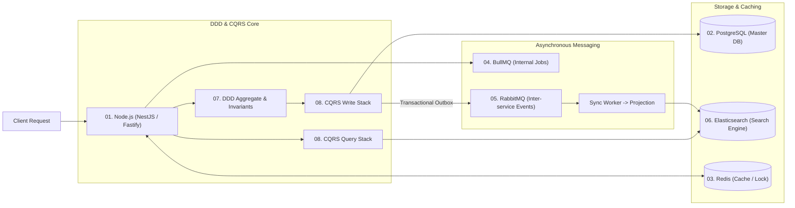

# 📚 BỘ TÀI LIỆU KIẾN TRÚC & CẨM NANG KỸ THUẬT BACKEND ENTERPRISE

Bộ tài liệu này cung cấp toàn cảnh kiến trúc chuyên sâu (Deep Dive), phân tích cơ chế nội tại, các cạm bẫy thực tế trên Production và ngân hàng câu hỏi phỏng vấn Senior/Staff cho 8 công nghệ và mô hình kiến trúc cốt lõi:

---

## 📑 Danh mục các chuyên đề chi tiết

| STT | Tài liệu chuyên đề | Trọng tâm nội dung chính | File đính kèm |
| :---: | :--- | :--- | :--- |
| **01** | **Node.js Architecture** | Libuv Event Loop phases, Microtasks priority, Worker Threads, Memory leaks, AsyncLocalStorage, Graceful Shutdown. | [01-nodejs.md](file:///c:/Users/Admin/Documents/Project/interview/01-nodejs.md) |
| **02** | **PostgreSQL & Database** | MVCC, WAL & Checkpoints, Isolation Levels, Row-level Locking, Indexing (B-Tree, GIN, BRIN, Covering), PgBouncer, Autovacuum. | [02-database-postgresql.md](file:///c:/Users/Admin/Documents/Project/interview/02-database-postgresql.md) |
| **03** | **Redis Deep-Dive** | I/O Multiplexing, Data Structures thực chiến, Cache Stampede/Penetration/Avalanche, Distributed Lock với Lua, Eviction policies, RDB vs AOF. | [03-redis.md](file:///c:/Users/Admin/Documents/Project/interview/03-redis.md) |
| **04** | **BullMQ & Task Queues** | Cấu trúc Redis ngầm (Streams/ZSets), Job Lifecycle, Stalled Jobs detection, Sandboxed Workers, Worker Concurrency vs DB Pool. | [04-bullmq.md](file:///c:/Users/Admin/Documents/Project/interview/04-bullmq.md) |
| **05** | **RabbitMQ & Messaging** | AMQP 0-9-1, Exchanges (Topic, Fanout, Direct), Quorum Queues, Publisher Confirms, DLX & Exponential Retry, Flow Control. | [05-rabbitmq.md](file:///c:/Users/Admin/Documents/Project/interview/05-rabbitmq.md) |
| **06** | **Elasticsearch Engine** | Inverted Index & Lucene Segments, Near Real-Time (Refresh vs Flush), Mapping Explosion, Quy tắc 50% Heap RAM, Deep Paging với PIT. | [06-elasticsearch.md](file:///c:/Users/Admin/Documents/Project/interview/06-elasticsearch.md) |
| **07** | **Domain-Driven Design** | Strategic (Bounded Context, ACL), Tactical (Aggregate Root, Entity, Value Object, Domain Events), Rich vs Anemic Domain Model. | [07-domain-driven-design.md](file:///c:/Users/Admin/Documents/Project/interview/07-domain-driven-design.md) |
| **08** | **CQRS Architecture** | Tách biệt Read/Write Model, Polyglot Persistence, Dual-Write & Transactional Outbox, Xử lý Eventual Consistency Delay. | [08-cqrs.md](file:///c:/Users/Admin/Documents/Project/interview/08-cqrs.md) |

---

## 🎯 Bản đồ phối hợp kiến trúc trong dự án thực tế

---

## 💡 Hướng dẫn sử dụng cho Buổi phỏng vấn

1. **Thẩm định chiều sâu (Depth Verification)**: Dùng các mục *Bẫy kỹ thuật & Lưu ý sống còn* và *Bộ câu hỏi phỏng vấn chuyên sâu* ở cuối mỗi file để đặt câu hỏi drill-down khi ứng viên nhắc tới các keyword tương ứng trong CV.
2. **Kiểm tra kinh nghiệm thực chiến (Hands-on vs Theory)**: Tập trung vào các tình huống ứng viên đã từng giải quyết:
   * Race condition trong Database / WMS Ledger ([02-database-postgresql.md](file:///c:/Users/Admin/Documents/Project/interview/02-database-postgresql.md))
   * Stalled jobs và rò rỉ RAM trong BullMQ / Redis ([04-bullmq.md](file:///c:/Users/Admin/Documents/Project/interview/04-bullmq.md) & [03-redis.md](file:///c:/Users/Admin/Documents/Project/interview/03-redis.md))
   * Thiết kế Transactional Outbox và Eventual Consistency trong CQRS ([08-cqrs.md](file:///c:/Users/Admin/Documents/Project/interview/08-cqrs.md))
